# Часть 1. Домашняя лаборатория: разворачиваем Graylog

> **Первый опыт.** С чего всё начиналось: выбор Graylog, подготовка сервера на
> РЕД ОС, установка стека Java + MongoDB + OpenSearch + Graylog и настройка
> приёма первых логов с Linux- и Windows-хостов.
>
> Это базовая часть истории. Продолжение — потоки, алерты и декодер — описано
> во [2-й части](02-streams-alerts.md), а настройка агентов по каждой системе —
> в разделах [Windows](03-windows.md), [Linux](04-linux.md) и [macOS](05-macos.md).

## Зачем это нужно

С уходом из России ряда крупных вендоров (включая Splunk) встаёт вопрос: можно ли
опираться на опенсорсные решения для сбора и анализа логов? Graylog — хороший
кандидат: это система централизованного сбора, анализа и хранения логов, доступная
в репозиториях российского дистрибутива РЕД ОС.

Graylog собирает и сразу анализирует большие объёмы журналов от разных приложений,
серверов и сетевых устройств, помогает выявлять проблемы, отслеживать инциденты
информационной безопасности и проводить расследование происшествий.

**Основные возможности:**

| Возможность | Что даёт |
|---|---|
| Сбор логов | Syslog, TCP, UDP, HTTP, Kafka и другие протоколы и форматы |
| Анализ и фильтрация | Мощный механизм фильтрации и поиска по данным |
| Визуализация | Графики, диаграммы, дашборды |
| Алертинг | Уведомления при выполнении заданных условий |
| Масштабируемость | Горизонтальное масштабирование под большие инфраструктуры |
| Платформы | Linux, Windows, Docker, Kubernetes |

## Архитектура

Graylog состоит из нескольких компонентов:

1. **Java 17** — среда выполнения Graylog (рекомендуется последняя стабильная версия).
2. **MongoDB** — хранение конфигурационных данных и метаданных.
3. **OpenSearch** — поисковая и аналитическая система: индексация, хранение и быстрый поиск по логам.
4. **Graylog server** — основной компонент: собирает, обрабатывает и визуализирует логи.

Схема лаборатории:

```
интернет → роутер → свитч → хосты (Windows / РЕД ОС / Raspberry Pi)
                                │
                                ▼
                        сервер Graylog
                     (MongoDB + OpenSearch)
```

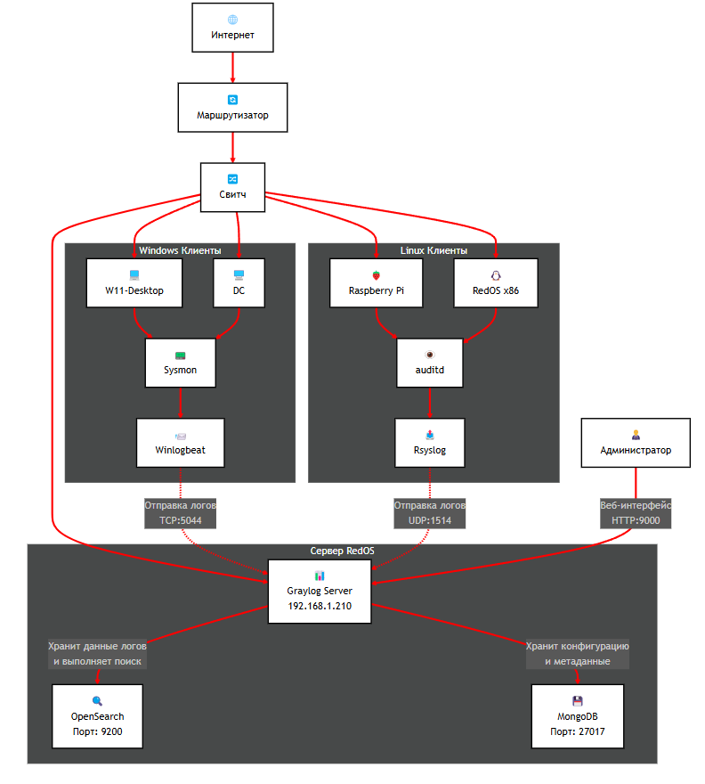

В тестовой лаборатории автора: пять устройств на x86-64, остальные — Raspberry Pi 4/5,
операционные системы РЕД ОС 8.0 (Linux) и Windows. Graylog успешно работает на ARM.

Средства сбора логов на клиентах:

- **Linux**: `auditd` (аудит событий безопасности) + `rsyslog` (пересылка системных логов).
- **Windows**: `Sysmon` (детальный мониторинг системы) + `Winlogbeat` (доставка событий из журналов Windows).
- **Протоколы**: TCP (надёжная доставка от Winlogbeat) и UDP (менее критичные системные логи с Linux).

## Установка компонентов

Все команды выполняем от `sudo` или в сеансе `root`. Ниже — установка на РЕД ОС (пакетный
менеджер `dnf`).

### Java 17

```bash
dnf install java-17-openjdk
```

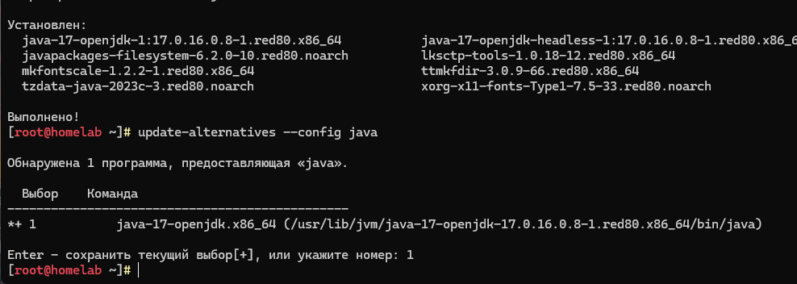

Если установлено несколько версий Java, выбираем версию 17.

### MongoDB

```bash
dnf install mongodb-org
systemctl daemon-reload
systemctl enable mongod --now
systemctl status mongod      # должно быть active (running)
```

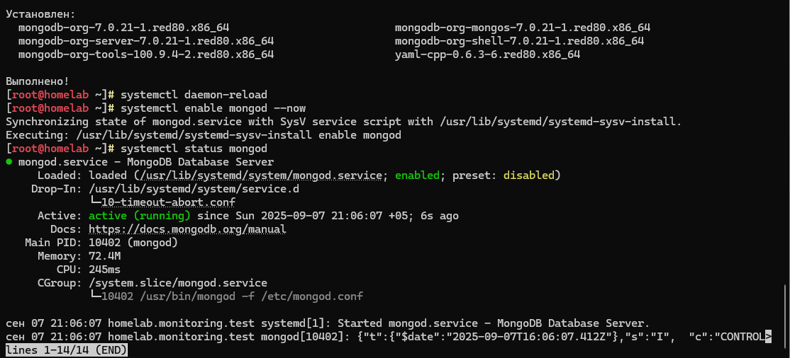

### OpenSearch

```bash
# задаём пароль администратора (от 12 символов: прописные, строчные, цифры, спецсимволы)
env OPENSEARCH_INITIAL_ADMIN_PASSWORD=<пароль> dnf install opensearch
```

Настраиваем `/etc/opensearch/opensearch.yml`:

```yaml
cluster.name: graylog
node.name: ${HOSTNAME}
path.data: /var/lib/opensearch
path.logs: /var/log/opensearch
discovery.type: single-node
network.host: 0.0.0.0
action.auto_create_index: false
plugins.security.disabled: true
```

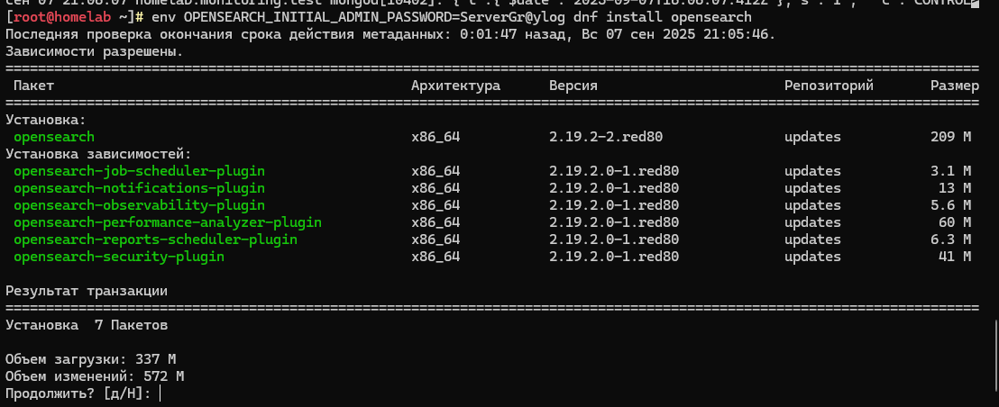

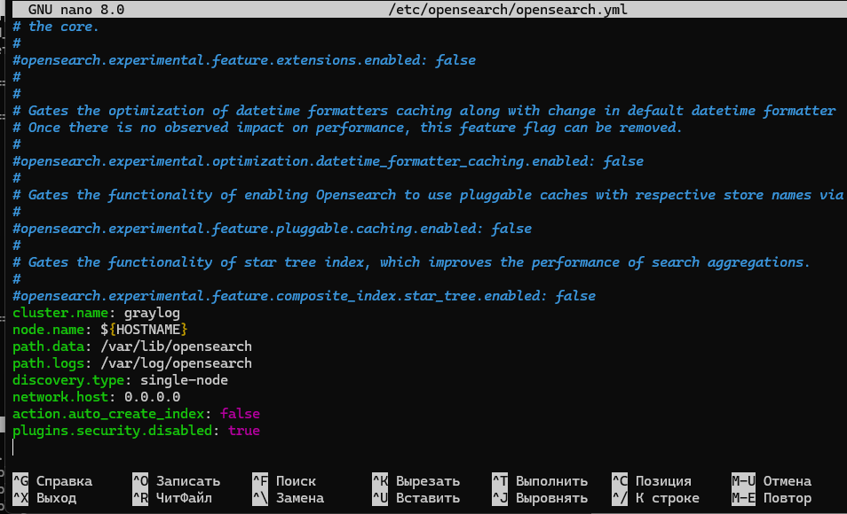

Готовый пример — [`config/opensearch.yml.example`](../config/opensearch.yml.example).

> `plugins.security.disabled: true` уместно только в изолированной домашней лаборатории.
> В промышленной эксплуатации безопасность отключать нельзя.

Виртуальная память:

```bash
sysctl -w vm.max_map_count=262144
echo 'vm.max_map_count=262144' >> /etc/sysctl.conf
```

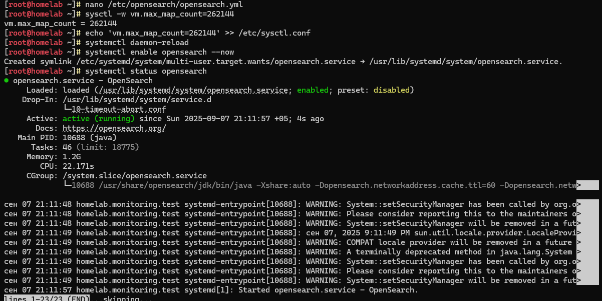

Запуск и проверка OpenSearch:

```bash
systemctl enable opensearch --now
systemctl status opensearch    # должно быть active (running)
```

### Graylog

```bash
# репозиторий Graylog (здесь 5.2; для 7.2 — пакет соответствующей ветки)
rpm -Uvh https://packages.graylog2.org/repo/packages/graylog5.2-repository_latest.rpm
dnf install graylog-server
```

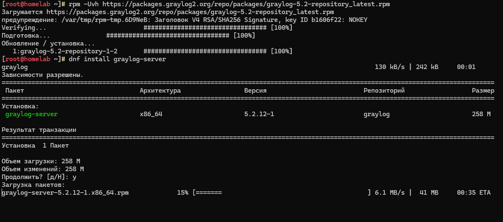

Создаём секретный ключ и хеш пароля администратора:

```bash
# хеш пароля администратора (вводим пароль, получаем sha256-хеш)
echo -n "Enter Password: " && head -1 </dev/stdin | tr -d '\n' | sha256sum | cut -d" " -f1

# секретный ключ password_secret
< /dev/urandom tr -dc A-Z-a-z-0-9 | head -c ${1:-96}; echo;
```

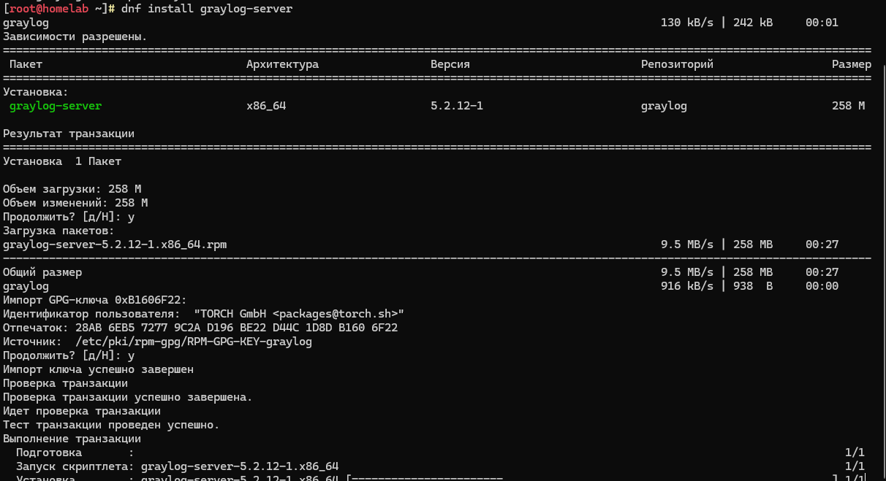

Правки в `/etc/graylog/server/server.conf`:

```ini
root_password_sha2 = <хеш_пароля>
password_secret = <секретный_ключ>
elasticsearch_hosts = http://localhost:9200
```

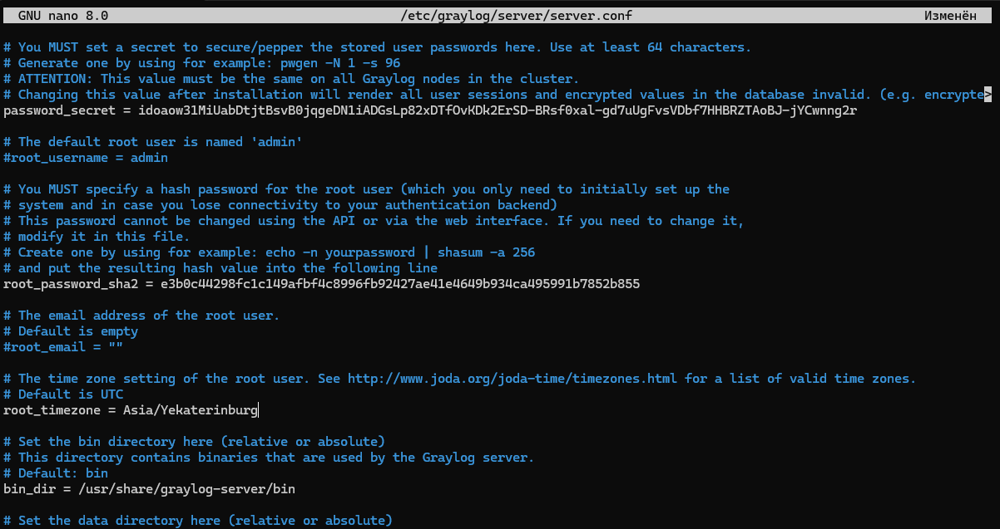

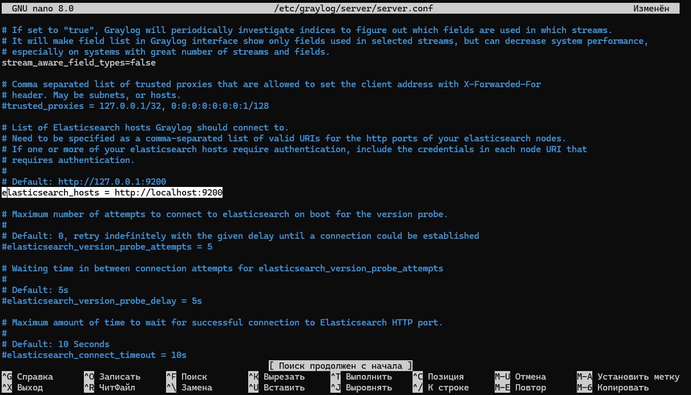

Запуск:

```bash
systemctl daemon-reload
systemctl enable graylog-server --now
systemctl --type=service --state=active | grep graylog
```

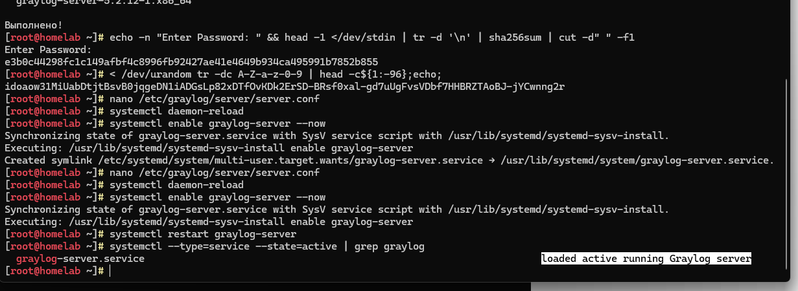

Веб-интерфейс доступен на `http://localhost:9000`, вход — `admin` с заданным паролем.

### Таймзона

По умолчанию Graylog использует UTC+00:00. Чтобы не путаться при анализе событий,
расскомментируй в `server.conf` параметр таймзоны (у автора — `+05:00`, Екатеринбург).


## Совместимость версий

Graylog требует определённых версий компонентов стека. В лаборатории автора сейчас:

| Компонент | Версия |
|---|---|
| Graylog | 7.2.1 |
| MongoDB | 7.0.43 |
| OpenSearch | 2.19.5 |
| JVM | Eclipse Adoptium 21.0.12 |

Лаборатория собиралась на Graylog 7.1.3 и MongoDB 7.0.37, а затем обновлена до версий из
таблицы. Главы 1–10 писались до обновления, поэтому на части скриншотов видна прежняя
версия; на работу описанного это не влияет. Что появилось в 7.2 — отдельная
[глава 11 про Collectors](11-collectors.md).

Поддерживаемые диапазоны для ветки 7.2.x по
[документации Graylog](https://go2docs.graylog.org/current/downloading_and_installing_graylog/red_hat_installation_os.htm):
MongoDB от 7.x до 8.2.x, OpenSearch от 1.1.x до 3.7.x (для Graylog Security — от 2.0.x).
OpenSearch 3.x годится для новых установок; при обновлении существующей проверь индексы,
созданные до версии 2.0, — они с 3.x несовместимы.

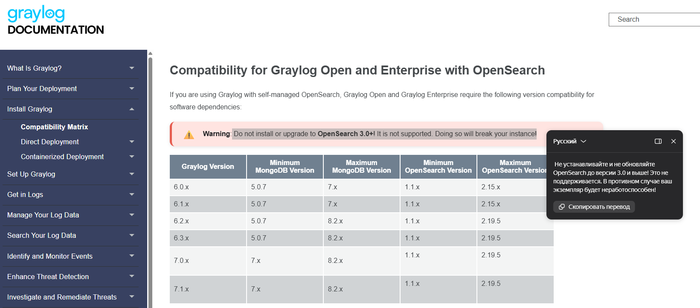

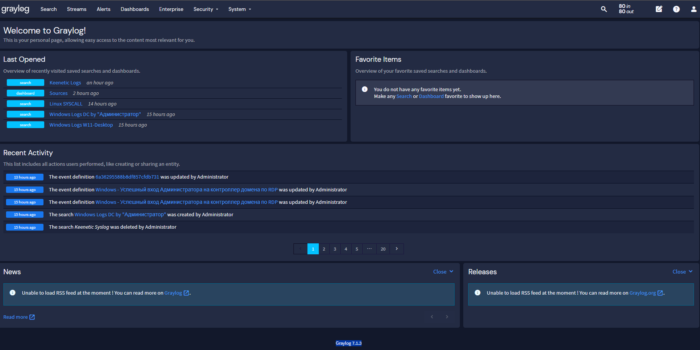

## Настройка входов (Inputs) на сервере

После установки агентов на хосты настраиваем приём логов:

1. **Beats** (порт 5044/TCP) — для Winlogbeat (Windows):
   `System/Overview → Inputs → Beats → Launch new input`.
2. **Syslog UDP** (порт 1514) — для логов с Linux-хостов.

## Дальше

Сбор логов настроен, но логи пока лежат одной кучей. В [части 2](02-streams-alerts.md)
разбираем, как разделить их на потоки, настроить алерты и декодировать auditd.
