# Часть 2. Потоки, алерты и декодер auditd

> **Обновлённая версия.** Вторая часть истории: логи уже собираются, но чтобы
> система стала по-настоящему полезной, она должна сама сортировать события,
> предупреждать о проблемах и показывать auditd в читаемом виде.

## Что мы делаем в этой части

1. **Потоки (Streams)** — раскладываем логи по смыслу: Windows, Linux, Security, Errors.
2. **Декодер auditd** — переводим шестнадцатеричные поля auditd в читаемый вид.
3. **Алерты** — настраиваем email-уведомления о подозрительной активности для Linux и Windows.

## Потоки (Streams)

Поток — логическая группа сообщений, объединённых заданными правилами. Это фильтр,
который автоматически раскладывает входящие логи по «папкам». Все сообщения
по-прежнему хранятся в одном индексе OpenSearch, но в интерфейсе можно переключаться
между потоками и работать только с нужными логами.

По умолчанию в системе есть три потока (активен только `Default stream`).

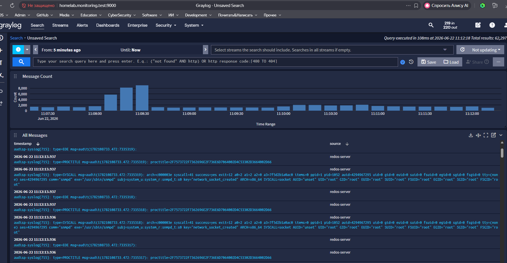

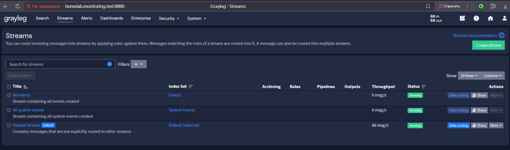

### Зачем нужны потоки

| Причина | Что даёт |
|---|---|
| Удобство | Не нужно каждый раз составлять сложные поисковые запросы |
| Безопасность | Для каждого потока — свои права доступа |
| Алерты | Для каждого потока — свои уведомления |
| Визуализация | Дашборды строятся на основе потоков |

### Правила потока

Создавая поток, задаёшь одно или несколько правил. Если сообщение соответствует всем
правилам (по логике И) — оно попадает в поток. Для логики ИЛИ правила объединяются в
группу. Правила гибкие:

- равенство поля значению (`source == "webserver-01"`);
- наличие подстроки (`message содержит "Out of memory"`);
- сравнение чисел (`event_id >= 4624`);
- проверка по регулярным выражениям.

### Какие потоки создаём

| Поток | Содержимое |
|---|---|
| **Windows Logs** | сообщения от Winlogbeat и Sysmon, только с хостов Windows |
| **Linux Logs** | сообщения с Linux-хостов, полученные по Syslog через UDP |
| **Security Events** | события аутентификации и доступа: event_id 4624, 4625, 4648 и др. (Windows + РЕД ОС) |
| **Errors** | сообщения со словами `error` или `critical` со всех хостов |

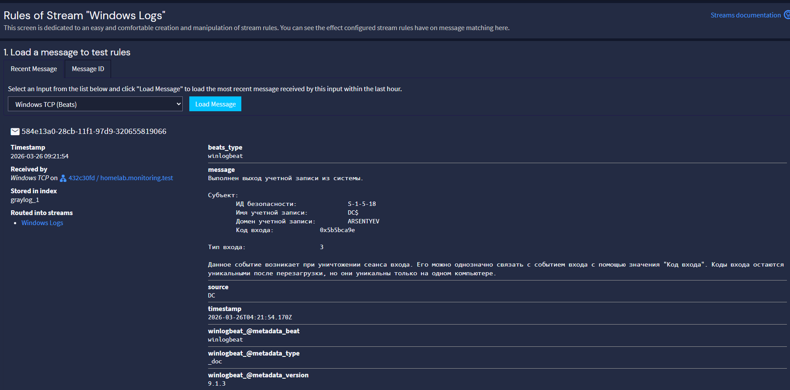

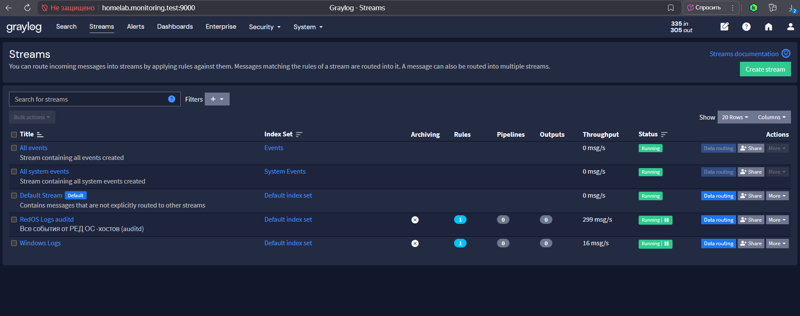

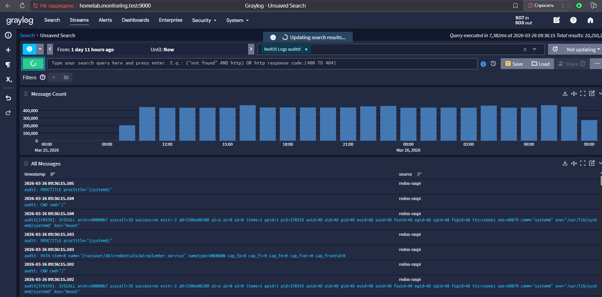

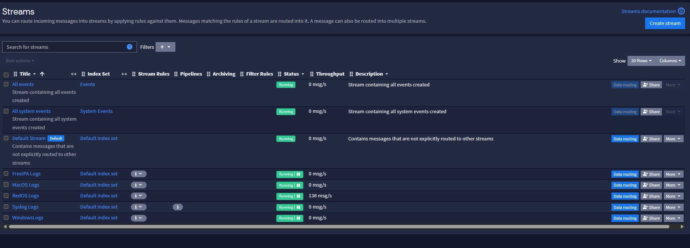

### Создание потока

1. Верхнее меню → **Streams**.

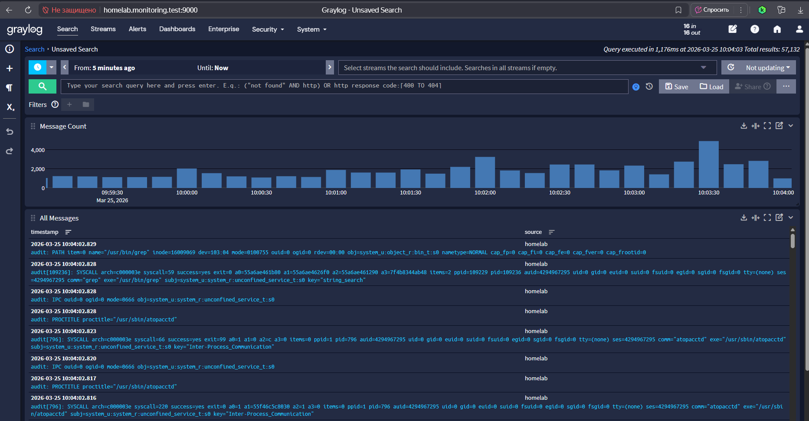

2. **Create stream** (правый верхний угол).
3. Заполнить поля: `Title` (например, `Windows Logs`), `Description`.
4. Поставить флажок **Remove matches from Default Stream** — чтобы события не дублировались.
5. Кнопка **More** → **Quick add rule** — задать правило маршрутизации.

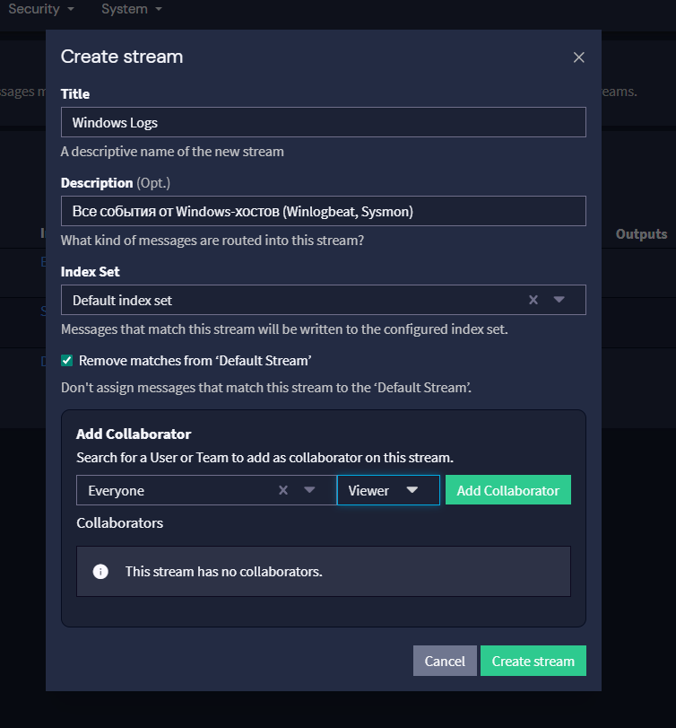

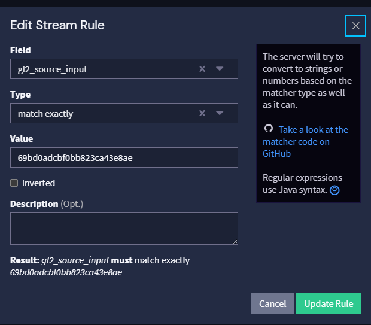

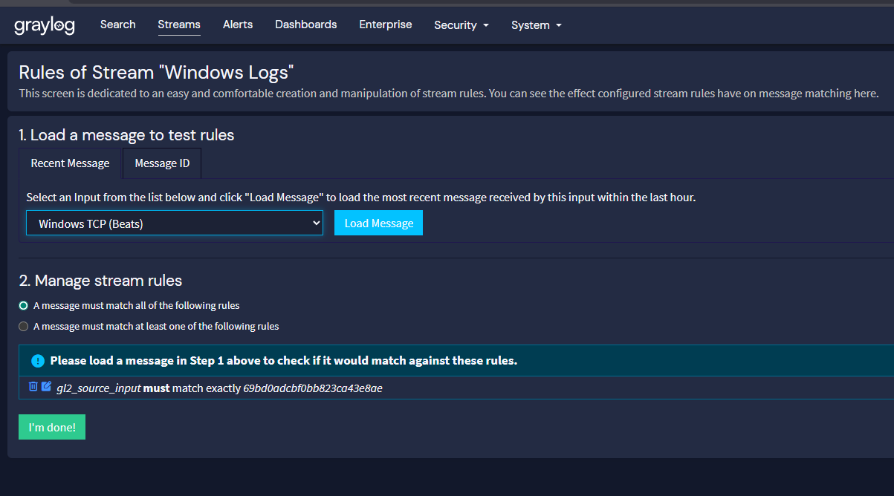

## Декодер auditd

### Зачем

События auditd приходят с полями в шестнадцатеричном виде (`comm=73736864` вместо
`comm=sshd`). Декодировать их в уме неудобно. Официальный плагин Graylog для auditd
работает только со старыми версиями, поэтому автор написал собственный декодер.

### Идея

Логи приходят на порт 1514. Декодер принимает их, разбирает пары `key=value`,
декодирует hex-поля и отправляет результат на отдельный вход Graylog в формате
**GELF** (Graylog Extended Log Format — структурированный JSON). Декодированные поля
получают суффикс `_decoded`.

### Какие поля извлекаем

**Общие поля:** `type`, `timestamp`, `serial`, `key`, `msg`, `audit_type`, `message`,
`_udp_source`, `_udp_port`, `_syslog_hostname`.

**SYSCALL** — системный вызов:

| Поле | Значение |
|---|---|
| arch | архитектура (например `c000003e` — x86_64) |
| syscall | номер системного вызова |
| success | `yes` / `no` |
| exit | код возврата |
| a0…a3 | аргументы системного вызова |
| comm | имя команды (декодируется из hex) |
| exe | полный путь к исполняемому файлу |
| uid, gid, pid, ppid, ses, tty | идентификаторы и контекст процесса |
| proctitle | командная строка процесса |

**Другие типы записей:** `EXECVE` (аргументы execve), `PATH` (объект файловой системы),
`CWD`, `PROCTITLE`, `SOCKADDR` (сетевой адрес), `USER_*` (аутентификация и сессии),
`SERVICE_START`/`SERVICE_STOP` (управление службами), `CONFIG_CHANGE` (изменение правил
аудита), `ANOM_ABEND` (аварийное завершение).

### Установка

```bash
# скрипт — в /usr/local/bin
sudo cp decoder/auditd_decoder.py /usr/local/bin/
sudo chmod 755 /usr/local/bin/auditd_decoder.py

# systemd-юнит
sudo cp decoder/audit-decoder.service /etc/systemd/system/

# автозапуск и старт
systemctl enable --now audit-decoder.service
systemctl status audit-decoder.service
```

Декодер слушает UDP 1514, отправляет GELF на `127.0.0.1:12201`. Создай в Graylog
вход **GELF UDP** на порту 12201.

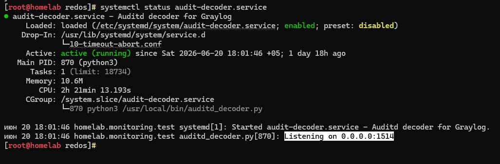

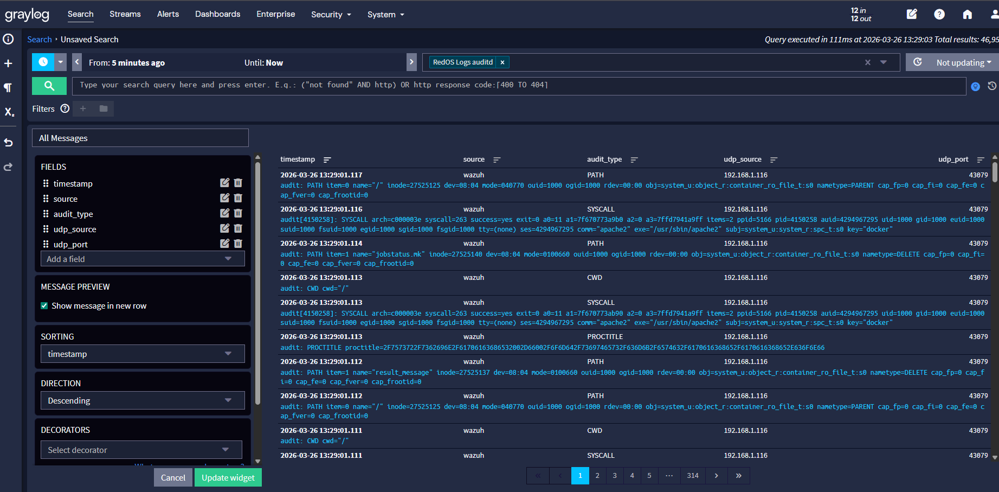

Примеры поисковых пресетов после декодирования:

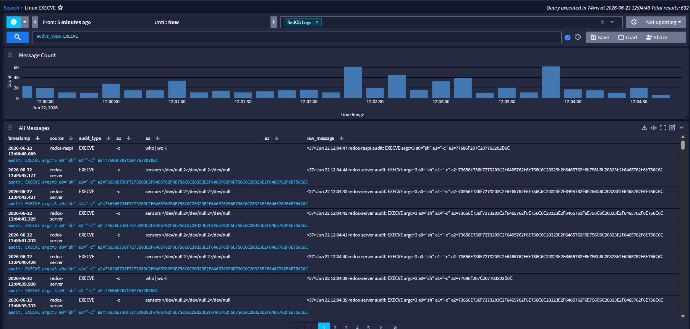

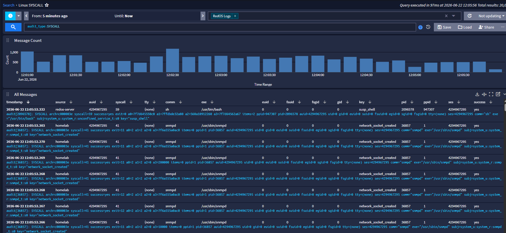

## Алерты

Алерт — автоматическое уведомление при выполнении заданного условия в выбранном потоке.
Graylog держится на двух «китах»:

1. **Уведомления (Notifications)** — куда и как отправлять сообщение (email, Telegram, Slack, HTTP, скрипт).
2. **Условия алерта (Alert Conditions / Event Definitions)** — при каком событии сработает алерт.

### Почтовый ящик Mail.ru

Mail.ru требует отдельный **пароль приложения** (обычный пароль от ящика не подойдёт):

1. Включи двухфакторную аутентификацию (Настройки → Безопасность).
2. В разделе «Пароли для внешних приложений» нажми «Добавить» (например, `Graylog Alerts`).
3. Скопируй сгенерированный пароль — он показывается один раз.

### Настройка SMTP в server.conf

Добавь в `/etc/graylog/server/server.conf`:

```ini
transport_email_enabled = true
transport_email_hostname = smtp.mail.ru
transport_email_port = 465
transport_email_use_auth = true
transport_email_use_ssl = true
transport_email_use_tls = false
transport_email_auth_username = your-email@mail.ru
transport_email_auth_password = <пароль_приложения>
transport_email_from_email = your-email@mail.ru
transport_email_subject_prefix = [Graylog Alert]
transport_email_web_interface_url = http://<адрес твоего сервера>:9000
```

Готовый пример — [`config/server.conf.smtp.example`](../config/server.conf.smtp.example).

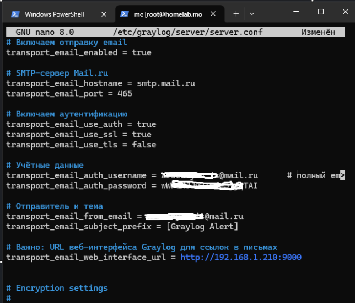

Перезапуск и проверка:

```bash
sudo systemctl restart graylog-server
sudo systemctl status graylog-server
sudo tail -f /var/log/graylog-server/server.log
journalctl -u graylog-server | grep -i smtp
```

Важные моменты:

- для Mail.ru надёжнее порт **465 с SSL** (порт 587 с STARTTLS тоже работает, но сложнее);
- в `auth_username` — полный адрес, включая `@mail.ru`;
- в `auth_password` — пароль приложения, а не пароль от ящика;
- **не включай TLS и SSL одновременно**.

### Уведомление (Notification)

1. **Alerts → Notifications → Create notification**.
2. Тип — **Email**.
3. `Title`: `Mail.ru Alert`.
4. `Email recipients` — адрес получателя.
5. `Subject` (опционально): `[Graylog] ${event_definition_title}`.
6. **Execute test notification** — проверка отправки.

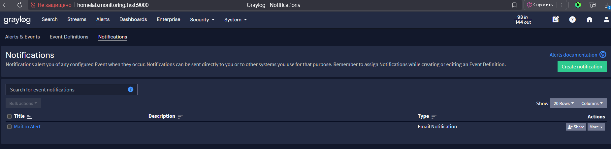

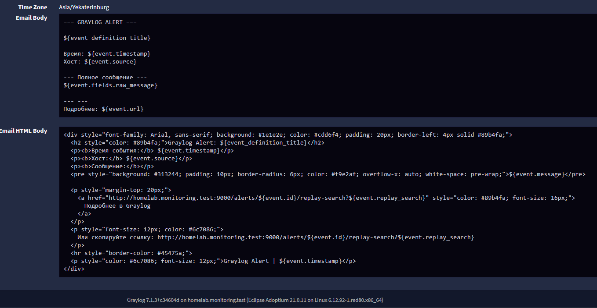

### Условия алерта

Правила проверяют, содержат ли поля определённые значения. Условия для Linux и Windows
различаются — см. [03-windows.md](03-windows.md) и [04-linux.md](04-linux.md).

Общая рекомендация: используй **структурированные поля**, а не поиск по `message`.
Поиск по индексированным полям OpenSearch быстрее, точнее и даёт больше возможностей
для группировки.

### Готовые алерты: content pack

Если не хочется собирать алерты руками — в [`graylog/content-pack-homelab-alerts.json`](../graylog/content-pack-homelab-alerts.json)
лежат **63 условия алерта и 3 email-уведомления** (Linux, macOS, Windows): 19 базовых алертов и 44 правила детектирования. Проверено на Graylog 7.2.0-rc.1.

Установка:

1. Создай потоки с точно такими названиями: `RedOS auditd Logs`, `MacOS Logs`, `WindowsLogs`, `BiZone_macOS` —
   content pack ссылается на потоки по названию, а не по ID.
2. **System → Content Packs → Upload** → выбери JSON → **Install**.
3. В трёх уведомлениях (**Alerts → Notifications**) замени `<your>@mail.ru` на свой адрес
   и `<Graylog server>` в ссылках — на адрес своего сервера.
4. Нажми **Execute test notification** в каждом уведомлении.

Что внутри:

| Группа | Алерты | Уведомление |
|--------|--------|-------------|
| 🐧 Linux (auditd, РЕД ОС) | SSH-ключ в authorized_keys, добавление/удаление пользователя, chmod, брутфорс SSH (5+ за 5 мин), неудачный sudo, использование sudo, systemctl stop | Mail.ru Alert Linux |
| 🍎 macOS | изменение /etc/sudoers, подозрительный процесс на TCP-порту, sudo, неудачный sudo, plist в автозагрузке, AirDrop, Apple-устройство по USB, USB-накопитель, мобильное устройство не Apple | Mail.ru Alert MacOS |
| 🪟 Windows | группа «Администраторы домена», подбор пароля (5+ событий 4625 за 5 мин), net user /add и /delete | Mail.ru Alert Windows |

Все алерты раз в 5 минут проверяют последние 5 минут, группируют по `source`
и прикладывают к письму до 5 исходных сообщений.

Как выглядит письмо:

- тема — `🐧 [HIGH] <название алерта> — <хост>` (🍎 для macOS, 🪟 для Windows);
- цвет шапки по приоритету: 🔴 HIGH, 🟠 MEDIUM, 🔵 LOW;
- в теле — хост, время, окно проверки, описание алерта, поля события и исходные сообщения
  с деталями под ОС: инициатор, uid и команда `a0…a3` для Linux; процесс, порт и путь plist
  для macOS; пользователь, IP и CommandLine для Windows.

На что легко наступить:

- **`${event.source}` — это узел самого Graylog**, а не хост, где случилось событие.
  Хост бери из `${event.group_by_fields.source}` (если алерт группирует по `source`)
  или из поля события `host` = `${source.source}`.
- **Поля события с флагом «require values»** не дают создать событие, если поля нет
  в сообщении — алерт молча не срабатывает. Ставь поля необязательными.
- Проблемы на стороне сервера (битые Event Definitions, лимит 1000 полей, конфликт типов
  поля `level`) — в [troubleshooting.md](troubleshooting.md), пункты 10–13.

### Правила детектирования

Помимо базовых алертов, в content pack входят **44 правила детектирования** с тегом `detection`
(в Alerts → Event Definitions их удобно отфильтровать по тегу). Запросы и исключения
подобраны по реальным данным лаборатории за неделю: шум от Wazuh, Kaspersky, Zabbix,
Docker, Bi.Zone Triage и обновлений браузеров отсечён.

Как они устроены:

- срабатывают на **каждое подходящее сообщение**, поэтому в письмо попадают команда,
  путь, пользователь и родительский процесс; повторы с одного хоста склеиваются
  (grace period 5 минут);
- **HIGH и MEDIUM** шлют письмо через уведомление своей ОС, **LOW** — только событие
  в Alerts, без письма;
- исключения у каждого правила свои — перед импортом в другую сеть просмотри их
  и подставь свои пути и программы.

#### 🐧 Linux (auditd)

| Правило | Приоритет |
|---|---|
| Изменение `/etc/passwd`, `shadow`, `group` (кроме системных процессов) | HIGH |
| Изменение `sshd_config` | HIGH |
| Обратная оболочка: `/dev/tcp` в командной строке | HIGH |
| Затирание следов: `shred`, `.bash_history`, `truncate` логов | HIGH |
| Отключение аудита или удаление правил auditd | HIGH |
| Подозрительные утилиты: `base64`, `nc`, `socat`, `scp` | MEDIUM |
| Исполнение из памяти (`memfd_create`) | MEDIUM |
| Закрепление через `systemctl enable` | MEDIUM |
| Изменение правил firewall (`iptables`, `nft`) | LOW |
| Отказ SELinux (AVC) | LOW |
| Разведка: `id`, `whoami` | LOW |

Правила опираются на ключи (`-k`) из набора правил auditd в духе
[Neo23x0/auditd](https://github.com/Neo23x0/auditd): `etcpasswd`, `sshd`, `susp_activity`,
`anon_file_create`, `sbin_susp`, `recon`. С другим набором правил ключи придётся поправить.

#### 🪟 Windows (Sysmon, Security, Defender)

| Правило | Приоритет |
|---|---|
| Очистка журнала событий (1102, 104) | HIGH |
| Доступ к памяти LSASS (кража учётных данных) | HIGH |
| Defender обнаружил угрозу или отключён (1116, 1117, 5001, 5010, 5012) | HIGH |
| Удаление теневых копий (`vssadmin`, `wmic shadowcopy`, `bcdedit`) | HIGH |
| Офисное приложение запустило `cmd`, `powershell`, `wscript` | HIGH |
| PowerShell с закодированной командой (`-enc`, `FromBase64String`) | HIGH |
| PowerShell скачивает и исполняет код (4104) | HIGH |
| Изменение привилегированных групп и учёток (4720, 4726, 4728, 4732, 4740) | HIGH |
| Новая служба (7045, 4697) | MEDIUM |
| Автозагрузка через ключ реестра `Run` | MEDIUM |
| LOLBins: `certutil -urlcache`, `mshta`, `bitsadmin`, `regsvr32 /i:http` | MEDIUM |
| Создание задачи через `schtasks /create` | MEDIUM |
| Вход по RDP (4624, тип 10) | LOW |
| Серия разведки: 5+ запусков `net`, `whoami`, `nltest` за 5 минут | LOW |

Для правила про группы и учётки на контроллере домена должен быть включён аудит
управления учётными записями (Advanced Audit Policy → Account Management), иначе
события 4720/4728/4732 не пишутся. Для 4104 нужен PowerShell Script Block Logging.

#### 🍎 macOS (osquery Endpoint Security)

| Правило | Приоритет |
|---|---|
| Отключение SIP или Gatekeeper | HIGH |
| Выгрузка паролей из Keychain | HIGH |
| Фишинговый запрос пароля через `osascript` | HIGH |
| Обратная оболочка (`/dev/tcp`, `pty.spawn`) | HIGH |
| Вмешательство в TCC (`tccutil`, `TCC.db`) | HIGH |
| Создание пользователя или изменение групп (`dscl`, `sysadminctl`, `dseditgroup`) | MEDIUM |
| Запуск программы из `/tmp` или `/Users/Shared` | MEDIUM |
| Загрузка расширения ядра | MEDIUM |
| Включение удалённого входа или Screen Sharing | MEDIUM |
| Снятие карантина с приложения (`xattr`) | LOW |

#### 🍎 macOS (BI.ZONE Triage)

BI.ZONE Triage присылает не события, а **снимки состояния** каждые несколько минут, и одна
и та же запись повторяется тысячи раз в неделю. Поэтому правила здесь построены иначе:

- **«новое»** — по возрасту файла (например, элемент автозагрузки моложе суток);
- **«не из белого списка»** — всё, чего не было в снимке на момент настройки правила;
- повторы одной и той же находки подавляются надолго (grace period 7 дней, для истории
  команд — 30 дней) по ключу «хост + конкретная запись».

| Правило | Приоритет |
|---|---|
| Неизвестный SSH-ключ в `authorized_keys` (белый список отпечатков) | HIGH |
| Новое правило в `sudoers` | HIGH |
| Новый пользователь (uid ≥ 500) | HIGH |
| Смена DNS-серверов в `resolv.conf` | HIGH |
| Подозрительная запись в `/etc/hosts` | HIGH |
| Процесс из `/tmp` или `/Users/Shared` | HIGH |
| Новый элемент автозагрузки (моложе суток) | MEDIUM |
| Новая опасная команда в истории оболочки | MEDIUM |
| Неудачные входы по SSH | LOW |

> ⚠️ Белые списки (отпечатки ключей, правила sudoers, пользователи, DNS, записи hosts,
> команды в истории) прописаны прямо в запросах и отражают состояние **моей** лаборатории.
> После импорта их нужно заменить на свои: открой правило → Filter & Aggregation → Search Query.
> Поля подписи у BI.ZONE ненадёжны (даже `/sbin/launchd` помечен как неподписанный),
> поэтому правил вида «неподписанный процесс» здесь нет.

## Дальше

Разделы по каждой операционной системе:

- [Windows: Sysmon, Winlogbeat и алерт 4625](03-windows.md)
- [Linux: auditd, rsyslog и алерт SSH](04-linux.md)
- [macOS: unified log, Filebeat, osquery](05-macos.md)
