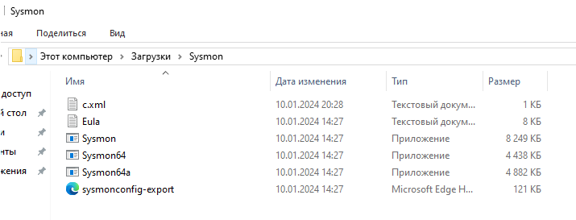
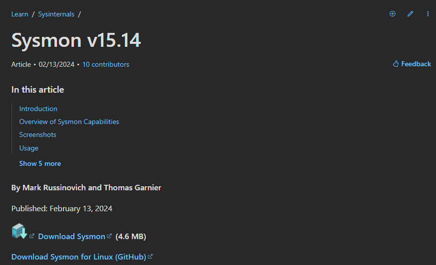
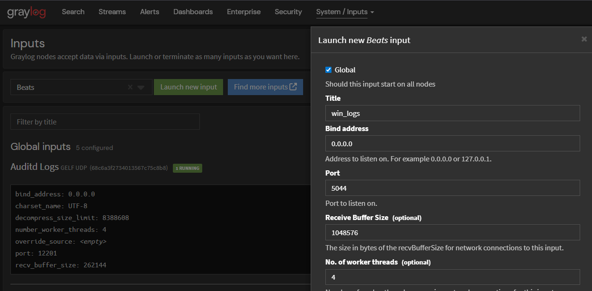
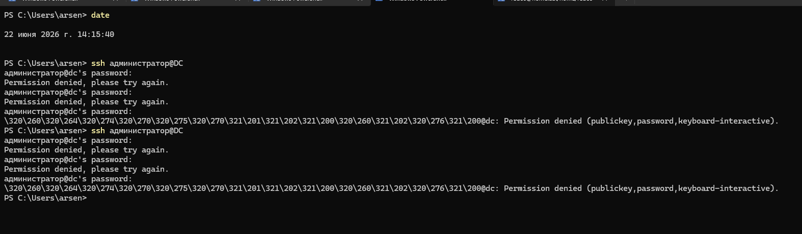
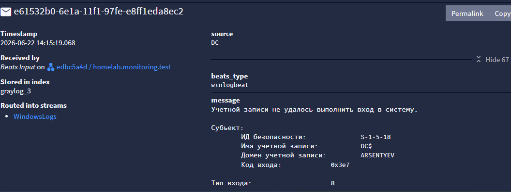
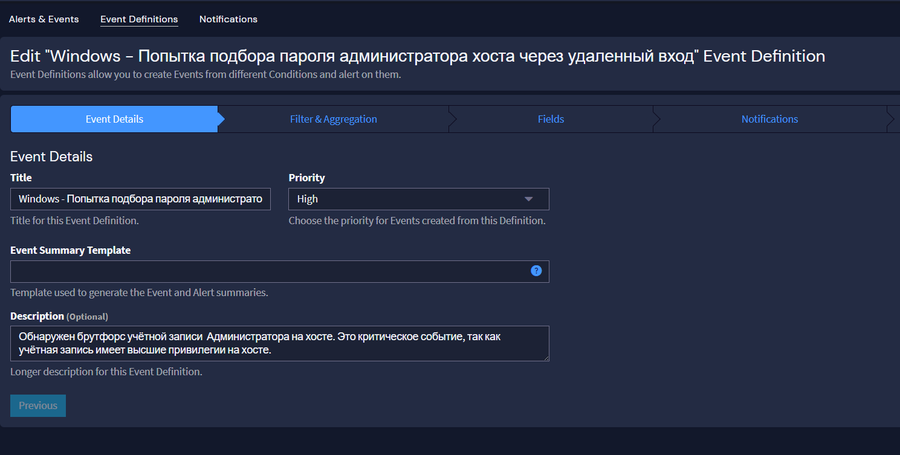
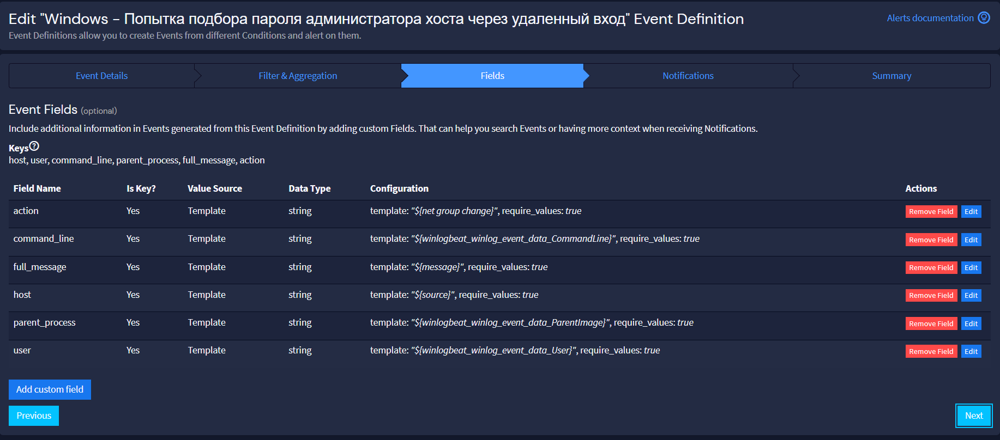
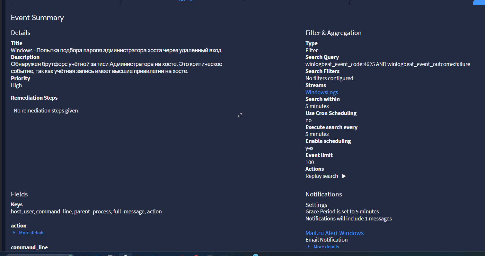
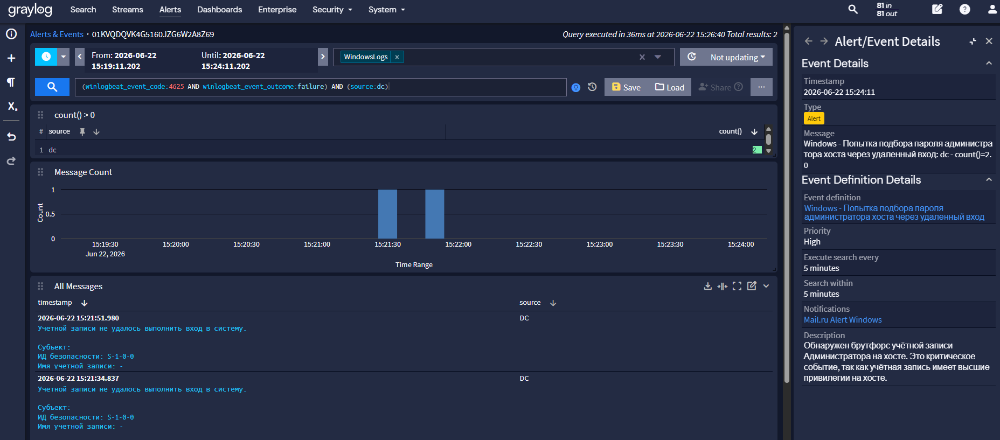

# Windows: Sysmon, Winlogbeat и алерт 4625

> Сбор логов с Windows-хостов: Sysmon для детального мониторинга, Winlogbeat для
> доставки событий, и алерт на неудачные входы (событие 4625).

## Sysmon

**Sysmon** (System Monitor) — бесплатная утилита из набора Microsoft Sysinternals
для мониторинга активности системы: запуск процессов, создание сетевых соединений,
модификация реестра и другие действия.

**Что умеет:**

- регистрирует создание/завершение процессов, изменения реестра, файлов и DLL, сетевую активность;
- поддерживает эвристические правила для выявления аномалий;
- фильтрует события по множеству критериев;
- настраивается через XML-конфиг (удобно автоматизировать через GPO);
- хорошо интегрируется с SIEM (Splunk, ELK, Graylog);
- минимальные системные требования (работает даже на Windows XP).

### Установка

1. Скачай Sysmon с официального сайта Microsoft Sysinternals.
2. Подготовь конфиг (свой или скачанный).
3. Распакуй архив, открой PowerShell от имени администратора:

```powershell
.\Sysmon64.exe -i .\sysmonconfig-export.xml -accepteula
```





Проверка логов: `eventvwr.msc` → «Журналы приложений и служб → Microsoft → Windows →
Sysmon → Operational».

## Winlogbeat

**Winlogbeat** — легковесный агент (из стека Elastic) для сбора и отправки событий
журналов Windows (Event Logs) в Elasticsearch, Logstash, Kafka и другие системы,
включая Graylog.

**Что умеет:** собирает события из Application, Security, System и других журналов;
поддерживает SSL/TLS; работает с несколькими транспортами; имеет встроенные модули.

### Настройка

Установи Winlogbeat на каждый Windows-хост. Отредактируй `winlogbeat.yml`
(обычно `C:\Program Files\winlogbeat\winlogbeat.yml`), указав адрес сервера Graylog:

```yaml
winlogbeat.event_logs:
  - name: Application
  - name: Security
  - name: System

output.logstash:
  hosts: ["<ip сервера Graylog>:5044"]
```

Готовый пример — [`config/winlogbeat.yml.example`](../windows/winlogbeat.yml.example).

Проверка и установка службы:

```powershell
cd "C:\Program Files\winlogbeat"
./winlogbeat test config
./winlogbeat test output
.\install-service-winlogbeat.ps1
Start-Service winlogbeat
```

На сервере Graylog создай вход **Beats** на порту 5044/TCP:
`System/Overview → Inputs → Beats → Launch new input`.



## Поток Windows Logs

Создай поток **Windows Logs** (см. [02-streams-alerts.md](02-streams-alerts.md)),
в который попадают сообщения от Winlogbeat и Sysmon с Windows-хостов.

## Алерт на неудачный вход (4625)

Windows пишет в журнал Security событие **4625** при неудачной попытке входа.

Структурированные поля события (после доставки Winlogbeat):

```
winlogbeat_event_code:4625
winlogbeat_event_action: Logon
winlogbeat_event_outcome: failure
winlogbeat_event_provider: Microsoft-Windows-Security-Auditing
winlogbeat_log_level: information
winlogbeat_tags: ["windows","security","sysmon"]
winlogbeat_winlog_channel: Security
winlogbeat_winlog_event_data_FailureReason: Неизвестное имя пользователя или неверный пароль.
winlogbeat_winlog_event_id: 4625
winlogbeat_winlog_keywords: ["Audit Failure"]
winlogbeat_winlog_opcode: Info
winlogbeat_winlog_provider_name: Microsoft-Windows-Security-Auditing
winlogbeat_winlog_task: Logon
```

Для детекта достаточно пары критериев:

```
winlogbeat_event_code:4625 AND winlogbeat_event_outcome:failure
```





### Создание алерта

1. **Alerts → Event Definitions → Create event definition**.
2. **Event Details** — тема, приоритет, сводка.
3. **Filter & Aggregation** — ищем в потоке **Windows Logs** по паттерну выше,
   проверка каждые 5 минут, условие «больше нуля сообщений».
4. **Fields** — добавь поля, которые должны попадать в алерт.
5. **Notifications** — выбери созданное email-уведомление, нажми **Add notification**.





Проверка: попытка входа с неверным паролем → в течение пары минут письмо со ссылкой
на событие.





> Не ищи события по русскому тексту в `message` — используй точные
> `event_code` и `outcome`. Это быстрее и без ложных срабатываний.

## Ещё 11 алертов по Sysmon и Security

Кроме базовых алертов в Graylog добавлен набор из 11 определений, которые смотрят в Sysmon (события 1, 3, 11,
12, 13, 17, 18, 22) и Security (4624, 4625). Спецификация лежит в
[`graylog/windows-event-definitions.json`](../graylog/windows-event-definitions.json): вместо `<WINDOWS_STREAM_ID>`
подставляется id потока `WindowsLogs`, вместо `<NOTIFICATION_ID>` — id email-уведомления. Скрипт импорта такой же, как
для [контейнерных правил](09-containers-dashboards.md#импорт-правил) (`POST /api/events/definitions?schedule=true`,
существующие названия пропускаются). Поля MITRE (`mitre_*`) записаны в определения сразу.

| Алерт | Что ловит | Приоритет |
|---|---|---|
| Вход из неизвестной сети (4624, тип 3 или 10) | сетевой вход или RDP с адреса вне справочника `homelab-subnets` (нужен `src_zone`, см. [главу 13](13-lookup-tables.md)) | 3 |
| Именованные каналы C2 | каналы `msagent_*`, `postex_*`, `status_*`, `MSSE-*` (Cobalt Strike и аналоги) | 3 |
| DNS-запрос к туннелям и файлообменникам | ngrok, pastebin, transfer.sh, trycloudflare, duckdns, anonfiles, serveo | 2 |
| wscript, cscript, mshta или regsvr32 ходит во внешнюю сеть | Sysmon 3 на внешний IP | 3 |
| Исключения или отключение защиты Defender | `Add-/Set-MpPreference`, ключ `Windows Defender\Exclusions` | 3 |
| Закрепление через IFEO Debugger, AppInit_DLLs и Winlogon | Sysmon 12/13 | 2 |
| Дамп учётных данных | `reg save` для SAM/SECURITY/SYSTEM, `comsvcs.dll MiniDump`, `ntdsutil` | 3 |
| Office, wscript или mshta создал исполняемый файл | Sysmon 11 в Temp, AppData, Public, ProgramData | 3 |
| Командная оболочка запущена через WMI | родитель `WmiPrvSE.exe` | 3 |
| Добавление в локальные администраторы | `net localgroup administrators /add`, `Add-LocalGroupMember` | 3 |
| Перебор несуществующих пользователей | 5+ событий 4625 с `SubStatus 0xc0000064` с одного IP за 10 минут | 2 |

**Как проверялись запросы.** Поля Sysmon (`win_image`, `ParentImage`, `PipeName`, `TargetObject`, `win_filename`,
`win_command_line`) в индексе хранятся как keyword: ищется точное значение с учётом регистра, поиск по слову из
пути не работает. Поэтому в запросах используются регулярные выражения (`win_image:/.*\\(mshta|wscript)\.exe/`),
а по командной строке — поиск в `message`. Каждый запрос перед созданием прогнали по `WindowsLogs` за 30 дней:
слишком шумные варианты сузили. Например, для `powershell` и `rundll32` соединения с GitHub, Cloudflare и Azure давали
около одного срабатывания в день, а запись `RunOnce` постоянно делают Office, Edge и Defender, поэтому их в алертах нет.
Сейчас за 30 дней срабатываний нет, кроме алерта на неизвестную сеть (до подключения pipeline поле `src_zone` не
заполнялось) и перебора несуществующих пользователей (6 событий).

### Ещё 2 алерта: подбор с успехом и ночные входы

| Алерт | Что ловит | Приоритет |
|---|---|---|
| Подбор пароля и успешный вход с одного IP (4625 и 4624) | агрегация по адресу источника: за 15 минут 5 и более сетевых или RDP-входов, среди них есть и 4625, и 4624 (условие `count >= 5` и `card(winlogbeat_event_code) >= 2`) | 3 |
| Вход по сети или RDP ночью (00:00-06:00) | успешный вход под обычной учёткой в ночные часы; правило запускается по расписанию (`cron_expression`), часы и часовой пояс подгони под себя | 2 |

> ⚠️ Алерты про Kerberoasting (4769 с RC4), AS-REP roasting (4768), DCSync (4662), задачи планировщика (4698, 4702) и подключение USB (6416) в лаборатории не сделаны: этих событий нет в логах, на контроллере домена не включён расширенный аудит. Включить: `auditpol /set /subcategory:"Kerberos Service Ticket Operations" /success:enable`, `"Directory Service Access"`, `"Other Object Access Events"`, `"Plug and Play Events"`. Без этого правило нечем проверить. Правило про WMI-подписки (события Sysmon 19, 20, 21) тоже ждёт: в конфиге Sysmon эти события выключены.

### Defender: сигнатуры не обновлялись

Алерт «Defender: сигнатуры не обновлялись 7 дней» ищет отсутствие события 2000 (успешное обновление сигнатур) за неделю. Окно проверяется раз в час, повтор не чаще раза в сутки. Если контроллер домена или ноутбук выключены дольше недели, алерт сработает, и это нормально.

### Ещё 11 алертов по матрице MITRE (волна 1)

Определения добавлены в [windows-event-definitions.json](../graylog/windows-event-definitions.json). Проверены на истории за 30 дней; «0» значит, что в логах такого не было, запрос проверен только на корректность.

| Алерт | Что ловит | Приоритет | За 30 дней |
|---|---|---|---|
| Остановка защиты и сбора логов | служба Sysmon, winlogbeat, Defender, брандмауэр или журнал событий остановлена (System 7036) | 2 | 1 |
| Утилиты удалённого доступа | ngrok, cloudflared, AnyDesk, TeamViewer, RustDesk, chisel, tailscale, plink | 2 | 0 |
| Выгрузка в облако | rclone, MEGAsync, MEGAcmd, WinSCP, pCloud | 2 | 0 |
| Обход UAC | запись в `ms-settings`, `mscfile`, `exefile\shell\open\command`, подмена `windir` | 3 | 0 |
| Маскировка под системный процесс | `svchost`, `lsass`, `csrss` и другие вне System32, SysWOW64, WinSxS | 2 | 0 |
| Разведка в домене | nltest, dsquery, AdFind, SharpHound, ldifde, `Get-AD*` | 2 | 0 |
| PsExec и аналоги | процесс, служба PSEXESVC, именованные каналы | 3 | 0 |
| Поиск паролей в файлах | `findstr /s`, `Select-String -Recurse` со словами password, secret, id_rsa; `secedit` исключён | 2 | 0 |
| Длинные DNS-имена | метка длиннее 40 символов или имя длиннее 70; служебные записи AD и CDN исключены | 2 | 0 |
| Признаки шифровальщика | расширения `.lockbit`, `.akira`, `.conti` и др., файлы-записки | 3 | 0 |
| Архивация не из проводника | 7-Zip, WinRAR, `Compress-Archive`, `tar -c`; установщики во временных папках исключены | 1 | 2 |

Что не вошло. Массовое создание файлов одним процессом (признак шифровальщика): `powershell`, браузеры и установщики Edge штатно пишут тысячи файлов, без окна в 2 минуты и списка исключений порог не подобрать. Алерт на WinRM-клиент через svchost давал 90 срабатываний в месяц.

### Контроллер домена: аудит и 16 алертов (волна 2)

Определения добавлены в [windows-event-definitions.json](../graylog/windows-event-definitions.json). Они ловят атаки на Active Directory, поэтому работают на хосте, который пишет события Security контроллера домена. Алерты на 4662 (DCSync) и 5136 (изменение объектов AD) срабатывают только при включённом аудите.

**Включи аудит.** Названия подкатегорий зависят от языка Windows, поэтому используй GUID (работает на любой локали). Выполни в PowerShell от администратора:

```powershell
# Kerberos Authentication Service (4768, 4771)
auditpol /set /subcategory:"{0CCE9242-69AE-11D9-BED3-505054503030}" /success:enable /failure:enable
# Kerberos Service Ticket Operations (4769)
auditpol /set /subcategory:"{0CCE9240-69AE-11D9-BED3-505054503030}" /success:enable /failure:enable
# Credential Validation (4776)
auditpol /set /subcategory:"{0CCE923F-69AE-11D9-BED3-505054503030}" /success:enable /failure:enable
# Directory Service Changes (5136)
auditpol /set /subcategory:"{0CCE923C-69AE-11D9-BED3-505054503030}" /success:enable /failure:enable
# Authentication Policy Change (4706, 4707, 4716)
auditpol /set /subcategory:"{0CCE9230-69AE-11D9-BED3-505054503030}" /success:enable /failure:enable
```

Для события 4662 нужна ещё запись SACL на корне домена (аудит чтения прав репликации). Без неё DCSync в журнале не виден.

**Расширь список событий Security в winlogbeat.** У параметра `event_id` есть лимит: не больше 22 записей (одиночный ID или диапазон считаются каждый за одну). В этой конфигурации ровно 22:

```yaml
  - name: Security
    ignore_older: 720h
    event_id: "1102, 4624-4625, 4648, 4662, 4672, 4688-4689, 4697-4698, 4702, 4706-4707, 4716, 4719-4726, 4728-4729, 4732-4733, 4738, 4740-4741, 4756, 4767-4769, 4771, 4776, 5136, 5140, 5145"
```

Проверь конфигурацию и перезапусти службу:

```powershell
& "C:\Program Files\winlogbeat\winlogbeat.exe" test config -c "C:\Program Files\winlogbeat\winlogbeat.yml"
Restart-Service winlogbeat
```

| Алерт | Что ловит | Приоритет |
|---|---|---|
| DCSync | чтение прав репликации каталога не компьютером (4662) | 3 |
| Kerberoasting | билет службы с шифрованием RC4 к учётной записи службы (4769) | 3 |
| Подбор пароля по Kerberos | 10+ ошибок 4771 с одного адреса за 5 минут | 3 |
| Подбор пароля по NTLM | 10+ ошибок 4776 с одного рабочего места за 5 минут | 3 |
| Добавление в группу администраторов | 4728, 4732, 4756 для администраторов, администраторов домена, предприятия и схемы | 3 |
| Изменение объектов AD | групповые политики и AdminSDHolder (5136) | 3 |
| Изменение политики аудита | 4719 | 3 |
| Постоянная подписка WMI | 5861 | 3 |
| Доверия домена | создание, удаление, изменение доверия (4706, 4707, 4716), в том числе отключение фильтрации SID | 3 |
| Блокировка учётной записи | 4740 | 2 |
| Сброс пароля | 4724 | 2 |
| Создана учётная запись | 4720 | 2 |
| Компьютерная учётная запись от пользователя | 4741, признак атаки через MachineAccountQuota | 2 |
| Задание планировщика с Temp, AppData или Public | 4698 | 2 |
| Установка службы вне System32 и Program Files | 4697 | 2 |
| Удалённый вход по WinRM | WinRM 91 | 2 |

Шум. Плановые действия администратора тоже срабатывают: сброс пароля, создание учётных записей, добавление в группы, присоединение компьютеров к домену, новые доверия. Для таких алертов нужен только повод посмотреть, кто и зачем это сделал. Если какой-то алерт шумит, сузь запрос исключением учётной записи или хоста.

Если создаёшь доверие с другим доменом (например, с FreeIPA), в журнале появятся события 4706 и 4716, а алерт на доверия сработает. Это ожидаемо.
