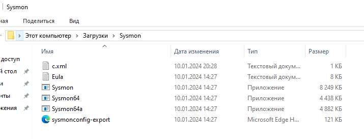
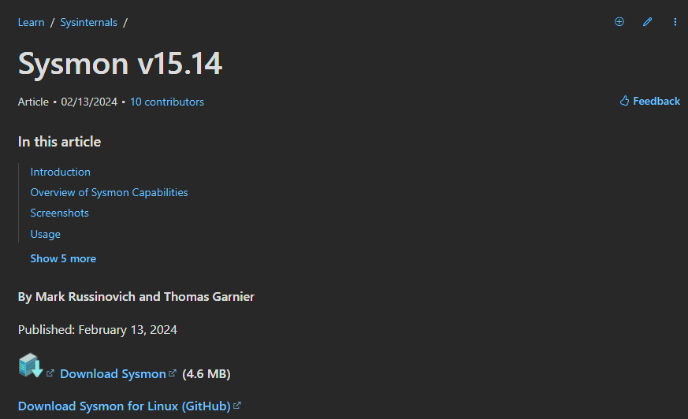
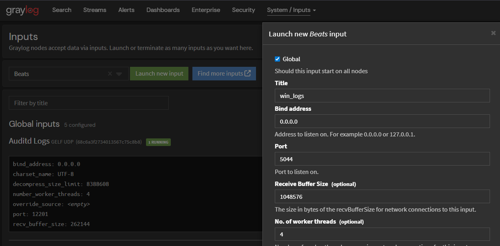
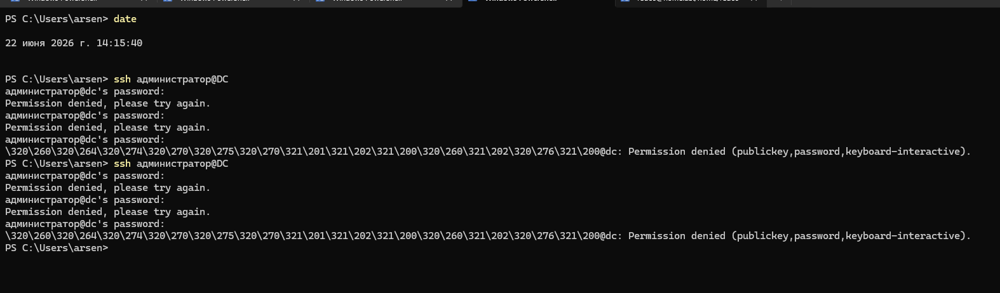
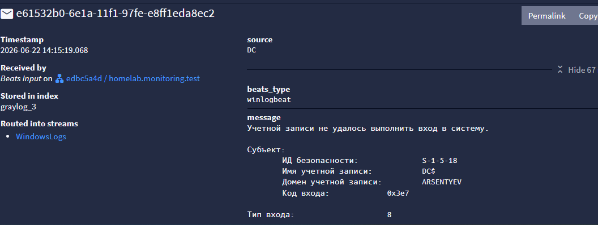
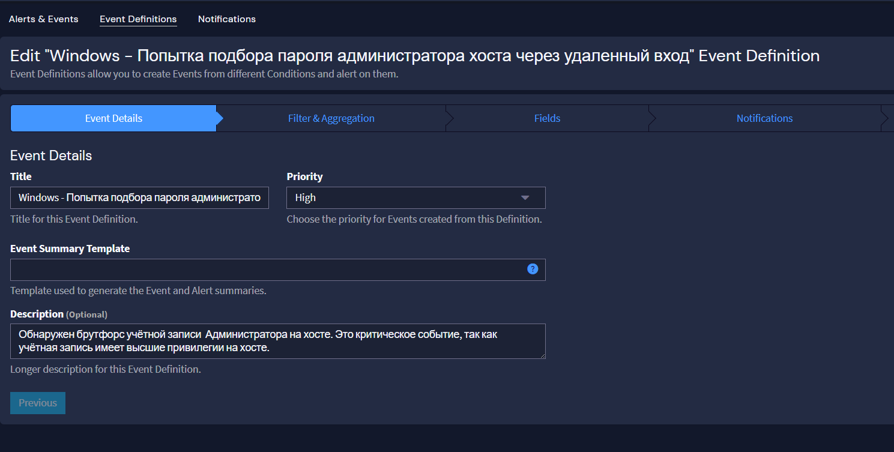
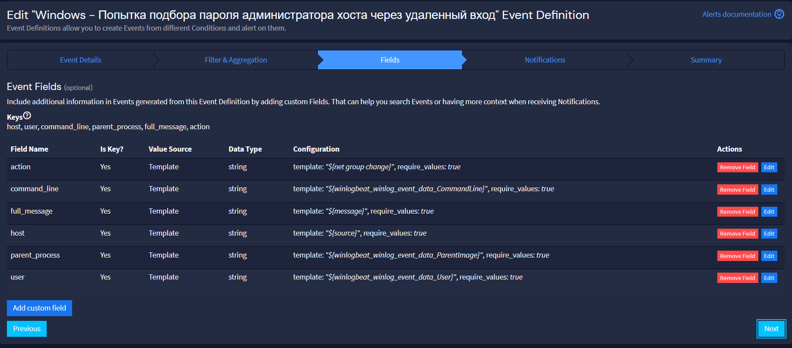
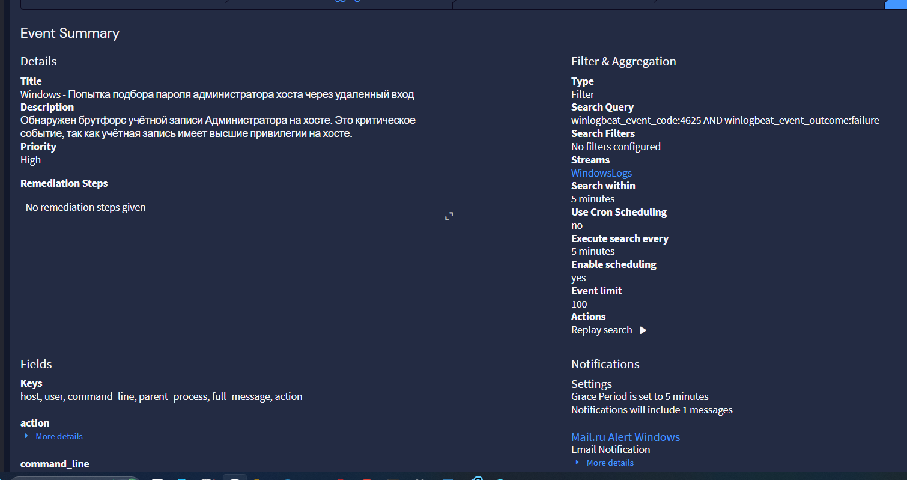
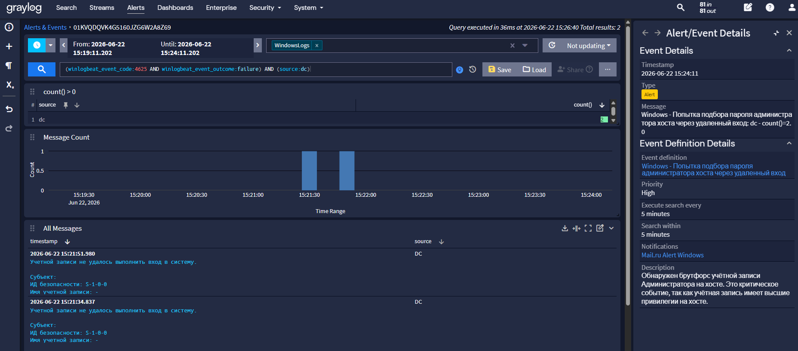

# Windows: Sysmon, Winlogbeat и алерт 4625

> Сбор логов с Windows-хостов: Sysmon для детального мониторинга, Winlogbeat для
> доставки событий, и алерт на неудачные входы (событие 4625).

## Sysmon

**Sysmon** (System Monitor) — бесплатная утилита из набора Microsoft Sysinternals
для мониторинга активности системы: запуск процессов, создание сетевых соединений,
модификация реестра и другие действия.

**Что умеет:**

- регистрирует создание/завершение процессов, изменения реестра, файлов и DLL, сетевую активность;
- поддерживает эвристические правила для выявления аномалий;
- фильтрует события по множеству критериев;
- настраивается через XML-конфиг (удобно автоматизировать через GPO);
- хорошо интегрируется с SIEM (Splunk, ELK, Graylog);
- минимальные системные требования (работает даже на Windows XP).

### Установка

1. Скачай Sysmon с официального сайта Microsoft Sysinternals.
2. Подготовь конфиг (свой или скачанный).
3. Распакуй архив, открой PowerShell от имени администратора:

```powershell
.\Sysmon64.exe -i .\sysmonconfig-export.xml -accepteula
```





Проверка логов: `eventvwr.msc` → «Журналы приложений и служб → Microsoft → Windows →
Sysmon → Operational».

## Winlogbeat

**Winlogbeat** — легковесный агент (из стека Elastic) для сбора и отправки событий
журналов Windows (Event Logs) в Elasticsearch, Logstash, Kafka и другие системы,
включая Graylog.

**Что умеет:** собирает события из Application, Security, System и других журналов;
поддерживает SSL/TLS; работает с несколькими транспортами; имеет встроенные модули.

### Настройка

Установи Winlogbeat на каждый Windows-хост. Отредактируй `winlogbeat.yml`
(обычно `C:\Program Files\winlogbeat\winlogbeat.yml`), указав адрес сервера Graylog:

```yaml
winlogbeat.event_logs:
  - name: Application
  - name: Security
  - name: System

output.logstash:
  hosts: ["<ip сервера Graylog>:5044"]
```

Готовый пример — [`config/winlogbeat.yml.example`](../config/winlogbeat.yml.example).

Проверка и установка службы:

```powershell
cd "C:\Program Files\winlogbeat"
./winlogbeat test config
./winlogbeat test output
.\install-service-winlogbeat.ps1
Start-Service winlogbeat
```

На сервере Graylog создай вход **Beats** на порту 5044/TCP:
`System/Overview → Inputs → Beats → Launch new input`.



## Поток Windows Logs

Создай поток **Windows Logs** (см. [02-streams-alerts.md](02-streams-alerts.md)),
в который попадают сообщения от Winlogbeat и Sysmon с Windows-хостов.

## Алерт на неудачный вход (4625)

Windows пишет в журнал Security событие **4625** при неудачной попытке входа.

Структурированные поля события (после доставки Winlogbeat):

```
winlogbeat_event_code:4625
winlogbeat_event_action: Logon
winlogbeat_event_outcome: failure
winlogbeat_event_provider: Microsoft-Windows-Security-Auditing
winlogbeat_log_level: information
winlogbeat_tags: ["windows","security","sysmon"]
winlogbeat_winlog_channel: Security
winlogbeat_winlog_event_data_FailureReason: Неизвестное имя пользователя или неверный пароль.
winlogbeat_winlog_event_id: 4625
winlogbeat_winlog_keywords: ["Audit Failure"]
winlogbeat_winlog_opcode: Info
winlogbeat_winlog_provider_name: Microsoft-Windows-Security-Auditing
winlogbeat_winlog_task: Logon
```

Для детекта достаточно пары критериев:

```
winlogbeat_event_code:4625 AND winlogbeat_event_outcome:failure
```





### Создание алерта

1. **Alerts → Event Definitions → Create event definition**.
2. **Event Details** — тема, приоритет, сводка.
3. **Filter & Aggregation** — ищем в потоке **Windows Logs** по паттерну выше,
   проверка каждые 5 минут, условие «больше нуля сообщений».
4. **Fields** — добавь поля, которые должны попадать в алерт.
5. **Notifications** — выбери созданное email-уведомление, нажми **Add notification**.





Проверка: попытка входа с неверным паролем → в течение пары минут письмо со ссылкой
на событие.





> Не ищи события по русскому тексту в `message` — используй точные
> `event_code` и `outcome`. Это быстрее и без ложных срабатываний.
