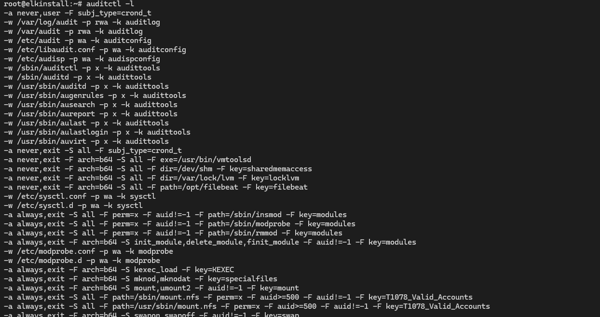
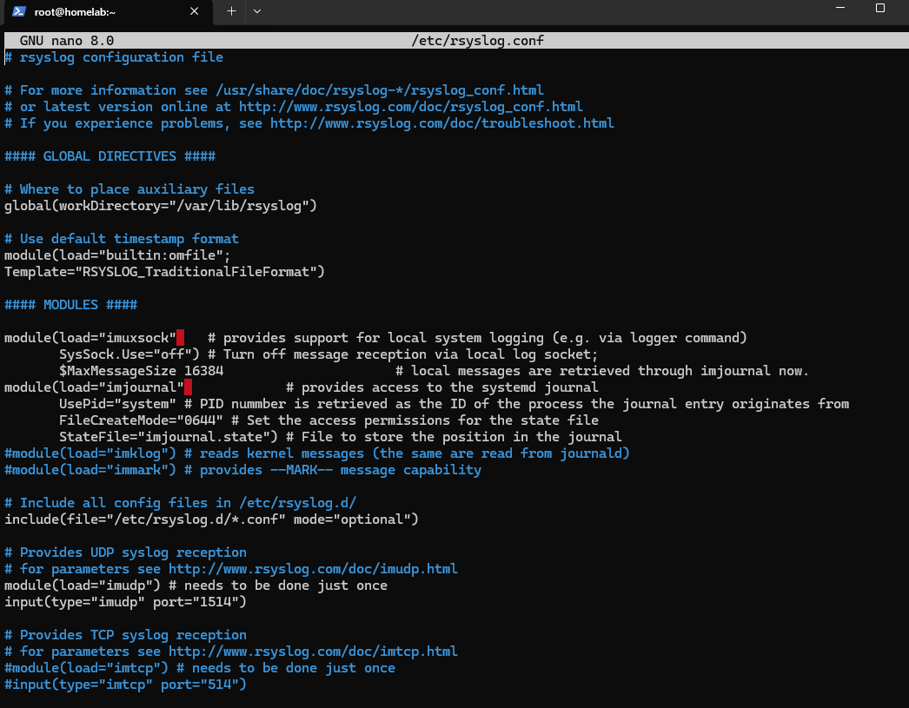
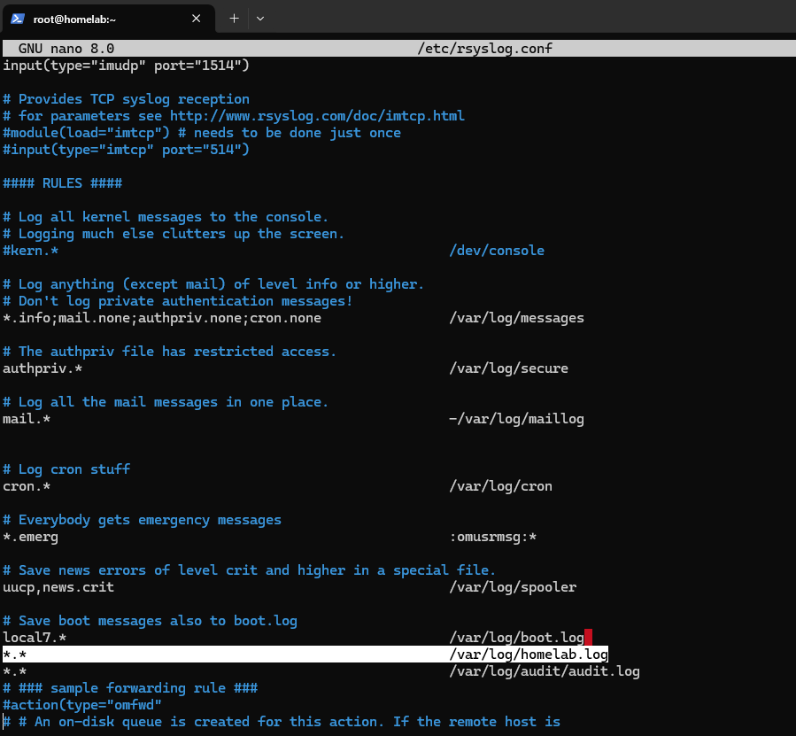
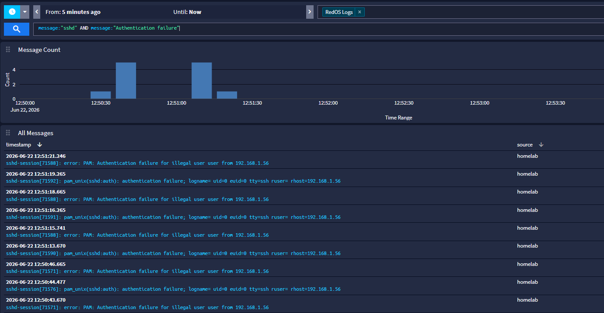
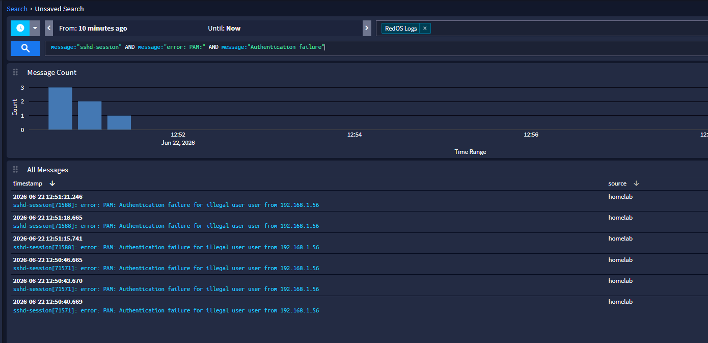
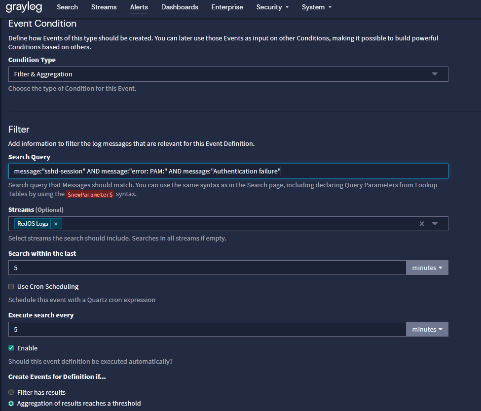
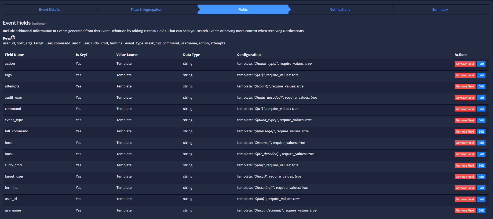
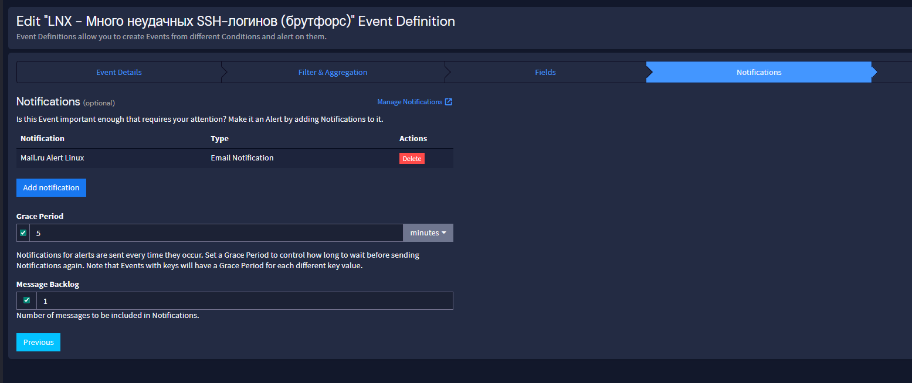
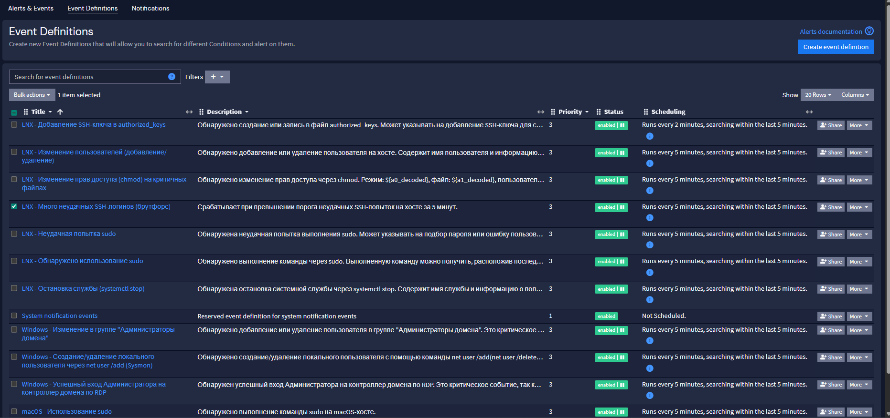
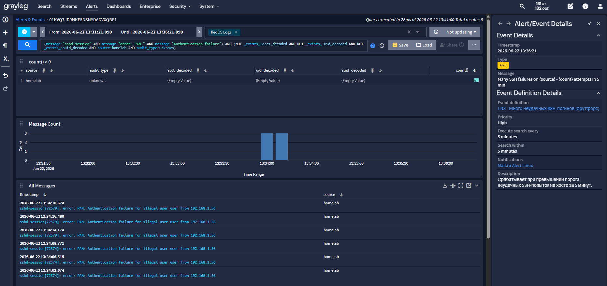

# Linux: auditd, rsyslog и алерт SSH

> Сбор логов с Linux-хостов (РЕД ОС): auditd для аудита безопасности, rsyslog для
> пересылки системных логов, и алерт на неудачные SSH-входы.

## auditd

Основа сбора логов с Linux — демон **auditd**. Устанавливается пакетным менеджером
(DNF, APT или Pacman).

```bash
dnf install auditd
```

Правила аудита кладём в `/etc/audit/rules.d`:

```bash
mv audit.rules /etc/audit/rules.d/audit.rules
augenrules --load
auditctl -l                    # убедиться, что правила добавились
tail /var/log/audit/audit.log  # проверить, что демон пишет события
```



## rsyslog

Для пересылки системных логов на Graylog используем rsyslog.

```bash
dnf install rsyslog -y
```

Правки в `/etc/rsyslog.conf`. **TCP или UDP?**

| | TCP | UDP |
|---|---|---|
| Доставка | Гарантированная, с подтверждением | Возможны потери |
| Скорость | Ниже из-за установки соединения | Выше, минимум накладных расходов |
| Когда | Критичные логи, корпоративные среды | Поток статистики/телеметрии, тестовые стенды |

Для надёжности в проде чаще выбирают TCP. Для менее критичных системных логов —
UDP.

Отправка всех событий по UDP на порт 1514:

```
*.* @<IP-Graylog>:1514
```

Для TCP — двойной знак `@@`:

```
*.* @@<IP-Graylog>:1514
```





Готовый пример — [`config/rsyslog.conf.example`](../linux/rsyslog.conf.example).

Перезапуск:

```bash
systemctl daemon-reload
systemctl restart rsyslog.service
systemctl status rsyslog.service
journalctl -fu rsyslog
```

На сервере Graylog создай вход **Syslog UDP** на порту 1514:
`System/Overview → Inputs → Syslog UDP → Launch new input`.

## Декодер auditd

Чтобы поля auditd (в hex) стали читаемыми, используй декодер из
[`decoder/auditd_decoder.py`](../decoder/auditd_decoder.py) — он принимает события,
декодирует hex-поля и отправляет результат в Graylog в формате GELF. Подробности —
в [02-streams-alerts.md](02-streams-alerts.md).

## Поток Linux Logs

Создай поток **Linux Logs**, в который попадают сообщения с Linux-хостов,
полученные по Syslog через UDP.

## Алерт на неудачный SSH-вход

При неудачной попытке подключения по SSH в логах появляется сообщение вида:

```
sshd-session[71592]: pam_unix(sshd:auth): authentication failure; logname= uid=0 euid=0 tty=ssh ruser= rhost=192.168.1.56
```

Поиск по потоку Linux Logs:

```
program:sshd AND message:"Authentication failure"
```





Этот запрос отлавливает все неудачные подключения по SSH: несуществующие имена
пользователей, неверные пароли, превышение числа попыток.

### Создание алерта

1. **Alerts → Event Definitions → Create event definition**.
2. **Event Details** — тема, приоритет, сводка.
3. **Filter & Aggregation** — поток **Linux Logs** (или RedOS Logs), паттерн выше,
   проверка каждые 5 минут, условие «больше нуля сообщений», группировка по
   `count` и `source`.
4. **Fields** — стандартные поля из логов Linux.
5. **Notifications** — выбери email-уведомление, нажми **Add notification**.









Совет: следующий алерт проще клонировать из предыдущего (**Update**), чем создавать
с нуля.



## Ещё 8 алертов по auditd

Определения лежат в [graylog/linux-event-definitions.json](../graylog/linux-event-definitions.json) (в файле плейсхолдеры `<AUDITD_STREAM_ID>` и `<NOTIFICATION_ID>`, подставьте свои). Поле `audit_key` в запросах берётся из правил auditd (`kernel_modules`, `cron_persistence`, `perm_modification`, `file_deletion`). Запросы проверены на истории за 30 дней.

| Алерт | Что ловит | MITRE | Приоритет |
|---|---|---|---|
| LNX - Запуск из /tmp, /dev/shm, /var/tmp | EXECVE из временных каталогов или интерпретатор со скриптом оттуда | T1059.004 | 3 |
| LNX - Вход по SSH из неизвестной сети | Успешный USER_LOGIN с адреса вне таблицы `homelab-subnets` | T1078 | 3 |
| LNX - Загрузка модуля ядра | init_module, finit_module, modprobe | T1547.006 | 2 |
| LNX - Закрепление через cron | Запись в каталоги и файлы cron | T1053.003 | 2 |
| LNX - Установка setuid или setgid | chmod с битами 04000 и 02000 (кроме rpm, dnf, systemd-tmpfiles) | T1548.001 | 3 |
| LNX - Обратная оболочка (python, perl, nc, socat, mkfifo) | Типовые командные строки обратных оболочек | T1059.004 | 3 |
| LNX - SSH-туннель (-R, -L, -D) | ssh с пробросом портов | T1572 | 2 |
| LNX - Массовое удаление файлов (200+ за 5 мин) | Агрегация: один процесс удалил 200+ файлов | T1485 | 3 |

Алерт про массовое удаление построен как агрегация (группировка по `source` и `exe`, условие `count >= 200`, окно 5 минут), остальные срабатывают на каждое событие.

### Источник входа: src_ip и src_zone

Декодер auditd обрезает поле `addr` у USER_LOGIN до первого октета (`192` вместо `192.168.1.3`), настоящий адрес остаётся только в тексте сообщения. Поэтому алерт про вход из неизвестной сети опирается на два правила pipeline «homelab: linux enrichment»:

1. стадия 0, [правило src_ip](../graylog/pipelines/rules/lookup-linux-login-src-ip.rule): достаёт IP из `addr=` в поле `src_ip`;
2. стадия 1, [правило src_zone](../graylog/pipelines/rules/lookup-linux-login-src-zone.rule): ищет `src_ip` в CIDR-таблице `homelab-subnets` и пишет сеть в `src_zone`.

Pipeline подключается к потоку с логами auditd. Если `src_zone` пустое, адрес не входит ни в одну известную сеть, и алерт срабатывает. Подсети лаборатории описываются в `homelab-subnets.csv` (см. [главу про Lookup-таблицы](13-lookup-tables.md)).

### Ещё 6 алертов: корреляция, выгрузка данных, контейнеры

Определения лежат в том же файле [linux-event-definitions.json](../graylog/linux-event-definitions.json). Запросы проверены на истории за 30 дней.

| Алерт | Что ловит | Приоритет | За 30 дней |
|---|---|---|---|
| Подбор пароля и успешный вход по SSH | на хосте за 15 минут 6 и более событий `USER_LOGIN` sshd, среди них и неудачные, и успешные (`count >= 6` и `card(res) >= 2`) | 3 | 1 |
| Вход по SSH ночью (00:00-06:00) | `Accepted` от sshd в ночные часы; запуск по расписанию, подгони часы под себя | 2 | 1 |
| Архивация данных пользователем | tar, zip и аналоги (ключ `Data_Compressed`), без gzip и pigz | 1 | 6 |
| Передача файлов наружу | scp, sftp, rsync из терминала (`tty` не `(none)`) | 2 | 18 |
| Изменение сетевых настроек и /etc/hosts | ключ `network_modifications`, кроме NetworkManager и рантайма контейнеров | 1 | 4 |
| Привилегированный контейнер или docker.sock | `docker` или `podman` с `--privileged` или `docker.sock` в аргументах | 3 | 0 |

> ⚠️ Правило про привилегированные контейнеры за месяц не сработало ни разу, проверить формат аргументов на живом запуске `docker run --privileged` стоит самому. Алертов про PAM, `/etc/ld.so.preload`, профили оболочки (`/etc/profile.d`, `.bashrc`) и чтение ключей и конфигов (`id_rsa`, `.kube/config`) пока нет: в auditd нет правил-наблюдателей на эти пути и событий в логах тоже. Добавь в auditd `-w /etc/pam.d -p wa -k pam_config`, `-w /etc/ld.so.preload -p wa -k ld_preload`, `-w /etc/profile.d -p wa -k shell_profile`, затем правила по этим ключам заводятся так же, как остальные.


### Ещё 7 алертов по матрице MITRE (волна 1)

Определения добавлены в [linux-event-definitions.json](../graylog/linux-event-definitions.json). Проверены на истории за 30 дней; «0» значит, что в логах такого не было, запрос проверен только на корректность.

| Алерт | Что ловит | Приоритет | За 30 дней |
|---|---|---|---|
| Остановка служб аудита и защиты | `SERVICE_STOP` для auditd, rsyslog, wazuh, filebeat, sshd, firewalld; постоянно перезапускающийся `filebeat-wazuh` исключён | 2 | 9 |
| Утилиты удалённого доступа | ngrok, cloudflared, AnyDesk, TeamViewer, RustDesk, chisel, tailscale, zerotier, frpc, plink | 2 | 0 |
| Выгрузка в облако | rclone, MEGAcmd, megatools | 2 | 0 |
| Веб-сервер запустил оболочку | uid 48 (apache) или 33 (www-data) запустил bash; `redos-raspi` и `homeserver` исключены, там это штатно | 3 | 0 |
| Сканеры сети | nmap, masscan, arp-scan, netdiscover, nbtscan, fping, zmap | 2 | 0 |
| Вход root по SSH | `USER_LOGIN` по sshd, `acct=root`, успех | 3 | 0 |
| Поиск паролей в файлах | `grep -r`, `find`, `rg` со словами password, secret, id_rsa, api_key | 2 | 0 |

Что не вошло. Интерактивный SSH-вход как признак перемещения: за месяц 43 срабатывания от обычной работы.
