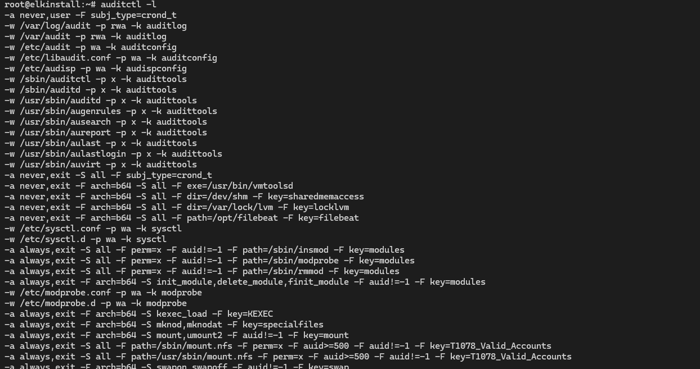
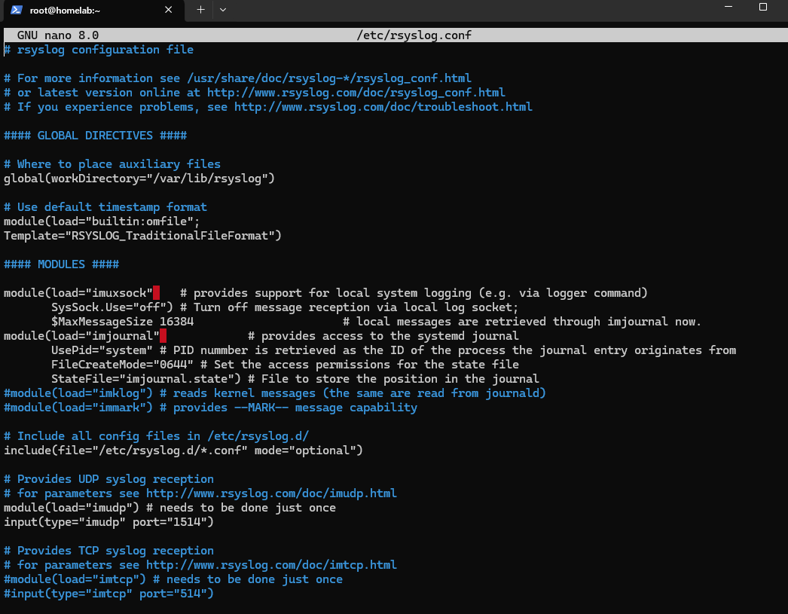
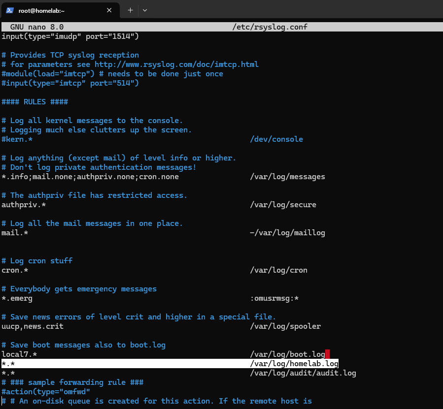
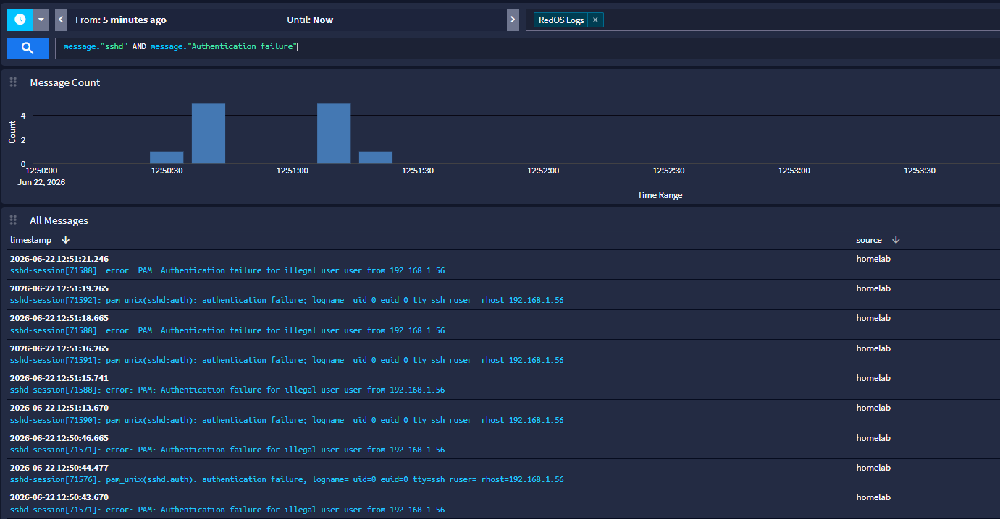
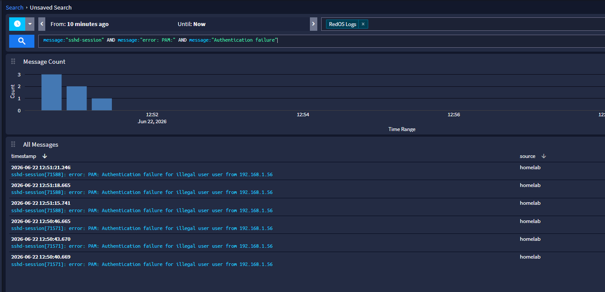
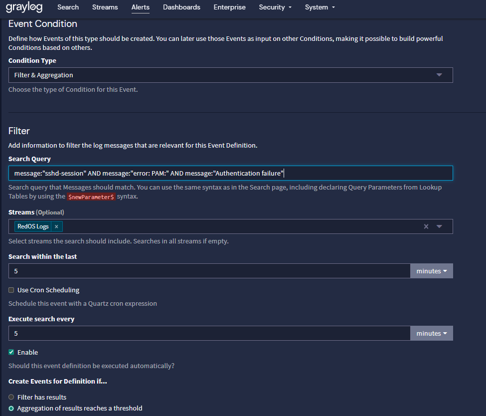
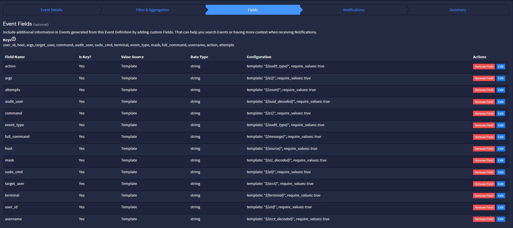
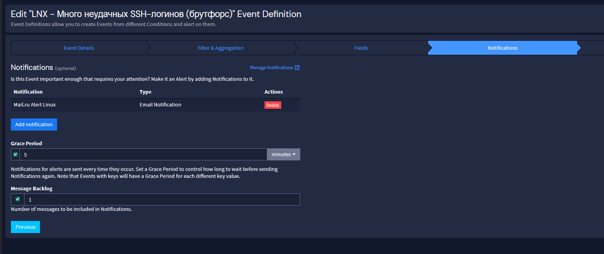
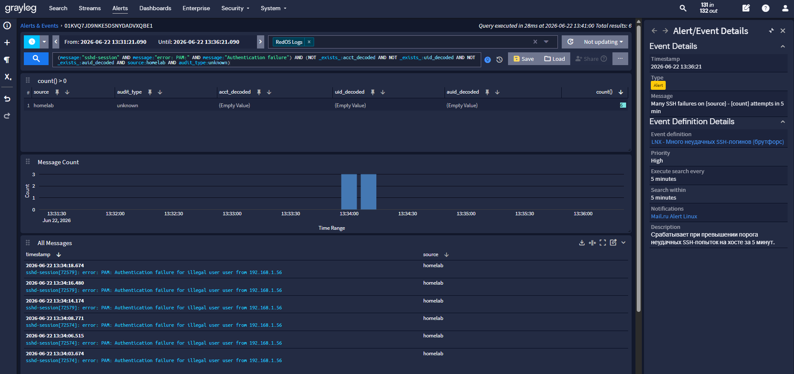

# Linux: auditd, rsyslog и алерт SSH

> Сбор логов с Linux-хостов (РЕД ОС): auditd для аудита безопасности, rsyslog для
> пересылки системных логов, и алерт на неудачные SSH-входы.

## auditd

Основа сбора логов с Linux — демон **auditd**. Устанавливается пакетным менеджером
(DNF, APT или Pacman).

```bash
dnf install auditd
```

Правила аудита кладём в `/etc/audit/rules.d`:

```bash
mv audit.rules /etc/audit/rules.d/audit.rules
augenrules --load
auditctl -l                    # убедиться, что правила добавились
tail /var/log/audit/audit.log  # проверить, что демон пишет события
```



## rsyslog

Для пересылки системных логов на Graylog используем rsyslog.

```bash
dnf install rsyslog -y
```

Правки в `/etc/rsyslog.conf`. **TCP или UDP?**

| | TCP | UDP |
|---|---|---|
| Доставка | Гарантированная, с подтверждением | Возможны потери |
| Скорость | Ниже из-за установки соединения | Выше, минимум накладных расходов |
| Когда | Критичные логи, корпоративные среды | Поток статистики/телеметрии, тестовые стенды |

Для надёжности в проде чаще выбирают TCP. Для менее критичных системных логов —
UDP.

Отправка всех событий по UDP на порт 1514:

```
*.* @192.168.1.210:1514
```

Для TCP — двойной знак `@@`:

```
*.* @@192.168.1.210:1514
```





Готовый пример — [`config/rsyslog.conf.example`](../config/rsyslog.conf.example).

Перезапуск:

```bash
systemctl daemon-reload
systemctl restart rsyslog.service
systemctl status rsyslog.service
journalctl -fu rsyslog
```

На сервере Graylog создайте вход **Syslog UDP** на порту 1514:
`System/Overview → Inputs → Syslog UDP → Launch new input`.

## Декодер auditd

Чтобы поля auditd (в hex) стали читаемыми, используйте декодер из
[`decoder/auditd_decoder.py`](../decoder/auditd_decoder.py) — он принимает события,
декодирует hex-поля и отправляет результат в Graylog в формате GELF. Подробности —
в [02-streams-alerts.md](02-streams-alerts.md).

## Поток Linux Logs

Создайте поток **Linux Logs**, в который попадают сообщения с Linux-хостов,
полученные по Syslog через UDP.

## Алерт на неудачный SSH-вход

При неудачной попытке подключения по SSH в логах появляется сообщение вида:

```
sshd-session[71592]: pam_unix(sshd:auth): authentication failure; logname= uid=0 euid=0 tty=ssh ruser= rhost=192.168.1.56
```

Поиск по потоку Linux Logs:

```
program:sshd AND message:"Authentication failure"
```





Этот запрос отлавливает все неудачные подключения по SSH: несуществующие имена
пользователей, неверные пароли, превышение числа попыток.

### Создание алерта

1. **Alerts → Event Definitions → Create event definition**.
2. **Event Details** — тема, приоритет, сводка.
3. **Filter & Aggregation** — поток **Linux Logs** (или RedOS Logs), паттерн выше,
   проверка каждые 5 минут, условие «больше нуля сообщений», группировка по
   `count` и `source`.
4. **Fields** — стандартные поля из логов Linux.
5. **Notifications** — выберите email-уведомление, нажмите **Add notification**.








Совет: следующий алерт проще клонировать из предыдущего (**Update**), чем создавать
с нуля.


