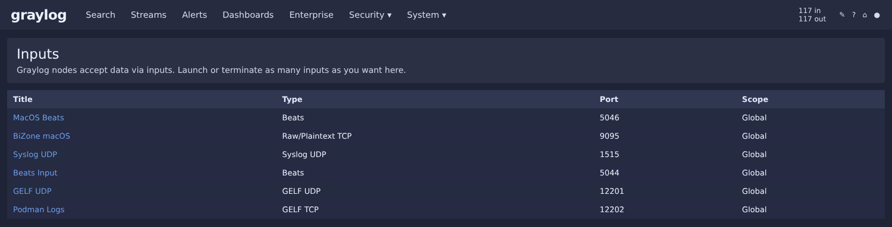
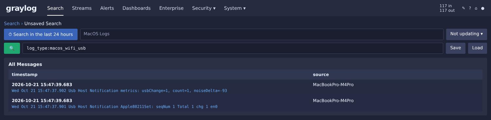

# macOS: unified log, Filebeat и osquery

> Сбор логов с macOS-хостов: unified logging, USB-события, снимки osquery и
> доставка через Filebeat в Graylog. Эта часть — расширение лаборатории на macOS;
> в базовых статьях она не описывалась, конфиги собраны в этом репозитории.

## Что собираем

| Источник | Что даёт | Инструмент |
|---|---|---|
| Unified logging | Системные события, ошибки ядра, TCC, AirDrop, USB | `log stream` + Filebeat |
| `wifi.log` | Подключение/отключение USB-устройств | Filebeat |
| osquery | Снимки состояния системы (процессы, порты, FIM) | osqueryd + Filebeat |
| `commands.log` | История команд терминала (кастомно) | zsh hook + Filebeat |

## Файлы в репозитории

| Файл | Назначение |
|---|---|
| [`filebeat.yml`](../macos/filebeat.yml) | Конфиг Filebeat (unified log, wifi.log, osquery) |
| [`co.elastic.filebeat.plist`](../macos/co.elastic.filebeat.plist) | LaunchDaemon для Filebeat (без `-e`) |
| [`osquery.conf`](../macos/osquery.conf) | Конфиг osquery (расписание запросов) |
| [`osquery.flags`](../macos/osquery.flags) | Флаги osqueryd: ротация, host_identifier, endpointsecurity |
| [`com.user.logstream.plist`](../macos/com.user.logstream.plist) | LaunchDaemon для `log stream` |
| [`zshrc.local`](../macos/zshrc.local) | Хук логирования команд |
| [`logstream/collector.sh`](../macos/logstream/collector.sh) | Сборщик: `log stream` с предикатом, перезапуск при падении |
| [`logstream/rotate.pl`](../macos/logstream/rotate.pl) | Ротация `unified.json.log` потоково, без перезапуска `log stream` |
| [`logstream/logstream.conf`](../macos/logstream/logstream.conf) | Параметры: MAX_MB=50, KEEP=72, LEVEL, PREDICATE |

## Установка

Все файлы лежат в каталоге [`macos/`](../macos/) репозитория. Перейди в него:

```bash
cd macos
```

### Filebeat

```bash
sudo cp filebeat.yml /usr/local/filebeat/filebeat.yml
# замени "YOUR GRAYLOG-SERVER IP:PORT" на адрес своего Graylog
sudo nano /usr/local/filebeat/filebeat.yml

sudo cp co.elastic.filebeat.plist /Library/LaunchDaemons/
sudo chown root:wheel /Library/LaunchDaemons/co.elastic.filebeat.plist
sudo chmod 644 /Library/LaunchDaemons/co.elastic.filebeat.plist
sudo launchctl load /Library/LaunchDaemons/co.elastic.filebeat.plist
```

### osquery

```bash
sudo cp osquery.conf /private/var/osquery/osquery.conf
sudo cp osquery.flags /private/var/osquery/osquery.flags
sudo chown root:wheel /private/var/osquery/osquery.conf /private/var/osquery/osquery.flags
sudo launchctl kickstart -k system/io.osquery.agent
```

В `osquery.flags` важно: `logger_rotate=true` (10 × 25 МБ), `host_identifier=hostname`,
`disable_endpointsecurity=false` (иначе нет таблицы `es_process_events`) и **нет**
`--verbose` — с ним `/var/log/osquery` пухнет до сотен мегабайт.

### Сбор и ротация unified.json.log

```bash
sudo mkdir -p /usr/local/libexec/logstream /usr/local/etc/logstream
sudo cp logstream/collector.sh logstream/rotate.pl /usr/local/libexec/logstream/
sudo chmod 755 /usr/local/libexec/logstream/collector.sh /usr/local/libexec/logstream/rotate.pl
sudo cp logstream/logstream.conf /usr/local/etc/logstream/
sudo cp com.user.logstream.plist /Library/LaunchDaemons/
sudo chown root:wheel /Library/LaunchDaemons/com.user.logstream.plist
sudo chmod 644 /Library/LaunchDaemons/com.user.logstream.plist
sudo launchctl bootstrap system /Library/LaunchDaemons/com.user.logstream.plist
```

`collector.sh` гоняет один `log stream` с предикатом из `logstream.conf` и пайпит
его в `rotate.pl`, который режет файл по MAX_MB и хранит KEEP сжатых архивов —
`log stream` при ротации не перезапускается (в отличие от старой схемы с
wrapper + newsyslog).

### Логирование команд (опционально)

```bash
mkdir -p ~/.local/log
echo 'source ~/.zshrc.local' >> ~/.zshrc
cp zshrc.local ~/.zshrc.local
```

## Проверка

```bash
sudo launchctl list | grep filebeat          # Filebeat работает?
sudo ls -lah /var/log/unified.json.log       # log stream пишет?
sudo log show --predicate 'process == "filebeat"' --last 5m --info | \
  grep -iE "events.sent|connection"          # данные идут в Graylog?
```


*Inputs в Graylog: приёмники для macOS (MacOS Beats, порт 5046) и остальных источников (воссоздано по реальным данным лаборатории).*


*Поиск по wifi.log: события USB от Filebeat на MacBookPro-M4Pro (воссоздано по реальным данным лаборатории).*


## Важные замечания

- **`include_lines` в Filebeat — подстрочный поиск, не regex.** Не добавляй паттерны,
  которые матчатся у шумных процессов (например, `Sandbox` или `incorrect` — их
  генерирует Kaspersky).
- **`log stream` держит файл открытым**, поэтому ротация `unified.json.log` —
  потоковая через `rotate.pl` (режет входной поток по размеру), без перезапуска
  процесса. Без ротации файл растёт до десятков ГБ.
- **Filebeat запускай без `-e` и без `StandardOutPath`/`StandardErrorPath` в plist.**
  Иначе весь журнал filebeat валится в один `/var/log/filebeat.log` без ротации
  (в лаборатории набегало 500–625 МБ). Без `-e` работает `logging.to_files` из
  `filebeat.yml`: ndjson в `/usr/local/filebeat/logs/`, 7 × 10 МБ.
- **Один logstream-демон на хост.** Два LaunchDaemon'а с `log stream` в один и
  тот же файл удваивают объём и частоту ротации (поймано на MacBook-Pro:
  com.graylog.logstream + com.user.logstream одновременно).
- **Не дублируй `preexec`** в `.zshrc` — используй `add-zsh-hook`, иначе команды
  пишутся в `commands.log` дважды.

Подробнее — в [`docs/troubleshooting.md`](troubleshooting.md).

## Другой подход — BI.ZONE Triage

Кроме Filebeat/osquery, для macOS есть второй способ сбора телеметрии — через
BI.ZONE Triage (процессы, сеть, autoruns, baseline). О нём — отдельная глава:
[06-macos-bztriage.md](06-macos-bztriage.md).

## Алерты для macOS

Алерты для macOS строятся так же, как для Windows и Linux (см.
[02-streams-alerts.md](02-streams-alerts.md)): выбери поток с macOS-логами,
задай условие по структурированным полям (`log_type: macos_unified`,
`host`, `process`) и привяжи email-уведомление. Примеры полезных условий:

- `log_type: macos_unified AND message: "kernel panic"` — паника ядра;
- `log_type: macos_wifi_usb AND message: "USBDeviceInserted"` — новое USB-устройство;
- отсутствие логов от хоста за интервал — признак, что Mac выключен или потерял связь.

### Ещё 11 алертов по процессам (osquery Endpoint Security)

Определения лежат в [graylog/macos-event-definitions.json](../graylog/macos-event-definitions.json) (плейсхолдеры `<MACOS_STREAM_ID>` и `<NOTIFICATION_ID>` замените своими). Все запросы смотрят события `es_process_events` и поле командной строки `columns_cmdline`, а не общий `message`: в `message` лежит вся запись целиком, и совпадения ловятся на посторонних полях. Проверка на истории за 30 дней дала ноль срабатываний, кроме добавления корневого сертификата (2 раза, собственные команды) и scp на хост без точки в имени, который исключён условием.

| Алерт | Что ловит | MITRE | Приоритет |
|---|---|---|---|
| Установка или удаление профиля конфигурации | `profiles install`, `remove`, `-I`, `-R` | T1685 | 3 |
| Добавление корневого сертификата | `security add-trusted-cert`, `trust-settings-import` | T1553.004 | 2 |
| Элемент входа через sfltool или osascript | Login Items без plist | T1547.015 | 2 |
| Отключение межсетевого экрана | `socketfilterfw --set… off`, `pfctl -d/-F/-f/-e` | T1686 | 3 |
| Загрузка launchd-задания | `launchctl load/bootstrap/submit`, кроме Apple и своих служб | T1569.001 | 2 |
| Скачивание и запуск (curl \| sh) | `curl … \| sh`, `bash -c "$(curl …)"` | T1059.004 | 3 |
| Копирование данных браузера | `sqlite3`, `cp`, `tar` и др. с Login Data, Cookies, key4.db | T1555.003 | 3 |
| Очистка журналов | `log erase`, `rm` в /var/log, `killall syslogd` | T1070.002 | 3 |
| Передача данных наружу | `scp`, `rsync`, `nc`, `socat` на адрес вне частных сетей | T1048 | 2 |
| Подмена библиотек | `DYLD_INSERT_LIBRARIES` | T1574.006 | 3 |
| Изменение базы авторизации | `security authorizationdb` | T1548 | 3 |

Что не вошло. Разведка (`system_profiler`, `sw_vers`, `dscl . list`): за месяц около 126 тысяч событий от служебных скриптов под root, надёжного отсечения нет. Неудачный вход на экране блокировки: в unified log не нашлось подходящих событий.

Ограничения. Алерт про данные браузера видит только команды, чтение файлов самим процессом не видно. Запросы на `columns_env` работают, если osquery отдаёт переменные окружения процесса.

### Ещё 3 алерта по системному журналу и osquery

Определения добавлены в [macos-event-definitions.json](../graylog/macos-event-definitions.json). Проверены на истории за 30 дней.

| Алерт | Что ловит | Приоритет | За 30 дней |
|---|---|---|---|
| Запись экрана на MacBook (replayd) | `replayd` начал сессию захвата экрана; Mac mini исключён, на нём это удалённая работа | 1 | 4 |
| JXA-скрипт через osascript | `osascript -l JavaScript` в таблице `suspicious_processes`; исключены инвентаризация Wi-Fi (CoreWLAN), подбор приложения для файла (NSWorkspace) и штатные вызовы агента Wazuh (cwd `/Library/Ossec`, с 19.11.2026) | 2 | 0 |
| Открытая Wi-Fi сеть в сохранённых | таблица `wifi_history`, `security_type = Open`; сводка раз в сутки, повтор не чаще раза в неделю | 1 | 15 |

Ещё два алерта на тишину отдельных хостов (Mac mini и MacBook-Pro) лежат в [health-event-definitions.json](../graylog/health-event-definitions.json). Ноутбук может уснуть, поэтому для него окно 3 часа и низкий приоритет. Имена хостов (`macminim2`, `macbook-pro`) и исключения под твои скрипты замени на свои.


### Ещё 5 алертов по матрице MITRE (волна 1)

Определения добавлены в [macos-event-definitions.json](../graylog/macos-event-definitions.json). Проверены на истории за 30 дней; «0» значит, что в логах такого не было, запрос проверен только на корректность.

| Алерт | Что ловит | Приоритет | За 30 дней |
|---|---|---|---|
| Остановка агентов | `launchctl bootout/unload/remove/disable` для osquery, filebeat, Graylog, Bi.Zone, Velociraptor, HostDeck | 2 | 6 |
| Утилиты удалённого доступа | ngrok, cloudflared, AnyDesk, TeamViewer, RustDesk, chisel, tailscale, zerotier, frpc | 2 | 0 |
| Выгрузка в облако | rclone, MEGAsync, MEGAcmd | 2 | 0 |
| Сканеры сети | nmap, masscan, arp-scan, netdiscover, nbtscan, fping, zmap | 2 | 0 |
| Поиск паролей в файлах | `grep -r`, `rg`, `find` по `/`, `~`, `/Users`; запуски через ssh с BatchMode исключены | 2 | 0 |

### Ещё 12 алертов по матрице MITRE (волна 2)

Определения добавлены в [macos-event-definitions.json](../graylog/macos-event-definitions.json). Проверены на истории за 30 дней; «0» значит, что в логах такого не было, запрос проверен только на корректность.

| Алерт | Что ловит | Приоритет | За 30 дней |
|---|---|---|---|
| Снятие карантина вне Applications | `xattr -d … quarantine`, `spctl --master-disable`; `/Applications` и hostdeck-agent исключены | 2 | 1 |
| Отключение SIP | `csrutil disable` | 3 | 0 |
| Доверенный корневой сертификат | `security add-trusted-cert`; свой caddy-root исключён | 3 | 0 |
| Выгрузка Keychain | `security dump-keychain`, `find-generic-password -w` | 3 | 0 |
| Поддельное окно пароля | `osascript … hidden answer` | 2 | 0 |
| Новая учётная запись | `dscl . -create /Users`, `sysadminctl -addUser`, `Hide500Users` | 3 | 0 |
| Включение удалённого доступа | `systemsetup -setremotelogin on`, `kickstart -activate`, `launchctl load` для screensharing и sshd | 3 | 0 |
| Конфигурационный профиль | `profiles install` | 3 | 0 |
| Расширения ядра и системы | `kextload`, `kmutil load`, `systemextensionsctl install`; служебный `logkextloadsd` исключён | 2 | 0 |
| Смена DNS и прокси | `networksetup -setdnsservers`, `-setwebproxy` и др. | 2 | 0 |
| Уничтожение бэкапов и дисков | `tmutil delete/disable`, `diskutil eraseDisk` | 3 | 0 |
| Элемент входа | `sfltool add`, `osascript … make login item` | 1 | 0 |

Что не вошло. Запросы про `launchctl print system/com.apple.screensharing` давали 589 событий в месяц, поэтому алерт на удалённый доступ смотрит только на включение. Алерты по таблицам osquery (новые расширения браузера, слушающие порты, USB, неподписанные процессы) требуют знать имена таблиц и дифференциальный режим в вашей выгрузке; отложены.

### Изменения 19.11.2026 (после SSH-харденинга 18.11)

- `Bi.Zone: неизвестный SSH-ключ в authorized_keys` — в белый список добавлен 15-й отпечаток (`SHA256:UYS6QzKTKgFwGBfGsk3fmvfnZ8yVhxE3Pb/CgUteskc`), новый ключ с харденинга SSH 18.11. Срабатывание было легитимным — свои ключи.
- `JXA-скрипт через osascript` — добавлено исключение `NOT columns_cwd:"/Library/Ossec"`: агент Wazuh штатно вызывает JXA от root с рабочим каталогом `/Library/Ossec`.
- `Включение удалённого входа или Screen Sharing` — отключено (нейтрализовано несовпадающим маркером, т.к. API Graylog не даёт снять определение с дежурства). Грубый запрос матчил любое слово «kickstart». Покрытие сохраняет точное правило «Включение удалённого доступа (SSH, Screen Sharing, ARD)».
