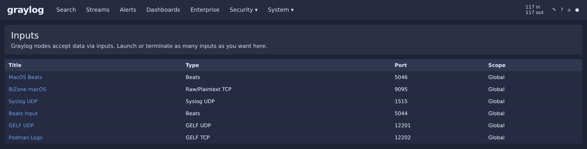
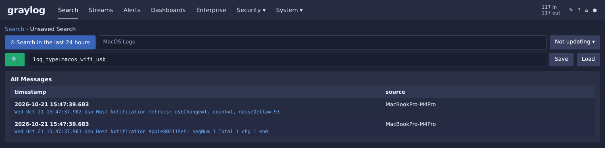

# macOS: unified log, Filebeat и osquery

> Сбор логов с macOS-хостов: unified logging, USB-события, снимки osquery и
> доставка через Filebeat в Graylog. Эта часть — расширение лаборатории на macOS;
> в базовых статьях она не описывалась, конфиги собраны в этом репозитории.

## Что собираем

| Источник | Что даёт | Инструмент |
|---|---|---|
| Unified logging | Системные события, ошибки ядра, TCC, AirDrop, USB | `log stream` + Filebeat |
| `wifi.log` | Подключение/отключение USB-устройств | Filebeat |
| osquery | Снимки состояния системы (процессы, порты, FIM) | osqueryd + Filebeat |
| `commands.log` | История команд терминала (кастомно) | zsh hook + Filebeat |

## Файлы в репозитории

| Файл | Назначение |
|---|---|
| [`filebeat.yml`](../macos/filebeat.yml) | Конфиг Filebeat (unified log, wifi.log, osquery) |
| [`co.elastic.filebeat.plist`](../macos/co.elastic.filebeat.plist) | LaunchDaemon для Filebeat |
| [`osquery.conf`](../macos/osquery.conf) | Конфиг osquery |
| [`com.user.logstream.plist`](../macos/com.user.logstream.plist) | LaunchDaemon для `log stream` (через wrapper) |
| [`zshrc.local`](../macos/zshrc.local) | Хук логирования команд |
| [`logstream/logstream-wrapper.sh`](../macos/logstream/logstream-wrapper.sh) | Обёртка: перезапуск `log stream` при ротации |
| [`logstream/unified.json.conf`](../macos/logstream/unified.json.conf) | Конфиг newsyslog для ротации |

## Установка

Все файлы лежат в каталоге [`macos/`](../macos/) репозитория. Перейди в него:

```bash
cd macos
```

### Filebeat

```bash
sudo cp filebeat.yml /usr/local/filebeat/filebeat.yml
# замени "YOUR GRAYLOG-SERVER IP:PORT" на адрес своего Graylog
sudo nano /usr/local/filebeat/filebeat.yml

sudo cp co.elastic.filebeat.plist /Library/LaunchDaemons/
sudo chown root:wheel /Library/LaunchDaemons/co.elastic.filebeat.plist
sudo chmod 644 /Library/LaunchDaemons/co.elastic.filebeat.plist
sudo launchctl load /Library/LaunchDaemons/co.elastic.filebeat.plist
```

### osquery

```bash
sudo cp osquery.conf /private/var/osquery/osquery.conf
sudo launchctl load /Library/LaunchDaemons/io.osquery.agent.plist
```

### Ротация unified.json.log

```bash
sudo cp logstream/logstream-wrapper.sh /usr/local/bin/
sudo chmod 755 /usr/local/bin/logstream-wrapper.sh
sudo cp logstream/unified.json.conf /etc/newsyslog.d/
sudo cp com.user.logstream.plist /Library/LaunchDaemons/
sudo chown root:wheel /Library/LaunchDaemons/com.user.logstream.plist
sudo chmod 644 /Library/LaunchDaemons/com.user.logstream.plist
sudo launchctl load /Library/LaunchDaemons/com.user.logstream.plist
```

### Логирование команд (опционально)

```bash
mkdir -p ~/.local/log
echo 'source ~/.zshrc.local' >> ~/.zshrc
cp zshrc.local ~/.zshrc.local
```

## Проверка

```bash
sudo launchctl list | grep filebeat          # Filebeat работает?
sudo ls -lah /var/log/unified.json.log       # log stream пишет?
sudo log show --predicate 'process == "filebeat"' --last 5m --info | \
  grep -iE "events.sent|connection"          # данные идут в Graylog?
```


*Inputs в Graylog: приёмники для macOS (MacOS Beats, порт 5046) и остальных источников (воссоздано по реальным данным лаборатории).*


*Поиск по wifi.log: события USB от Filebeat на MacBookPro-M4Pro (воссоздано по реальным данным лаборатории).*


## Важные замечания

- **`include_lines` в Filebeat — подстрочный поиск, не regex.** Не добавляй паттерны,
  которые матчатся у шумных процессов (например, `Sandbox` или `incorrect` — их
  генерирует Kaspersky).
- **`log stream` держит файл открытым**, поэтому нужен wrapper для ротации
  `unified.json.log`. Без него файл растёт до десятков ГБ.
- **Не дублируй `preexec`** в `.zshrc` — используй `add-zsh-hook`, иначе команды
  пишутся в `commands.log` дважды.

Подробнее — в [`docs/troubleshooting.md`](troubleshooting.md).

## Другой подход — BI.ZONE Triage

Кроме Filebeat/osquery, для macOS есть второй способ сбора телеметрии — через
BI.ZONE Triage (процессы, сеть, autoruns, baseline). О нём — отдельная глава:
[06-macos-bztriage.md](06-macos-bztriage.md).

## Алерты для macOS

Алерты для macOS строятся так же, как для Windows и Linux (см.
[02-streams-alerts.md](02-streams-alerts.md)): выбери поток с macOS-логами,
задай условие по структурированным полям (`log_type: macos_unified`,
`host`, `process`) и привяжи email-уведомление. Примеры полезных условий:

- `log_type: macos_unified AND message: "kernel panic"` — паника ядра;
- `log_type: macos_wifi_usb AND message: "USBDeviceInserted"` — новое USB-устройство;
- отсутствие логов от хоста за интервал — признак, что Mac выключен или потерял связь.

### Ещё 11 алертов по процессам (osquery Endpoint Security)

Определения лежат в [graylog/macos-event-definitions.json](../graylog/macos-event-definitions.json) (плейсхолдеры `<MACOS_STREAM_ID>` и `<NOTIFICATION_ID>` замените своими). Все запросы смотрят события `es_process_events` и поле командной строки `columns_cmdline`, а не общий `message`: в `message` лежит вся запись целиком, и совпадения ловятся на посторонних полях. Проверка на истории за 30 дней дала ноль срабатываний, кроме добавления корневого сертификата (2 раза, собственные команды) и scp на хост без точки в имени, который исключён условием.

| Алерт | Что ловит | MITRE | Приоритет |
|---|---|---|---|
| Установка или удаление профиля конфигурации | `profiles install`, `remove`, `-I`, `-R` | T1685 | 3 |
| Добавление корневого сертификата | `security add-trusted-cert`, `trust-settings-import` | T1553.004 | 2 |
| Элемент входа через sfltool или osascript | Login Items без plist | T1547.015 | 2 |
| Отключение межсетевого экрана | `socketfilterfw --set… off`, `pfctl -d/-F/-f/-e` | T1686 | 3 |
| Загрузка launchd-задания | `launchctl load/bootstrap/submit`, кроме Apple и своих служб | T1569.001 | 2 |
| Скачивание и запуск (curl \| sh) | `curl … \| sh`, `bash -c "$(curl …)"` | T1059.004 | 3 |
| Копирование данных браузера | `sqlite3`, `cp`, `tar` и др. с Login Data, Cookies, key4.db | T1555.003 | 3 |
| Очистка журналов | `log erase`, `rm` в /var/log, `killall syslogd` | T1070.002 | 3 |
| Передача данных наружу | `scp`, `rsync`, `nc`, `socat` на адрес вне частных сетей | T1048 | 2 |
| Подмена библиотек | `DYLD_INSERT_LIBRARIES` | T1574.006 | 3 |
| Изменение базы авторизации | `security authorizationdb` | T1548 | 3 |

Что не вошло. Разведка (`system_profiler`, `sw_vers`, `dscl . list`): за месяц около 126 тысяч событий от служебных скриптов под root, надёжного отсечения нет. Неудачный вход на экране блокировки: в unified log не нашлось подходящих событий.

Ограничения. Алерт про данные браузера видит только команды, чтение файлов самим процессом не видно. Запросы на `columns_env` работают, если osquery отдаёт переменные окружения процесса.
