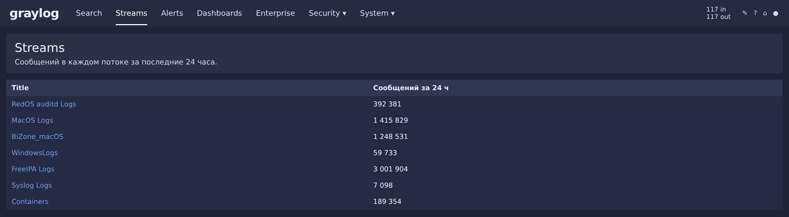
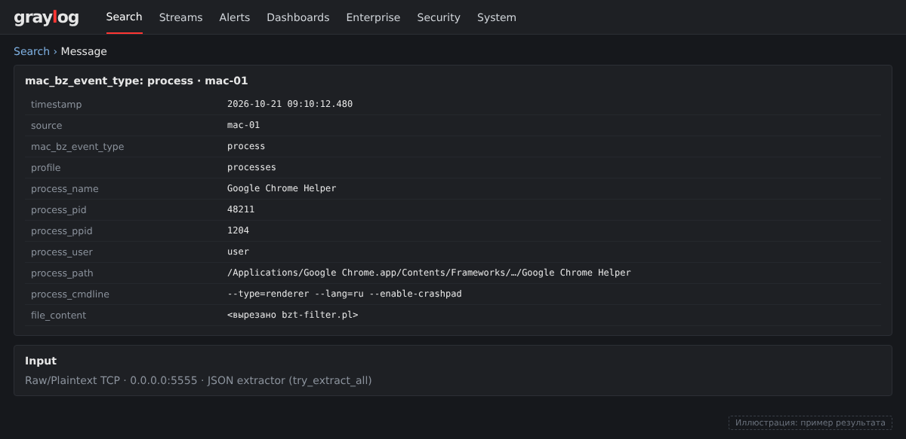

# macOS (2): телеметрия через BI.ZONE Triage

> Второй подход к сбору логов с macOS — лёгкий агент на базе
> [BI.ZONE Triage](https://bi.zone/): готовый коллектор, обёрнутый в три
> `launchd`-агента, шлёт телеметрию прямо в Graylog через `nc`.
>
> Это дополнение к [главе про Filebeat и osquery](05-macos.md) — два способа
> не заменяют, а дополняют друг друга: Filebeat/osquery покрывают unified log и
> системные события, Triage даёт глубокий снимок процессов, сети и persistence.

## Идея

Не пишем свой EDR-агент. Используем `bz_triage` как готовый коллектор и
оборачиваем его в три `launchd`-агента с разной частотой и разными наборами
профилей. Данные уходят напрямую в Graylog через `nc`, без промежуточных шипперов
(Filebeat/Logstash/Vector не нужны — меньше JVM/Python на хостах и меньше
поверхность атаки).

```text
┌──────────────────┐   JSON Lines      ┌───────────────┐
│ bz_triage        │ ──────────────>   │   Graylog     │
│ + bzt-filter.pl  │  Raw TCP :<порт>  │  Raw/Plaintext│
│ + nc             │                   │  + JSON       │
└──────────────────┘                   │  Extractor    │
```

## Три агента на каждом хосте

| Агент | Профили | Интервал | Зачем |
|-------|---------|----------|-------|
| `bzt-activity` | `hostinfo,netconn,processes,sessions,users` | 10 мин | Активность в реальном времени |
| `bzt-persistence` | `hostinfo,autoruns` | 30 мин | Мониторинг persistence-механизмов |
| `bzt-baseline` | `investigation` | раз в сутки, 03:00 | Полный снапшот для forensic |

Один агент с одним интервалом не подходит: интервал должен быть в 2–3 раза больше
времени сбора самого тяжёлого профиля (например, `autoruns` идёт 30–60 сек).
Разделив профили по частоте изменений, получаем независимые агенты, которые не
блокируют друг друга (у каждого свой per-profile lock).

## Файлы

Всё лежит в каталоге [`macos/bztriage/`](../macos/bztriage/) репозитория:

| Файл | Назначение |
|---|---|
| [`scripts/bzt-stream.sh`](../macos/bztriage/scripts/bzt-stream.sh) | запускает `bz_triage`, фильтрует и шлёт JSON в Graylog |
| [`scripts/bzt-filter.pl`](../macos/bztriage/scripts/bzt-filter.pl) | вырезает тяжёлые поля (`file_content`, YARA) до отправки |
| [`scripts/bzt-diagnose.sh`](../macos/bztriage/scripts/bzt-diagnose.sh) | диагностика агентов (exit 0/1/2) |
| [`scripts/ru.bi.zone.bzt-*.plist`](../macos/bztriage/scripts/) | три launchd-агента |
| [`docs/architecture.md`](../macos/bztriage/docs/architecture.md) | почему 3 агента, Calendar vs Interval |
| [`docs/fields.md`](../macos/bztriage/docs/fields.md) | какие поля отправляются |
| [`docs/graylog-setup.md`](../macos/bztriage/docs/graylog-setup.md) | настройка Graylog (heap, retention, Extractor) |
| [`docs/troubleshooting.md`](../macos/bztriage/docs/troubleshooting.md) | все грабли |

## Установка

Коротко (полная инструкция — в [`macos/bztriage/README.md`](../macos/bztriage/README.md)):

### 1. Бинарь

```bash
sudo mkdir -p /usr/local/bin
sudo cp bz_triage-<версия>-darwin-<arm64|amd64> /usr/local/bin/bz_triage
sudo chmod 755 /usr/local/bin/bz_triage
sudo xattr -d com.apple.quarantine /usr/local/bin/bz_triage 2>/dev/null || true
```

### 2. Скрипты

```bash
sudo cp scripts/bzt-stream.sh scripts/bzt-filter.pl scripts/bzt-diagnose.sh /usr/local/bin/
sudo chmod 755 /usr/local/bin/bzt-stream.sh /usr/local/bin/bzt-filter.pl /usr/local/bin/bzt-diagnose.sh
```

### 3. Адрес Graylog

Открой `/usr/local/bin/bzt-stream.sh` и укажи:

```bash
GRAYLOG_HOST="<IP-сервера Graylog>"
GRAYLOG_PORT="<порт-Input'а>"
```

### 4. Plist-ы

```bash
sudo cp scripts/ru.bi.zone.bzt-*.plist /Library/LaunchDaemons/
sudo chown root:wheel /Library/LaunchDaemons/ru.bi.zone.bzt-*.plist
sudo chmod 644 /Library/LaunchDaemons/ru.bi.zone.bzt-*.plist
```

> Минуты запуска в `activity` и `persistence` заданы для первого хоста
> (`:00/:05`). Для каждого следующего хоста сдвигай минуты в `StartCalendarInterval`
> на 2 — чтобы Mac'и не били в Graylog одновременно.

### 5. Загрузка агентов

```bash
for p in activity persistence baseline; do
    sudo launchctl bootout   system/ru.bi.zone.bzt-${p} 2>/dev/null
    sudo launchctl bootstrap system /Library/LaunchDaemons/ru.bi.zone.bzt-${p}.plist
done
sudo launchctl list | grep bzt
```

### 6. Диагностика

```bash
sudo /usr/local/bin/bzt-diagnose.sh
echo "EXIT=$?"
```


*Потоки лаборатории и число сообщений за 24 часа (BiZone_macOS — телеметрия Triage) (воссоздано по реальным данным лаборатории).*


## Настройка Graylog

На стороне сервера нужно:

1. **Input** `Raw/Plaintext TCP` (Bind address — `0.0.0.0`, не `127.0.0.1`).
2. **JSON Extractor** с `try_extract_all` — раскладывает сообщения на поля.
3. **Heap** ≥ 4 ГБ на OpenSearch и Graylog.
4. **Retention** — обязательно, иначе диск забьётся (~515 МБ/сутки на хост).
5. `http_publish_uri` (а не `publish_uri`) в `server.conf`.

Пошагово — в [`macos/bztriage/docs/graylog-setup.md`](../macos/bztriage/docs/graylog-setup.md).


*Сообщение BI.ZONE Triage в Graylog с извлечёнными полями (воссоздано по реальным данным лаборатории).*


## Что фильтруется на хосте

До отправки `bzt-filter.pl` вырезает тяжёлые поля:

| Поле | Почему |
|------|--------|
| `file_content` | первые байты бинарника, сотни байт на запись |
| `file_yara_scope` / `file_yara_status` / `file_yara_matches` | мусор, если YARA не используется |

## Ключевые грабли

- На macOS нет GNU `timeout` — не использовать в скриптах.
- `nc -w 180` вешает скрипт; правильно — `nc -G 5 -w 1`.
- `bootstrap` без `kickstart` не активирует `StartInterval` — поэтому
  `StartCalendarInterval` + `RunAtLoad=true`.
- Lock с PID-файлом (а не просто `mkdir`), иначе после SIGKILL агент
  навсегда останется «занятым».
- `bz_triage` оставляет `edr-data*` в `/tmp` — чистим через `find -mmin +10`.

Полный список — в [`macos/bztriage/docs/troubleshooting.md`](../macos/bztriage/docs/troubleshooting.md).

## Лицензия

Скрипты — GPL-3.0. Сам `bz_triage` — собственность BI.ZONE (бинарь сюда не кладём).
