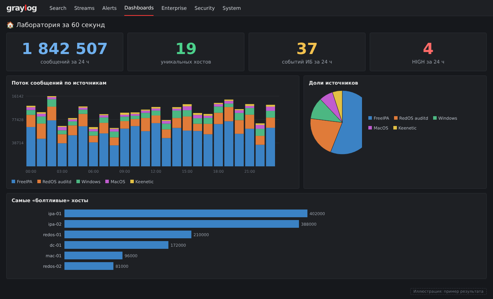
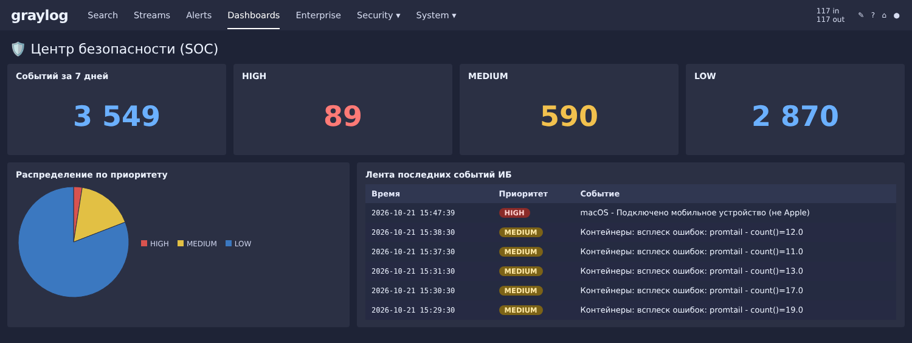

# Дашборды для доклада

> Семь дашбордов, собранных поверх уже готовых потоков и алертов. Задача —
> не «ещё одна таблица логов», а связный визуальный рассказ: от масштаба
> лаборатории к тому, как система сама находит угрозы, и к живым находкам
> в данных. Рассчитаны на **живую демонстрацию** в Graylog (проектор,
> автообновление, полный экран), а не на статичные скриншоты.

## Зачем отдельные дашборды под доклад

Операционные дашборды (по одному на источник) удобны в работе, но на слайде
таблица сообщений нечитаема. Для доклада нужны крупные цифры, графики и
понятный сюжет. Поэтому эти семь построены по принципу «KPI сверху →
графики в середине → ленты-таблицы внизу», с русскими заголовками и эмодзи.

## Семь дашбордов

| # | Дашборд | Для доклада |
|---|---------|-------------|
| 1 | 🏠 **Лаборатория за 60 секунд** | Титульный: масштаб лаборатории одним экраном |
| 2 | 🛡️ **Центр безопасности (SOC)** | Главный: система находит угрозы и сообщает |
| 3 | 🌐 **Сеть глазами Keenetic** | Детективная история про аномалии в сети |
| 4 | 🪟 **Контроллер домена** | Кто и как заходит в домен на самом деле |
| 5 | 🐧 **Linux: кто что запускает** | Жизнь серверов: команды, sudo, SELinux |
| 6 | 🍎 **macOS: приватность и периферия** | Кто просит доступ к камере, файлам, экрану |
| 7 | 🔐 **FreeIPA: аутентификация** | Объём логов и как его уменьшить вдвое |

### 1. 🏠 Лаборатория за 60 секунд

Обзор всей системы. Поток: `RedOS auditd`, `MacOS`, `BiZone_macOS`,
`Windows`, `Keenetic`, `FreeIPA` — все сразу.

- **KPI:** сообщений за 24 ч · уникальных хостов · событий ИБ за 24 ч · HIGH за 24 ч
- Поток сообщений по источникам (столбцы, с накоплением)
- Доли источников (круговая)
- Самые «болтливые» хосты (бар)

На этом дашборде сразу видно, что FreeIPA даёт больше половины всего потока —
удобная завязка для разговора про объём логирования.

*Дашборд «Лаборатория за 60 секунд» (воссоздано по реальным данным лаборатории).*

### 2. 🛡️ Центр безопасности (SOC)

Центральный дашборд. Источник — поток событий (`All events`), куда пишут
все 63 алерта. Приоритет в событиях хранится числом: **3 = HIGH, 2 = MEDIUM, 1 = LOW**.

- **KPI:** событий за 7 дней · HIGH · MEDIUM · LOW
- Алерты во времени по приоритету (столбцы с накоплением)
- Распределение по приоритету (круговая)
- Хосты с наибольшим числом событий (бар)
- Лента последних событий ИБ (таблица: время, приоритет, хост, правило, сообщение)

*Дашборд «Центр безопасности (SOC)» (воссоздано по реальным данным лаборатории).*

### 3. 🌐 Сеть глазами Keenetic

Логи домашнего роутера. Поток `Keenetic` (syslog).

- **KPI:** событий за 7 дней · конфликтов ARP · WireGuard отказов · WireGuard успешно
- Активность роутера по типам (столбцы)
- Типы событий (круговая)
- Конфликты ARP по IP (бар)
- Активность WireGuard и SSH (таблица)

Контраст «отказов WireGuard против успешных» — наглядная аномалия для доклада.

### 4. 🪟 Контроллер домена: кто и как заходит

Доступ к Windows-DC и активность процессов. Поток `Windows` (Sysmon + Security).

- **KPI:** событий за 24 ч · сетевых соединений · запусков процессов · успешных входов
- Тепловая карта **порт × хост** (видно RDP 3389, SSH 22, WinRM 5985)
- Топ DNS-запросов (бар)
- Входы по типам LogonType (круговая)
- Активность по журналам/каналам (столбцы)
- Создание процессов (таблица: хост, пользователь, образ, командная строка)

### 5. 🐧 Linux: кто что запускает

auditd с РЕД ОС. Поток `RedOS auditd`.

- **KPI:** событий auditd за 24 ч · EXECVE · sudo · отказов SELinux
- Активность по хостам во времени (столбцы)
- Топ команд `a0` (бар)
- Типы аудита (круговая)
- Категории правил (`key` из набора auditd: разведка, susp_activity, perm_mod…)
- Запуски sudo (таблица)

### 6. 🍎 macOS: приватность и периферия

osquery Endpoint Security и unified log. Поток `MacOS`.

- **KPI:** событий за 24 ч · запусков процессов · обращений к TCC · USB/AirDrop
- Категории запросов TCC (круговая)
- Топ запускаемых программ (бар)
- Активность по типам логов (столбцы)
- Топ процессов unified log (бар)
- Запуск программ через Endpoint Security (таблица)

### 7. 🔐 FreeIPA: аутентификация в домене

Самый объёмный источник. Поток `FreeIPA`.

- **KPI:** сообщений за 24 ч · Kerberos (krb5kdc) · LDAP-доступ (389) · SSSD
- Доли подсистем (круговая)
- Активность по подсистемам во времени (столбцы)
- Объём по подсистемам (бар)
- Журнал безопасности (таблица)

Основной объём — служебный шум `sssd`. Хороший повод показать, как чистят
логирование и экономят место в индексе.

## Дополнительные дашборды для работы

Семь дашбордов выше построены под доклад. Шесть следующих нужны в повседневной работе: они
отвечают на вопросы «что шумит», «доходят ли логи», «кто ломится». Собраны через API
Graylog тем же способом, что и в [главе 9](09-containers-dashboards.md): поиск
(`/api/views/search`), затем view типа `DASHBOARD` с виджетами и `widget_mapping`.

| # | Дашборд | Поток | Окно | Что показывает |
|---|---------|-------|------|----------------|
| 8 | 🔥 **Детекты: кто шумит** | All events | 7 дней | Топ правил и объектов срабатываний, приоритеты по времени, последние события. Нужен для подбора порогов |
| 9 | 🩺 **Здоровье сбора логов** | все потоки | 24 часа | Объём по входам и потокам, число источников, таблица «последнее сообщение от каждого источника» (самые тихие сверху) |
| 10 | 🚨 **Кто ломится: неудачные входы** | Windows, RedOS, FreeIPA, Syslog, Containers, BiZone | 7 дней | Неудачная аутентификация со всех источников на одной странице |
| 11 | 🌐 **Сеть и устройства (Keenetic + netalertx)** | Syslog, Containers | 24 часа и 7 дней | Роутер и сканер сети вместе: ARP-конфликты, WireGuard, Wi-Fi, результаты сканов netalertx |
| 12 | 📦 **Контейнеры: доставка логов** | Containers | 24 часа | Ошибки promtail → Loki по хостам и времени, ошибки Loki, объём логов по хостам |
| 13 | 📅 **Недельный обзор** | All events и все потоки | 30 и 7 дней | События ИБ по дням и приоритетам, топ правил, объём логов по дням и потокам |

### Детали

- **Детекты: кто шумит.** Правила в событиях хранятся по `event_definition_id`, а не по
  названию, поэтому на дашборде внизу лежит текстовый виджет «Справочник правил» (id → название).
  Справочник составляется в момент создания и не обновляется сам: после добавления правил
  обнови его вручную.
- **Здоровье сбора логов.** Входы и потоки в графиках показываются идентификаторами, для них
  есть текстовый справочник. Таблица «последнее сообщение» считает `latest(timestamp)` по полю
  `source` и сортируется по возрастанию: хост, который перестал присылать логи, оказывается
  первым.
- **Кто ломится.** Запросы взяты из правил детектирования: Windows `4625`, Linux SSH и
  неудачный `sudo`, FreeIPA `PREAUTH_FAILED`, WireGuard на Keenetic, Grafana и macOS Triage
  (`LogonHistoryFailure`). Общий график строится по объединённому запросу: поля у источников
  разные, поэтому условия друг другу не мешают.
- **Сеть и устройства.** Сканер netalertx на каждом сканировании пишет строку
  `New Devices: N`; виджет показывает именно эти строки.
- **Недельный обзор.** История событий в индексе `gl-events` ограничена сроком хранения:
  если событий меньше, чем за 30 дней, значения будут за доступный период.

> Все названия полей (`kn_event_type`, `winlogbeat_event_code`, `gl2_source_input`,
> `container_name`, `loglevel`) зависят от твоих пайплайнов и extractor-ов, как и в первых
> семи дашбордах.

### Остальные дашборды

Кроме перечисленных, в Graylog есть рабочие дашборды по источникам. У каждого есть значок и
описание в списке дашбордов:

| Дашборд | Что показывает |
|---|---|
| 🍎 macOS: журналы Unified и osquery | Сбои, ошибки, TCC и события безопасности macOS |
| 🛡️ macOS: BI.ZONE Triage | Процессы, пользователи, неподписанные файлы, подозрительные команды |
| 🪟 Windows: Sysmon и события входа | Процессы, входы, реестр, загрузка DLL |
| 🐧 РЕД ОС: auditd | Команды, сервисы, сессии, типы аудита |
| 📡 Keenetic: журналы роутера | ARP-конфликты, SSH, Wi-Fi и WireGuard в деталях |
| 📦 Контейнеры, 🔧 диагностика, ⚙️ процессы | Три дашборда из [главы 9](09-containers-dashboards.md) |
| 📊 Общий базовый дашборд | Все источники: объём по входам, потокам и узлам |

## Дашборды в репозитории

Все 22 дашборда описаны в [`graylog/dashboards-spec.json`](../graylog/dashboards-spec.json) (потоки по названию,
не по ID). Скрипт [`graylog/import-dashboards.js`](../graylog/import-dashboards.js) создаёт их через API: вставь
его в консоль браузера на странице Graylog и вызови `await importDashboards(SPEC, {dryRun: true})`, затем без
`dryRun`. Если хочешь собрать руками, смотри [главу 10](10-dashboards-manual.md): там по каждому виджету
расписано, что выбрать в редакторе.

## Как это устроено

Каждый дашборд — это Graylog View (`DASHBOARD`) с одной страницей. Все виджеты
стандартные, без плагинов:

- **числовые плитки** (KPI) — `aggregation` с визуализацией `numeric`;
- **круговые / бары / столбцы во времени** — `aggregation` с пивотами по
  значению (`values`) и по времени (`time`);
- **тепловая карта** — `aggregation` с двумя пивотами (строки × колонки);
- **ленты** — виджет `messages` с выбранными полями.

События алертов лежат в отдельном индексе `gl-events`, поэтому дашборд SOC
привязан к потоку `All events` (а не к потокам источников).

## Живая демонстрация

| Что | Как |
|-----|-----|
| **Автообновление** | Вверху справа «Not updating» → интервал 5–10 сек. Цифры и графики двигаются на глазах. |
| **Период** | Слева вверху «No Override» → окно (сутки / 7 дней). Меняется на лету. |
| **Полный экран** | Кнопка «…» → Fullscreen. Убирает меню — чисто для проектора. |
| **Порядок показа** | 1 → 2 → 3: масштаб → система ловит угрозы → живая находка. |
| **Провалиться в деталь** | Клик по сегменту/строке виджета открывает поиск с этим фильтром. |

## Перенос на другой сервер

Дашборды ссылаются на потоки по их **ID**, а ID на другом сервере будут иными.
При переносе (через экспорт View или content pack) после импорта нужно
переоткрыть каждый виджет и указать свои потоки. Названия полей (`win_event_id`,
`audit_type`, `kn_event_type`, `mac_bz_event_type`, `application_name`,
`columns_path` и т.д.) зависят от твоих пайплайнов и агентов — сверь их со
своими.

---

Главы: [Потоки и алерты](02-streams-alerts.md) ·
[Windows](03-windows.md) · [Linux](04-linux.md) · [macOS](05-macos.md) ·
[BI.ZONE Triage](06-macos-bztriage.md) · [Troubleshooting](troubleshooting.md)
