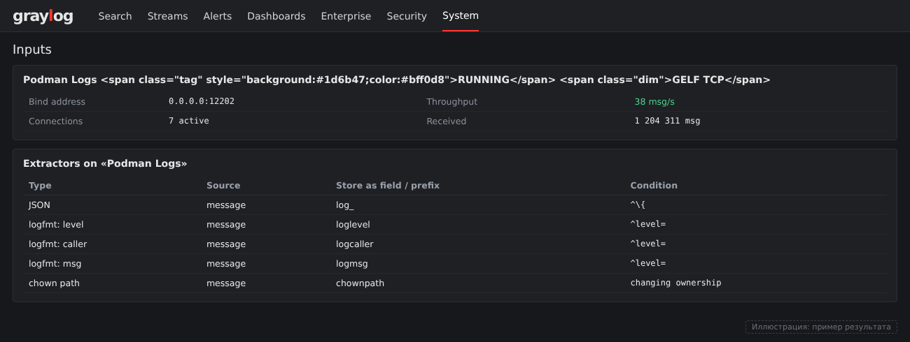
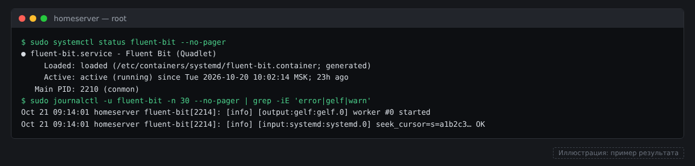
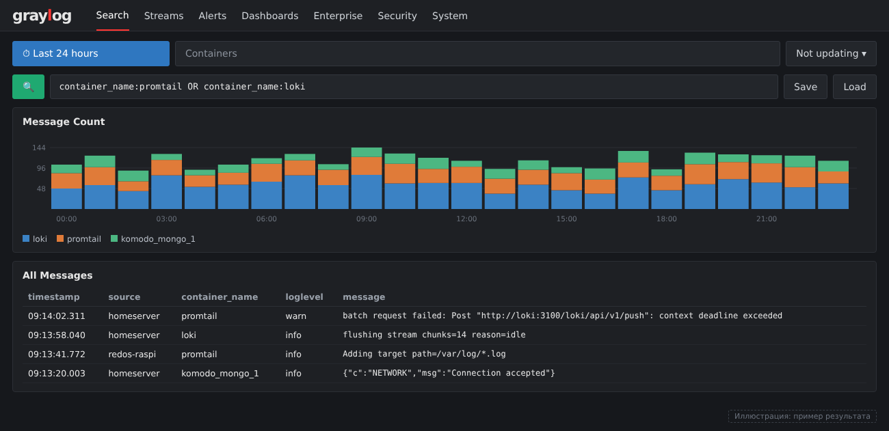

# Часть 8. Контейнеры: логи Podman в Graylog

В этой части собираем логи всех контейнеров домашней лаборатории: агент Fluent Bit на каждом
хосте читает journald и отправляет записи контейнеров в Graylog. Дальше логи разбираем
(JSON, logfmt, ошибки) и выводим в поиски и дашборды.

## Что получилось в итоге

- Сбор на 7 хостах: два на x86_64 и пять на aarch64 (РЕД ОС, Podman 5.x, `events_logger=journald`).
- Один и тот же образ и один и тот же конфиг на всех хостах: образ Fluent Bit собирается под amd64 и arm64.
- Поток **Containers** (только записи с полем `CONTAINER_NAME`).
- Разбор JSON от MongoDB, logfmt от loki и promtail, ошибок `chown` от MariaDB.
- Saved Searches для типовых запросов.

Открытые вопросы в конце главы.

## Как устроено

```
[хост, Podman]                      [Graylog]
 journald (контейнеры)              input "Podman Logs" (GELF TCP, 12202)
   │                                  │
   └─► Fluent Bit (Quadlet) ──────────┘ поток "Containers" (CONTAINER_NAME есть)
       grep CONTAINER_NAME              │
                                        ├─ extractor JSON (только строки от { )
                                        ├─ extractor logfmt (строки level=)
                                        ├─ extractor chown (строки changing ownership)
                                        └─ pipeline "Container logs" (normalize)
```

Почему Fluent Bit, а не Graylog Collector или rsyslog: один образ работает на обеих
архитектурах, а поля journald (`CONTAINER_NAME`, `CONTAINER_ID`, `PRIORITY`) уходят в
Graylog без дополнительного парсинга.

Почему системный Quadlet, а не пользовательский: rootless-контейнеры пишут журнал в
пользовательский journal. Системный сервис с правами root видит и системный, и
пользовательский журнал.

## Шаг 1. Graylog: input и поток

1. **System → Inputs → GELF TCP**, порт `12202`. Тип именно TCP: UDP теряет записи при нагрузке.
2. На сервере Graylog открыть порт в firewalld:
   ```bash
   sudo firewall-cmd --permanent --add-port=12202/tcp && sudo firewall-cmd --reload
   ```
3. **Streams → Create stream**: название `Containers`, index set по умолчанию.
   Правило: поле `CONTAINER_NAME`, тип **field presence**, must match.
   Галочку «Remove matches from Default Stream» не ставим, чтобы логи оставались и в Default.


*Input «Podman Logs» и его extractor-ы (иллюстрация, пример результата).*


## Шаг 2. Fluent Bit на хосте

Файлы лежат в [`containers/`](../containers/):
[`fluent-bit.container`](../containers/fluent-bit.container) и
[`fluent-bit.conf.example`](../containers/fluent-bit.conf.example).

```bash
sudo mkdir -p /etc/fluent-bit /var/lib/fluent-bit
sudo cp containers/fluent-bit.conf.example /etc/fluent-bit/fluent-bit.conf   # впиши адрес Graylog
sudo cp containers/fluent-bit.container /etc/containers/systemd/fluent-bit.container
sudo systemctl daemon-reload && sudo systemctl start fluent-bit
sudo systemctl status fluent-bit --no-pager
sudo journalctl -u fluent-bit -n 30 --no-pager | grep -iE 'error|gelf|warn'
```

Проверка в Graylog: в поиске по потоку `Containers` должны появиться записи, у которых есть
`CONTAINER_NAME` и `source` = имя хоста. Счётчик на странице Inputs у input-а «Podman Logs»
показывает поток в msg/s.

Для нового хоста сначала выполни:

```bash
ls -d /var/log/journal || echo "volatile: используй /run/log/journal"
```

Если каталога `/var/log/journal` нет, в Quadlet убери его монтирование, а в конфиге замени
`Path /var/log/journal` на `Path /run/log/journal`. Подробнее: troubleshooting, раздел 15.

Если Fluent Bit пишет `could not open the Journal: Permission denied` и систему включён SELinux,
добавь в `[Container]` строку `SecurityLabelDisable=true` и перезапусти сервис.
Подробнее: troubleshooting, раздел 14.


*Fluent Bit на хосте: сервис запущен, GELF-вывод работает (иллюстрация, пример результата).*


## Шаг 3. Разбор сообщений

Все extractor-ы создаются на input **Podman Logs** (**System → Inputs → Podman Logs → Manage extractors**).
Pipeline на разбор не полагаемся: в нашем стенде правила pipeline не сохраняли поля (см. «Открытые вопросы»).

### JSON из message

Для логов в формате JSON (MongoDB в контейнере komodo):

- Тип: **JSON**, source field: `message`, префикс `log_`, flatten: on.
- **Условие: regex `^\{`**. Без условия extractor падает на строках, которые JSON не являются,
  и пишет `gl2_processing_error`. Подробнее: troubleshooting, раздел 16.

Получаем поля `log_s` (уровень), `log_c` (компонент), `log_msg`, `log_ctx`, `log_id`, `log_t`, `log_attr`.

### logfmt (loki, promtail)

Строки вида `level=warn ts=... caller=... msg="..."`. Четыре extractor-а: два Regex
(уровень, компонент) и один Regex для `msg="..."`, у каждого условие `^level=`:

| Поле | Regex |
|---|---|
| `loglevel` | `^level=(?<loglevel>\w+)` |
| `logcaller` | `caller=(?<logcaller>[^ ]+)` |
| `logmsg` | `msg="(?<logmsg>[^"]*)"` |

Имена групп только из латинских букв и цифр: Java не принимает `_` в именах групп.
Подробнее: troubleshooting, раздел 17.

### Ошибки chown (MariaDB в контейнере observiumdb)

Regex extractor, условие `changing ownership`, regex:
`changing ownership of '(?<chownpath>[^']+)'`.

Поле `chownpath` позволяет считать, на каких файлах повторяется ошибка.

### Pipeline «Container logs»

Один rule в stage 0: `containers: normalize fields`. Копирует `CONTAINER_NAME` в `container_name`
и `IMAGE_NAME` в `image_name`. Поле `IMAGE_NAME` в journal Podman не приходит, поэтому
`image_name` остаётся пустым: для таблиц используем `container_name` и `source`.

## Шаг 4. Saved Searches и дашборд

Saved Searches на потоке **Containers**, окно 24 часа:

| Название | Запрос |
|---|---|
| Контейнеры: все | `*` |
| Контейнеры: ошибки | `level:3` |
| Контейнеры: observiumdb | `container_name:observiumdb` |
| Контейнеры: MongoDB | `container_name:komodo_mongo_1` |
| Контейнеры: promtail и loki | `container_name:promtail OR container_name:loki` |

Дашборд «Контейнеры»: Bar chart по `container_name`, Area chart по времени с разбивкой по
`container_name`, Pie по `source` для `level:3`, таблица последних сообщений с полями
`timestamp`, `source`, `container_name`, `log_s`, `log_msg`.


*Поиск по потоку Containers: promtail и loki (иллюстрация, пример результата).*


## Открытые вопросы

- **Правила pipeline для logfmt и тегов не применяют поля.** Обработка идёт (есть время
  обработки), но `kv_*` и `event_kind` не появляются. Extractor-ы выполняют ту же задачу,
  поэтому pipeline пока не используем. Причину ищем через симулятор pipeline в UI.
- **`image_name` пустой**: в journal Podman нет `IMAGE_NAME`.
- **Event Definitions по контейнерам ещё не созданы**: контейнер упал (`died`), OOM,
  массовый рестарт, `exec` в контейнер, запуск привилегированного контейнера. Для `exec` и
  `privileged` нужно проверить, что события Podman попадают в journal (`events_logger=journald`
  уже есть на всех хостах).

## Дальше

- Event Definitions по контейнерам (см. список выше).
- Разбор логов `netalertx` (вывод сканирования идёт построчно, каждая строка — отдельная запись).
- Пересборка образа Observium на arm64 по результатам диагностики (см. `docker-observium-arm64`).
