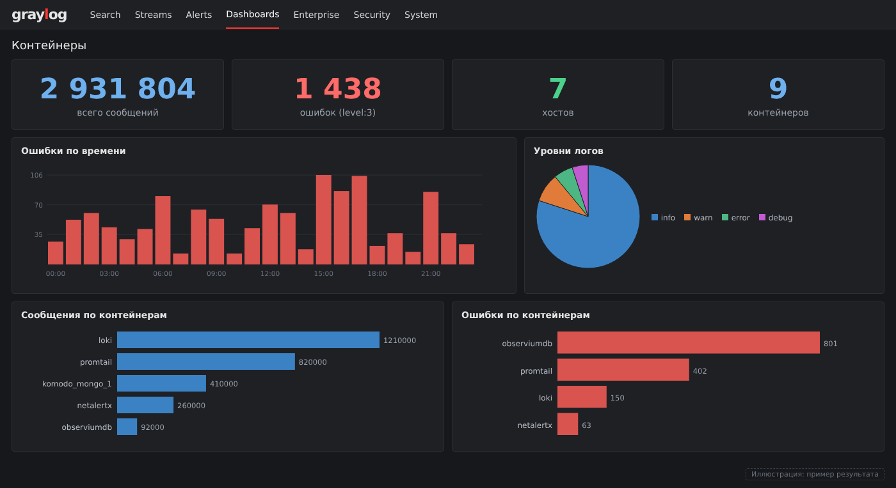
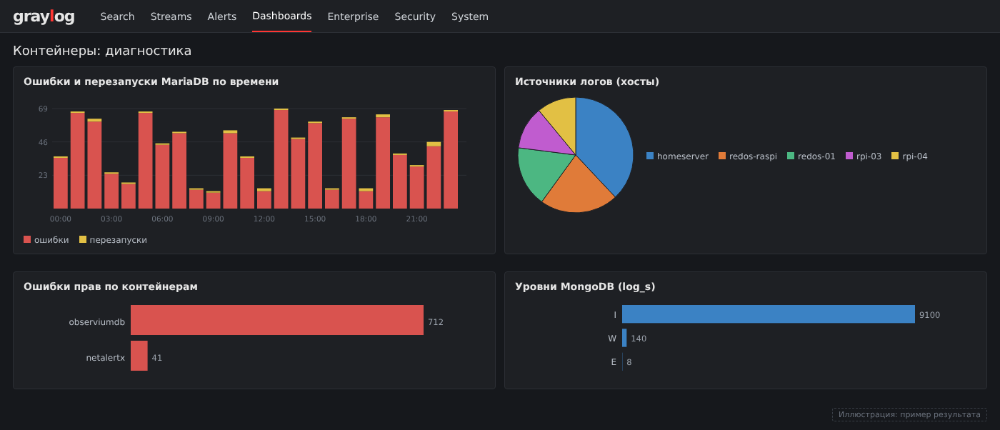
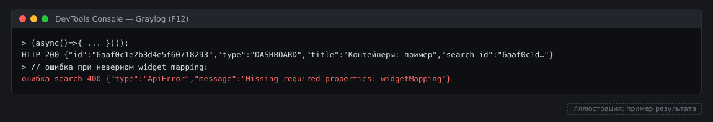
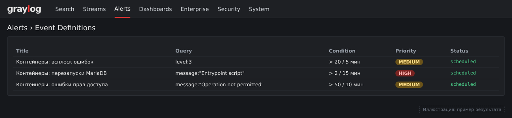

# Часть 9. Контейнеры: дашборды, поиски и события в Graylog

В части 8 логи контейнеров попадают в поток **Containers** и разбираются extractor-ами.
Здесь — что строим поверх потока: три дашборда, сохранённые поиски и пороговые события.

Дашборды создавались не кликами, а через API Graylog 7.2: скриптом из консоли браузера,
под своей сессией администратора. Так структура объектов фиксируется в коде, а повторить
или поправить сборку можно за один запуск. Тот же результат получается и через интерфейс,
просто медленнее.

## Что получилось

| Объект | Тип | Что показывает |
|---|---|---|
| **Контейнеры** | Дашборд, 7 виджетов | Всего сообщений и ошибок, уровни логов, активность по времени, сообщения и ошибки по контейнерам, таблица «контейнер × уровень» |
| **Контейнеры: диагностика** | Дашборд, 6 виджетов | Ошибки и перезапуски MariaDB по времени, ошибки прав по контейнерам, источники логов (хосты), уровни MongoDB, уровни Loki и Promtail |
| **Контейнеры: процессы** | Дашборд, 6 виджетов | Готовность и остановки MariaDB, компоненты MongoDB, подключения без авторизации, компоненты Loki, активность `observiumapp` |
| Контейнеры: observiumdb, MongoDB, promtail и loki | Сохранённые поиски | Просмотр логов одного сервиса |
| Контейнеры: всплеск ошибок, перезапуски MariaDB, ошибки прав доступа | Event Definitions | Пороговые события по потоку, без уведомлений (см. «Открытые вопросы») |

Виджеты MariaDB и `observiumapp` в «процессах» и часть «диагностики» остаются пустыми,
пока сервисы не запущены: это ожидаемо.


*Дашборд «Контейнеры» (иллюстрация, пример результата).*


*Дашборд «Контейнеры: диагностика» (иллюстрация, пример результата).*


## Как устроен дашборд в Graylog 7.2

Дашборд — это view типа `DASHBOARD`. Он ссылается на поисковый запрос (`search_id`), а
поисковый запрос хранит типы поиска (`search_types`), по которым Graylog считает данные.
Состояние дашборда лежит в `state[queryId]`:

```
search   (POST /api/views/search)
  queries[0].search_types[]      один тип pivot на каждый виджет
view     (POST /api/views, type=DASHBOARD)
  search_id                      ссылка на поиск
  state[queryId]
    widgets[]                    визуализация: config.visualization, row_pivots, series
    titles.widget                название виджета по его id
    positions                    col, row, width, height (сетка 12 колонок)
    widget_mapping               id виджета -> [id типа поиска]
```

Без `widget_mapping` виджеты создаются, но пустые: Graylog не знает, какой поиск для них
выполнять. Это была первая ошибка при сборке.

## Ошибки API, которые пришлось обойти

Graylog 7.2 строго проверяет поля, поэтому список полезен при любой сборке через API.

| Ответ сервера | Что сделать |
|---|---|
| `entity cannot be null` | Тело оборачивается: `{"entity": {...}}`. Касается `/api/views` и `/api/events/definitions` |
| `Unable to map property requires` | Поле `requires` есть у дашборда, у поиска (`/api/views/search`) его быть не должно |
| `Unable to map property name` в виджете | Название задаётся в `state.titles.widget[id]`, а не в самом виджете |
| `Unable to map property sort` в значениях | У pivot по значениям допустимы только `limit` и `skip_empty_values` |
| `Missing required properties: widgetMapping` | Ключ называется `widget_mapping` (с подчёркиванием) |
| Виджеты создались, но пустые | `widget_mapping` пустой или не ссылается на типы поиска |
| `copy is not defined`, буфер обмена недоступен | В Firefox и Yandex Browser нет `copy()`, а `navigator.clipboard` может быть запрещён. Результат выводим в `textarea` поверх страницы и копируем вручную |

Для отладки удобнее всего `GET /api/views?page=1&per_page=5`: там видна точная структура
существующего дашборда, включая `state`, `titles` и `positions`.

## Шаблон скрипта дашборда

Скрипт запускается в консоли (F12) открытой страницы Graylog. Замени `<stream-id>` на id
потока **Containers** (его видно в адресе страницы потока). Ниже шаблон с тремя виджетами;
остальные виджеты добавляются строками в `defs`.

```javascript
(async()=>{
const h={'Accept':'application/json','Content-Type':'application/json','X-Requested-By':'graylog-web-interface'};
const STREAM='<stream-id>';
const qid=crypto.randomUUID();
const tr={type:'relative',from:86400};
const cnt=[{type:'count',id:'count()',field:null}];
const val=(f,n)=>({type:'values',fields:[f],limit:n||15,skip_empty_values:true});
const time={type:'time',fields:['timestamp'],interval:{type:'auto',scaling:1.0}};
// n — номер виджета, r/c — строка и колонка, w/hh — ширина и высота в сетке 12 колонок,
// v — тип визуализации (numeric, pie, area, bar, table), g — группировка, q — запрос виджета
const defs=[
{n:1,t:'Ошибки по времени',r:1,c:1,w:6,hh:4,v:'area',g:[time],q:'level:3'},
{n:2,t:'Ошибки по контейнерам',r:5,c:1,w:6,hh:5,v:'bar',g:[val('container_name')],q:'level:3'},
{n:3,t:'Уровни логов',r:5,c:7,w:6,hh:5,v:'pie',g:[val('level',10)],q:''}
];
const wid=d=>'55555555-0000-4000-8000-00000000000'+d.n;
const sid=d=>'66666666-0000-4000-8000-00000000000'+d.n;
const search_types=defs.map(d=>({type:'pivot',id:sid(d),name:null,timerange:null,query:d.q?{type:'elasticsearch',query_string:d.q}:null,streams:[],stream_categories:[],filter:null,filters:[],series:cnt,sort:[],rollup:true,row_groups:d.g,column_groups:[]}));
const sr=await fetch('/api/views/search',{method:'POST',headers:h,body:JSON.stringify({queries:[{id:qid,timerange:tr,query:{type:'elasticsearch',query_string:''},filter:{type:'or',filters:[{type:'stream',id:STREAM}]},filters:[],search_types}],parameters:[],skip_no_streams_check:false})});
const search=await sr.json();
if(!sr.ok){console.log('ошибка search',sr.status,JSON.stringify(search));return;}
const pos={},titles={widget:{}},widget_mapping={};
const ws=defs.map(d=>{
pos[wid(d)]={col:d.c,row:d.r,width:d.w,height:d.hh};
titles.widget[wid(d)]=d.t;
widget_mapping[wid(d)]=[sid(d)];
return {id:wid(d),type:'aggregation',filter:null,filters:[],timerange:tr,query:{type:'elasticsearch',query_string:''},streams:[STREAM],stream_categories:[],config:{row_pivots:d.g.map(g=>({type:g.type,fields:g.fields,config:g.type==='time'?{interval:g.interval}:{limit:g.limit,skip_empty_values:true}})),units:{},column_pivots:[],series:[{function:'count()',config:{name:null,thresholds:[]}}],sort:[],visualization:d.v,rollup:true,row_limit:null,column_limit:null},description:null,context:null};
});
const view={type:'DASHBOARD',title:'Контейнеры: пример',summary:'Пример дашборда',description:'',search_id:search.id,properties:[],requires:{},state:{[qid]:{selected_fields:null,titles,widgets:ws,positions:pos,widget_mapping,formatting:null,display_mode_settings:{positions:{}}}}};
const vr=await fetch('/api/views',{method:'POST',headers:h,body:JSON.stringify({entity:view})});
console.log('HTTP',vr.status,(await vr.text()).slice(0,300));
})();
```

Результат смотрим в ответе консоли. `HTTP 200` — дашборд создан; проверка — на странице **Dashboards**.


*Результат запуска скрипта в консоли браузера (иллюстрация, пример результата).*


## Сохранённые поиски

Сохранённый поиск — тот же view, но типа `SEARCH`, без виджетов. Создаётся в два запроса:
сначала `POST /api/views/search` с одним запросом и типом `messages`, затем
`POST /api/views` с телом `{"entity": {"type": "SEARCH", "title": "...", "search_id": ..., "state": {...}}}`.
Запросы для наших пяти поисков из части 8 — в таблице там же.

## События (Event Definitions)

Пороговое событие: счётчик сообщений по запросу, сгруппированный по контейнеру, сравнивается
с порогом за окно времени. Тело запроса — `POST /api/events/definitions?schedule=true`
с обёрткой `{"entity": ...}`:

```javascript
const def=(title,description,query,threshold,windowMin,priority)=>({
title,description,priority,alert:true,
config:{type:'aggregation-v1',query,query_parameters:[],streams:[STREAM],group_by:['container_name'],
  series:[{id:'count-000',type:'count',field:null}],
  conditions:{expression:{expr:'>',left:{expr:'number-ref',ref:'count-000'},right:{expr:'number',value:threshold}}},
  search_within_ms:windowMin*60000,execute_every_ms:60000},
field_spec:{},key_spec:[],notification_settings:{grace_period_ms:0,backlog_size:0},notifications:[],storage:[]
});
```

Созданы три:

| Событие | Запрос | Порог | Окно | Приоритет |
|---|---|---|---|---|
| Всплеск ошибок | `level:3` | больше 20 | 5 минут | 2 |
| Перезапуски MariaDB | `message:"Entrypoint script"` | больше 2 | 15 минут | 3 |
| Ошибки прав доступа | `message:"Operation not permitted"` | больше 50 | 10 минут | 2 |

Событие «Перезапуски MariaDB» опирается на то, что entrypoint образа MariaDB печатает строку
при каждом старте контейнера: три старта за 15 минут означают цикл перезапусков.


*Event Definitions по контейнерам (иллюстрация, пример результата).*


## Проверка

1. **Dashboards**: у каждого дашборда виджеты показывают данные за последние сутки.
2. **Event Definitions**: все три события в состоянии «scheduled», после срабатывания появляются в **Events**.
3. Если виджет пустой, открой его редактор: какой запрос и поле в нём стоят. Чаще всего
   причина в имени поля, которое Graylog не извлёк (см. «Открытые вопросы»).

## Открытые вопросы

- **Уведомления по событиям не подключены.** Пороги подбираем по факту, а почта подключается
  отдельно через объекты уведомлений и SMTP-сервер Graylog.
- **События Podman не попадают в поток.** Fluent Bit собирает только записи контейнеров
  (`CONTAINER_NAME`). Смерть контейнера (`died`), OOM, `exec` и запуск привилегированного
  контейнера приходят в journal как события Podman без `CONTAINER_NAME`. Чтобы их видеть,
  нужен второй фильтр в Fluent Bit по `SYSLOG_IDENTIFIER=podman` на каждом хосте.
- **Имена полей из JSON-экстрактора.** Виджеты «подключения без авторизации» и «уровни
  MongoDB» используют поля `log_attr_client` и `log_s`, которые появились от префикса
  `log_` и `flatten`. Если виджет пустой, проверь имя поля в одном сообщении.
- **Дубликаты дашбордов** при отладке можно удалить через интерфейс: в списке дашбордов
  меню «More» → Delete.

## Дальше

- Уведомления по событиям: почта на адрес администратора, с ограничением частоты.
- Фильтр событий Podman в Fluent Bit (см. «Открытые вопросы»).
- Разбор вывода сканирования `netalertx` (строки приходят отдельными записями).
