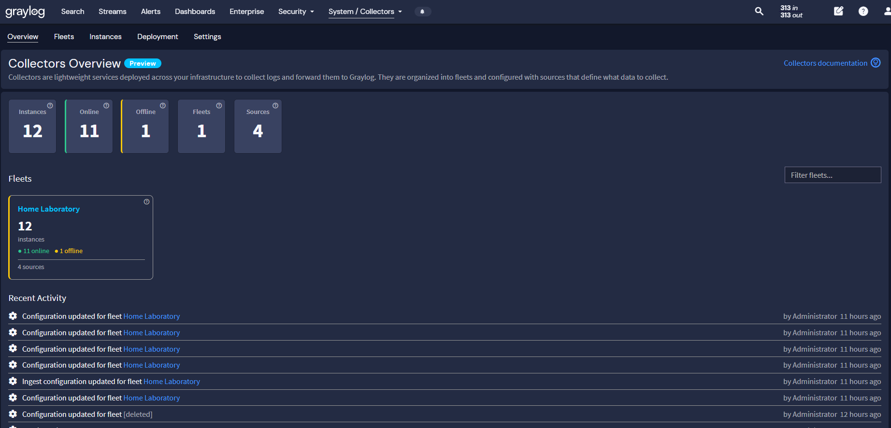
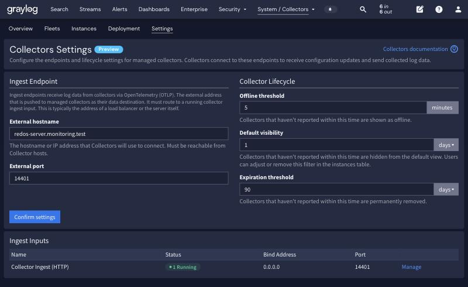
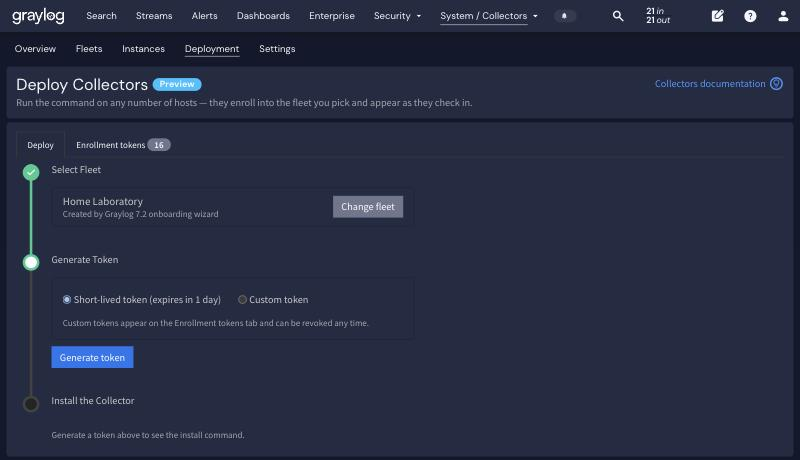
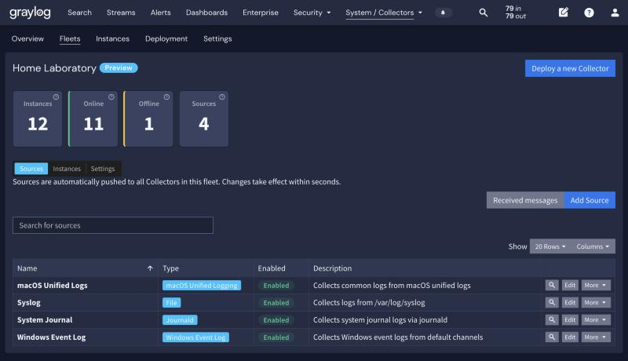
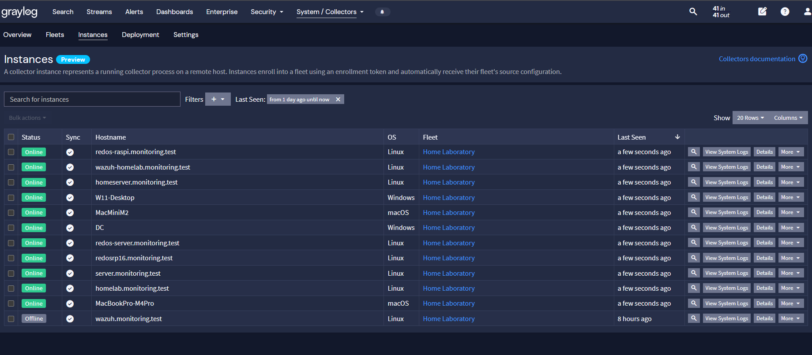
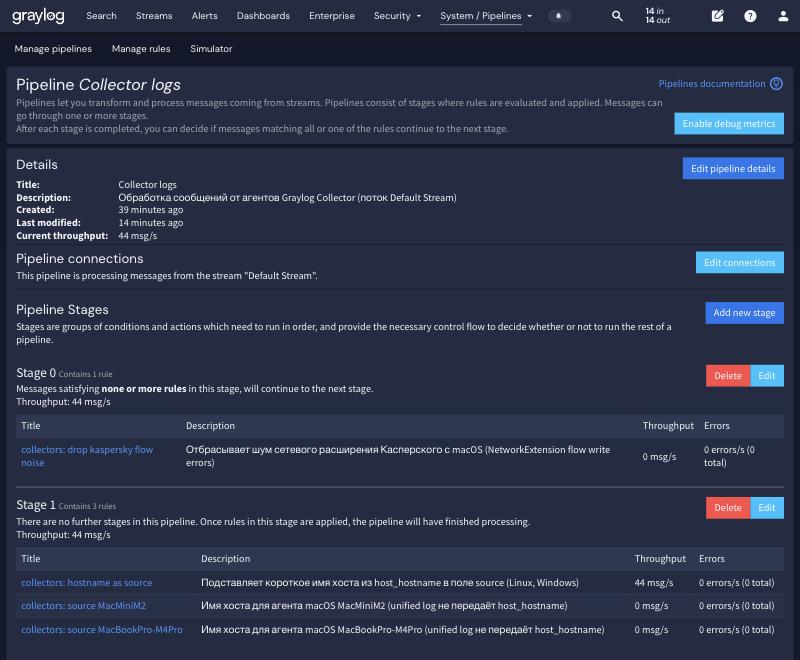

# Часть 11. Graylog Collectors: агенты под управлением сервера

В главах 3–8 каждый источник логов настраивался отдельно: Winlogbeat на Windows,
Filebeat и osquery на macOS, rsyslog и auditd на Linux, Fluent Bit в контейнерах. Конфиг
лежал на хосте, и любое изменение означало поход на все машины.

**Collectors** — встроенный в Graylog 7.2 механизм управления агентами. Один агент на хост,
вся настройка на сервере, изменения доезжают до машин за секунды. Это альтернатива всему,
что было раньше, и в этой главе она разобрана целиком: от установки до разбора грабель.

Раздел помечен **Preview**: в версии 7.2.1 он работает, но интерфейс и API ещё меняются.

## Что получилось в итоге

- **12 агентов** на РЕД ОС (x86_64 и aarch64), macOS 27.2 и Windows 11/Server 2025.
- **Один флот** `Home Laboratory` и **четыре источника** на все хосты сразу.
- **86 000 сообщений в час** через один вход вместо пяти разных входов.
- Поля `agent_*` и `host_*` в каждом сообщении: видно, какой агент и какой источник их прислал.
- Pipeline `Collector logs` из четырёх правил: имя хоста вместо IP и отсев шума.



## Чем это отличается от прежних способов

| | Beats / Fluent Bit / rsyslog | Collectors |
|---|---|---|
| Где лежит конфиг | на каждом хосте | на сервере Graylog |
| Изменить сбор | зайти на все хосты | изменить источник во флоте |
| Видно ли, что агент жив | только по потоку логов | статус online/offline, heartbeat 30 с |
| Один агент на все ОС | нет, под каждую свой | да, один пакет под Linux/macOS/Windows |
| Транспорт | Beats, GELF, syslog | OTLP поверх HTTPS |
| Шифрование и аутентификация | настраивается руками | сертификаты выдаёт сам Graylog |
| Разбор полей | extractor-ы и pipeline | агент присылает готовые поля |
| Зрелость | годами в проде | Preview в 7.2 |

Прежние способы остаются полезными там, где нужен нестандартный ввод: декодер auditd из главы 2
принимает UDP и отдаёт GELF, Fluent Bit читает journald контейнеров с фильтром по
`CONTAINER_NAME`. Collectors закрывают типовое — системный журнал, журнал событий Windows,
unified log macOS, обычные файлы.

## Как устроено

```
[хост]                                        [Graylog 7.2.1, redos-server]
 graylog-collector (supervisor 0.6.0)
   ├─ канал управления ── OpAMP/HTTPS :9000 ──► конфигурация флота
   │     heartbeat 30 с, свой сертификат           (источники, предикаты, пути)
   │
   └─ канал данных ───── OTLP/HTTP :14401 ───► input "Collector Ingest (HTTP)"
         приёмники:                                 │
         journald | windowseventlog                 ├─ поток Default Stream
         macos_unified_logging | file               └─ pipeline "Collector logs"
```

Агент состоит из супервизора и встроенного OpenTelemetry-коллектора. Супервизор держит
связь с сервером по протоколу **OpAMP**, получает конфигурацию и перезапускает приёмники.
Данные идут отдельным каналом по **OTLP** на выделенный вход.

Сертификаты агенту выдаёт сам Graylog при регистрации: срок 1 год, ротация за 5 минут до
истечения. Токен регистрации живёт максимум 1 час с момента использования.

## Шаг 1. Вход и общие настройки

Вход создаётся автоматически мастером первичной настройки. Проверить:
**System → Collectors → Settings**.



| Параметр | Значение в лаборатории | Что значит |
|---|---|---|
| External hostname | `redos-server.monitoring.test` | адрес, который сервер сообщает агентам |
| External port | `14401` | порт приёма данных |
| Offline threshold | 5 минут | после этого агент показан как offline |
| Default visibility | 1 день | молчащие дольше скрыты из списка |
| Expiration threshold | 90 дней | после этого агент удаляется совсем |
| Ingest input | `Collector Ingest (HTTP)`, `0.0.0.0:14401` | сам приёмник |

Важно: **External hostname должен резолвиться с хостов**, а не с сервера. Если в сети нет
общего DNS, ставь сюда IP-адрес. Порт нужно открыть:

```bash
sudo firewall-cmd --permanent --add-port=14401/tcp && sudo firewall-cmd --reload
```

Полную конфигурацию, включая отпечатки сертификатов, отдаёт API:

```js
await (await fetch('/api/collectors/config', {headers:{'Accept':'application/json'}})).json()
```

## Шаг 2. Флот

**Флот** — группа агентов с общей конфигурацией. В лаборатории он один, `Home Laboratory`,
и в нём все 12 машин: источники пишутся один раз для всех ОС, а неподходящие приёмники на
хосте просто не запускаются.

Несколько флотов имеют смысл, когда наборы источников действительно разные: отдельный флот
для серверов с аудитом и отдельный для рабочих станций.

## Шаг 3. Установка агента на хост

**System → Collectors → Deployment**: выбрать флот, выпустить токен, скопировать команду.



Токены бывают двух видов: короткоживущий (1 день) и постоянный — последний виден на вкладке
**Enrollment tokens** и отзывается в любой момент. Для разовой установки хватает первого.

После установки агент сам регистрируется во флоте и появляется в списке через несколько
секунд. Перезапускать Graylog не нужно.

### Где что лежит на хостах

| ОС | Файл подключения | Служба | Журнал агента |
|---|---|---|---|
| Linux | `/etc/graylog/collector/enrollment.env` | `graylog-collector` (systemd) | `/var/lib/graylog-collector/logs/supervisor.log` |
| macOS | `/Library/Application Support/Graylog/Collector/supervisor.yaml` | `org.graylog.collector` (launchd) | `/Library/Application Support/Graylog/Collector/logs/supervisor.log` |
| Windows | в реестре, отдельного файла нет | `graylog-collector` (служба) | `C:\ProgramData\Graylog\Collector\logs\supervisor.log` |

В этих файлах лежит **только подключение**: адрес сервера и токен. Что собирать — приходит
с сервера и локально в редактируемом виде не хранится. Править на хосте нечего, и это
главное отличие от Beats и Fluent Bit.

На Linux файл создаётся копированием `enrollment.env.example`, права `0600`. На macOS права
на `supervisor.yaml` ограничены root. На Windows служба работает от `LocalSystem`.

## Шаг 4. Источники

**Fleets → Home Laboratory → Sources**. Источник описывает, что именно читать; он
привязан к флоту и приезжает на все его агенты.



| Источник | Тип | Конфигурация | Поток в лаборатории |
|---|---|---|---|
| System Journal | `journald` | `read_mode: end`, `priority: info` | 79 156 сообщений/час |
| Windows Event Log | `windows_event_log` | каналы по умолчанию, `read_mode: end` | 6 374 /час |
| macOS Unified Logs | `macos_unified_logging` | предикат (ниже), опрос раз в 30 с | 899 /час |
| Syslog | `file` | `/var/log/syslog`, `read_mode: end` | 0 — файла нет в РЕД ОС |

`read_mode: end` означает «читать только новое». Для первичной загрузки истории есть
`beginning`, но на journald это даст всплеск в десятки тысяч сообщений.

Предикат macOS написан на языке NSPredicate — том же, что у `log stream`:

```
subsystem IN {
'com.apple.opendirectoryd',
'com.apple.authorization',
'com.apple.loginwindow',
'com.apple.securityd',
'com.apple.TCC',
'com.apple.alf',
'com.apple.networkextension',
'com.apple.DiskManagement',
'com.apple.CoreStorage',
'com.apple.endpointsecurity',
'com.apple.syspolicyd',
'com.apple.launchd'
} AND messageType >= error
```

Двенадцать подсистем — это вход в систему, права доступа, TCC, файрвол, работа с дисками и
запуск процессов. Всё остальное отсекается, иначе unified log завалит сервер.

Конфигурацию источников целиком можно вытащить через API:

```js
const F = '<id флота>';
await (await fetch(`/api/collectors/fleets/${F}/sources?page=1&per_page=20`,
  {headers:{'Accept':'application/json'}})).json()
```

## Шаг 5. Агенты

**System → Collectors → Instances** — список машин, статус, синхронизация конфигурации,
кнопка **View System Logs** для журнала самого агента.



| Хост | ОС | Архитектура |
|---|---|---|
| redos-server, server, homelab, wazuh | РЕД ОС 8.0.3 | x86_64 |
| homeserver, redosrp16, redos-raspi, wazuh-homelab | РЕД ОС 8.0.3 | aarch64 |
| MacMiniM2, MacBookPro-M4Pro | macOS 27.2 | arm64 |
| W11-Desktop | Windows 11 Pro 25H2 | x86_64 |
| DC | Windows Server 2025 Standard | x86_64 |

Один и тот же агент версии 0.6.0 на всех пяти вариантах — ради этого всё и затевалось.

## Шаг 6. Поля сообщений

Агент присылает готовые поля, extractor-ы не нужны:

| Поле | Что внутри |
|---|---|
| `agent_id` | идентификатор экземпляра агента, стабилен между перезапусками |
| `agent_fleet_id` | флот — удобный признак «это сообщение от Collectors» |
| `agent_source_id` | источник, из которого пришло сообщение |
| `agent_receiver_type` | `journald`, `windowseventlog`, `macos_unified_logging`, `file` |
| `host_hostname` | полное имя хоста |
| `host_id` | machine-id хоста |

У macOS добавляются `process_name`, `process_path`, `event_source` (подсистема),
`vendor_event_severity`, `user_id` и группа `macos_*` с идентификаторами потока, активности
и образа.

Пример запроса «всё от агентов за час»:

```
_exists_:agent_fleet_id
```

## Шаг 7. Потоки и pipeline

Сообщения агентов попадают в **Default Stream**, если их не перехватило правило другого
потока. Поэтому pipeline для них подключается именно к Default Stream.



### Правило 1. Имя хоста вместо IP

В поле `source` у части агентов оказывается IP. Имя при этом есть в самом сообщении:

```
rule "collectors: hostname as source"
when
  has_field("host_hostname")
then
  set_field("source", regex_replace("^([^.]+).*$", to_string($message.host_hostname), "$1", true));
end
```

Правило берёт первую часть имени до точки, чтобы `server.monitoring.test` стал `server` —
так же, как выглядят источники из прежних способов сбора.

### Правило 2. Хосты без `host_hostname`

Приёмник `macos_unified_logging` поле `host_hostname` не передаёт, поэтому для Маков нужно
отдельное правило по идентификатору агента. Идентификатор берётся из списка агентов
(`/api/collectors`, поле `instance_uid`) или из любого сообщения этого хоста:

```
rule "collectors: source MacMiniM2"
when
  to_string($message.agent_id) == "<instance_uid агента>"
then
  set_field("source", "MacMiniM2");
end
```

Такое правило нужно по одному на каждый подобный хост. Минус очевиден: при переустановке
агента идентификатор меняется и правило придётся поправить.

### Правило 3. Отсев шума

На Маках 89% событий давало сетевое расширение антивируса: по две строки на каждое закрытое
соединение. Правило убирает только их, оставляя настоящие события антивируса:

```
rule "collectors: drop kaspersky flow noise"
when
  to_string($message.process_name) == "com.kaspersky.kav.sysext"
  AND (
    contains(to_string($message.message), "Failed to write flow Data")
    OR contains(to_string($message.message), "flow is closed for writes")
  )
then
  drop_message();
end
```

После него с Маков приходит около 95 сообщений в час вместо 900, и это `tccd`,
`opendirectoryd`, `sandboxd`, `syspolicyd` — то, ради чего сбор и нужен.

### Сборка pipeline

```
pipeline "Collector logs"
stage 0 match pass
  rule "collectors: drop kaspersky flow noise"
stage 1 match pass
  rule "collectors: hostname as source"
  rule "collectors: source MacMiniM2"
  rule "collectors: source MacBookPro-M4Pro"
end
```

Отсев идёт первой стадией, чтобы не тратить работу на сообщения, которые всё равно
отбрасываются. Подключение: **Edit connections → Default Stream**.

## Проверка и диагностика

**Работает ли правило.** Самый честный способ — метрики самого правила, а не глаз на поиске:

```js
const rid = '<id правила>', pid = '<id pipeline>';
const names = ['matched','not-matched','failed'].map(k =>
  `org.graylog.plugins.pipelineprocessor.ast.Rule.${rid}.${pid}.1.${k}`);
await (await fetch('/api/cluster/metrics/multiple', {method:'POST',
  headers:{'Accept':'application/json','Content-Type':'application/json','X-Requested-By':'cli'},
  body: JSON.stringify({metrics: names})})).json()
```

Цифра в `matched` растёт — правило срабатывает; растёт `failed` — в правиле ошибка.
Число после `${pid}` — номер стадии.

**Что реально приходит с источника.** На вкладке Sources есть кнопка **Received messages**,
она открывает поиск по `agent_source_id`.

**Жив ли агент.** `View System Logs` на вкладке Instances. Журналы агентов идут в поток
`Collector System Logs`, но доезжают не со всех хостов: на Linux агент пишет в journald и
его подхватывает источник System Journal, а на macOS журнал остаётся файлом на диске.
Если агент молчит — смотреть `supervisor.log` по таблице путей выше.

## Грабли

**1. Фильтр в предикате macOS может тихо убить сбор.** Попытка дописать в предикат
`AND process != 'com.kaspersky.kav.sysext'` закончилась тем, что с обоих Маков перестали
приходить любые сообщения. Агент при этом остался online и «здоровым», ошибок не показал.
Вывод: фильтровать процессы надёжнее на стороне Graylog правилом pipeline, а предикат
трогать только в части подсистем и уровня важности. После любой правки предиката проверяй
поток сообщений через 2–3 минуты.

**2. `/var/log/syslog` в РЕД ОС нет.** Источник типа `file` из мастера первичной настройки
рассчитан на Debian. В РЕД ОС системный журнал — это `/var/log/messages`, а ещё вернее
пользоваться источником `journald`. Источник, который всегда отдаёт ноль, лучше выключить,
чтобы не путал.

**3. Pipeline не достаёт до сообщений в чужом потоке.** Логи хоста `server.monitoring.test`
перехватывал поток FreeIPA Logs, и правило подстановки имени до них не доходило — в
`source` остался IP. Pipeline работает только с теми потоками, к которым подключён:
либо подключить его ещё и к этому потоку, либо добавить правило в тот pipeline, который там
уже есть.

**4. Правка pipeline заменяет его целиком.** Запись нового описания через API стирает
стадии, которых нет в теле запроса. Если правила добавлялись в несколько приёмов, перед
изменением вычитай текущую конфигурацию и допиши к ней, а не перезаписывай.

**5. Агент offline.** Порог 5 минут, heartbeat 30 секунд. Если хост показан offline, а сам
работает — проверь, открыт ли порт 14401 и резолвится ли External hostname с этого хоста.

## Когда что выбирать

**Collectors** — для типового сбора: системный журнал Linux, журнал событий Windows,
unified log macOS, обычные файлы логов. Особенно когда хостов много и они разные.

**Прежние способы** — когда нужен нестандартный ввод или разбор: декодер auditd (глава 2),
Fluent Bit с фильтром по полям journald для контейнеров (глава 8), BI.ZONE Triage с
собственной телеметрией (глава 6), osquery (глава 5).

Переходить разом не обязательно: в лаборатории оба подхода работают одновременно, с Маков
логи идут и через Filebeat, и через Collectors. Это удобно для сравнения, но за объёмом
нужно следить — дубли съедают место в индексах.

## Открытые вопросы

- **Маршрутизация в потоки.** Сообщения агентов лежат в Default Stream. Правила потоков по
  полю `agent_receiver_type` разложили бы их по привычным `MacOS Logs`, `WindowsLogs`,
  `Syslog Logs`, но тогда их перестанет видеть pipeline, подключённый к Default Stream.
- **Журналы агентов с macOS и Windows** не попадают в `Collector System Logs`.
- **Дубли с прежним сбором.** Нужно решить, оставлять ли Filebeat на Маках.
- **Preview.** API раздела (`/api/collectors/*`) не описан в документации и может измениться
  в следующих версиях.
