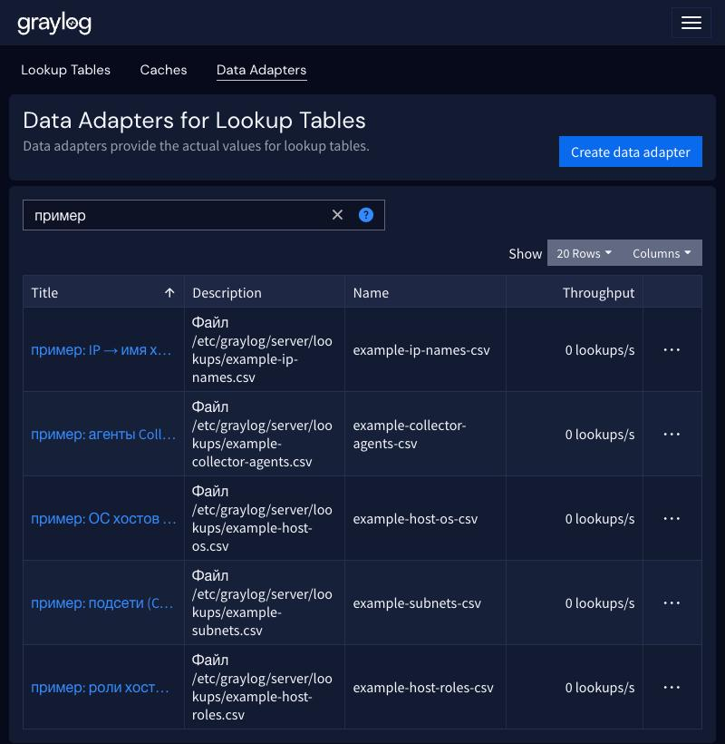
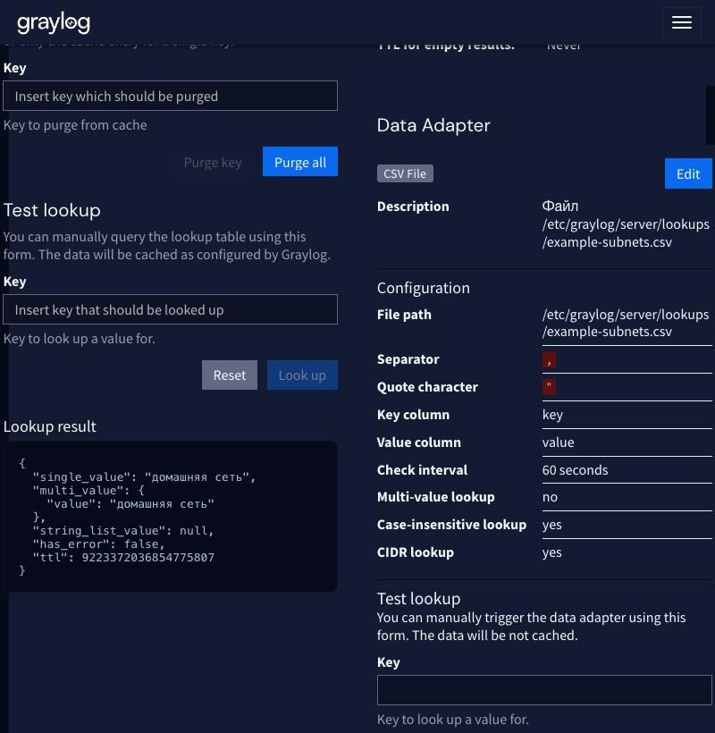

# 13. Lookup Tables: обогащение событий справочниками

Lookup Table подставляет в сообщение значение по ключу из справочника: код события Windows `4625` превращается
в «Неудачная попытка входа», `source` — в роль и ОС хоста, числовой `level` — в `error`, IP — в сеть. Алерты и
дашборды после этого показывают понятный текст вместо кодов.

## Как это устроено

Справочник состоит из трёх объектов:

| Объект | Роль | У нас |
|---|---|---|
| Data Adapter | откуда брать данные | `csvfile`: CSV на сервере Graylog (`/etc/graylog/server/lookups/`), перечитывается раз в 60 с |
| Cache | где держать результаты | `guava_cache`, 1000 записей |
| Lookup Table | связывает адаптер и кэш, это имя используется в правилах | `homelab-*` |

Сообщение обогащает правило pipeline: `lookup_value("таблица", ключ, значение_по_умолчанию)`, результат пишется
в новое поле через `set_field`. Новые строки добавляются прямо в CSV, адаптер подхватит их за минуту.

## Справочники

| Таблица | Ключ → значение | Поле в сообщении | Где работает |
|---|---|---|---|
| `homelab-windows-events` | EventID → название события | `event_name` | `WindowsLogs` |
| `homelab-windows-logon-types` | LogonType → смысл | `logon_type_name` | `WindowsLogs` |
| `homelab-windows-status` | Status/SubStatus → причина отказа входа (4625) | `fail_reason` | `WindowsLogs` |
| `homelab-ip-names` | IP → имя хоста | `src_host` | `WindowsLogs` |
| `homelab-subnets` | IP → сеть (поиск по CIDR) | `src_zone` | `WindowsLogs` |
| `homelab-host-roles` | `source` → роль хоста | `host_role` | потоки с хостами |
| `homelab-host-os` | `source` → ОС | `host_os` | потоки с хостами |
| `homelab-syslog-severity` | `level` 0–7 → emergency … debug | `level_name` | Syslog, FreeIPA, контейнеры |
| `homelab-auditd-types` | `type` → описание записи | `type_name` | auditd |
| `homelab-keenetic-events` | `kn_event_type` → название | `kn_event_name` | Syslog (Keenetic) |
| `homelab-collector-agents` | `agent_id` → имя хоста | `source` | Collectors (правило не подключено) |

## Установка

1. Положить CSV на сервер Graylog (файлы лежат в [`graylog/pipelines/lookups/`](../graylog/pipelines/lookups/)):

   ```
   sudo install -d -m 750 -o root -g graylog /etc/graylog/server/lookups
   sudo cp graylog/pipelines/lookups/*.csv /etc/graylog/server/lookups/
   sudo chown root:graylog /etc/graylog/server/lookups/*.csv
   sudo chmod 640 /etc/graylog/server/lookups/*.csv
   ```

   В репозитории лежат примеры на вымышленных данных (адреса из RFC 5737, имена `*.example.test`): подставьте
   свои хосты, подсети и `agent_id`.

2. Создать кэши, адаптеры и таблицы скриптом [`import-lookup-tables.js`](../graylog/pipelines/import-lookup-tables.js):
   в браузере под своей учётной записью Graylog открыть консоль, вставить файл и выполнить
   `await importLookupTables({dryRun: true})`, затем без `dryRun`. Скрипт ищет объекты по имени, существующие
   не меняет и ничего не удаляет.

3. Загрузить правила ([`import-rules.js`](../graylog/pipelines/import-rules.js)) и создать три отдельных
   pipeline: `homelab: windows enrichment` (стадия 0, поток `WindowsLogs`), `homelab: host info` (стадия 2,
   потоки с хостами) и `homelab: syslog enrichment` (стадия 0, syslog-потоки). Отдельные pipeline нужны,
   чтобы не затрагивать существующие: запись pipeline через API заменяет его целиком вместе со стадиями.
   Подробности и порядок стадий — в [README pipeline](../graylog/pipelines/README.md#справочники-для-всех-потоков).

## Проверка

Страница **System → Lookup Tables** показывает таблицы, кэш и адаптер, а блок **Test lookup** выполняет запрос
по ключу. Тот же запрос по API: `GET /api/system/lookup/tables/<имя>/query?key=<ключ>`.


Каждый адаптер указывает на свой CSV:



Таблица `example-subnets` с поиском по CIDR: ключ `192.0.2.77` попадает в сеть `192.0.2.0/24` и возвращает
«домашняя сеть».



После подключения pipeline в сообщениях появляются поля `event_name`, `fail_reason`, `host_role`, `level_name`
и другие: их можно использовать в поиске, виджетах дашбордов и условиях алертов.

## Пример на вымышленных данных

Готовый набор для опыта лежит в [`graylog/pipelines/lookups-example/`](../graylog/pipelines/lookups-example/README.md)
(CSV `example-*` и описание). Скриншоты выше сняты именно с него.

## Что почитать дальше

- [Правила pipeline](../graylog/pipelines/README.md): состав правил, порядок внутри стадии, списки исключений
  `homelab-trusted-hosts`, справочники Windows.
- [Windows](03-windows.md): события, на которые строятся алерты.
- [Troubleshooting](troubleshooting.md).
