# 16. GraylogRuleTester: проверка всех правил без запуска на хостах

**GraylogRuleTester** (версия 0.10, каталог [`rule-tester/`](../rule-tester/)) проверяет правила Graylog автоматически. Образцы сообщений отправляются прямо на сервер Graylog по GELF HTTP, а потом инструмент смотрит, находят ли их запросы правил и появляются ли события. На хостах ничего запускать не нужно, в отличие от [проверки детектов](15-detection-tests.md) из главы 15.

Инструмент работает как контейнер Podman с веб-интерфейсом и как обычный консольный скрипт. Нужен только Python 3.11+ и доступ к Graylog.

> Скриншоты в этой главе, кроме трёх из рабочей лаборатории (проверка доступа, разбор провала и история запусков с настоящим прогоном всех 218 правил), сняты на заглушке Graylog ([`mock_graylog.py`](../rule-tester/mock_graylog.py)) с каталогом настоящих правил, поэтому в шапке стоит «Graylog 7.2.1-mock». До объединения страниц ART и «Проверка детектов» в версии 0.5 обе страницы Atomic Red Team тоже снимались в рабочей лаборатории — после объединения их пересняли на заглушке вместе с остальными.

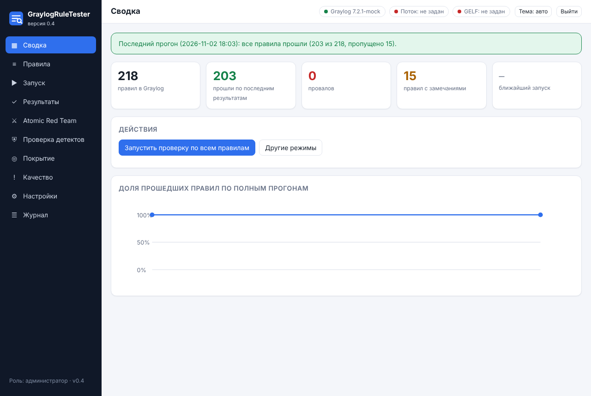
*Сводка: состояние подключения, итог последнего прогона, доля прошедших правил по полным прогонам, ближайший запуск по расписанию.*

## Зачем это нужно

Правил в Graylog много (у меня 218), запросы у них сложные: регулярки, списки исключений, группировка по полям. Опечатка, лишний символ или поле, которое пайплайн переименовал, делают правило «молчащим», и об этом узнаёшь только тогда, когда пропускаешь настоящую атаку. Проверять руками каждое правило на каждом хосте нереально. Идея в том, чтобы подставить сообщение сразу на сервер и посмотреть, сработает ли правило.

## Как это устроено

```
образцы ──► GELF HTTP ──► Graylog ──► тестовый поток «Rule Tester» ──► запрос правила находит образец?
(из запросов правил,                 └─► (режим «до алерта») боевой поток ──► событие ──► письмо
 ручные, настоящие)
```

1. **Правила** читаются из Graylog (определения событий, только чтение). Если Graylog недоступен, берётся каталог [`graylog/detections/detections-source.json`](../graylog/detections/detections-source.json).
2. **Образцы** строятся из самого запроса правила. Каждая ветка `OR` даёт положительное сообщение. Отрицательные получаются из положительного: убрано обязательное условие либо нарушено исключение `NOT`. Дополнительно используются ручные образцы и настоящие обезличенные сообщения.
3. **Два режима запуска:**
   - **Запросы в тестовом потоке.** Сообщения уходят в отдельный поток «Rule Tester», запрос каждого правила выполняется по ним. Положительные должны находиться, отрицательные нет. **Алертов и писем нет**, это безопасный режим по умолчанию.
   - **До алерта.** Сообщения идут в боевые потоки (поля подгоняются под правила потока), затем ждём событие в Graylog. Проходит весь путь: поток, правило, событие, уведомление. **Создаёт настоящие события и письма**, поэтому всегда спрашивает подтверждение, а ночью по расписанию включается только осознанно.
4. **Разбор провалов.** Если образец не найден, инструмент сравнивает отправленные поля с проиндексированными и показывает, какое поле пропало, изменилось или перестало подходить под запрос.
5. **Замечания к запросам.** Отдельно проверяется сам текст запросов: заглушки вида `<белый список>`, регулярки с символами, которые в Lucene означают операторы, запросы, которые отличаются от каталога, одинаковые и перекрывающиеся запросы.

Собственный вычислитель Lucene внутри инструмента нужен для офлайн-проверки образцов (команда `selftest`) и подсказок. Последнее слово всегда за самим Graylog: правило считается прошедшим, только если его находит настоящий поиск.

## Подготовка Graylog (один раз)

1. **Токен API.** В Graylog: профиль пользователя → Edit Tokens → создать. Нужна учётная запись с правом чтения, токен показывается один раз.
2. **Вход GELF HTTP.** System → Inputs → GELF HTTP → Launch. Порт любой свободный: у меня 12201 и 12202 заняты другими входами, поэтому выбран **12203**. Если на хосте работает firewalld, порт нужно открыть (`firewall-cmd --permanent --add-port=12203/tcp && firewall-cmd --reload`).
3. **Тестовый поток «Rule Tester».** Создаётся командой `setup --apply` (или вручную). Поток собирает только сообщения с полем `rt_run`, которое ставит сам тестер, поэтому настоящие логи в него не попадают, а сообщения не уходят в стандартный поток.
4. **Проверка** всего сразу: `doctor` в консоли или режим «Проверка доступа и входа GELF» в интерфейсе (см. ниже).

## Установка в контейнер Podman

Ниже установка на мой `redos-server` (rootless Podman, RED OS), под обычным пользователем.

```bash
git clone https://github.com/ArsIS-02/Graylog_streams-alerts.git
cd Graylog_streams-alerts
bash rule-tester/deploy/install.sh      # первый запуск создаёт ~/rule-tester/rule-tester.env и останавливается
nano ~/rule-tester/rule-tester.env      # заполнить, см. таблицу ниже (файл chmod 600)
bash rule-tester/deploy/install.sh      # собирает образ, ставит quadlet-юнит, запускает службу
```

Обновление: `git pull && bash rule-tester/deploy/install.sh`. Настройки и образцы лежат на томе `rule-tester-data` и при обновлении сохраняются.

Контейнер запускается с `ReadOnly=true`, без привилегий и без лишних capability (`DropCapability=ALL`, `NoNewPrivileges`). Данные (отчёты, настройки, журнал, образцы) хранятся на томе `/data`.

| Переменная | Назначение |
|---|---|
| `GRAYLOG_URL` | Адрес Graylog. Из контейнера до Graylog на хосте проще всего достучаться через `http://host.containers.internal:9000` |
| `GRAYLOG_TOKEN` | Токен API (только чтение) |
| `RT_GELF` | Адрес входа GELF HTTP, например `http://host.containers.internal:12203/gelf` |
| `RT_STREAM` | Название тестового потока (по умолчанию «Rule Tester») |
| `RT_PASSWORD` | Пароль администратора интерфейса (обязателен) |
| `RT_RUNNER_PASSWORD` | Пароль роли «запуск», необязательный (может запускать проверки, настроек не меняет) |
| `RT_VIEWER_PASSWORD` | Пароль наблюдателя, необязательный (только просмотр) |
| `RT_CA_FILE`, `RT_INSECURE` | Свой центр сертификации либо отключение проверки сертификата (только лаборатория) |
| `RT_SCHEDULE` | Запуски по расписанию, например `queries@02:30,selftest@03:00,drift@03:30` |
| `RT_SCHEDULE_ENABLED` | `0` — приостановить запуски по расписанию, не стирая само расписание (по умолчанию включено) |
| `RT_E2E_PLATFORMS` | Платформы для ночного «до алерта». Пусто: не запускать |

Значения, сохранённые на странице «Настройки», лежат на томе (`settings.json`, права 0600) и **имеют приоритет** над переменными окружения. Пароли (`RT_PASSWORD`, `RT_RUNNER_PASSWORD`, `RT_VIEWER_PASSWORD`) задаются только переменными. На странице «Настройки» рядом с полем расписания есть галочка «запускать по расписанию» — удобнее, чем стирать и восстанавливать строку расписания.

### Доступ по адресу через Caddy

Интерфейс слушает порт 8085 хоста. Мои сервисы публикуются через общий Caddy на адресах `*.apps.monitoring.test`, поэтому в панели сервисов добавлена карточка:

| Поле | Значение |
|---|---|
| Название | GraylogRuleTester |
| Адрес | `rule-tester` (получится `rule-tester.apps.monitoring.test`) |
| Backend, схема | `host.containers.internal:8085`, `http` |
| Галочки «не проверять сертификат», «Host», «закрыть входом» | выключены, у инструмента свой вход по паролю |

После сохранения Caddy нужно перезагрузить: `podman exec caddy caddy reload --config /etc/caddy/Caddyfile`. Порт 8085 должен быть опубликован **не только на `127.0.0.1`**: контейнер Caddy ходит на хост через `host.containers.internal`, и до loopback хоста он не дотягивается. В `deploy/rule-tester.container` и `podman-compose.yaml` стоит `8085:8080`. Если наружу из сети достучаться не нужно, не открывайте 8085 в firewalld: Caddy достаёт до порта и так.

Имя `rule-tester.apps.monitoring.test` находится через DNS-маску `*.apps` на FreeIPA. Чтобы устройства, которые берут DNS у роутера, тоже видели такие имена, на роутере Keenetic достаточно передать зону серверу FreeIPA: `ip name-server 192.168.1.50 monitoring.test`, затем `system configuration save`.

## Первый запуск: проверка доступа

Вход в интерфейс по паролю. Если заданы `RT_RUNNER_PASSWORD`/`RT_VIEWER_PASSWORD`, тот же экран пускает и роль «запуск» (может запускать проверки, настроек не меняет), и наблюдателя (только просмотр).

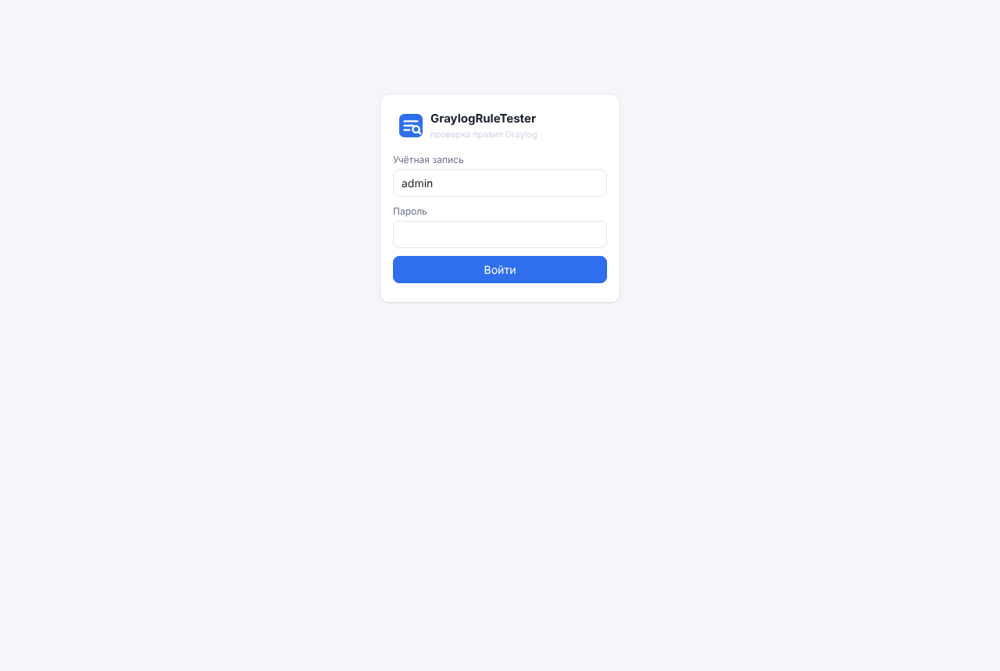

В шапке три индикатора: Graylog (версия при успешном ответе), тестовый поток и вход GELF. Красная точка означает проблему, подробности даст режим «Проверка доступа и входа GELF» на странице «Запуск». Он проверяет по очереди: токен и REST, чтение определений событий, наличие тестового потока и то, что сообщение по GELF доходит до индекса.

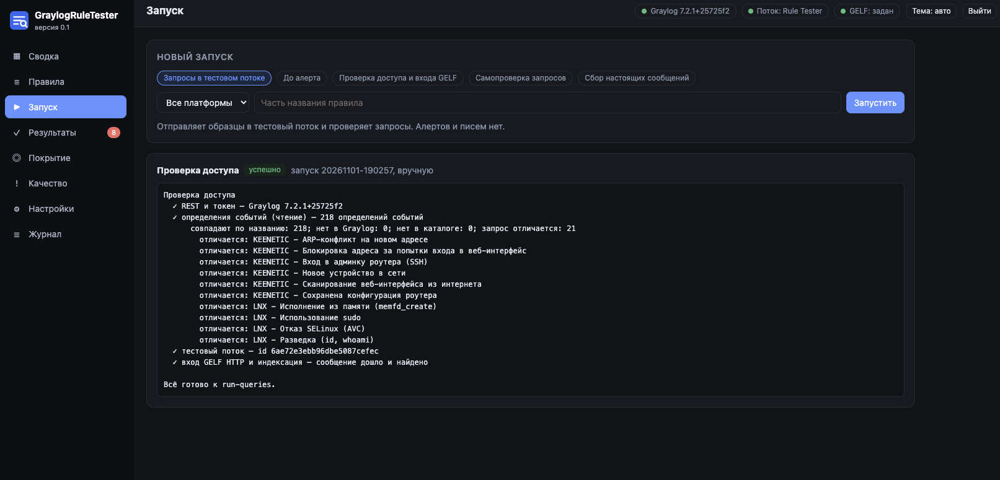
*Проверка доступа на лабораторном Graylog 7.2.1: все четыре проверки зелёные. Строки «отличается» это правила, запрос которых в Graylog не совпадает с каталогом (у меня туда вписаны настоящие списки исключений вместо заглушек), на результат они не влияют.*

Как читать итог проверки определений событий:

| Строка | Смысл |
|---|---|
| совпадают по названию: 218 | каждое правило из Graylog найдено в каталоге репозитория и наоборот |
| нет в Graylog / нет в каталоге | правило есть только в одном месте: его не импортировали в Graylog либо оно добавлено в Graylog руками и в каталог не попало |
| запрос отличается: 21 | у правила запрос в Graylog не равен каталожному. Обычно это не ошибка: в публичном каталоге вместо настоящих значений стоят заглушки (`<белый список>`, `<роутер>`), а в Graylog вписаны свои списки исключений и имя роутера. Тестер проверяет запрос из Graylog, поэтому такие правила проверяются по-настоящему. Если расхождение не про заглушки, значит, запрос правили руками, и каталог стоит обновить |

Список расхождений виден и на странице «Качество» (вид «отличие от каталога»).

Типичные ошибки:

| Симптом | Причина и решение |
|---|---|
| `HTTP 401` во всех проверках | Graylog не принял токен: он пустой, отозван или создан не тем пользователем. Создайте новый и вставьте на странице «Настройки» |
| `Connection refused` на Graylog | В контейнере `127.0.0.1` это он сам. Используйте `host.containers.internal:9000` |
| «Поток: …» пустой | Поток не создан или токену не хватает прав его прочитать. Запустите `setup --apply` |
| GELF «не задан» или сообщение не находится | Неверный порт входа, порт закрыт в firewalld или вход GELF HTTP не запущен |
| Интерфейс не открывается по `rule-tester.apps…`, Caddy отвечает 502 | Порт 8085 опубликован только на loopback или в панели указан не тот backend |
| Имя не находится на Mac | Устройство берёт DNS у роутера, а зона `monitoring.test` не передана FreeIPA (см. выше), либо кэш DNS |

## Интерфейс

Слева меню: Сводка, Правила, Запуск, Результаты (с бейджем числа известных провалов), Проверка детектов, Покрытие, Качество, Настройки, Журнал, Руководство. Тема оформления переключается между автоматической, светлой и тёмной, интерфейс адаптируется под телефон.


*Светлая тема.*

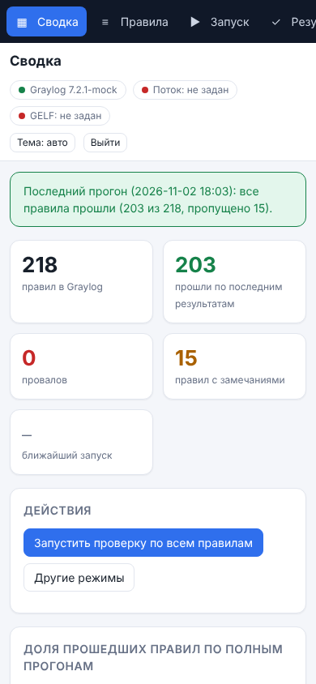
*Мобильный вид: меню сворачивается в полосу.*

### Правила

Живой список правил из Graylog с поиском по названию, запросу и технике, фильтрами по платформе (`LNX`, `Windows`, `macOS`, `FREEIPA`, `KEENETIC` и т.д.) и по результату последнего прогона. У каждой строки видны замечания к запросу.

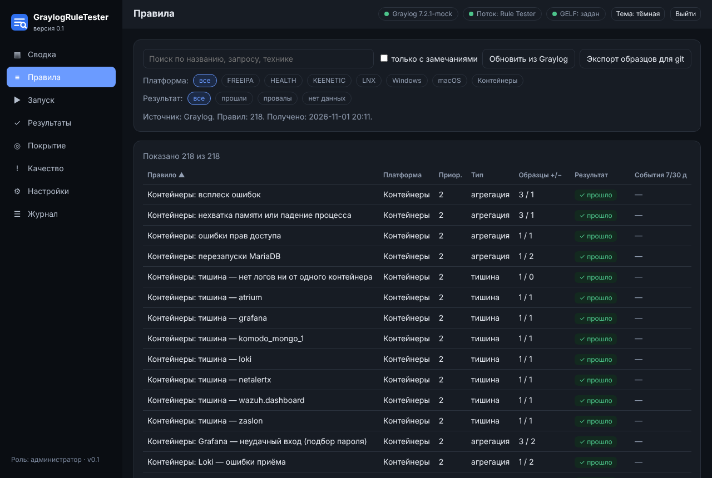

Клик по правилу открывает панель: приоритет, поток, тактика и техника MITRE ATT&CK, полный запрос с кнопкой «Копировать», образцы и три действия:

- **Проверить это правило** прогоняет только его в тестовом потоке, без алертов;
- **Собрать настоящее сообщение** запускает сбор для этого правила: из Graylog берутся реальные сообщения, которые находит запрос, они обезличиваются и сохраняются как образцы на томе;
- **До алерта** (красная кнопка) отправляет сообщение боевым путём и создаёт настоящее событие и письмо, после подтверждения в собственном диалоге инструмента.

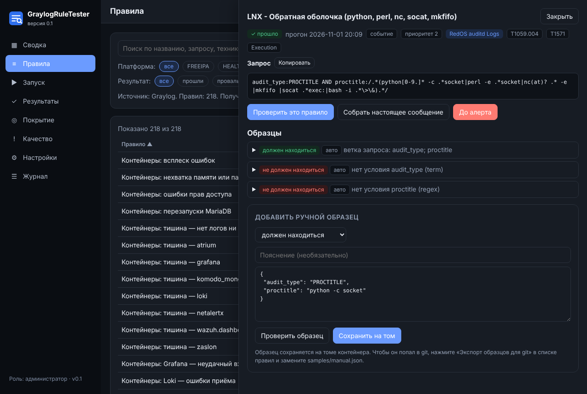
*Панель правила: запрос, автообразцы (один положительный и два отрицательных, по одному на каждое условие) и форма добавления ручного образца с проверкой.*

### Запуск

Выбор режима: запросы в тестовом потоке, до алерта, проверка доступа и входа GELF, самопроверка запросов (офлайн, Graylog не нужен), сбор настоящих сообщений, сверка каталога с Graylog, проверка ложных срабатываний, сверка CALDERA (техники и окно времени), replay инцидента (сценарий JSON-текстом, требует подтверждения, как «до алерта»), задержка обнаружения (офлайн). Область для большинства режимов ограничивается платформой или частью названия правила (точное название задаётся как `=Название`); у CALDERA и replay — свои поля. Ход выполнения виден по строкам: сколько правил проверено, сколько прошло, провалилось, пропущено.

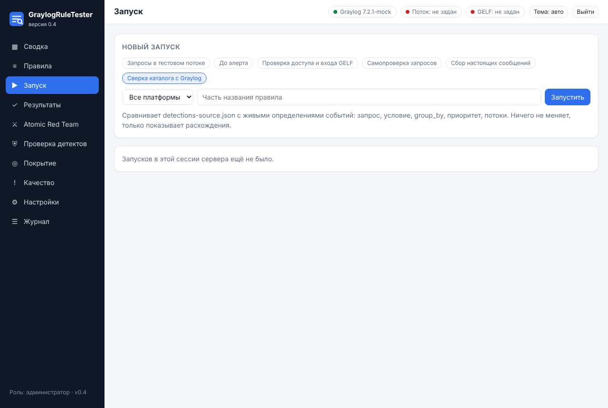

По расписанию запускаются режимы из `RT_SCHEDULE` (или со страницы «Настройки»), например `queries@02:30`. Время считается по часовому поясу контейнера.

### Проверка детектов: Atomic Red Team и методика (глава 15)

Режимы «Запросы» и «До алерта» проверяют только сам запрос правила — подставленным, заранее подогнанным сообщением. Они не показывают, действительно ли реальная атака на хосте (с настоящим агентом, настоящим auditd/Sysmon/winlogbeat между хостом и Graylog) дойдёт до события. Для этого есть страница **Проверка детектов** с двумя вкладками наверху — **Atomic Red Team** и **Методика (глава 15)** — у каждой свои раннеры по платформам и своя сверка с Graylog; до версии 0.5 это были две отдельные страницы в меню, их объединили, когда выяснилось, что устроены они одинаково и их легко перепутать. Старые ссылки `#/art` и `#/method` по-прежнему работают — открывают эту же страницу с нужной вкладкой.

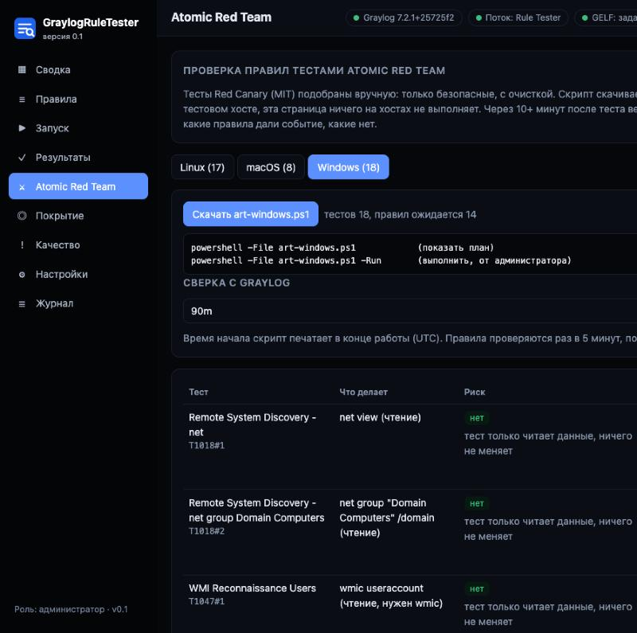
*Вкладки по платформам внутри каждого режима; у каждого теста — что он делает на хосте и какие правила должны сработать. Скрипт по умолчанию только показывает план, ничего не выполняет.*

#### Atomic Red Team

План безопасных тестов [Atomic Red Team](https://github.com/redcanaryco/atomic-red-team) (Red Canary, MIT, см. [`rule-tester/art/NOTICE.md`](../rule-tester/art/NOTICE.md)) для Linux, macOS и Windows, каждый тест сопоставлен с правилами, которые должны на него сработать.

Как это устроено:

1. **Тесты отбирались вручную**, не автоматическим фильтром: читались команда и очистка каждого теста. В план не попадают и не будут добавлены тесты, которые отключают существующую защиту или журналирование (антивирус/EDR, auditd, syslog, SELinux, firewall), удаляют теневые копии или бэкапы, внедряются в чужие процессы или похищают учётные данные (LSASS, Keychain, Mimikatz и аналоги) — независимо от того, есть ли у них очистка.
2. **У каждого теста — явная оценка риска**: «нет» (только чтение), «низкий» (создаёт и сам убирает тестовый объект, прав администратора не требует) или «средний» (нужен root/администратор, тест реально меняет системный объект — службу, правило firewall, ключ реестра, бит setuid). Для «среднего» риска расписано, что произойдёт, если скрипт прервётся до очистки, и как проверить/убрать вручную.

   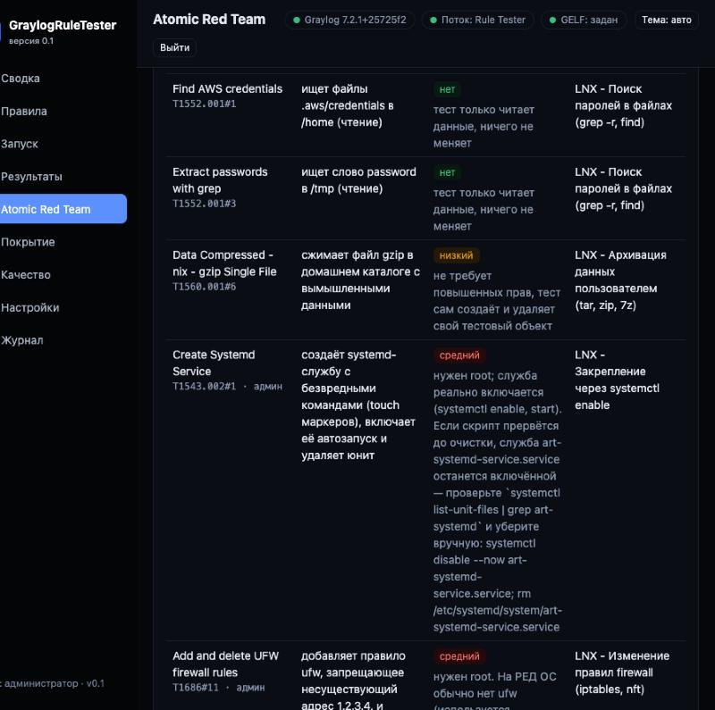

3. **Скрипт скачивается и выполняется на тестовом хосте**, не здесь: страница ничего не делает с хостами сама. Скрипт самодостаточный (bash для Linux/macOS, PowerShell для Windows), не требует установки Invoke-AtomicRedTeam и не качает ничего из интернета. Без флагов — только план; `--run`/`-Run` выполняет и сразу чистит за собой; есть `--only` (конкретные тесты) и `--cleanup` (если прервали).
4. **Сверка с Graylog** — по технике MITRE и окну времени (его печатает скрипт в конце работы, в UTC): какие из ожидаемых правил получили событие, какие нет. Правила проверяются раз в 5 минут, поэтому сверять стоит не раньше чем через 10 минут после теста.

Для FreeIPA, Keenetic и контейнеров готовых тестов Atomic Red Team нет — FreeIPA покрывается отдельной [главой 15](15-detection-tests.md). Совпадение правила с тестом идёт по технике MITRE, поэтому «нет события» не всегда значит, что правило сломано: возможно, тест не создал то конкретное поле, которое ищет запрос, либо сообщение не дошло до агента.

#### Методика (глава 15)

Вкладка раздаёт те же раннеры, что и [глава 15](15-detection-tests.md) (`detection-tests/`) — Windows, Linux (auditd), macOS, FreeIPA, Контейнеры, Keenetic, 121 проверка на 164 правила — без переписывания: скрипт, который скачивает инструмент, побайтово совпадает с файлом в репозитории. Инструмент только раздаёт его и потом, как и для Atomic Red Team, сверяет результат с Graylog за выбранное окно. Запускать проверки нужно всё так же руками — на хосте (Windows/Linux/macOS/FreeIPA), на машине с доступом к docker/podman (Контейнеры) или на машине в той же сети, что и роутер (Keenetic, параметр `--host`); страница `run-queries`/`e2e` для этого не подходит, они проверяют только сам запрос правила, а не настоящий путь через агента или сеть.

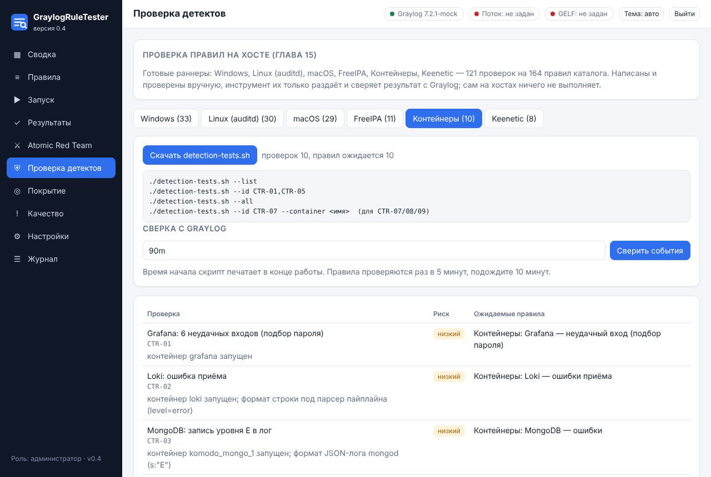

Методика Keenetic включает две отключённые по умолчанию проверки (`KEN-07` — блокировка адреса в веб-интерфейсе, `KEN-08` — обрыв PPPoE): первая на время бана отрезает тестовую машину от веб-интерфейса роутера, вторая на время переподключения рвёт интернет всей сети. Обе не входят в `--all`, выбираются только явно по `--id` и требуют набрать слово «ДА» при запуске — флаг `--yes` на них не действует. Остальные проверки Keenetic (вход по SSH, отказ во входе, ARP-конфликт для собственного адреса, новое устройство по DHCP, неудачный WireGuard-handshake, сохранение конфигурации) безопасны и обратимы.

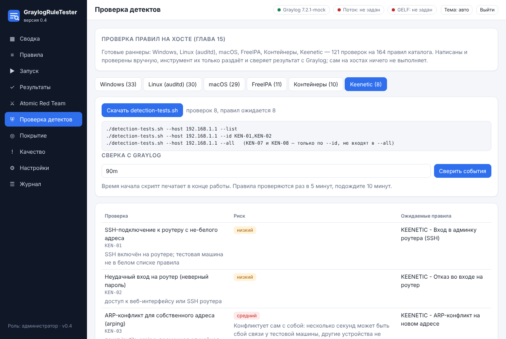

### Результаты

Три вкладки: «Отчёты», «Сравнение» и «История запусков» (кто и когда запускал, чем закончилось). Отчёт открывается построчно: статус, причина, запрос, таблица образцов (ожидалось, результат, поля). Доступны фильтр «только проблемы», поиск, выгрузка в **CSV** и страница для **печати или PDF**. Отчёты сохраняются на томе в `reports/<запуск>-<режим>.json` и `.md`.

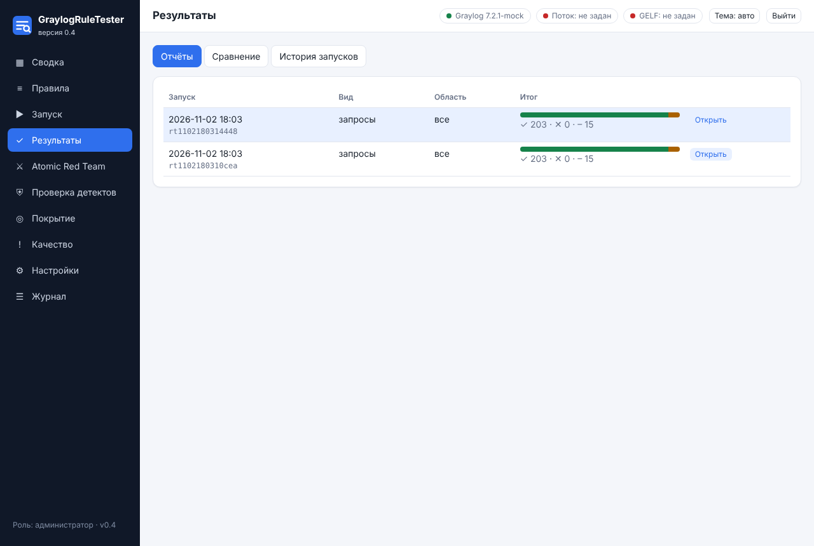

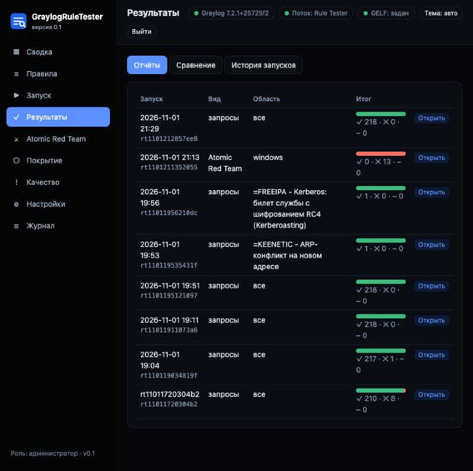
*Настоящая история запусков: вверху — полная проверка всех 218 правил режимом «Запросы» (18 секунд, провалов нет); второй сверху — сверка Atomic Red Team для Windows, которая не нашла событий, потому что окно сверки (90 минут) не захватило тесты, запущенные несколькими часами раньше. Такое тоже стоит показать — это типичная ошибка при сверке, не поломка инструмента.*

**Сравнение** показывает, что изменилось между двумя прогонами: какие правила сломались, какие починились, какие остаются проваленными и какие появились. Это удобно после правки запросов или обновления Graylog.

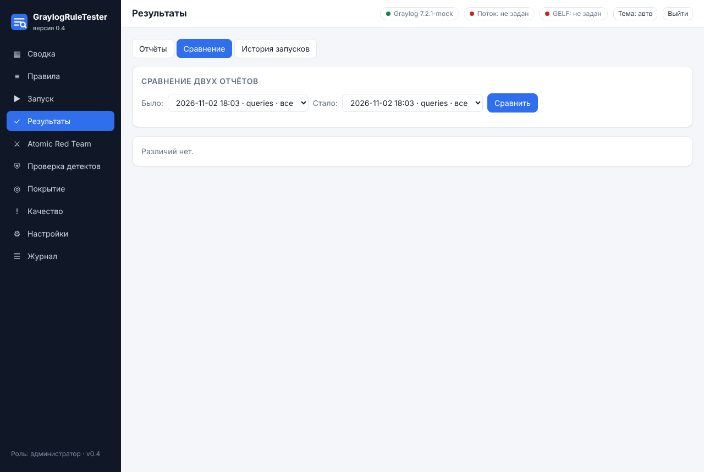
*Сравнение: после исправления регулярок восемь правил LNX перешли из «провал» в «прошло».*

На сводке по полным прогонам строится тренд: доля прошедших правил по времени.

### Покрытие

Тактики и техники MITRE ATT&CK, под каждой техникой названия правил, которые её закрывают (клик открывает правило). Сверху: сколько правил имеют ручные или настоящие образцы, сколько только автообразцы, сколько не создавали событий за 30 дней. Кнопка «Обновить счётчики событий» запрашивает у Graylog, сколько событий создало каждое правило за 7 и 30 суток (только чтение), так находятся правила, которые «молчат» подозрительно долго.

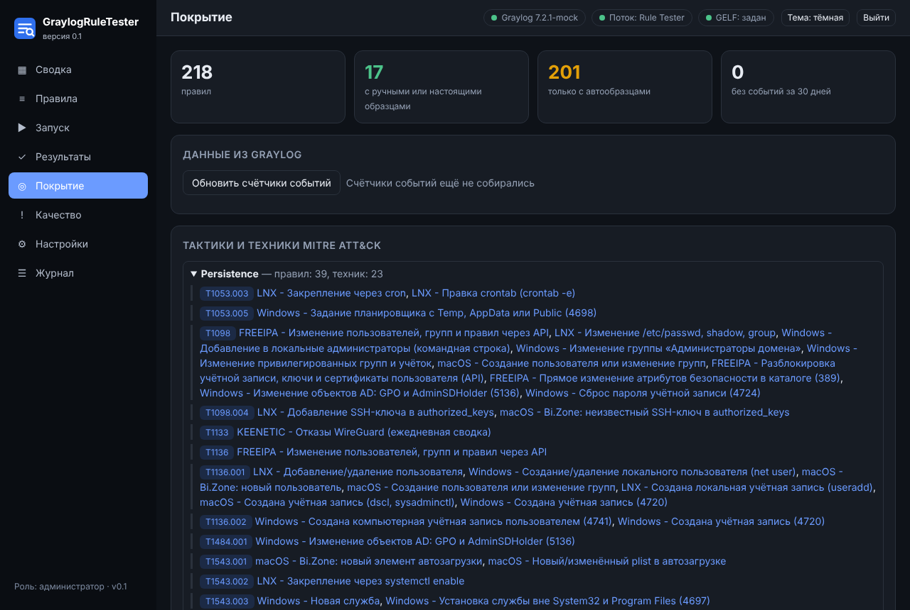

### Качество запросов

Замечания по самим запросам: заглушки (`<белый список>`), регулярки Lucene с символами `& > @ ~ #` вне скобок и с `\d \w \s`, расхождение с каталогом, одинаковые запросы и перекрытия. Каждое замечание кликабельно и ведёт к правилу.

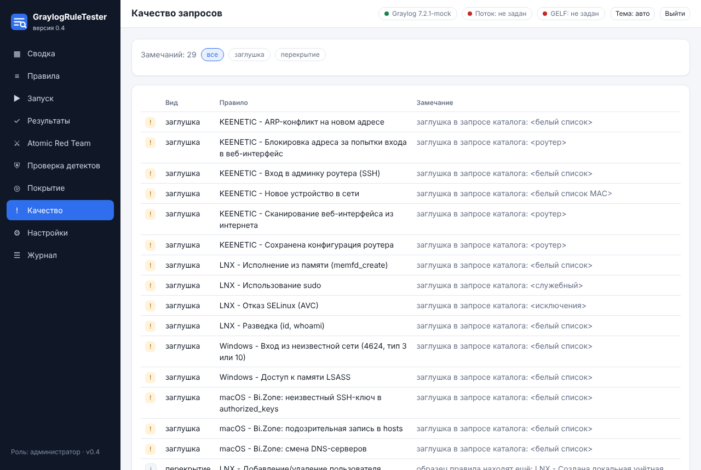

### Настройки и журнал

На странице «Настройки» меняются адрес Graylog, токен (поле пустое, если не нужно менять), вход GELF, тестовый поток, сертификат, расписание и платформы для ночного «до алерта». Кнопка «Проверить соединение» делает то же, что режим проверки доступа.

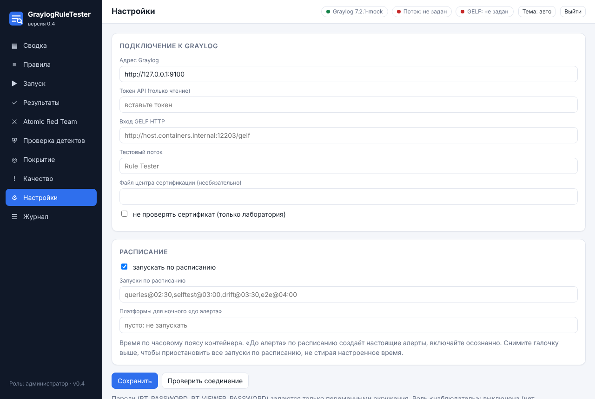

В «Журнале» записаны действия: вход, запуск, изменение настроек, сохранение и удаление образцов, выгрузка резервной копии. Ведётся на томе в `audit.jsonl`. Там же кнопка «Скачать архив» — tar.gz всего тома (`RT_DATA`): отчёты, история запусков, журнал, ручные образцы, настройки и сохранённые сценарии `replay`. Доступна только администратору; архив несёт токен Graylog в открытом виде (как и сам том), поэтому хранить его стоит так же бережно.

### Руководство

Страница «Руководство» показывает [главу 17 — руководство администратора](17-admin-guide-ruletester.md) прямо в интерфейсе: пошаговый маршрут со скриншотами, собранный из `docs/17-admin-guide-ruletester.md` на лету (минимальный встроенный конвертер Markdown → HTML, без внешних зависимостей — см. `rule-tester/mdlite.py`). Правки в сам файл главы в репозитории сразу видны и в контейнере — отдельного шага пересборки для текста не нужно, если файл главы и картинки лежат на месте (при сборке образа копируются `docs/17-admin-guide-ruletester.md` и `docs/images/17-*.png`).

## Образцы

Образцы бывают трёх видов, у каждого правила они объединяются.

**Автообразцы** строятся из запроса (см. выше) и дают минимальную гарантию: запрос синтаксически разобран, находит положительный образец и не находит отрицательные. Это не заменяет проверку на настоящих данных, поэтому в «Покрытии» отдельно считаются правила «только с автообразцами».

**Ручные образцы** добавляются в панели правила: JSON с полями сообщения, пометка «должен находиться / не должен», пояснение. Кнопка «Проверить образец» сразу показывает, что скажет эталонный вычислитель, «Сохранить на том» кладёт образец в `${RT_DATA}/samples/manual.json` на томе контейнера. Чтобы образцы попали в git, в списке правил есть выгрузка («Экспорт образцов для git»): её результатом заменяют `rule-tester/samples/manual.json` и коммитят. При чтении образцы из репозитория и с тома объединяются, и в интерфейсе у каждого видно происхождение («репозиторий» или «том»).

**Настоящие образцы** собирает `harvest` (и кнопка «Собрать настоящее сообщение»): по запросу правила берутся реальные сообщения за указанный срок, после чего **обезличиваются**. IP-адреса заменяются на документационные адреса из `192.0.2.0/24` с сохранением соответствия внутри образца, адреса почты, MAC-адреса и имена хостов заменяются, а дополнительные слова (имена пользователей и т.п.) можно задать списком. После обезличивания образец проверяется ещё раз: если он перестал проходить запрос, он не сохраняется. Результат лежит на томе (`samples/harvested.json`) и в git не попадает.

Числовые поля (например, `win_event_id`) в отправляемом сообщении приводятся к числам. Их список задаётся параметром `--numeric` или полем `numeric` у образца.

## Как читать результат

| Статус | Смысл |
|---|---|
| **прошло** | все положительные образцы найдены запросом, отрицательные не найдены |
| **провал** | хотя бы один образец ведёт себя не так, как ожидалось; в строке причина |
| **пропущено** | проверять нечего: в запросе заглушка из каталога (`<белый список>`, `<роутер>`). С источником «Graylog» заглушки уже заменены настоящими значениями |
| **ошибка запроса** | Graylog отклонил сам запрос (синтаксис или тип поля); причина в строке отчёта |
| **событие есть** | для режима «до алерта»: после отправки Graylog создал событие |

Правила «тишина» (событий нет за период) проверяются только на уровне запроса, потому что событие по ним создаётся отсутствием сообщений.

### Пример разбора провала

Вот настоящий провал из первого прогона на моём Graylog:

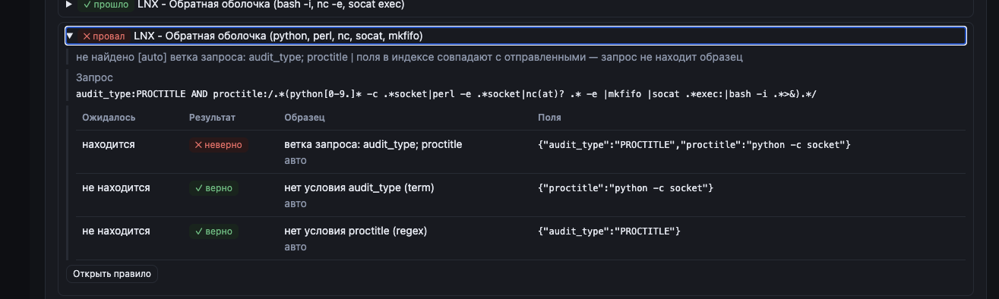

Положительный образец (`proctitle: "python -c socket"`) должен находиться, но не находится, хотя поля в индексе совпадают с отправленными. Раз поля те же, значит, дело в самом запросе. Причина в регулярке `…|bash -i .*>&)…`: в синтаксисе Lucene `&` это оператор пересечения, а `>` относится к интервалам `<a-b>`. Последняя альтернатива превращалась в пересечение с пустым выражением и ломала разбор всей группы. Лечится экранированием: `bash -i .*\>\&`. После правки запроса в Graylog правило проходит. То же самое нашлось в соседнем правиле «Обратная оболочка (bash -i, nc -e, socat exec)»: оно проходило только за счёт другой ветки, а `0>&1` в нём не работал бы.

Тестер сразу показывает такие места на странице «Качество» (замечание «регулярка Lucene»), так что их можно исправить до того, как правило пропустит атаку.

## Консоль

Тот же инструмент без веб-интерфейса:

```bash
export GRAYLOG_TOKEN=…
cd rule-tester
python3 rule_tester.py selftest                          # офлайн: разбор запросов, образцы, замечания
python3 rule_tester.py --url https://graylog.apps.monitoring.test --gelf http://graylog.apps.monitoring.test:12203/gelf \
    --stream "Rule Tester" doctor                        # доступ, вход GELF, поток
python3 rule_tester.py --url … --gelf … --stream "Rule Tester" run-queries
python3 rule_tester.py --url … --gelf … --stream "Rule Tester" --platform Windows run-queries
python3 rule_tester.py --url … --gelf … --stream "Rule Tester" --rule "=LNX - Разведка (id, whoami)" run-queries
python3 rule_tester.py --url … harvest --days 7          # настоящие сообщения, обезличены
python3 rule_tester.py --url … --gelf … --rule DCSync run-e2e --yes-send-alerts   # настоящие алерты и письма
python3 rule_tester.py art-plan                                                   # план Atomic Red Team: тесты, риски, правила
python3 rule_tester.py art-runner --os linux --out art-linux.sh                   # скрипт запуска (можно без --out, в stdout)
python3 rule_tester.py --url … art-verify --os linux --since 90m                  # сверка с Graylog (--since: ISO-время или "90m")
python3 rule_tester.py method-plan                                               # план проверки детектов (глава 15): тесты, риски, правила
python3 rule_tester.py method-runner --os freeipa --out ipa-tests.py             # тот же раннер, что и в detection-tests/, без изменений
python3 rule_tester.py --url … method-verify --os windows --since 90m            # сверка с Graylog, как art-verify
python3 rule_tester.py --url … drift                                             # сверка каталога репозитория с живым Graylog
python3 rule_tester.py --url … fp-check --since 7d                               # ложные срабатывания на «чистом» трафике
python3 rule_tester.py --url … --gelf … replay --file incident.json --yes-send-alerts   # replay инцидента, настоящие алерты
python3 rule_tester.py latency --days 30                                         # офлайн: статистика задержки обнаружения
python3 rule_tester.py --platform Windows caldera-plan                           # список техник MITRE для adversary-профиля CALDERA
python3 rule_tester.py --url … caldera-verify --techniques T1110,T1021.004 --since 90m   # сверка с Graylog по техникам
python3 rule_tester.py --version
```

Команды: `list`, `selftest`, `generate`, `doctor`, `drift`, `setup`, `harvest`, `run-queries`, `run-e2e`, `fp-check`, `replay`, `latency`, `art-plan`, `art-runner`, `art-verify`, `method-plan`, `method-runner`, `method-verify`, `caldera-plan`, `caldera-verify`. Общие параметры: `--url`, `--token-env`, `--insecure`, `--ca-file`, `--gelf`, `--stream`, `--source {auto,file,live}`, `--rule`, `--platform`. `run-e2e` и `replay` без `--yes-send-alerts` не запустятся. Код возврата 1, если есть провалы, поэтому команду удобно подключать в cron или CI.

### Сверка каталога репозитория с живым Graylog (`drift`)

Правило можно поправить прямо в Graylog (например, через API при расследовании), забыть перенести правку в `detections-source.json` — и каталог репозитория тихо расходится с тем, что реально работает. Именно так осталась непойманной на время причина 9 неработавших правил Windows в этой главе: пайплайн переименовал поля, а запрос правила — что в репозитории, что в самом Graylog — продолжал ссылаться на старое имя, расхождение было не в самом запросе, а в том, что он искал несуществующее поле.

Команда `drift` (и одноимённый режим в веб-интерфейсе, страница «Запуск») сравнивает каждое правило каталога с живым определением события в Graylog: запрос, условие (порог/тишина), `group_by`, приоритет, список потоков. Любое расхождение — отдельная строка отчёта со статусом `РАСХОЖДЕНИЕ`, с текстом «было / стало» по обеим сторонам. Правил, которые есть только в одном из двух источников, тоже показывает. Ничего не меняет ни в Graylog, ни в репозитории — это именно сверка, а не синхронизация; какую сторону привести к какой, решаете сами и правите вручную. Удобно добавить в расписание (`RT_SCHEDULE=...,drift@03:30`), чтобы расхождение попадало в отчёт раньше, чем правило перестанет находить реальные атаки.

### Проверка ложных срабатываний (`fp-check`)

Все остальные режимы проверяют, находит ли запрос то, что должен (положительные образцы). `fp-check` проверяет обратное — не находит ли запрос лишнего: берёт недавний «чистый» трафик (боевые потоки за последние несколько дней, по умолчанию 7, и/или файл с сообщениями) и прогоняет через него запросы всех правил офлайн, тем же встроенным вычислителем Lucene, что и остальные офлайн-проверки. Совпадение означает, что запрос слишком широкий и будет шуметь на обычных логах, даже если формально ни одного образца не теряет. Ничего не отправляет и не создаёт в Graylog — только читает сообщения, как режимы `harvest`/`drift`.

Статусы: `ЧИСТО` (совпадений с корпусом не найдено — считается «прошло») и `ЕСТЬ СОВПАДЕНИЯ` (запрос совпал хотя бы с одним сообщением обычного трафика — в отчёте показаны первые несколько таких сообщений как образцы). В веб-интерфейсе доступен только с источником трафика «боевой Graylog» и окном 7 дней; файл добавляется из консоли:

```bash
python3 rule_tester.py --url … fp-check                                    # корпус из боевых потоков за 7 дней
python3 rule_tester.py --url … fp-check --since 24h --limit 5000           # другое окно и лимит сообщений
python3 rule_tester.py --url … fp-check --file clean-traffic.jsonl         # Graylog + ещё и файл (JSON-массив или JSONL)
python3 rule_tester.py fp-check --no-live --file clean-traffic.jsonl       # только файл, без Graylog вообще
```

### Replay реального инцидента (`replay`)

`run-e2e` проверяет «дойдёт ли подогнанный образец до алерта», но не проверяет, сработает ли правило на **настоящей последовательности событий** реального инцидента — это важно для правил с `group_by`/порогом («5 неудачных входов за 5 минут»), чей движок агрегации у встроенного вычислителя Lucene не воспроизведён. `replay` решает это, прогоняя реальный (или анонимизированный) инцидент через сам боевой Graylog: временные метки сдвигаются так, чтобы последнее событие сценария стало «сейчас» (относительные интервалы между событиями сохраняются), сообщения отправляются по-настоящему в боевые потоки — и может сработать настоящий алерт. Поэтому, как и `run-e2e`, требует флаг `--yes-send-alerts`.

Сценарий — JSON-файл:

```json
{
  "title": "Подбор пароля по RDP, инцидент от 2026-10-15",
  "expected": ["Windows - Подбор пароля на DC по NTLM (10+ ошибок 4776 за 5 мин)"],
  "events": [
    {"timestamp": "2026-10-15T03:12:01Z", "win_event_id": 4776, "message": "...", "source": "dc01"},
    {"timestamp": "2026-10-15T03:12:04Z", "win_event_id": 4776, "message": "...", "source": "dc01"}
  ]
}
```

`expected` необязателен. Если задан — после replay сверяется именно этот список (как `run-e2e`): статус `СОБЫТИЕ ЕСТЬ` или `НЕТ СОБЫТИЯ` на каждое ожидаемое правило. Если не задан — режим информационный: показывает, какие правила вообще получили событие за время сверки, без вердикта «прошло/провалилось». Без обёртки `{"title":...,"events":[...]}` подойдёт и просто JSON-массив событий — тогда будет информационный режим с именем файла вместо заголовка.

```bash
python3 rule_tester.py --url … --gelf … replay --file incident.json --yes-send-alerts            # по сценарию с expected
python3 rule_tester.py --url … --gelf … replay --file incident.json --yes-send-alerts --wait 900  # дольше ждать события
python3 rule_tester.py --url … --gelf … replay --file incident.json --yes-send-alerts --pace 0.5  # пауза между событиями
```

В веб-интерфейсе — на странице «Запуск», режим «Replay инцидента»: сценарий вставляется JSON-текстом (тот же формат, что в файле выше), ожидание и пауза между событиями — необязательные поля, запуск требует подтверждения, как «до алерта». Сам файл сценария при этом сохраняется на том (`RT_DATA/scenarios/`). Консоль остаётся удобнее для большого сценария или когда файл уже лежит на диске.

### Задержка обнаружения (`latency`)

Сколько проходит времени от момента, когда сработавшая активность случилась, до того, как в Graylog появилось событие. Это не отдельный прогон, а офлайн-статистика по уже накопленным локальным отчётам: `run-e2e` и `replay` знают точный момент отправки сообщения (они сами его отправляли), поэтому их задержка точная; `art-verify` и `method-verify` считают задержку приблизительно — от начала окна сверки (`--since`), а не от настоящего момента выполнения теста на хосте, который был позже. В отчёте такие строки помечены «приблизительно». Ничего не ходит в Graylog — только читает `reports/*.json` на томе.

```bash
python3 rule_tester.py latency                        # за последние 30 дней, только правила с измерениями
python3 rule_tester.py latency --days 7 --all          # за неделю, включая правила без единого измерения
```

Статус `ИЗМЕРЕНО` (мин/сред/макс по накопленным наблюдениям, в скобках — верхняя граница по конфигурации правила: окно агрегации + периодичность проверки) считается «прошло»; без наблюдений — `ПРОПУЩЕНО`. В веб-интерфейсе — режим «Задержка обнаружения» на странице «Запуск».

### CALDERA (`caldera-plan` — только консоль; `caldera-verify` — консоль и веб-интерфейс)

`art-verify`/`method-verify` проверяют тесты по заранее собранному плану (ART-тесты, скрипты главы 15). Для более реалистичной эмуляции атак на своём C2 — [CALDERA](https://github.com/mitre/caldera) (MITRE) — такого плана нет: CALDERA сам решает, какие способности (abilities) и в каком порядке выполнять, а здесь нет ни сервера CALDERA, ни его агентов (Sandcat) — сервер и агентов ты разворачиваешь и запускаешь сам, инструмент только помогает собрать профиль и потом сверяет результат с Graylog.

Готовых файлов adversary-профиля или ability с конкретными UUID этот инструмент не генерирует: идентификаторы способностей в стандартном наборе stockpile могут отличаться между версиями CALDERA, а выдумывать команды, которые реально выполнятся на хосте, без проверенного источника — плохая идея. Вместо этого `caldera-plan` печатает «список покупок» — список техник MITRE ATT&CK (из того же поля `techniques` каталога детектов, что и на странице «Покрытие»), под которые в Graylog уже есть правила, с разбивкой по платформе и названиями покрываемых правил:

```bash
python3 rule_tester.py caldera-plan                      # по всем платформам
python3 rule_tester.py --platform Windows caldera-plan    # только для Windows
```

Дальше это делается руками в самом CALDERA: Adversaries → Create → добавляешь abilities, отфильтровав по нужной технике (у CALDERA есть свой фильтр/поиск по ATT&CK technique) — обычно достаточно одной способности на технику для нужной платформы, покрывать все способности сразу не нужно. Запускаешь профиль на агенте.

После того как профиль отработал, `caldera-verify` сверяет результат с Graylog — так же, как `art-verify`/`method-verify`, только ключ сверки не план тестов, а список T-кодов, которые ты указываешь сам (те, что реально были в запущенном профиле), и окно времени:

```bash
python3 rule_tester.py --url … caldera-verify --techniques T1110,T1021.004 --since 90m
python3 rule_tester.py --url … --platform Windows caldera-verify --techniques T1003.001 --since "2026-11-02T18:00:00Z"
```

Статусы те же, что у `art-verify`: `СОБЫТИЕ ЕСТЬ` / `НЕТ СОБЫТИЯ` / `ПРОПУЩЕНО` (правила нет в Graylog, либо под указанные техники нет вообще ни одного правила в каталоге). Задержка обнаружения считается так же приблизительно, как у `art-verify`/`method-verify` — от начала `--since`, а не от настоящего момента выполнения способности на хосте, и тоже попадает в отчёты `latency`. `--rule` и `--platform` фильтруют так же, как в остальных командах.

В веб-интерфейсе — на странице «Запуск», режим «Сверка CALDERA»: поле платформы и правила (как у остальных режимов), плюс техники через запятую и окно времени. `caldera-plan` («список покупок» техник) кнопки по-прежнему не имеет — консольная команда.

### Матрица покрытия тестами

На странице **Покрытие** добавлены счётчики «покрыты Atomic Red Team» и «покрыты методикой (глава 15)», а также список правил, у которых нет вообще никакого реального теста: ни ручных или настоящих образцов, ни ART, ни методики. Для правил без событий за 30 дней дополнительно показывается дата последнего настоящего срабатывания (или «никогда» за последний год) — это отличает «правило сломано» от «правило просто давно не срабатывало».

## Безопасность

- Вход — по учётной записи и паролю (учётная запись сейчас одна, `admin`, другие не планируются), сессия с атрибутами `HttpOnly` и `SameSite=Strict`, запросы на изменение принимаются только как JSON, действует строгая политика CSP, все диалоги интерфейса свои, без системных окон браузера.
- Роли: **администратор** (`RT_PASSWORD`) может всё; **запуск** (`RT_RUNNER_PASSWORD`) может запускать проверки и обновлять счётчики срабатываний, но не меняет настройки подключения и не правит ручные образцы; **наблюдатель** (`RT_VIEWER_PASSWORD`) только смотрит и проверяет образцы, не запускает прогоны и не меняет настройки. Все роли входят под учётной записью `admin` — различает их пароль.
- Токен Graylog нужен только для чтения. Запись выполняется ровно в двух местах: отправка тестовых сообщений на вход GELF и создание тестового потока командой `setup --apply`. Определения событий, уведомления и другие объекты Graylog инструмент не меняет.
- Сообщения тестера помечены полями `rt_run` и `rt_sample` и в боевые потоки без явного режима «до алерта» не попадают.
- «До алерта» и `replay` создают настоящие события и письма, поэтому запрашивают подтверждение (`--yes-send-alerts`/подтверждение в веб-интерфейсе); «до алерта» ночью запускается, только если платформы заданы в `RT_E2E_PLATFORMS`, `replay` по расписанию не запускается вовсе — только вручную, из консоли с файлом сценария или из веб-интерфейса (страница «Запуск», сценарий вставляется JSON-текстом).
- `fp-check` только читает боевые потоки (как `harvest`/`drift`), в Graylog ничего не пишет.
- В журнал пишутся только имена изменённых настроек, значения и токен в журнал и отчёты не попадают. Файл `rule-tester.env` не коммитить (в репозитории только `deploy/env.example`).

## Что инструмент не проверяет

- Встроенный вычислитель Lucene приблизителен (анализаторы, регистр, типы полей). Окончательный вердикт даёт запрос в самом Graylog.
- Правила «тишина» проверяются только на уровне запроса.
- В режиме «до алерта» сообщения должны подходить под правила потока. Если правило потока привязано ко входу (`gl2_source_input`), образец туда не попадёт.
- Правила с заглушками в каталоге проверяются по запросу из Graylog, где заглушки заменены настоящими значениями. При работе без Graylog такие правила пропускаются.
- Доставка писем и работа почтового сервера не проверяются, только факт создания события.

## Непрерывная проверка (CI)

Workflow [`.github/workflows/rule-tester-ci.yml`](../.github/workflows/rule-tester-ci.yml) запускается на каждый push и pull request, который трогает `graylog/detections/detections-source.json`, `rule-tester/**` или `detection-tests/**`. Три независимые офлайн-проверки, боевой Graylog не трогают:

- **selftest** — синтаксис всех модулей (`py_compile`) и `rule_tester.py selftest` (разбор запросов, образцы, замечания Lucene). То же самое, что офлайн-режим «Самопроверка запросов».
- **detection-tests-check** — `detection-tests/build_tests.py --check`: что каждое правило из тестов есть в каталоге (и подстрока однозначна) и что у каждого теста есть реализация в раннере своей платформы.
- **container-smoke** — собирает образ из `rule-tester/Containerfile` и проверяет, что контейнер стартует и веб-интерфейс отвечает на `/`. Ловит как раз класс ошибок «забыли добавить файл в `COPY`», из-за которого контейнер падал в этой главе раньше.

Любая проверка красная — значит, правка что-то сломала до того, как это дошло до продакшена.

## Файлы

| Файл | Зачем |
|---|---|
| [`rule_tester.py`](../rule-tester/rule_tester.py) | консольный инструмент |
| [`lucene.py`](../rule-tester/lucene.py) | разбор и вычисление запросов Lucene, сборка образцов, замечания к регулярным выражениям |
| [`graylog_api.py`](../rule-tester/graylog_api.py) | REST Graylog и GELF HTTP |
| [`web.py`](../rule-tester/web.py), [`web_index.html`](../rule-tester/web_index.html) | веб-интерфейс, роли, расписание, журнал |
| [`insights.py`](../rule-tester/insights.py) | покрытие MITRE и качество запросов |
| [`mock_graylog.py`](../rule-tester/mock_graylog.py) | заглушка Graylog для проверки самого инструмента |
| [`art.py`](../rule-tester/art.py), [`art/plan.json`](../rule-tester/art/plan.json) | генератор скриптов запуска и сверки Atomic Red Team, план тестов с рисками |
| [`art_build.py`](../rule-tester/art_build.py), [`art/NOTICE.md`](../rule-tester/art/NOTICE.md) | пересборка плана из локальной копии Atomic Red Team, атрибуция и лицензия MIT |
| [`methodology.py`](../rule-tester/methodology.py) | то же самое для [проверки детектов главы 15](15-detection-tests.md): раздаёт готовые раннеры `detection-tests/` (включая Контейнеры и Keenetic) без изменений, сверяет с Graylog |
| [`samples/manual.json`](../rule-tester/samples/manual.json) | ручные образцы в репозитории |
| [`Containerfile`](../rule-tester/Containerfile), [`deploy/`](../rule-tester/deploy/) | контейнер, compose, quadlet, `install.sh`, пример настроек |
| [`.github/workflows/rule-tester-ci.yml`](../.github/workflows/rule-tester-ci.yml) | офлайн-проверки на push/PR: selftest, сверка detection-tests с каталогом, сборка и smoke-test контейнера |

Лицензия: GPL-3.0, как и весь репозиторий.
