# 17. GraylogRuleTester: руководство администратора

GraylogRuleTester служит для автоматической проверки правил обнаружения, уже настроенных в Graylog. Подробное описание всех режимов инструмента и его устройства — в репозитории [ArsIS-02/Graylog_streams-alerts](https://github.com/ArsIS-02/Graylog_streams-alerts). Эта глава — не справочник по режимам, а пошаговый маршрут: что нажимать первым, вторым, третьим, чтобы дойти от пустого «Graylog недоступен» до регулярных отчётов по покрытию и синтетическим техникам. Каждый ключевой экран снят со скриншотом, а порядок действий на нём отмечен пронумерованными кружками — ① делаете первым, ② вторым и так далее.

Снято на заглушке Graylog (как и бо́льшая часть главы 16), но интерфейс и последовательность действий — ровно те же, что на боевом сервере.

Этот же текст доступен прямо в инструменте — раздел «Руководство» в левом меню (последний пункт, после «Журнала»).

## Карта интерфейса

Девять разделов в левом меню — это не случайный список, а примерный порядок знакомства с инструментом в первый раз: от подключения до журнала действий.

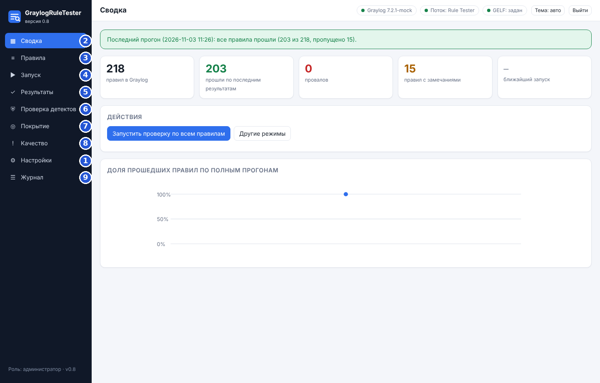
*① Настройки — сначала подключаемся к Graylog. ② Сводка — общее состояние. ③ Правила — каталог. ④ Запуск — здесь всё происходит. ⑤ Результаты — отчёты по прогонам. ⑥ Проверка детектов — тесты на хостах (ART, методика). ⑦ Покрытие — что проверено, а что нет. ⑧ Качество — предупреждения по самим запросам. ⑨ Журнал — кто и что менял.*

Дальше — по порядку.

## Шаг 0. Вход

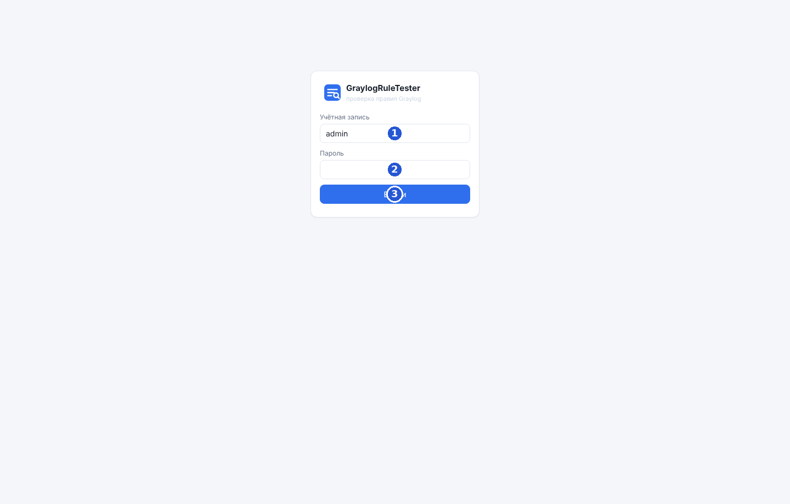
*① Учётная запись (поле уже содержит «admin» — других учёток пока нет). ② Пароль. ③ Войти.*

Пароль администратора задаётся переменной окружения `RT_PASSWORD` при запуске контейнера (см. [главу 16, «Установка в контейнер Podman»](https://github.com/ArsIS-02/Graylog_streams-alerts/blob/main/docs/16-rule-tester.md#установка-в-контейнер-podman)). Отдельная переменная `RT_VIEWER_PASSWORD` включает роль «наблюдатель» — только просмотр, без запуска проверок и без доступа к настройкам.

## Шаг 1. Подключение к Graylog (Настройки)

Без этого шага всё остальное работать не будет: шапка будет показывать «Graylog недоступен», а «Правила» и «Покрытие» — только то, что лежит в каталоге репозитория, без сверки с живым сервером.

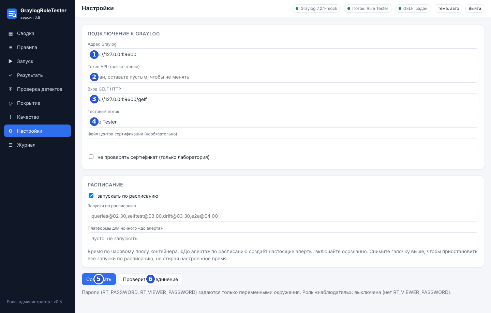
*① Адрес Graylog — REST API, обычно порт 9000. ② Токен API — создаётся в самом Graylog (профиль пользователя → Edit tokens), с правом только на чтение. ③ Вход GELF HTTP — порт для входящих сообщений по HTTP, обычно 12201 или сопоставимый. ④ Тестовый поток — отдельный поток в Graylog, куда инструмент отправляет образцы (заведите его заранее, если нет: Streams → Create stream). ⑤ Сохранить. ⑥ Проверить соединение — запускает тот же `doctor`, что и консольная команда.*

Дополнительно на этой странице:
- **Файл центра сертификации** и галочка «не проверять сертификат» — для self-signed TLS в лаборатории.
- **Расписание** — автоматические прогоны (`queries@02:30,selftest@03:00,drift@03:30,e2e@04:00` и так далее). Время — по часовому поясу контейнера (задаётся `TZ`). «До алерта» по расписанию создаёт настоящие алерты и письма — включайте осознанно.
- Пароли задаются **только** переменными окружения (`RT_PASSWORD`, `RT_VIEWER_PASSWORD`), через веб-форму их сменить нельзя — это намеренное ограничение.

## Шаг 2. Проверка доступа

После «Проверить соединение» (или команды `doctor`) открывается страница «Запуск» с результатом:

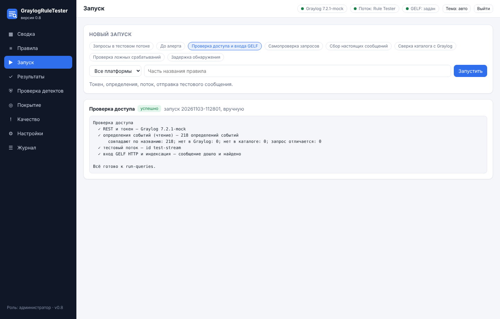

Четыре пункта проверки: REST и токен, определения событий (совпадает ли каталог репозитория с тем, что реально в Graylog, по названиям и запросам), тестовый поток, вход GELF HTTP со сквозной проверкой — сообщение действительно доходит и находится поиском. Если здесь всё зелёное — можно переходить к правилам и запускам; если нет — текст ошибки обычно и есть инструкция, что поправить (не задан поток, недоступен GELF-порт, токен без прав и т.д.).

## Шаг 3. Каталог правил

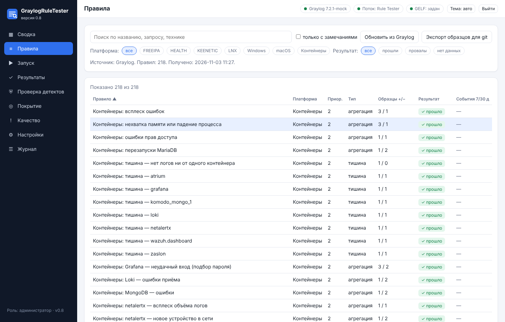

Таблица всех правил каталога: платформа, приоритет, тип (агрегация/тишина/одиночное), сколько образцов (положительных/отрицательных), результат последней проверки, события за 7 и 30 дней. Фильтры сверху — по платформе и по результату. Поиск — по названию, тексту запроса или технике MITRE (например, можно ввести `T1110`, чтобы увидеть все правила на брутфорс).

Клик по строке открывает правило — это способ проверить **одно** правило, не гоняя весь каталог:

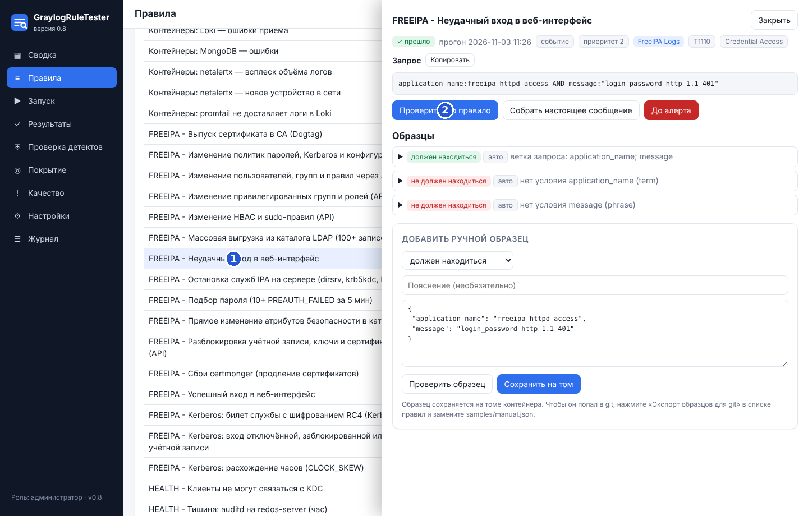
*① Выбрать правило в списке. ② «Проверить это правило» — безопасный прогон: образец уходит в тестовый поток, алертов и писем нет.*

На той же панели — сам запрос правила (с кнопкой «Копировать» для отладки вручную в Graylog), встроенные образцы (должен/не должен находиться, с пояснением, какую ветку запроса каждый проверяет) и форма добавления своего образца. Кнопка «До алерта» (красная, то есть предупреждающая) отправляет сообщение в **боевой** поток и может вызвать настоящий алерт — используйте только когда действительно нужно проверить end-to-end доставку до уведомления.

## Шаг 4. Запуск проверки по всем правилам

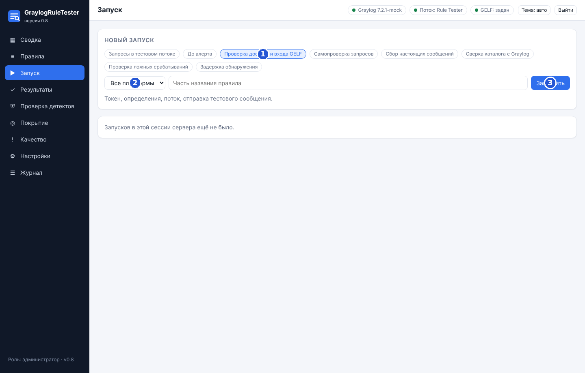
*① Выбрать режим (чип). ② При необходимости сузить по платформе. ③ Запустить.*

Семь режимов доступны из веб-интерфейса (полное описание каждого — в [главе 16](https://github.com/ArsIS-02/Graylog_streams-alerts/blob/main/docs/16-rule-tester.md#интерфейс)): запросы в тестовом потоке (офлайн разбор, самый быстрый и безопасный), до алерта (настоящие алерты и письма — только по необходимости), проверка доступа и входа GELF, самопроверка запросов, сбор настоящих сообщений, сверка каталога с Graylog, проверка ложных срабатываний, задержка обнаружения. `replay` и команды CALDERA в веб-форму не вынесены — им нужен файл сценария или список техник, это консольные команды (шаг 8).

Типичный порядок администратора при регулярной проверке:
1. **Запросы в тестовом потоке** — быстрая офлайн-проверка всего каталога, без всякого риска. Делайте это первым и чаще всего.
2. **До алерта** — точечно, для правил, которые недавно поменяли, или по расписанию ночью.
3. **Сверка каталога с Graylog** (`drift`) — после любой ручной правки правила через API Graylog, чтобы каталог репозитория не разошёлся с тем, что реально работает.
4. **Проверка ложных срабатываний** (`fp-check`) — раз в неделю на боевом трафике, чтобы ловить слишком широкие запросы до того, как они начнут шуметь.
5. **Задержка обнаружения** (`latency`) — раз в месяц, чтобы видеть тренд: не стало ли правило обнаруживать события медленнее.

## Шаг 5. Чтение результатов

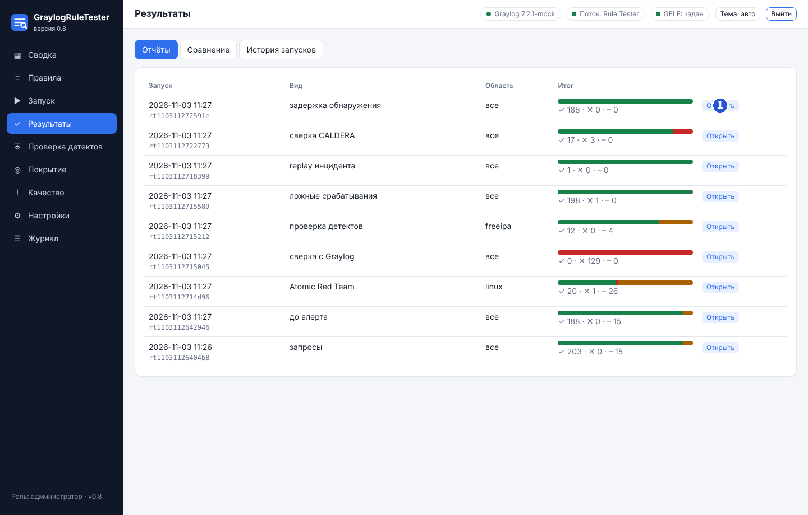
*① Открыть любой отчёт из списка.*

Три вкладки: **Отчёты** — все прогоны с итоговой полосой (зелёное — прошло, красное — провал, серое — нет данных/пропущено); **Сравнение** — сопоставить два прогона бок о бок (удобно смотреть, что изменилось после правки правила); **История запусков** — кто, когда и каким режимом запускал, включая автоматические по расписанию.

Внутри отчёта — построчный разбор по каждому правилу:

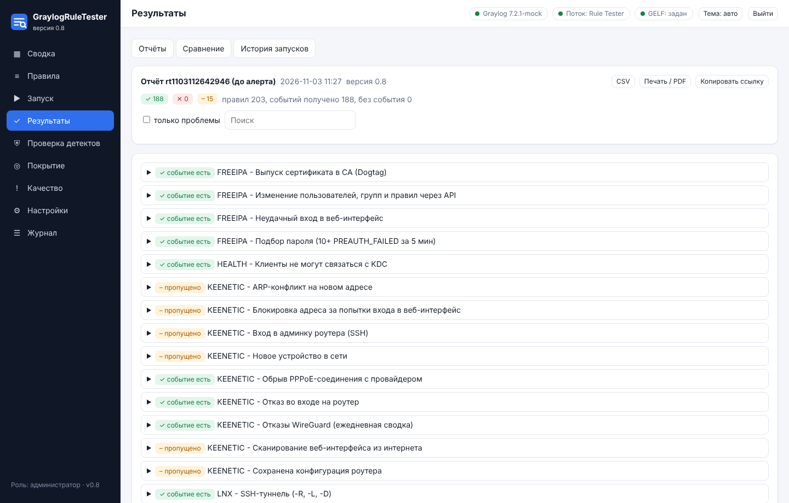

Сверху — сводка (сколько прошло/провалилось/пропущено), кнопки экспорта (CSV, печать/PDF) и «Копировать ссылку» — отчёт можно прислать коллеге напрямую. Каждая строка разворачивается стрелкой и показывает детали: сколько событий, их время, какой запрос сработал.

### Как читать провал

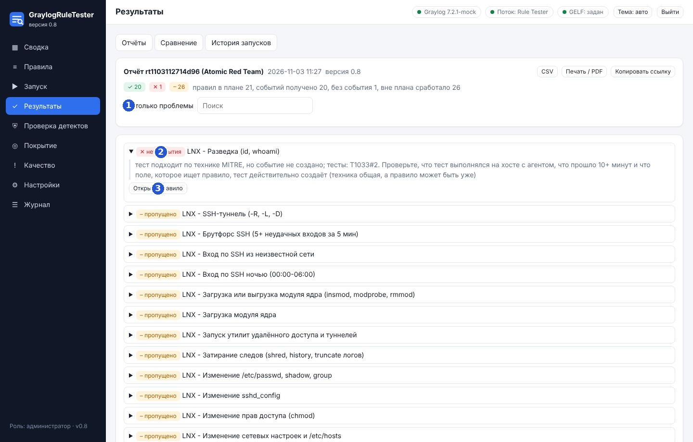
*① Галочка «только проблемы» — скрыть всё, что и так прошло. ② Строка с провалом уже развёрнута — здесь видно, почему: событие ожидалось по технике/тесту, но не создано. ③ «Открыть правило» — одним кликом перейти к правилу и перепроверить вручную.*

Текст подсказки в каждом провале написан так, чтобы сразу объяснять, что проверить: выполнился ли тест на хосте, дошёл ли агент, прошло ли достаточно времени (обычно 10+ минут на индексацию и повторную проверку).

### Сверка каталога с Graylog

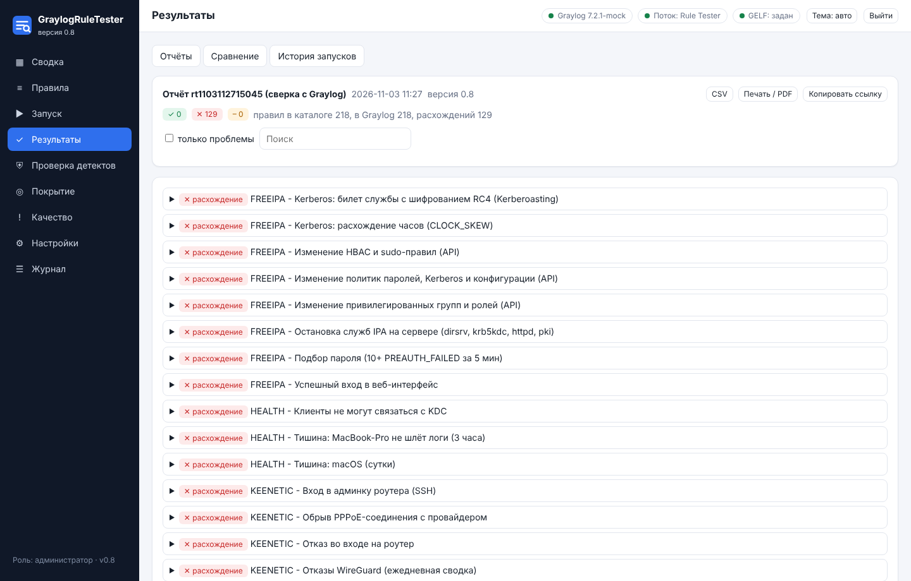

Отчёт `drift` — отдельный случай: здесь не «прошло/провалилось», а «было / стало» по каждому расхождению (запрос, приоритет, условие, список потоков), если правило правили прямо в Graylog, а каталог репозитория не обновили.

### Сверка CALDERA по техникам

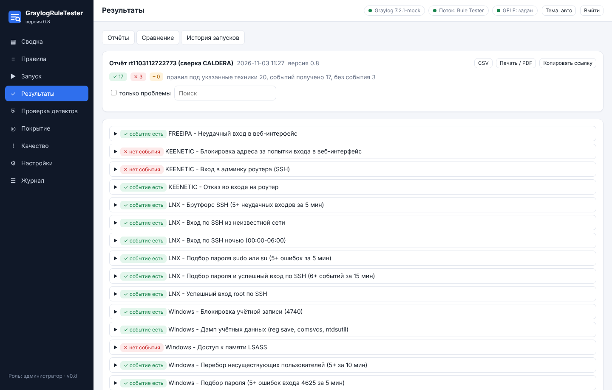

Отчёт `caldera-verify` (консоль, см. шаг 8) выглядит как `art-verify`/`method-verify`, только ключ сверки — список техник MITRE ATT&CK, а не заранее собранный план тестов.

## Шаг 6. Проверка детектов тестами на хостах

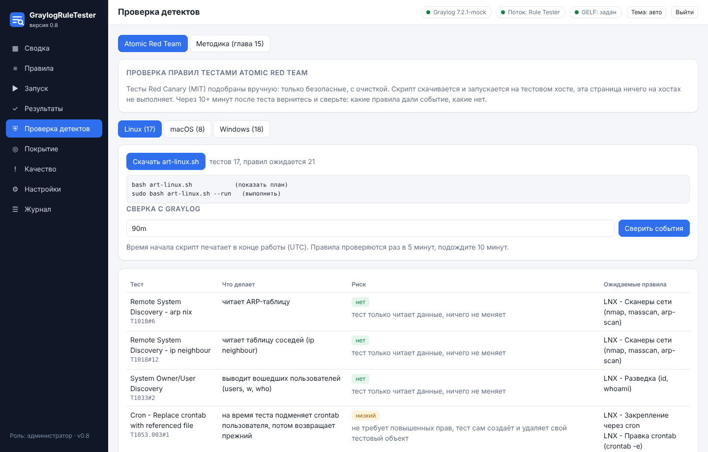

Раздел объединяет два источника тестов на реальных хостах — Atomic Red Team (тесты Red Canary, подобраны вручную, только безопасные с очисткой) и методику главы 15 (скрипты `detection-tests/`):

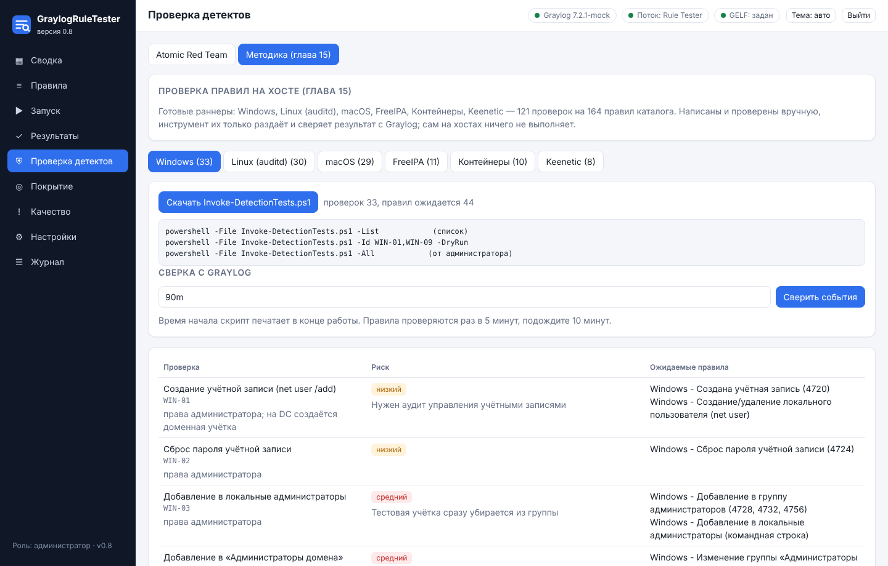

Порядок одинаковый для обеих вкладок: выбрать платформу → скачать скрипт (`art-linux.sh`, `ipa_detection_tests.py` и т.п.) → выполнить его на подходящем хосте (команды показаны прямо на странице, обычно просмотр плана и отдельно выполнение с `--run` или `sudo`) → подождать 10+ минут, пока события дойдут и индексируются → нажать «Сверить события». Колонка «Ожидаемые правила» заранее показывает, что должно сработать — так сразу видно, не перепутан ли тест с правилом.

## Шаг 7. Синтетические техники без готового плана: CALDERA, replay, задержка (консоль)

Три вещи в инструменте работают только из консоли — для них либо нужен файл сценария, либо подключённый CALDERA, либо они просто читают локальные отчёты офлайн. Веб-кнопки для них нет осознанно (как и у `setup`/`generate`).

```bash
cd rule-tester
export GRAYLOG_TOKEN=…

# CALDERA: инструмент не разворачивает сервер и агентов — это делаете сами.
# caldera-plan печатает список техник, под которые уже есть правила —
# по нему в самом CALDERA собираете adversary-профиль (Adversaries → Create,
# фильтр abilities по технике).
python3 rule_tester.py --platform Windows caldera-plan

# После того как профиль отработал на агенте — сверка с Graylog по тем же
# техникам и окну времени:
python3 rule_tester.py --url … caldera-verify --techniques T1110,T1021.004 --since 90m

# Replay — проверка настоящего (или анонимизированного) инцидента: временные
# метки сдвигаются так, что последнее событие сценария становится «сейчас»,
# сообщения реально уходят в боевые потоки. Нужен --yes-send-alerts.
python3 rule_tester.py --url … --gelf … replay --file incident.json --yes-send-alerts

# Задержка обнаружения — офлайн-статистика по уже накопленным локальным
# отчётам (run-e2e/replay знают точный момент отправки; art-verify/
# method-verify/caldera-verify — только приблизительно, от --since).
python3 rule_tester.py latency --days 30
```

Подробности каждой команды, формат файла сценария для `replay` и устройство техник в каталоге детектов — в [главе 16, разделе «Консоль»](https://github.com/ArsIS-02/Graylog_streams-alerts/blob/main/docs/16-rule-tester.md#консоль).

## Шаг 8. Покрытие — что проверено, а что нет

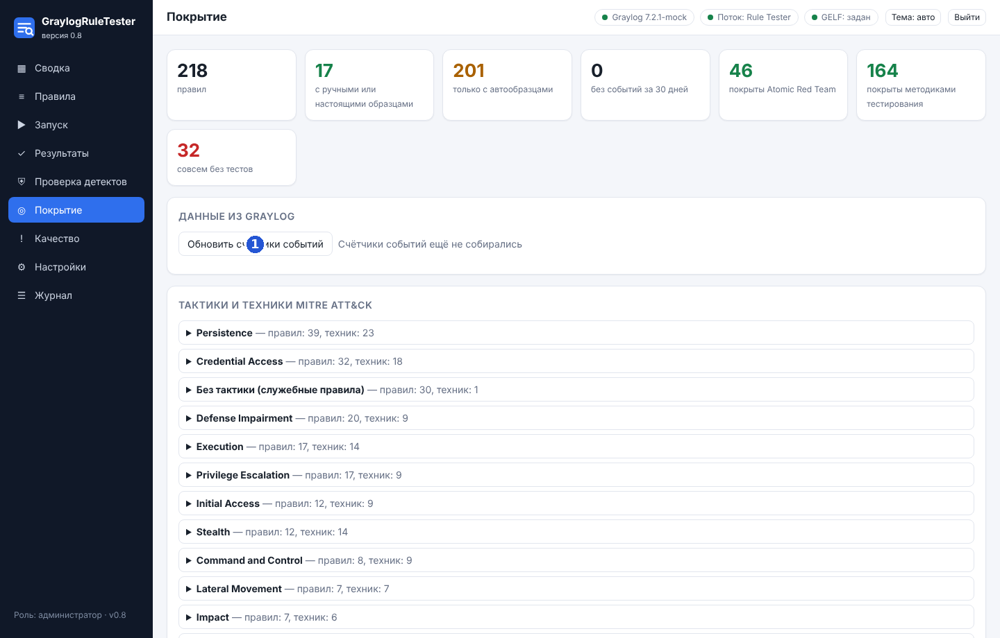
*① «Обновить счётчики событий» — подтягивает из Graylog, сколько раз каждое правило реально сработало за 7/30 дней (отдельно от самих прогонов тестов).*

Шесть счётчиков сверху: сколько правил всего, сколько с ручными или настоящими образцами, сколько только с автообразцами (сгенерированы из запроса — это нижняя планка покрытия), сколько без единого события за 30 дней (кандидаты на «правило сломано» — но проверьте дату последнего срабатывания, возможно, просто давно не было такой активности), сколько покрыто Atomic Red Team, сколько методикой главы 15, и сколько совсем без тестов — ручных, автообразцов, ART или методики.

Ниже — разбивка по тактикам и техникам MITRE ATT&CK: сколько правил и сколько уникальных техник в каждой тактике, с раскрывающимся списком правил внутри. Это та же техническая информация, которую `caldera-plan` использует для построения списка техник под adversary-профиль.

## Шаг 9. Качество запросов

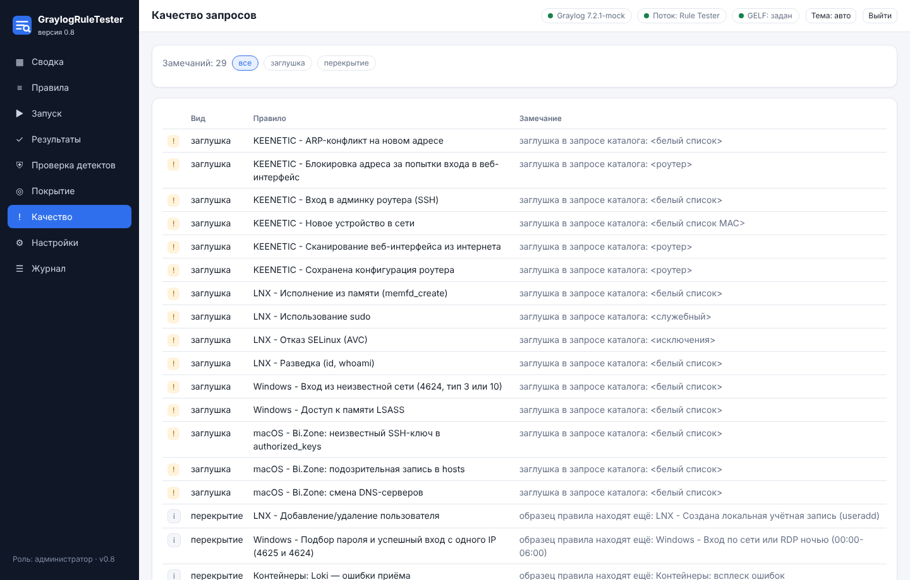

Список правил, в запросе которых есть что-то, требующее внимания человека: **заглушка** — в запросе осталось место вида `<белый список>`, его нужно заполнить реальными значениями (IP, именами хостов, списком учётных записей) перед боевым использованием; **перекрытие** — образец этого правила совпадает ещё и с другим правилом, то есть одно событие может сработать дважды или не туда. Замечания собираются автоматически при разборе каталога (`selftest`), никакого отдельного запуска не требуют.

## Шаг 10. Журнал действий

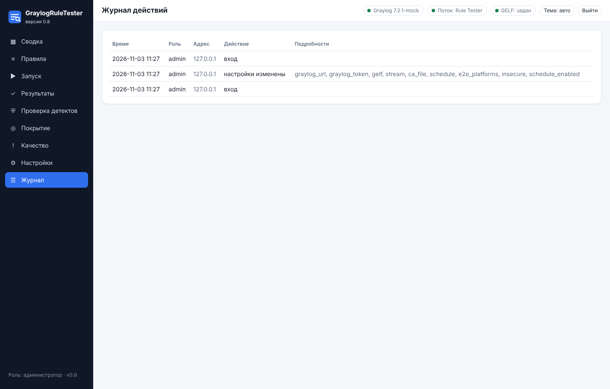

Кто и когда входил, что менял в настройках (с перечнем изменённых полей, но без значений — токены и пароли в журнал не попадают), какие запуски выполнял вручную. Полезно при разборе «кто вчера ночью создал настоящий алерт».

## Итоговый маршрут (шпаргалка)

Первое подключение к новому серверу Graylog:

1. Войти (шаг 0).
2. Настройки → адрес, токен, GELF, тестовый поток → Сохранить → Проверить соединение (шаг 1–2).
3. Правила → убедиться, что каталог совпадает с Graylog (колонка «Результат» не пустая) (шаг 3).
4. Запуск → «Запросы в тестовом потоке» по всем правилам — первая полная проверка (шаг 4).
5. Результаты → разобрать провалы, если есть, через «только проблемы» (шаг 5).
6. Проверка детектов → по возможности прогнать ART/методику хотя бы на одной машине каждой платформы (шаг 6).
7. Покрытие → посмотреть, что осталось совсем без тестов, и решить, чем закрывать: ручным образцом, ART-тестом или CALDERA (шаг 8).
8. Настройки → включить расписание (`queries` ежедневно, `drift`/`fp-check` раз в неделю) (шаг 1).

Дальше — это уже рутина: смотреть «Сводку» раз в день, и раз в месяц — «Задержку обнаружения» и «Покрытие» целиком.
