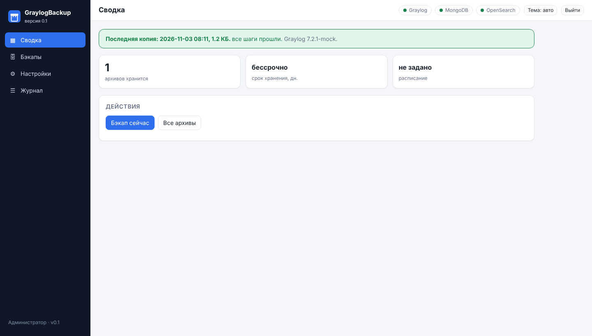
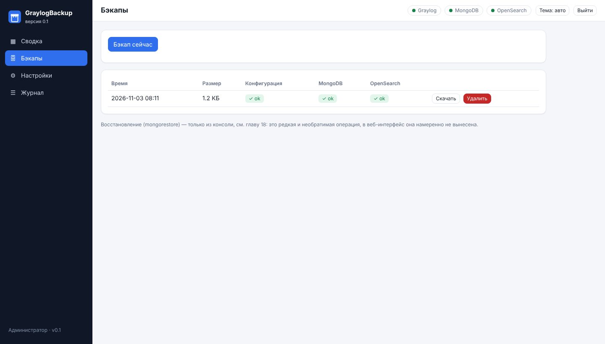
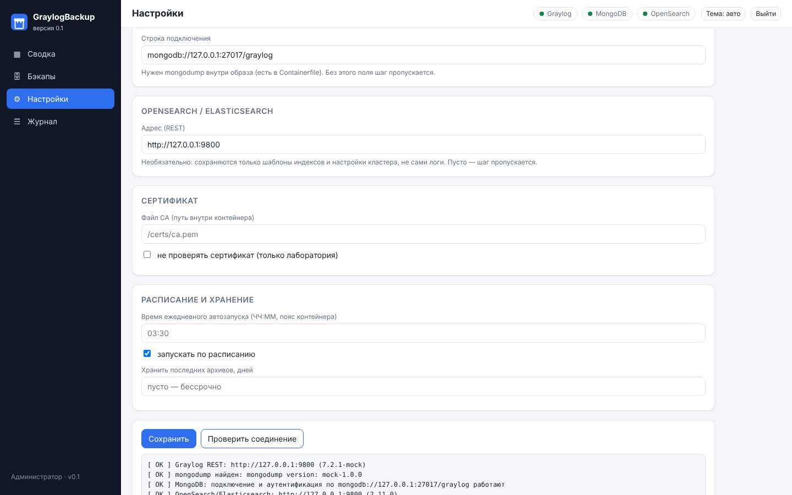

# 18. GraylogBackup: резервное копирование сервера для быстрого восстановления

**GraylogBackup** (версия 0.3, каталог [`graylog-backup/`](../graylog-backup/)) делает резервную копию конфигурации сервера Graylog — не самих логов — так, чтобы при аварии или переносе на другое железо сервер можно было быстро поднять заново, а не восстанавливать потоки, правила, уведомления, справочники и настройки самого сервера руками с нуля. Инструмент не про архив «на всякий случай»: он прямо нацелен на то, чтобы `tar.gz` с диска превратился в работающий Graylog за несколько команд.

Работает так же, как [GraylogRuleTester](16-rule-tester.md): контейнер Podman с веб-интерфейсом (расписание, хранение, журнал) и тот же инструмент как консольный скрипт.

> Скриншоты в этой главе сняты на заглушке Graylog (`mock_graylog.py`-подобный стенд) и с поддельными `mongodump`/`mongorestore`, поэтому в шапке стоит «Graylog 7.2.1-mock».


*Сводка: время и размер последней копии, статус шагов, версия Graylog, ближайший запуск по расписанию.*

## Зачем это нужно

Один `graylog/backup-definitions.js` (скрипт для консоли браузера, см. [«Готовые файлы»](../README.md#-готовые-файлы) в README) сохраняет только определения событий — удобно для быстрой правки одного алерта, но это не восстановление сервера: без потоков, index sets, пользователей, ролей, lookup-таблиц, pipeline-правил, самого `server.conf` и настроек MongoDB восстановленный Graylog всё равно придётся донастраивать вручную. GraylogBackup существует именно для случая «сервер умер или переезжает на новое железо, а алерты должны снова работать как можно быстрее» — отсюда и упор на `mongodump` и `server.conf`, без которых восстановление «один в один» не получится.

## Как это устроено

Семь независимых источников, каждый — отдельным шагом в одном архиве `graylog-backup-<дата>.tar.gz`:

| Шаг | Что сохраняет | Для чего годится |
|---|---|---|
| `config` | Снимок через REST API Graylog: потоки, определения событий, уведомления, index sets, outputs/inputs, pipeline-правила и связи, lookup-таблицы, grok-паттерны, dashboards | Читаемый JSON для просмотра и diff'а в git. **Не восстанавливается импортом одной кнопкой** — это не content pack |
| `mongo` | Полный `mongodump` базы MongoDB Graylog | **Основной источник настоящего восстановления**: пользователи, роли, потоки, правила, index sets, sidecar-конфигурация — бóльшая часть того, что есть в MongoDB |
| `server_conf` | Файл `server.conf` самого `graylog-server` (путь задаётся `GB_SERVER_CONF`, монтируется в контейнер только для чтения) | **Без этого шага восстановление неполное**: именно здесь `password_secret`, которым в MongoDB зашифрована часть значений (секреты некоторых input'ов, lookup-адаптеров) — на новом сервере с другим `password_secret` эти значения не расшифруются. Здесь же `root_password_sha2` и остальные настройки сервера, которых нет в MongoDB |
| `mongod_conf` | Файл `mongod.conf` самой MongoDB (путь — `GB_MONGOD_CONF`, тоже только для чтения) | Настройки хранилища, сети, репликации и, что важнее всего, auth/`keyFile` — без них восстановленный экземпляр MongoDB на новом сервере придётся настраивать вручную, рискуя разойтись с тем, как было |
| `plugins` | Содержимое каталога плагинов `graylog-server` (путь — `GB_PLUGIN_DIR`, тоже монтируется только для чтения), архив `plugins.tar.gz` | `mongodump` сохраняет то, что плагин записал в базу, но не сам `.jar` — без этого шага плагины на новом сервере пришлось бы переустанавливать вручную |
| `search` | Шаблоны индексов OpenSearch/Elasticsearch, component templates, настройки кластера, политики ISM (если есть) — через REST API | Структура индексов. **Сами логи (данные индексов) сюда не попадают** — это задача ротации/снапшотов самого кластера |
| `opensearch_conf` | Файл `opensearch.yml`/`elasticsearch.yml` самого кластера (путь — `GB_OPENSEARCH_CONF`, тоже только для чтения) | Настройки кластера, сети, путей данных уровня самого процесса — то, чего нет в REST API и что `search` не захватывает |

Неудача одного шага не останавливает остальные — у каждого свой статус (`ok`/`partial`/`error`/`skipped`) в `meta.json` внутри архива, рядом с версией Graylog на момент копии (`graylog_version`) и временем выполнения каждого шага. `server_conf`, `mongod_conf`, `opensearch_conf` и `plugins` — по умолчанию `skipped`, если соответствующие переменные (`GB_SERVER_CONF`, `GB_MONGOD_CONF`, `GB_OPENSEARCH_CONF`, `GB_PLUGIN_DIR`) не заданы: это не ошибка, а состояние «источник не подключён», его стоит исправить, если инструмент ставится именно ради аварийного восстановления (см. ниже).

## 🚑 Аварийное восстановление сервера: пошагово

Это главный сценарий, ради которого инструмент сделан. Предполагается, что старый сервер недоступен (авария) либо Graylog переезжает на новое железо, а архив `graylog-backup-<дата>.tar.gz` есть на диске или скачан из веб-интерфейса.

1. **Посмотреть версию Graylog в архиве.** Внутри `tar.gz` лежит `meta.json`, в нём поле `graylog_version` — версия, с которой снята копия:
   ```bash
   tar -xzf graylog-backup-20261103-030000.tar.gz meta.json -O | python3 -m json.tool | grep graylog_version
   ```
   На сводке веб-интерфейса та же версия видна прямо в баннере последней копии, без распаковки архива.
2. **Установить Graylog той же версии** (или максимально близкой минорной) на новом сервере — MongoDB хранит внутренние структуры данных, которые могут не совпадать между мажорными версиями Graylog, поэтому «восстановить 5.2 в 7.2» не гарантирует рабочий результат. Установите MongoDB и OpenSearch/Elasticsearch как обычно, но **graylog-server пока не запускайте**.
3. **Остановить graylog-server**, если он всё же был запущен (например, при переносе «вживую», без аварии) — во время восстановления он не должен писать в базу поверх распаковываемых данных:
   ```bash
   systemctl stop graylog-server     # или: podman stop graylog-server
   ```
4. **Восстановить `server.conf`.** Сделайте это до первого запуска `graylog-server` на новом сервере — так новый сервер сразу стартует с тем же `password_secret`, и значения, зашифрованные им в MongoDB, расшифруются:
   ```bash
   tar -xzf /путь/graylog-backup-20261103-030000.tar.gz server.conf
   cp server.conf /etc/graylog/server/server.conf   # путь зависит от дистрибутива/установки
   chown graylog:graylog /etc/graylog/server/server.conf && chmod 640 /etc/graylog/server/server.conf
   ```
   Если шаг `server_conf` архива стоит `skipped` или `error` (см. ниже), этого файла в архиве нет — тогда `server.conf` нового сервера нужно настроить вручную, **обязательно скопировав `password_secret` со старого сервера** (из резервной копии файла, из менеджера паролей или откуда он ещё у вас записан) — без совпадающего `password_secret` часть зашифрованных значений в восстановленной MongoDB не заработает молча, без явной ошибки, и это самая неприятная находка уже после того, как всё вроде бы «восстановилось».
5. **Восстановить `mongod.conf` и `opensearch.yml`/`elasticsearch.yml`, если нужен новый экземпляр MongoDB/OpenSearch.** Сделайте это **до первого запуска** соответствующей службы на новом сервере — так же, как с `server.conf` на шаге 4:
   ```bash
   tar -xzf /путь/graylog-backup-20261103-030000.tar.gz mongod.conf opensearch.yml
   cp mongod.conf /etc/mongod.conf                                        # путь зависит от дистрибутива
   cp opensearch.yml /etc/opensearch/opensearch.yml                       # аналогично для elasticsearch.yml
   ```
   Если вы просто переносите Graylog на новый сервер, а MongoDB/OpenSearch остаются прежними (не переустанавливаются), этот шаг не нужен — конфигурация СУБД не менялась. Если же поднимается новый экземпляр MongoDB или OpenSearch «с нуля», без этих файлов auth (`keyFile`), сетевые настройки и параметры кластера придётся восстанавливать вручную, что особенно неприятно для `keyFile` — без него узлы реплика-сета или шарды не смогут аутентифицироваться друг у друга.
6. **Восстановить плагины**, если архив их содержит:
   ```bash
   tar -xzf /путь/graylog-backup-20261103-030000.tar.gz plugins.tar.gz -O | tar -xzC /usr/share/graylog-server/plugin/
   ```
   Версии плагинов должны быть совместимы с версией Graylog, которую вы установили на шаге 2 — если плагин был собран под другую версию API плагинов, Graylog при старте может отказаться его загрузить (это будет видно в логе `graylog-server`).
7. **Восстановить MongoDB из архива.** Это основное восстановление, которое переносит потоки, правила, пользователей, роли и всё остальное содержимое базы:
   ```bash
   python3 graylog-backup/backup.py restore-mongo \
       --archive /путь/graylog-backup-20261103-030000.tar.gz \
       --yes
   ```
   По умолчанию команда **стирает существующие коллекции** перед восстановлением (`mongorestore --drop`) — так новая база гарантированно не смешается со старой. Флаг `--yes` обязателен: без него команда ничего не делает и выходит с ошибкой, это осознанный предохранитель, а не галочка для автоматизации. `--no-drop`, наоборот, добавляет данные к уже существующим — пригодится, если восстанавливаетесь в заведомо пустую базу и хотите на всякий случай оставить то немногое, что там могло быть.
8. **Запустить graylog-server.** При первом запуске после восстановления он подхватит `server.conf` с хоста и пользователей, роли, потоки, правила, index sets и prefs из MongoDB — на этом шаге обычно всё и оживает.
   ```bash
   systemctl start graylog-server
   ```
9. **Проверить OpenSearch/Elasticsearch.** Если это тоже новый кластер (не просто перезапуск старого), создайте индексы по шаблонам из `opensearch-templates.json` того же архива — вручную через `_index_template`/`_component_template` или сверяясь с ними при настройке index sets в интерфейсе Graylog. Это только структура, логи в архиве не хранятся: старые данные индексов восстановлению не подлежат, если под них не было отдельного снапшота самого OpenSearch.
10. **Сверить с `config-snapshot.json`.** Он не импортируется, но удобен как контрольный список: откройте JSON и на глаз (или через `drift` из [GraylogRuleTester](16-rule-tester.md#сверка-каталога-репозитория-с-живым-graylog-drift), если это ваши детекты) сверьте количество потоков, определений событий, уведомлений и pipeline-правил с тем, что получилось после восстановления MongoDB — пустых мест быть не должно.
11. **Проверить алерты.** Самый надёжный способ убедиться, что всё действительно восстановилось, а не просто запустилось — прогнать [GraylogRuleTester](16-rule-tester.md) (`run-queries` или кнопка «Проверить запросы» в интерфейсе): если правила снова находят образцы, значит, и потоки, и определения событий, и lookup-таблицы на месте, а секреты, зашифрованные `password_secret`, расшифровались.

Если авария случилась между двумя резервными копиями, потеряются изменения конфигурации за это время (новые или изменённые правила, lookup-записи и т.п.) — отсюда и важность расписания с разумной частотой (см. ниже), а не разового бэкапа «для галочки».

### Если какого-то из шагов нет в архиве

- **`mongo` — `skipped` или `error`.** Настоящего восстановления из этого архива не будет вовсе, доступен только `config-snapshot.json` для сверки руками. Это самое важное — проверяйте на сводке или странице «Бэкапы», что у последних копий шаг `mongo` зелёный (`✓ ok`), а не просто ориентируйтесь на факт, что архив вообще существует.
- **`server_conf` — `skipped` или `error`.** MongoDB восстановится, но без совпадающего `password_secret` часть значений в ней не расшифруется (см. шаг 4 выше) — нужно будет вручную перенести `password_secret` со старого сервера, если он ещё доступен.
- **`mongod_conf`/`opensearch_conf` — `skipped`, `error` или `partial`** (`partial` — файл прочитался, но в нём не нашлось ожидаемого содержимого, например `storage:` в `mongod.conf` или `cluster.name` в `opensearch.yml` — похоже, смонтирован не тот файл). Если поднимается новый экземпляр СУБД «с нуля», конфигурацию (включая `keyFile` для MongoDB) придётся восстанавливать вручную; если MongoDB/OpenSearch просто продолжают работать как были (не переустанавливались), это не критично.
- **`plugins` — `skipped`, `error` или `partial`** (`partial` — часть файлов каталога не прочиталась, обычно из-за прав доступа). Плагины придётся переустановить вручную тем же способом, каким они ставились изначально.

## Подготовка (один раз)

1. **Токен API Graylog** — такой же read-only токен, как у [GraylogRuleTester](16-rule-tester.md#подготовка-graylog-один-раз), можно использовать тот же самый.
2. **Строка подключения к MongoDB.** Для контейнера: `mongodb://host.containers.internal:27017/graylog` (если MongoDB — служба на хосте). Пользователь, под которым работает `mongodump`, должен иметь право на чтение всей базы Graylog.
3. **Пути к `server.conf`, `mongod.conf`, `opensearch.yml` и каталогу плагинов на хосте(ах)**, если нужен полный бэкап для аварийного восстановления (см. выше, зачем это важно) — `install.sh` сам смонтирует их в контейнер только для чтения, достаточно указать реальные пути хоста в `graylog-backup.env` (`HOST_SERVER_CONF`, `HOST_MONGOD_CONF`, `HOST_OPENSEARCH_CONF`, `HOST_PLUGIN_DIR`, см. таблицу ниже). Без этого шаги `server_conf`/`mongod_conf`/`opensearch_conf`/`plugins` будут пропускаться — не ошибка, но и не полный бэкап. `mongod.conf`/`opensearch.yml` часто лежат на других хостах, чем `graylog-server` — контейнер должен стоять там, где лежит нужный файл.
4. **Адрес OpenSearch/Elasticsearch** — необязательно, без него шаг `search` просто пропускается.
5. **Проверка всего сразу** — `doctor` в консоли или кнопка «Проверить соединение» на странице «Настройки» веб-интерфейса.

## Установка в контейнер Podman

```bash
git clone https://github.com/ArsIS-02/Graylog_streams-alerts.git
cd Graylog_streams-alerts
bash graylog-backup/deploy/install.sh      # первый запуск создаёт ~/graylog-backup/graylog-backup.env и останавливается
nano ~/graylog-backup/graylog-backup.env   # заполнить, см. таблицу ниже (файл chmod 600)
bash graylog-backup/deploy/install.sh      # собирает образ, ставит quadlet-юнит, запускает службу
```

Обновление: `git pull && bash graylog-backup/deploy/install.sh`. Настройки и архивы лежат на томе `graylog-backup-data` и при обновлении сохраняются.

Контейнер запускается с `ReadOnly=true`, без привилегий и без лишних capability (`DropCapability=ALL`, `NoNewPrivileges`), как и rule-tester. Образ при сборке докачивает `mongodb-database-tools` (официальный статический архив с `fastdl.mongodb.org` — в репозиториях Debian этого пакета нет) и проверяет, что `mongodump`/`mongorestore` действительно работают (`--version` на этапе сборки).

| Переменная | Назначение |
|---|---|
| `GRAYLOG_URL` | Адрес Graylog. Из контейнера до Graylog на хосте — `http://host.containers.internal:9000` |
| `GRAYLOG_TOKEN` | Токен API (только чтение; подходит тот же, что у rule-tester) |
| `GB_MONGO_URI` | Строка подключения к MongoDB Graylog, например `mongodb://host.containers.internal:27017/graylog` |
| `HOST_SERVER_CONF` | **Путь на хосте** к `server.conf` graylog-server. `install.sh` сам монтирует этот файл в контейнер только для чтения и прописывает `GB_SERVER_CONF` — вручную эту переменную в `.env` заполнять не нужно (см. предупреждение в самом `env.example`) |
| `HOST_MONGOD_CONF` | **Путь на хосте** к `mongod.conf`. Та же логика, что у `HOST_SERVER_CONF`, только для `GB_MONGOD_CONF` — обычно на другом хосте, чем `graylog-server`, если MongoDB вынесена отдельно |
| `HOST_OPENSEARCH_CONF` | **Путь на хосте** к `opensearch.yml`/`elasticsearch.yml`. Та же логика, только для `GB_OPENSEARCH_CONF` |
| `HOST_PLUGIN_DIR` | **Путь на хосте** к каталогу плагинов graylog-server. Та же логика, что у `HOST_SERVER_CONF`, только для `GB_PLUGIN_DIR` |
| `GB_OPENSEARCH_URL` | Адрес OpenSearch/Elasticsearch (необязательно; пусто — шаг `search` пропускается) |
| `GB_PASSWORD` | Пароль администратора интерфейса (обязателен; роль одна — инструмент только читает и архивирует, ничего в Graylog не пишет) |
| `GB_CA_FILE`, `GB_INSECURE` | Свой центр сертификата либо отключение проверки сертификата (только лаборатория) |
| `GB_DATA` | Каталог тома: архивы, настройки, журнал |
| `GB_RETENTION_DAYS` | Хранить столько последних дней архивов, остальные удалять автоматически раз в сутки; пусто — бессрочно |
| `GB_SCHEDULE` | Время ежедневного автозапуска, например `03:30` (по часовому поясу контейнера); пусто — по расписанию не запускать |
| `GB_SCHEDULE_ENABLED` | `0` — приостановить запуски по расписанию, не стирая само время |
| `GB_PORT` | Порт веб-интерфейса внутри контейнера (по умолчанию 8080) |

Значения, сохранённые на странице «Настройки», лежат на томе (`settings.json`, права 0600) и **имеют приоритет** над переменными окружения — так же, как у rule-tester. Пароль (`GB_PASSWORD`), `server.conf`, `mongod.conf`, `opensearch.yml` и каталог плагинов (через `HOST_SERVER_CONF`/`HOST_MONGOD_CONF`/`HOST_OPENSEARCH_CONF`/`HOST_PLUGIN_DIR`) задаются только переменными/при установке — в веб-интерфейсе это не редактируется, только видно текущее состояние («смонтирован» / «не смонтирован») на странице «Настройки».

Если файл или каталог на хосте читается не для всех (обычный случай для `server.conf`: владелец `root`/`graylog`, права `0640`), `install.sh` предупредит об этом при установке, но юнит всё равно поставит — внутри контейнер работает от непривилегированного пользователя (`uid 10002`), и если он не сможет прочитать примонтированный файл, соответствующий шаг будет падать с `error`, а не тихо пропускаться. Проще всего добавить группе, под которой работает контейнер, право на чтение (`setfacl` или общая группа), не ослабляя права сверх необходимого.

### Если SELinux enforcing

На хостах с SELinux в режиме `Enforcing` (проверить: `getenforce`) контейнер при старте может упасть ещё до запуска Python, с ошибкой вроде:

```
Error: lsetxattr(label=system_u:object_r:container_file_t:s0:cXXX,cYYY) /usr/share/graylog-server/plugin: operation not permitted
```

Это не ошибка самого GraylogBackup — так себя ведёт rootless Podman при попытке примонтировать `server.conf`/каталог плагинов/`mongod.conf`/`opensearch.yml` с автоматическим relabel (раньше в `install.sh` эти монтирования шли с суффиксом `:Z`). Relabel — это `lsetxattr` на security-атрибут файла, а его может выполнить только владелец файла или процесс с `CAP_FOWNER`; эти пути почти всегда принадлежат `root`/`graylog`/другой системной учётке, а не пользователю, под которым крутится rootless-контейнер (в примере выше — `redos`), поэтому ядро отказывает с `operation not permitted` ещё до того, как успевает включиться сам SELinux.

`install.sh`, начиная с версии 0.3, монтирует эти пути **без** `:Z` — relabel при каждом старте контейнеру больше не нужен. Но раз контейнер читает файл со своим штатным SELinux-типом хоста (например, `usr_t` для `/usr/share/...`, `etc_t` для `/etc/...`), а не с типом `container_file_t`, то при enforcing-политике сам доступ на чтение изнутри контейнера будет запрещён тоже — просто с другой ошибкой (`Permission denied` внутри контейнера, а не при старте). Поэтому тип нужно выставить **один раз от root**, постоянно (переживает `restorecon`/перезагрузки), под каждый путь, который вы монтируете:

```bash
sudo semanage fcontext -a -t container_file_t "/usr/share/graylog-server/plugin(/.*)?"
sudo restorecon -Rv /usr/share/graylog-server/plugin

sudo semanage fcontext -a -t container_file_t "/etc/graylog/server/server.conf"
sudo restorecon -v /etc/graylog/server/server.conf

# аналогично для HOST_MONGOD_CONF/HOST_OPENSEARCH_CONF, если задавали их в .env
```

`install.sh` сам определяет `getenforce` и печатает эти команды с подставленным путём для каждого заданного `HOST_*`, если видит `Enforcing` — остаётся скопировать и выполнить их от root один раз, затем переустановить (`bash graylog-backup/deploy/install.sh`) или просто `systemctl --user restart graylog-backup.service`. Если `semanage` не установлен (пакет `policycoreutils-python-utils` или аналог для вашего дистрибутива), `sudo` его поставит через пакетный менеджер.

### Доступ по адресу через Caddy

Интерфейс слушает порт **8086** хоста (у rule-tester — 8085). В `deploy/graylog-backup.container` и `podman-compose.yaml` стоит `8086:8080`, опубликован не только на loopback — так же, как у rule-tester (см. [главу 16](16-rule-tester.md#доступ-по-адресу-через-caddy) про то, почему это важно для Caddy в отдельном контейнере). В панели сервисов карточка:

| Поле | Значение |
|---|---|
| Название | GraylogBackup |
| Адрес | `graylog-backup` (получится `graylog-backup.apps.monitoring.test`) |
| Backend, схема | `host.containers.internal:8086`, `http` |
| Галочки «не проверять сертификат», «Host», «закрыть входом» | выключены, у инструмента свой вход по паролю |

### firewalld

Если Caddy (или любой другой клиент, которому нужен интерфейс) работает **на том же хосте**, что и сам контейнер — через `host.containers.internal` или просто `127.0.0.1` — открывать порт в firewalld не нужно: это локальный трафик, он не пересекает внешний периметр хоста, ровно как у rule-tester и его порта 8085 (см. [главу 16](16-rule-tester.md#доступ-по-адресу-через-caddy)).

Порт нужно открыть, только если к интерфейсу GraylogBackup обращаются **напрямую по сети**, в обход Caddy (например, временно, при отладке, или если сервис публикуется без общего реверс-прокси):

```bash
firewall-cmd --permanent --add-port=8086/tcp
firewall-cmd --reload
```

Проверить, что правило встало: `firewall-cmd --list-ports` (должно быть видно `8086/tcp`). Если позже порт решите не публиковать наружу напрямую, откатить так же: `firewall-cmd --permanent --remove-port=8086/tcp && firewall-cmd --reload`. Никаких дополнительных портов GraylogBackup не слушает — в отличие от rule-tester, у него нет своего входа GELF.

## Интерфейс

Слева меню: Сводка, Бэкапы, Настройки, Журнал.

На **Сводке** — время, размер и статус шагов последней копии, версия Graylog на момент копии, ближайший автозапуск по расписанию, кнопка «Бэкап сейчас».

### Бэкапы


*Таблица архивов: дата, размер, статус каждого из семи шагов (`✓ ok`, `~ partial`, `✗ error`, `- skipped`), версия Graylog.*

У каждого архива — скачивание (по архиву переносится токен Graylog в открытом виде, как и в самом архиве, храните бережно) и удаление. Восстановление (`mongorestore`) в этой таблице кнопки не имеет — **оно сознательно вынесено только в консоль**, см. раздел «Аварийное восстановление» выше: это редкая и необратимая операция (стирает текущую базу), запускать её с одного клика в веб-интерфейсе было бы слишком легко сделать по ошибке.

### Настройки


*Адреса Graylog/MongoDB/OpenSearch, состояние server.conf, mongod.conf, opensearch.yml и каталога плагинов (смонтированы или нет — редактируется только при установке), сертификат, расписание и хранение, кнопка «Проверить соединение» с результатом по каждому из семи источников.*

Кнопка «Проверить соединение» делает то же, что консольный `doctor`: Graylog REST (с версией), наличие `mongodump` в образе, подключение и аутентификация к MongoDB (пробным `mongodump` по несуществующей коллекции — минимально инвазивно, с учётом того, называет ли сама строка подключения базу: иначе `mongodump` откажется стартовать из-за конфликта `--db` с URI), доступность и валидность `server.conf` (наличие `password_secret`), `mongod.conf` (наличие раздела `storage:`), `opensearch.yml`/`elasticsearch.yml` (наличие `cluster.name`), каталог плагинов, OpenSearch/Elasticsearch.

### Журнал

Записаны действия: вход, запуск копии, изменение настроек, скачивание и удаление архивов. Ведётся на томе в `audit.jsonl`, как у rule-tester.

## Консоль

```bash
export GRAYLOG_TOKEN=…
export GB_MONGO_URI=mongodb://127.0.0.1:27017/graylog
export GB_SERVER_CONF=/etc/graylog/server/server.conf          # необязательно, но нужен для полного DR-бэкапа
export GB_MONGOD_CONF=/etc/mongod.conf                         # необязательно
export GB_OPENSEARCH_CONF=/etc/opensearch/opensearch.yml       # необязательно
export GB_PLUGIN_DIR=/usr/share/graylog-server/plugin          # необязательно
cd graylog-backup
python3 backup.py --url https://graylog.apps.monitoring.test doctor                       # проверка всех семи источников
python3 backup.py --url … --out-dir /var/backups/graylog run                              # резервная копия, все семь шагов
python3 backup.py --url … --out-dir … run --skip-search                                   # без шага search
python3 backup.py --url … --out-dir … run --skip-server-conf --skip-plugins               # без server.conf и плагинов
python3 backup.py --url … --out-dir … run --skip-mongod-conf --skip-opensearch-conf       # без mongod.conf и opensearch.yml
python3 backup.py --out-dir /var/backups/graylog list                                     # список архивов на диске
python3 backup.py --out-dir /var/backups/graylog prune --days 30                           # удалить архивы старше 30 дней
python3 backup.py restore-mongo --archive /var/backups/graylog/graylog-backup-....tar.gz --yes   # восстановление MongoDB, см. выше
tar -xzf /var/backups/graylog/graylog-backup-....tar.gz server.conf mongod.conf opensearch.yml plugins.tar.gz   # достать файлы конфигурации и плагины вручную
python3 backup.py --version
```

Команды: `doctor`, `run`, `list`, `prune`, `restore-mongo`. Общие флаги (`--url`, `--insecure`, `--ca-file`, `--out-dir`) пишутся **до** имени команды, как у `rule_tester.py`: `backup.py --out-dir /путь run`, а не `backup.py run --out-dir /путь`. `run` возвращает код 2, если хотя бы один шаг завершился с `error` — удобно для cron: по расписанию в контейнере то же самое делает встроенный планировщик веб-интерфейса, а `cron`/`systemd timer` пригодится, если инструмент запускается вне контейнера. Восстановление `server.conf`, `mongod.conf`, `opensearch.yml` и плагинов отдельной команды не имеет — это просто распаковка нужных файлов из архива на место, см. раздел «Аварийное восстановление» выше.

## Безопасность

- Вход — по учётной записи и паролю (роль одна, `admin`; других не планируется — инструмент не пишет в Graylog ничего, кроме как читает конфигурацию и индексы), сессия с `HttpOnly`/`SameSite=Strict`, свои диалоги интерфейса без системных окон браузера, строгая CSP.
- Токен Graylog нужен только для чтения. MongoDB и `server.conf`/`mongod.conf`/`opensearch.yml`/каталог плагинов — тоже только для чтения в режиме `run` (`mongodump` ничего не меняет, файлы монтируются `:ro`); запись в MongoDB происходит ровно в одном месте — `restore-mongo`, который доступен только из консоли и требует `--yes`.
- **Архив с шагом `server_conf` — один из самых чувствительных файлов во всей инфраструктуре**, не просто «ещё одна резервная копия»: в нём в открытом виде лежат `password_secret` (которым в MongoDB зашифрована часть секретов) и `root_password_sha2` (хэш пароля администратора Graylog). Вместе с `mongodump` (пользователи, роли, конфигурация inputs) такой архив достаточен, чтобы полностью восстановить или подменить сервер Graylog — храните и передавайте его так же бережно, как ключи от самого сервера, не только как «бэкап конфигурации». Если `GB_SERVER_CONF` не настроен, этого риска нет, но нет и полноты DR-бэкапа — компромисс обсуждается в начале главы.
- **Шаг `mongod_conf` тоже чувствителен**, если в `mongod.conf` прописан `security.keyFile` или другие параметры аутентификации — сам ключевой файл шаг не захватывает (он отдельный файл на диске, не часть `mongod.conf`), но путь к нему и схема аутентификации в архиве видны. Обращайтесь с архивом соответственно.
- В журнал пишутся только имена изменённых настроек, значения и токен в журнал не попадают. Файл `graylog-backup.env` не коммитить (в репозитории только `deploy/env.example`).

## Чем это дополняет `backup-definitions.js`

[`graylog/backup-definitions.js`](../graylog/backup-definitions.js) остаётся удобным для быстрого разового экспорта одних только определений событий прямо из браузера, без установки и настройки контейнера — например, перед рискованной правкой одного алерта. GraylogBackup его не заменяет для этой узкой задачи, но для всего остального — расписания, полного состава конфигурации, а главное, для настоящего восстановления через MongoDB — нужен именно он: ручной скрипт в консоли браузера восстановить сервер не поможет.

## Файлы

| Файл | Зачем |
|---|---|
| [`backup.py`](../graylog-backup/backup.py) | консольный инструмент: `doctor`, `run`, `list`, `prune`, `restore-mongo` |
| [`gl_client.py`](../graylog-backup/gl_client.py) | минимальный REST-клиент Graylog (копия подхода из `rule-tester/graylog_api.py`) |
| [`web.py`](../graylog-backup/web.py), [`web_index.html`](../graylog-backup/web_index.html) | веб-интерфейс, расписание, хранение, журнал |
| [`Containerfile`](../graylog-backup/Containerfile), [`deploy/`](../graylog-backup/deploy/) | контейнер (с `mongodb-database-tools`), compose, quadlet, `install.sh` (сам монтирует `server.conf`/`mongod.conf`/`opensearch.yml`/каталог плагинов по `HOST_SERVER_CONF`/`HOST_MONGOD_CONF`/`HOST_OPENSEARCH_CONF`/`HOST_PLUGIN_DIR` из `.env`), пример настроек |

Лицензия: GPL-3.0, как и весь репозиторий.
