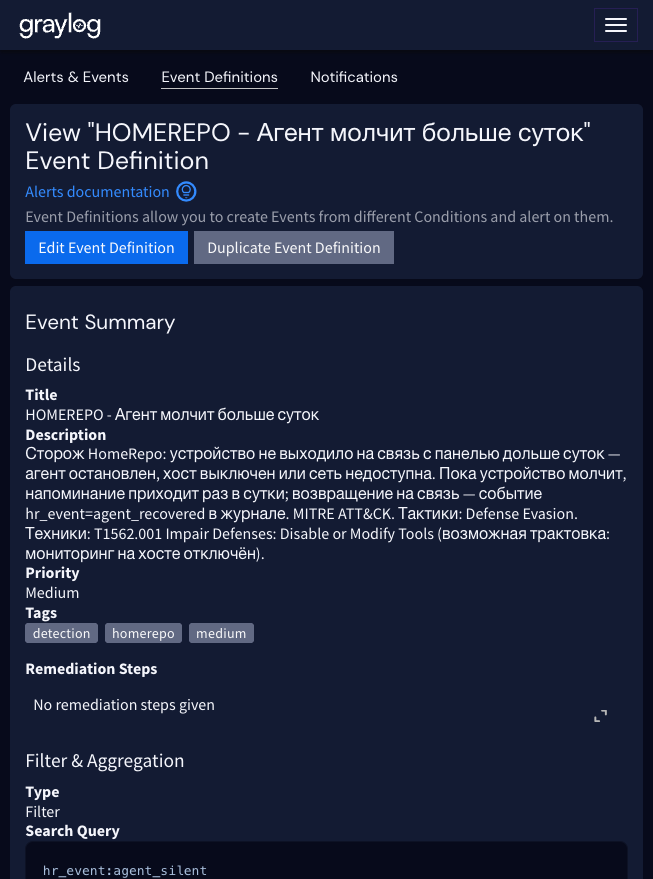
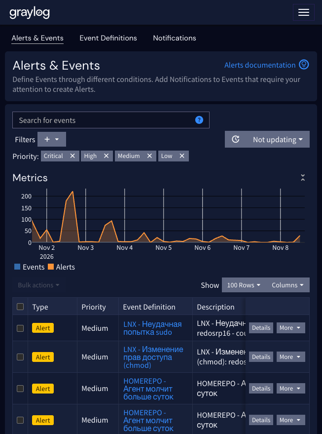
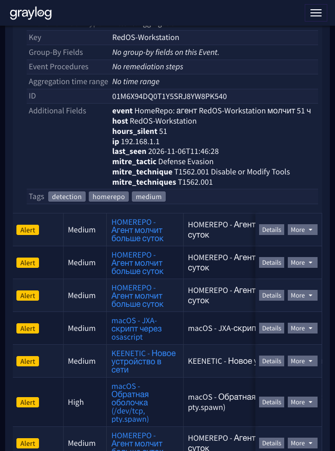

# 22. HomeRepo: алерт «агент молчит больше суток»

Глава 21 научила панель HomeRepo писать журнал действий в Graylog. Но у самого важного вопроса — «живы ли вообще хосты?» — ответа в Graylog не было. Агент HomeRepo опрашивает панель каждые 2 минуты; если устройство молчит дольше суток, что-то сломалось: агент остановлен, хост выключен, сеть или VPN недоступны. В лаборатории это и случилось: рабочая станция молчала двое суток, а хост с Wazuh — почти неделю, и никто не замечал, пока не посмотрели в панель руками.

Теперь за этим следит сам HomeRepo: встроенный сторож (watchdog) раз в час проверяет, кто из агентов молчит дольше суток, и шлёт в Graylog событие `hr_event:agent_silent`, а на него срабатывает алерт с письмом.

> **Статус проверки.** Сторож покрыт тестами в репозитории HomeRepo (тревога, отсутствие дублей, возвращение, забывание удалённых устройств). В лаборатории на Graylog 7.2.1 (ноябрь 2026) пройден полный путь: тестовое сообщение по GELF → событие с полями и тегами → письмо «Mail.ru Alert Homelab tools»; после обновления панели боевые тревоги по двум реально молчащим хостам пришли сами через минуту после запуска службы.



## Как это устроено

Сторож — фоновый поток службы панели (`homerepo-web`), модуль `lib/homerepo/watchdog.py` в [HomeRepo](https://github.com/ArsIS-02/HomeRepo):

- раз в час (первый проход — через минуту после старта службы) читает `last_poll` всех устройств из базы панели;
- молчание дольше 24 часов (`last_poll`, а если его ещё не было — `enrolled`) → сообщение в Graylog с `hr_event=agent_silent`, уровень warning;
- пока устройство не вернулось, напоминание уходит **не чаще раза в сутки** — состояние хранится в таблице `settings` базы, схема не менялась;
- устройство снова вышло на связь → одно сообщение `hr_event=agent_recovered` (уровень info, алерта нет — просто запись в журнале);
- устройство, удалённое из панели, сторож забывает: тревог по нему больше не будет;
- если в `homerepo.conf` не настроен `[graylog] gelf_host`, сторож пишет в журнал «GELF не настроен — сторож выключен» и завершается: панели он не мешает.

Поля сообщения (префикс `_` у GELF Graylog снимает):

| Поле | Что в нём |
|---|---|
| `hr_event` | `agent_silent` или `agent_recovered` |
| `hr_agent_name` | имя устройства в панели |
| `hr_ip` | адрес, с которого агент выходил на связь |
| `hr_hours_silent` | сколько часов молчит (на момент отправки) |
| `hr_last_seen` | когда панель видела агента последний раз |
| `hr_source`, `homelab_app` | `homerepo` — по ним сообщение попадает в поток «HomeRepo» (глава 21) |

## Установка и проверка

Сторож есть в HomeRepo начиная с версии 2.4.0. Обновление на сервере репозитория — обычное:

```bash
cd ~/homerepo-git && git pull && sudo ./deploy/install.sh --yes
```

Служба панели перезапустится со сторожем, и через минуту он сделает первый проход — если молчащие устройства уже есть, тревоги уйдут сразу.

Разовая проверка вручную (без ожидания часового цикла):

```bash
sudo homerepo watchdog
# проверено: тревог о молчащих 2, возвращений на связь 0
```

**Важно: только через sudo.** Командная строка `homerepo` рассчитана на root: она сама понижается до пользователя панели, и только так получает доступ к базе `/var/lib/homerepo/homerepo.db`. От обычного пользователя получите `sqlite3.OperationalError: unable to open database file` — это не поломка, а права.

Журнал сторожа — вместе с журналом панели: `journalctl -u homerepo-web | grep watchdog`.

## Определение события в Graylog

Определение «HOMEREPO - Агент молчит больше суток» — в [graylog/homelab-tools-event-definitions.json](../graylog/homelab-tools-event-definitions.json) вместе с остальными правилами для своих инструментов (плейсхолдеры `<HOMEREPO_STREAM_ID>` и `<NOTIFICATION_ID>`, как в главе 21). В лаборатории уведомление — «Mail.ru Alert Homelab tools».

| Параметр | Значение |
|---|---|
| Запрос | `hr_event:agent_silent` |
| Поток | HomeRepo |
| Окно поиска / выполнение | 60 с / 60 с |
| Ключ события | `host` (имя устройства) |
| Важность | Medium |
| Поля | `event` ← `message`, `host` ← `hr_agent_name`, `ip`, `hours_silent`, `last_seen`, MITRE из шаблона |
| MITRE ATT&CK | Defense Evasion, T1562.001 Impair Defenses: Disable or Modify Tools |

Два замечания по настройке:

- **Окна 60/60 — не мелочь.** Если сделать окно поиска шире интервала выполнения (например, 120 с при запуске каждые 60 с), одно и то же сообщение попадёт в выборку дважды и создаст два события и два письма. Проверено на боевом: с окнами 60/60 каждое сообщение даёт ровно одно событие.
- **MITRE здесь — трактовка, а не факт.** Молчание агента чаще всего означает выключенный хост или упавшую службу, а не атаку. Привязка к T1562.001 нужна, чтобы событие попадало в матрицу покрытия: отключение мониторинга на хосте — это ровно та техника, просто обычно случайная.





## Пульс панели и алерт «Тишина: HomeRepo»

Сторож смотрит только `last_poll` в базе панели: если молчит сама панель (упала служба `homerepo-web`, недоступен сервер репозитория), сторож молчит вместе с ней, и никто ничего не замечает. Поэтому каждый проход сторожа — раз в час — отправляет ещё и пульс `hr_event=heartbeat` (уровень info) со счётчиками: `hr_hosts_total` — сколько устройств в панели, `hr_hosts_silent` — сколько из них молчат дольше суток. Заодно пульс удобен для дашбордов.

На пульс заведено health-определение «HEALTH - Тишина: HomeRepo (3 часа)» — как у остальных «тишин» из главы 14: запрос `hr_event:heartbeat` в потоке HomeRepo, счётчик сообщений за 3 часа, срабатывание при нуле, уведомление «Mail.ru Alert Homelab tools» не чаще раза в сутки. Определение — в [graylog/health-event-definitions.json](../graylog/health-event-definitions.json). Три часа вместо одного, чтобы плановая перезагрузка сервера репозитория не поднимала тревогу.

Реакция на «тишину»: зайти на сервер репозитория и смотреть `systemctl status homerepo-web`, `journalctl -u homerepo-web -n 100`; если служба жива — проверять доставку GELF (вход «Homelab tools», UDP 12206) тестовым сообщением из раздела «Журнал» панели.

## Реакция на алерт

1. **Проверить, жив ли хост:** `ping`, затем `ssh`. Если хост просто выключен или уехал в спящий режим (ноутбук!) — это штатно, письмо можно закрыть.
2. **Если хост работает — смотреть агента:** `systemctl status homerepo-agent` и `journalctl -u homerepo-agent -n 100`. Типовые причины: служба остановлена, истёк токен, сменился адрес панели.
3. **Если агент жив — сеть:** доступен ли адрес панели (`curl` на `api_url` из `/etc/homerepo/agent.conf`), не отвалился ли VPN/маршрут.
4. **Если хост списан** — удалить устройство из панели HomeRepo: сторож забудет тревогу сам.

Пока устройство молчит, письмо-напоминание приходит раз в сутки; когда агент вернётся, в журнале Graylog появится `hr_event:agent_recovered` — по нему видно, что инцидент закрылся.

## Проверка без реального простоя

Тестовое сообщение можно отправить прямо на вход «Homelab tools» (GELF UDP, в лаборатории — порт 12206):

```bash
python3 - <<'EOF'
import json, socket, time, zlib
msg = {"version": "1.1", "host": "homerepo", "level": 4, "timestamp": time.time(),
       "short_message": "HomeRepo: агент test-watchdog молчит 30 ч (ТЕСТ)",
       "_hr_source": "homerepo", "_homelab_app": "homerepo", "_hr_event": "agent_silent",
       "_hr_agent_name": "test-watchdog", "_hr_ip": "192.0.2.222", "_hr_hours_silent": 30,
       "_hr_last_seen": "2026-11-07T08:00:00"}
s = socket.socket(socket.AF_INET, socket.SOCK_DGRAM)
s.sendto(zlib.compress(json.dumps(msg, ensure_ascii=False).encode()), ("graylog.example", 12206))
EOF
```

Через 1–2 минуты событие и письмо должны дойти. Помечайте тесты в тексте сообщения, чтобы не путать с боевыми.

Другой способ — подвинуть `last_poll` у настоящего устройства в базе панели и выполнить `sudo homerepo watchdog`, но первый способ не трогает данные.

## Ограничения

- Напоминание — раз в сутки на устройство; чаще сторож не пишет, даже если перезапускать панель (состояние в базе).
- Пульс идёт раз в час: между падением панели и алертом «Тишина» проходит до трёх часов (окно правила). Это осознанная плата за отсутствие ложных срабатываний при перезагрузках.
- Время в `hr_last_seen` — локальное время сервера панели.
- Дубликаты событий в списке Alerts за 8 ноября — след первоначальной настройки с окнами 120/60 (см. выше); с окнами 60/60 их нет.

## Файлы

| Файл | Зачем |
|---|---|
| [`lib/homerepo/watchdog.py`](https://github.com/ArsIS-02/HomeRepo/blob/main/lib/homerepo/watchdog.py) | сторож: проверка `last_poll`, напоминания, возвращения |
| [`lib/homerepo/gelf.py`](https://github.com/ArsIS-02/HomeRepo/blob/main/lib/homerepo/gelf.py) | функции `agent_silent` / `agent_recovered` — формирование сообщений |
| [`tests/test_watchdog.py`](https://github.com/ArsIS-02/HomeRepo/blob/main/tests/test_watchdog.py) | тесты: тревога, отсутствие дублей, возвращение, забывание удалённых |
| [`graylog/homelab-tools-event-definitions.json`](../graylog/homelab-tools-event-definitions.json) | определение «HOMEREPO - Агент молчит больше суток» вместе с остальными |
| [`graylog/health-event-definitions.json`](../graylog/health-event-definitions.json) | определение «HEALTH - Тишина: HomeRepo (3 часа)» по пульсу панели |

Лицензия: GPL-3.0, как и весь репозиторий.
