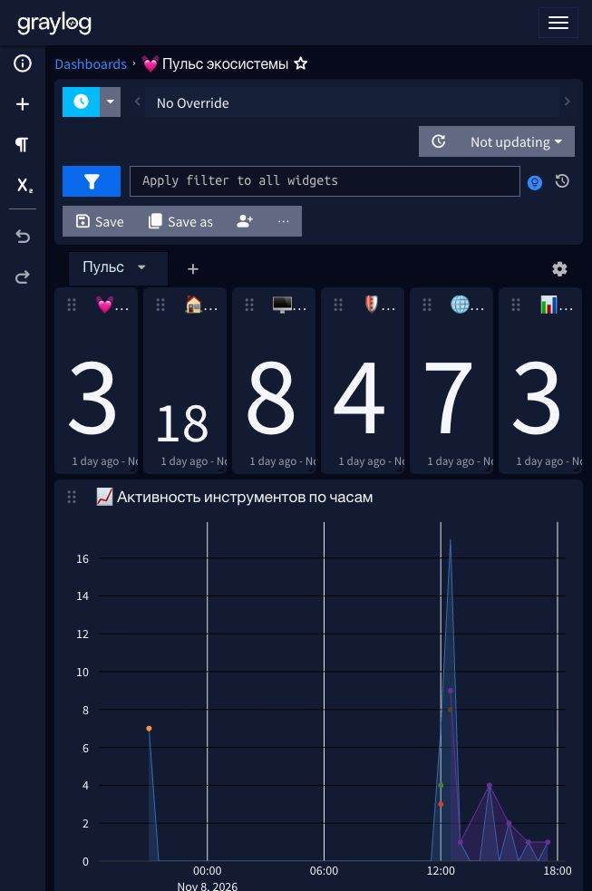

# 24. Пульс экосистемы: дашборд живости своих инструментов

Свои инструменты (HomeRepo, HostDeck, ZaSlon, TrafficLens, LogAtlas) пишут журналы действий в Graylog по GELF — каждый в свой поток. Но пока не зайдёшь в поток, не видно главного: жив инструмент или молчит. Дашборд **«💓 Пульс экосистемы»** собирает живость всех пяти на одном экране: молчание видно за секунду по нулям в счётчиках и пустому графику.

> **Статус проверки.** Дашборд создан на Graylog 7.2.1 (ноябрь 2026) импортёром `graylog/import-dashboards.py` из спеки `graylog/dashboards-spec.json`; все 10 виджетов отрисовались с данными, ссылки на разборы правил в текстовом блоке кликабельны. Импортёр — питоновский порт `import-dashboards.js`, адаптированный под строгий REST Graylog 7.2.1 (см. «Грабли» ниже).



## Что на дашборде

| Виджет | Что показывает |
|---|---|
| 💓 Heartbeat HomeRepo · 24 ч | сообщения `hr_event:heartbeat` — панель шлёт раз в час, норма ~24 в сутки |
| 🏠/🖥️/🛡️/🌐/📊 счётчики | сообщения за 24 ч по каждому потоку инструмента |
| 📈 Активность по часам | стек-график сообщений по часам с разбивкой по потокам — видны окна молчания |
| ⏱️ За последний час | таблица «поток → количество» за час; heartbeat даёт ровно 1 |
| 🕒 Последние сообщения | 10 свежих сообщений из всех пяти потоков с timestamp |
| ℹ️ Нормы | текстовый блок: что считать нормой, какие алерты ловят молчание, ссылки на разборы в HomeWiki |

Нормы (записаны прямо на дашборде): heartbeat HomeRepo — каждый час, тишина дольше 3 ч ловится алертом «Тишина: HomeRepo (3 часа)»; молчание агентов дольше суток — алертом «Агент молчит больше суток». HostDeck и ZaSlon пишут событийно (входы, сканы, смены статуса) — ноль за сутки у них не авария. TrafficLens — разборы pcap и ретропроверки, LogAtlas — находки разборов архивов.

## Как воспроизвести

```bash
cd graylog
python3 import-dashboards.py --title "Пульс" --dry-run   # что будет создано
python3 import-dashboards.py --title "Пульс"             # создать
```

Импортёр находит потоки по названию, собирает JSON поиска и вида, создаёт `POST /api/views/search` + `POST /api/views`. Без `--title` пересоздаст все дашборды из спеки — для существующих лучше не запускать (будут дубли).

## Грабли REST Graylog 7.2.1 (дополнение к главе 20)

JS-импортёр писался под более терпимый REST; на 7.2.1 питоновский порт пришлось подгонять под строгие DTO:

1. `event_annotation` в pivot-типе поиска — поле неизвестно, убираем.
2. Бакеты в `search_types` — **плоская** форма без обёртки `config`: `{"type":"time","field":"timestamp","interval":{...}}`, `{"type":"values","fields":[...],"limit":8}`. В конфиге виджета вида, наоборот, нужна обёртка `config` и `fields`.
3. `barmode` принимает только bar-визуализация; у area/line в `visualization_config` — `axis_type` и `interpolation`.
4. Сортировка в конфиге message-list виджета (`sort`, `sortDirection`) не маппится на DTO — сортировку задаёт только search type (`sort: [{"field":"timestamp","order":"DESC"}]`).

Каждая ошибка возвращает точный `path` до непонравившегося свойства — отладка занимает минуты.
