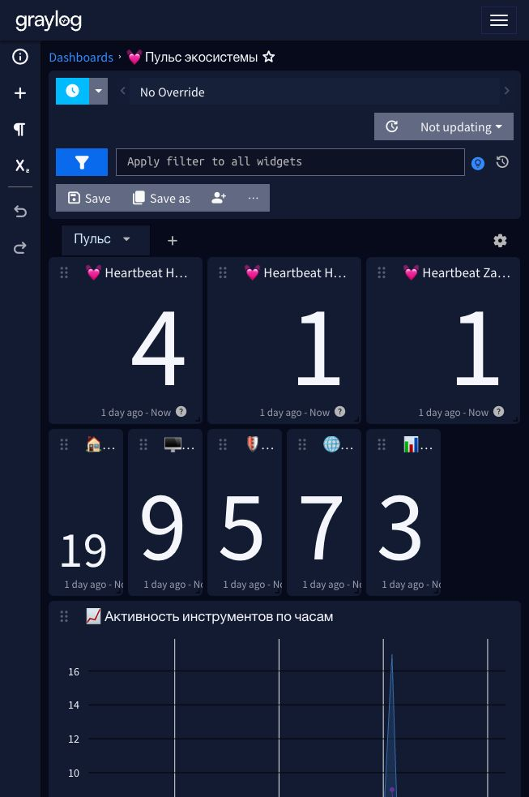

# 25. Пульс панелей HostDeck и ZaSlon + алерты «Тишина»

Глава 24 собрала дашборд «💓 Пульс экосистемы», но пульс в нём был только у HomeRepo: HostDeck и ZaSlon писали в Graylog журналы действий, а регулярного heartbeat не слали — их молчание ловилось бы только глазами. Теперь обе панели шлют пульс раз в час по образцу HomeRepo, а его пропажу ловят новые алерты «HEALTH - Тишина: HostDeck (3 часа)» и «HEALTH - Тишина: ZaSlon (3 часа)».

> **Статус проверки.** Тесты: HostDeck 23/23, ZaSlon 6/6. После деплоя на redos-server (ноябрь 2026) оба пульса подтверждены поиском в Graylog: `hd_event:heartbeat` — «HostDeck: панель на связи (хостов 12, провалов 2)», `zs_event:heartbeat` — «ZaSlon: панель на связи (хостов 8)». Алерты созданы и стоят в расписании вместе с остальным семейством «Тишина». Каталог HomeWiki синхронизирован — у обоих правил есть runbook-страницы, кнопка «Разбор в HomeWiki» из писем ведёт на них.



## Реализация

Один и тот же паттерн в обоих репозиториях ([HostDeck](https://github.com/ArsIS-02/HostDeck), [zaslon](https://github.com/ArsIS-02/zaslon)):

- `gelf.heartbeat(...)` — собирает сообщение «панель на связи» с полями потока и счётчиками;
- `gelf.start_heartbeat(stats_fn)` — daemon-поток: первый пульс через минуту после старта панели (даёт ей подняться), дальше раз в час; сбой одного прохода поток не убивает; без настроенного GELF поток не стартует;
- интервал можно поменять переменными `HOSTDECK_GELF_HEARTBEAT` / `ZASLON_GELF_HEARTBEAT` (секунды, по умолчанию 3600);
- HostDeck стартует пульс из lifespan Starlette и считает хостов в базе и проверки `fail` по posture; ZaSlon — при старте приложения, считает хосты в реестре.

| | HomeRepo | HostDeck | ZaSlon |
|---|---|---|---|
| Поле | `hr_event=heartbeat` | `hd_event=heartbeat` | `zs_event=heartbeat` |
| Счётчики | устройств, молчат | хостов, провалов | хостов |
| Поток | HomeRepo | HostDeck | ZaSlon |

## Алерты «Тишина»

Созданы клонированием «HEALTH - Тишина: HomeRepo (3 часа)» (`POST /api/events/definitions` с обёрткой `{"entity": …}` — без неё 7.2.1 отвечает «entity cannot be null»): запрос `hd_event:heartbeat` / `zs_event:heartbeat` по соответствующему потоку, условие `count() < 1` за 3 часа, проверка раз в 3 часа, уведомление «Mail.ru Alert Homelab tools» — в письме уже есть кнопка «Разбор в HomeWiki».

## Дашборд: два ряда счётчиков

Верхний ряд — три пульса (HomeRepo, HostDeck, ZaSlon), второй — итоги за сутки по всем пяти потокам. Импортёр `graylog/import-dashboards.py` научился `--update-existing`: находит дашборд по названию и обновляет его через `PUT /api/views/{id}` с новым search — ID и ссылки на дашборд не меняются, дублей нет.

## Грабля: SELinux на РЕД ОС + rootless podman

После пересборки образа ZaSlon контейнер ушёл в crash-loop: `PermissionError: /data/keys`. Причина — связка SELinux Enforcing и rootless podman:

- контейнер был пересоздан вручную без `user:`/`userns`, а в compose-проекте он работает от UID 1000;
- том хоста без метки SELinux контейнеру не положен.

Лечится параметрами запуска, повторяющими compose:

```bash
podman run -d --name zaslon --network host --restart always \
  --userns=keep-id --user 1000:1000 \
  -v /home/redos/zaslon-v2/data:/data:Z \
  -e ZASLON_GELF_HOST=127.0.0.1 -e ZASLON_GELF_PORT=12206 \
  localhost/zaslon:1.4
```

`--userns=keep-id --user 1000:1000` — UID внутри контейнера совпадает с UID владельца каталога на хосте; `:Z` — приватная метка SELinux для тома. Если контейнер вдруг начал падать с Permission denied на данных — проверяйте эти три вещи первыми.
