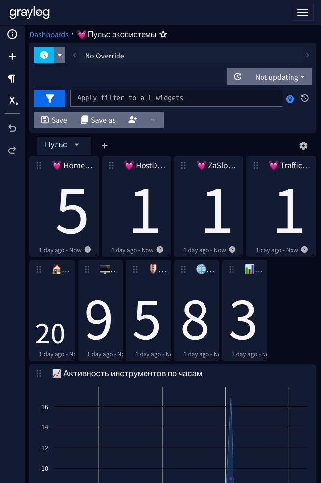
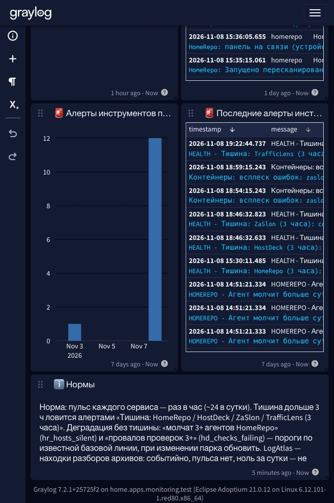

# 26. Пульс TrafficLens, алерты деградации и ряд алертов на дашборде

Глава 25 дала пульс панелям HostDeck и ZaSlon. Оставался последний «молчун» среди своих сервисов — TrafficLens: он слал в Graylog только события разбора (verdict, ioc_hit), и отличить «нет находок» от «сервис лёг» было невозможно. Теперь TrafficLens шлёт heartbeat раз в час, его пропажу ловит алерт «HEALTH - Тишина: TrafficLens (3 часа)», а дашборд «💓 Пульс экосистемы» показывает все четыре пульса и новый ряд — срабатывания алертов инструментов за 7 дней. Бонусом — два алерта деградации: панель жива, а парк за ней плывёт.

> **Статус проверки.** Тесты TrafficLens 59/59. После пересборки образа и перезапуска контейнера на redos-server (ноябрь 2026) пульс подтверждён поиском: `tl_event:heartbeat` — «TrafficLens: сервис на связи (задач 5, IOC 4380)». Алерт «Тишина: TrafficLens» отработал боем: до первого пульса он успел сработать и прислать письмо — end-to-end цепочка замкнута. Каталог HomeWiki синхронизирован: 245 правил, у всех новых есть runbook-страницы.

## Пульс TrafficLens

Тот же паттерн, что в главе 25 ([TrafficLens](https://github.com/ArsIS-02/TrafficLens), коммит `a2034e5`):

- `trafficlens/gelf.py` → `heartbeat(cfg, db)` — сообщение «сервис на связи» со счётчиками задач и IOC в базе; `start_heartbeat(cfg, db)` — daemon-поток, первый пульс через минуту после старта, дальше раз в час; сбой прохода поток не убивает; без настроенного GELF не стартует;
- `trafficlens/web.py` — старт пульса рядом с worker'ом разбора;
- интервал — переменная `TL_GELF_HEARTBEAT` (секунды, по умолчанию 3600).

| | HomeRepo | HostDeck | ZaSlon | TrafficLens |
|---|---|---|---|---|
| Поле | `hr_event=heartbeat` | `hd_event=heartbeat` | `zs_event=heartbeat` | `tl_event=heartbeat` |
| Счётчики | устройств, молчат | хостов, провалов | хостов | задач, IOC |
| Поток | HomeRepo | HostDeck | ZaSlon | TrafficLens |

LogAtlas осознанно без пульса: он событийный (присылает находки разборов архивов), ноль сообщений за сутки для него — норма, а не авария.

## Алерты: тишина и деградация

**«HEALTH - Тишина: TrafficLens (3 часа)»** — клон семейства «Тишина»: запрос `tl_event:heartbeat` по потоку TrafficLens, условие `count() < 1` за 3 часа, проверка раз в 3 часа, уведомление «Mail.ru Alert Homelab tools» с кнопкой «Разбор в HomeWiki». Экспортировано в `graylog/health-event-definitions.json` (заодно туда же добавлены «Тишина: HostDeck» и «Тишина: ZaSlon» из главы 25 — в файл они тогда не попали).

**Деградация — новый тип алерта.** Тишина ловит «панель умерла», но не ловит «панель жива, а хозяйство за ней плывёт». Пульс уже несёт счётчики — значит, порог можно проверять прямо по ним, без нового кода:

| Правило | Запрос | Окно | Смысл |
|---|---|---|---|
| HOMEREPO - Деградация: молчат 3+ агентов | `hr_event:heartbeat AND hr_hosts_silent:[3 TO *]` | 9 ч | парк агентов редеет |
| HOSTDECK - Деградация: провалов проверок 3+ | `hd_event:heartbeat AND hd_checks_failing:[3 TO *]` | 9 ч | состояние парка плывёт |

Порог 3 — не с потолка: сейчас 2 молчащих агента и 2 провала проверок — известная базовая линия (свои же стенды). Окно 9 часов, чтобы поймать устойчивую деградацию, а не кратковременный ребут. Пороги задокументированы в описаниях правил — при изменении парка обновить. Экспорт — `graylog/homelab-tools-event-definitions.json`.

## Дашборд: ряд алертов за 7 дней

В дашборд «💓 Пульс экосистемы» добавлен ряд из двух виджетов по потоку **All events** (`000000000000000000000002`):

- **🚨 Алерты инструментов по дням** — столбцы за 7 дней, запрос `message:homerepo OR message:hostdeck OR message:zaslon OR message:trafficlens OR message:logatlas`: сразу видно всплески срабатываний;
- **🚨 Последние алерты инструментов** — лента последних срабатываний с текстом правила.

Плюс текстовый виджет «ℹ️ Нормы» с памяткой: сколько пульсов в сутки норма, что ловят «Тишина» и деградация, почему у LogAtlas нет пульса.

## Грабли

**Термы-агрегация по `message` падает в Graylog 7.2.1.** Первая версия второго виджета группировала срабатывания по полю `message` («какие правила чаще») — виджет падал с `OpenSearch exception [type=script_exception, reason=runtime error]`: `message` — анализируемое поле, terms-агрегация по нему не работает. Лечится заменой на виджет-ленту сообщений: названия правил видны прямо в тексте, а «что чаще» читается по столбцам соседнего виджета. Если очень нужен топ правил — заводите отдельное keyword-поле через pipeline.

**Пересборка образа ≠ новый код в образе.** После первого деплоя пульс не появился: образ `localhost/trafficlens:latest` оказался собран **за час до коммита** с heartbeat — `podman build` из старого контекста молча перетёр тег. Диагностика в одну команду: `podman run --rm localhost/trafficlens:latest grep -c start_heartbeat /app/trafficlens/gelf.py` — если функции нет в образе, пересобирать из свежего чекаута. Проверяйте содержимое образа, а не только дату тега.

**`pgrep -f` ловит сам себя по SSH.** Проверка «идёт ли сборка» через `ssh ... pgrep -f "podman build"` всегда говорит «идёт»: строка команды содержит искомый паттерн, и pgrep находит собственный шелл. Надёжнее `ps -eo args | grep "[p]odman build"` или `kill -0 <pid>`.
