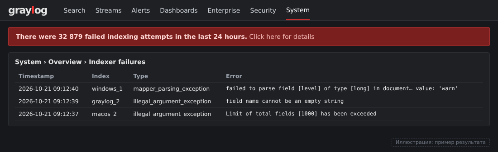

# Troubleshooting — грабли при настройке мониторинга macOS

Здесь собраны проблемы, с которыми я столкнулся на практике, и их решения.

---

## 1. `unified.json.log` растёт бесконечно (до 14 ГБ)

**Симптом:** файл `/var/log/unified.json.log` растёт до десятков гигабайт,
диск заполняется, `log stream` пишет без остановки.

**Причина:** `log stream` пишет в файл через перенаправление stdout из
LaunchDaemon `com.user.logstream`. Штатный `newsyslog` про этот файл
ничего не знает и не ротирует его.

**Решение:** связка wrapper + newsyslog:

1. `/etc/newsyslog.d/unified.json.conf` — правила ротации (50 МБ, 7 архивов)
2. `/usr/local/bin/logstream-wrapper.sh` — перезапускает `log stream`,
   когда файл превышает порог
3. `/Library/LaunchDaemons/com.user.logstream.plist` — запускает wrapper

Файлы лежат в каталоге `macos/logstream/` этого репозитория.

**Почему wrapper:** `log stream` держит файл открытым (file descriptor).
Даже если `newsyslog` переименует файл, процесс продолжит писать
в старый inode. Единственный способ — перезапустить процесс.

---

## 2. Дубли команд в `commands.log` и в Graylog

**Симптом:** каждая команда в терминале появляется в Graylog **дважды**.

**Причина:** в `~/.zshrc` одновременно оказались **оба** варианта
логирования — через `add-zsh-hook` и через `preexec()` напрямую.

**Решение:** оставить только `add-zsh-hook`:

```bash
function log_command() {
    echo "$(date '+%Y-%m-%d %H:%M:%S') | $(whoami) | $(pwd) | $1" >> ~/.local/log/commands.log
}
autoload -Uz add-zsh-hook
add-zsh-hook preexec log_command
```

---

## 3. Kaspersky засоряет unified logs

**Симптом:** в `/var/log/unified.json.log` тысячи записей
`Sandbox: System Toolkit ...` и `Entitlement ... com.kaspersky ... is ignored`.

**Причина:** Kaspersky for Mac генерирует много сообщений
о sandbox-блокировках. Если включить `Sandbox` или `incorrect`
в `include_lines` Filebeat — поток вырастет в 10 раз без пользы.

**Решение:** не включать эти паттерны. Оставить только точные:

```yaml
include_lines:
  - 'AirDrop'
  - 'TCC'
  - 'hostNotificationUSB'
  - 'kernel panic'
  - 'SIP'
  - 'FileVault'
  - 'Gatekeeper'
```

Проверка перед добавлением нового паттерна:

```bash
sudo grep -c "паттерн" /var/log/unified.json.log*
```

Если счётчик тысяч — паттерн шумный.

---

## 4. `include_lines` — подстрочный поиск, не regex

**Причина:** `include_lines` в Filebeat — простой поиск подстроки.
Не поддерживает regex и логические операторы.

**Решение:** для сложной логики — processors с `drop_event`:

```yaml
processors:
  - drop_event:
      when:
        and:
          - contains:
              message: "Sandbox"
          - contains:
              message: "kaspersky"
```

---

## 5. macOS APFS snapshots держат "удалённые" данные

**Симптом:** удалил файл, а `df -h` показывает, что место не освободилось.

**Причина:** macOS создаёт локальные snapshots APFS (Time Machine).

**Проверка и очистка:**

```bash
tmutil listlocalsnapshots /
sudo tmutil deletelocalsnapshots /
```

---

## 6. `nc -w 1` рвёт соединение до окончания потока (BiZone)

**Симптом:** `bzt-stream.sh` завершается за 10 секунд вместо 20–25,
в Graylog ничего не приходит.

**Причина:** флаг `-w 1` в BSD `nc` (macOS) означает «закрыть
соединение после 1 секунды тишины». `bz_triage` первые 5–8 секунд
собирает данные молча, `nc` закрывается раньше.

**Решение:**

```bash
# Было
nc -G 5 -w 1 "$GRAYLOG_HOST" "$GRAYLOG_PORT"

# Стало
nc -G 5 -w 180 "$GRAYLOG_HOST" "$GRAYLOG_PORT"
```

---

## 7. Filebeat не может прочитать `audit.log` (Linux/RedOS)

**Симптом:** Filebeat запускается, но данные в Graylog не идут.

**Причина:** пользователь `filebeat` не имеет прав на
`/var/log/audit/audit.log` (владелец `root:root`, права `0600`).

**Решение:** либо запускать Filebeat от root (`User=root`
в systemd-юните), либо дать права через `setfacl`:

```bash
sudo setfacl -m u:filebeat:rx /var/log/audit/
sudo setfacl -m u:filebeat:r /var/log/audit/audit.log
```

На RedOS `setfacl` может не работать — тогда проще запускать
Filebeat от root.

---

## 8. Порт Beats input занят / не слушается

**Симптом:** Filebeat шлёт на 5040/5046, получает connection refused.

**Проверка:**

```bash
sudo ss -tlnp | grep 5044
nc -zv <graylog-ip> 5044
```

**Причина:** либо input не создан, либо SELinux блокирует bind.

**Решение:** проверить состояние input через API:

```bash
curl -s -u admin:admin -H "X-Requested-By: cli" \
  "http://localhost:9000/api/system/inputs" | python3 -c "
import json, sys
d = json.load(sys.stdin)
for inp in d.get('inputs', []):
    print(f\"{inp.get('title')}: state={inp.get('state')}, port={inp.get('attributes',{}).get('port')}\")
"
```

Если `state=FAILED` — смотреть лог:

```bash
sudo tail -50 /var/log/graylog-server/server.log | grep -iE "bind|error"
```

---

## 9. Диагностика «идут ли вообще данные?»

Три команды для быстрой проверки:

```bash
# 1. Что Filebeat отправил за последние 5 минут
sudo log show --predicate 'process == "filebeat"' --last 5m --info | \
  grep -iE "events.sent|connection|error"

# 2. Сколько в Graylog за 5 минут
curl -s "http://<graylog>:9200/graylog_0/_count?pretty" -H 'Content-Type: application/json' -d '{
  "query": {"range": {"timestamp": {"gte": "now-5m"}}}
}' | grep count

# 3. Лог Filebeat
sudo tail -20 /usr/local/filebeat/logs/filebeat.log
```

---

## 10. Алерты не создаются, список Event Definitions падает с `IOException encountered while parsing`

**Симптом:** страница Alerts → Event Definitions пустая или с ошибкой, событий нет,
в `server.log` бесконечно повторяется:

```
ERROR [EventProcessorExecutionJob] Event processor <...> failed to execute ... (retry in 5000 ms)
Caused by: UnrecognizedPropertyException: Unrecognized field "type"
  (class ...NotificationParameters$FallbackParameters)
```

**Причина:** версия Graylog в памяти не совпадает с версией, которая записала документы
в MongoDB (в нашем случае поверх пакета `rc.1` вручную подложили `graylog.jar` и
storage-плагины от `beta.3`). Один нечитаемый алерт ломает весь список.

**Проверка:**

```bash
rpm -V graylog-server                 # "S.5" у graylog.jar = файл подменён
curl -s http://<graylog>:9000/api/     # какая версия реально запущена
```

**Решение:** вернуть файлы пакета (`dnf reinstall graylog-server`, лишние jar из
`plugin/` убрать), в битых алертах сбросить `notification_parameters` в `null`
через pymongo и перезапустить Graylog.

---

## 11. `Limit of total fields [1000] has been exceeded`

**Симптом:** в System → Overview растёт счётчик failed indexing attempts,
часть сообщений и все события алертов не попадают в индекс.

**Причина:** auditd, macOS (osquery `columns_*`) и Windows (winlogbeat) пишут
в один `graylog_*` индекс, и суммарно полей больше 1000. Плюс стримы
«All events» / «All system events» были привязаны к Default index set.

**Решение:**

- отдельный index set на источник: `redos-auditd`, `macos`, `windows`;
- «All events» → `gl-events`, «All system events» → `gl-system-events`;
- ротировать наборы (System → Indices → Rotate active write index);
- при необходимости поднять лимит на текущем индексе:
  `PUT /<index>/_settings {"index.mapping.total_fields.limit": 2000}`.

---

## 12. `failed to parse field [level] of type [long] ... 'warn'`

**Причина:** одно и то же поле приходит то числом (GELF/syslog level), то строкой
(`warn` из unified log). Тип поля в индексе задаёт первый документ.

**Решение:** зафиксировать тип в Graylog (System → Indices → набор → Field types →
`level` = String) и ротировать индекс. Так же сделано для `macos_event_time`.

**Вариант, когда тип фиксировать нельзя.** Caddy пишет `log_new_expiration` то числом
(время в секундах), то строкой с датой, и числовой тип нужен для остальных документов.
Тогда строковые значения выносят в соседнее поле правилом pipeline, а числовые оставляют:

```
rule "containers: log_new_expiration в строку"
when
  has_field("log_new_expiration")
  AND NOT to_bool(regex("^[0-9]+$", to_string($message.log_new_expiration)).matches)
then
  set_field("log_new_expiration_text", to_string($message.log_new_expiration));
  remove_single_field("log_new_expiration");
end
```

Правило лежит в [graylog/pipelines](../graylog/pipelines/README.md) и подключается к pipeline
`Container logs` второй стадией.


*Баннер о неудачных попытках индексации в Graylog (воссоздано по реальным данным лаборатории).*


---

## 13. После создания index set: `deflector_exists_as_index`, ротация падает

**Причина:** сообщения пришли раньше, чем Graylog создал алиас `<prefix>_deflector`,
и OpenSearch автоматически создал *индекс* с этим именем.

**Решение:** перенести документы и атомарно заменить индекс алиасом:

```bash
curl -XPOST "$OS/_reindex?refresh=true" -H 'Content-Type: application/json' \
  -d '{"source":{"index":"<prefix>_deflector"},"dest":{"index":"<prefix>_0"}}'
curl -XPOST "$OS/_aliases" -H 'Content-Type: application/json' \
  -d '{"actions":[{"remove_index":{"index":"<prefix>_deflector"}},
                  {"add":{"index":"<prefix>_0","alias":"<prefix>_deflector"}}]}'
```

Затем ротировать набор в Graylog.

---

## 14. Fluent Bit: `could not open the Journal: Permission denied (error=-13)`

**Симптом:** контейнер fluent-bit запущен, но input `systemd` падает при инициализации,
в журнале сервиса повторяется `failed initialize input systemd.0`.

**Причина:** SELinux блокирует доступ контейнера к файлам журнала. Так было на одном из
хостов РЕД ОС; на остальных с тем же конфигом проблемы не было.

**Решение:** отключить SELinux-метки только для этого контейнера:

```ini
# /etc/containers/systemd/fluent-bit.container, секция [Container]
SecurityLabelDisable=true
```

```bash
sudo systemctl daemon-reload && sudo systemctl restart fluent-bit
```

Это ослабляет изоляцию именно контейнера fluent-bit. Остальная система остаётся под SELinux.

---

## 15. Fluent Bit: `statfs /var/log/journal: no such file or directory`

**Симптом:** контейнер не стартует, `podman` пишет `Error: statfs /var/log/journal`.

**Причина:** journald на хосте работает в volatile-режиме, каталога `/var/log/journal` нет,
журнал лежит только в `/run/log/journal`.

**Решение:** читать `/run/log/journal`. В Quadlet убрать монтирование `/var/log/journal`,
в конфиге Fluent Bit заменить `Path`:

```bash
sudo sed -i '/\/var\/log\/journal:\/var\/log\/journal/d' /etc/containers/systemd/fluent-bit.container
sudo sed -i 's#/var/log/journal#/run/log/journal#' /etc/fluent-bit/fluent-bit.conf
sudo systemctl daemon-reload && sudo systemctl restart fluent-bit
```

Важно: на хостах с постоянным журналом (`/var/log/journal` есть) конфиг должен читать именно
`/var/log/journal`. Путь `/run/log/journal` там покажет только текущую загрузку, новые записи
в него не попадут.

---

## 16. Extractor ломает обработку: `Could not apply extractor ... Unrecognized token`

**Симптом:** в Graylog растёт счётчик processing errors, у сообщений поле
`gl2_processing_error: Could not apply extractor <... JSON from message ...> - Unrecognized token 'chown'`.

**Причина:** JSON-extractor применяется ко всем сообщениям входа, а строки вида
`chown: changing ownership ...` и `level=warn ...` не JSON. Ошибка разбора отмечает
сообщение, и обработка для него нарушается.

**Решение:** задать условие на extractor: тип условия **regex**, значение `^\{`.
Тогда extractor обрабатывает только сообщения, которые начинаются с `{`.

---

## 17. Regex extractor: `named capturing group is missing trailing '>'`

**Симптом:** создание extractor-а через API или UI падает с этой ошибкой.

**Причина:** имена групп в Java-регулярках допускают только латинские буквы и цифры.
`(?<chown_path>...)` с подчёркиванием не проходит.

**Решение:** `(?<chownpath>...)`. Имя группы становится именем поля в Graylog.
Тип extractor-а `key_value` в Graylog 7.2 API не существует (ошибка `No enum constant
KEY_VALUE`): для `key=value` используем regex-extractor-ы на отдельные поля.

---

## 18. OpenSearch упал: `OutOfMemoryError: Java heap space`

**Симптом:** в Graylog не работают поиск и дашборды (`Failed to obtain results`), в System →
Overview «Opensearch cluster is not available», API `/api/system/indexer/cluster/health`
отвечает 500, а `/api/system/indexer/overview` 503. Алерты при этом не приходят: Graylog не
может сообщить о собственной проблеме. `systemctl status opensearch` показывает `failed`, в
журнале:

```
java.lang.OutOfMemoryError: Java heap space
fatal error in thread [opensearch[...][search][T#1]], exiting
```

Строка `Unable to create data: File exists` рядом ни на что не влияет: OpenSearch не смог
сохранить дамп памяти.

**Причина:** кучи в 4 ГиБ (`-Xms4g -Xmx4g`) не хватило под тяжёлые запросы при непрерывной
индексации. Процесс завершился, а автоперезапуска у штатного юнита нет.

**Решение:** поднять кучу и включить автоперезапуск. Куча не больше половины оперативной
памяти и не выше примерно 31 ГиБ, остальное нужно Graylog и файловому кэшу (на нём держится
скорость поиска). На хосте с 31 ГиБ поставили 8 ГиБ:

```bash
sudo sed -i -E 's/^-Xm([sx])4g/-Xm\18g/' /etc/opensearch/jvm.options

sudo mkdir -p /etc/systemd/system/opensearch.service.d
sudo tee /etc/systemd/system/opensearch.service.d/restart.conf <<'EOT'
[Service]
Restart=on-failure
RestartSec=30
TimeoutStartSec=300
EOT
sudo systemctl daemon-reload && sudo systemctl restart opensearch
```

Проверка: `ps -o args= -C java | tr ' ' '\n' | grep -E '^-Xm[sx]'`. Процессов Java два (второй, скорее
всего, сам Graylog со своей кучей, у нас 2 ГиБ), поэтому строк с `-Xm` две пары. Кластер после запуска на
минуту-две остаётся красным, пока восстанавливается последний шард.

Перезапуск занимает минуту-две, и в это время Graylog не индексирует.

---

## 19. OpenSearch не поднимается после перезагрузки хоста

**Симптом:** после перезагрузки Graylog запускается, а OpenSearch нет, пока его не запустить
вручную. Данные OpenSearch лежат на отдельном диске (`path.data: /mnt/nvme/opensearch` в
`/etc/opensearch/opensearch.yml`).

**Причина (по времени событий; журнал той загрузки к моменту разбора уже вычистился):** у штатного
юнита нет порядка запуска относительно диска. Диск появляется в системе на 9-й секунде загрузки
и монтируется примерно на 20-й, а OpenSearch может стартовать раньше. Каталога данных ещё нет,
процесс падает, и без `Restart=` служба остаётся лежать. Сеть ни при чём: `network-online.target`
готова на 8-й секунде.

**Решение:** привязать службу к точке монтирования и к сети:

```bash
sudo tee /etc/systemd/system/opensearch.service.d/boot.conf <<'EOT'
[Unit]
After=network-online.target
Wants=network-online.target
RequiresMountsFor=/mnt/nvme/opensearch
EOT
sudo systemctl daemon-reload
systemctl show opensearch -p After -p Requires | tr ' ' '\n' | grep -E 'mnt|network'
```

В выводе должны быть `mnt-nvme.mount` и `network-online.target`. Если диск не смонтируется,
OpenSearch теперь не стартует вовсе, а не пытается создать данные на корневой файловой системе.
Это правильное поведение. Для диска в `fstab` оставьте `nofail`, чтобы хост всё же загрузился.

Проверка по-настоящему возможна только перезагрузкой: после неё
`systemctl status opensearch --no-pager | head -5` и `curl -s localhost:9200/_cluster/health?pretty`.

---

## 20. `Document contains at least one immense term` в ошибках индексации

**Симптом:** растёт счётчик failed indexing attempts (System → Overview → Indexer failures),
в тексте ошибки `immense term in field="eventMessage"` (или `columns_cmdline`) и «longer than
the max length 32766».

**Причина:** значение поля с типом keyword не может быть длиннее 32766 байт. Бывает у `eventMessage`
в unified log macOS и у командной строки osquery (`columns_cmdline`): иногда приходят целые
простыни. Такой документ индекс отбрасывает целиком.

**Решение:** обрезать значение правилом pipeline до отправки в индекс. Предел с запасом на
UTF-8 (до 4 байт на символ): 6000 символов для `eventMessage` и 8000 для `columns_cmdline`.
Правило оставляет пометку `eventMessage_truncated=true`, чтобы обрезанные сообщения можно было найти:

```
rule "macos: обрезать слишком длинный eventMessage"
when
  has_field("eventMessage")
  AND length(to_string($message.eventMessage)) > 6000
then
  set_field("eventMessage", abbreviate(to_string($message.eventMessage), 6000));
  set_field("eventMessage_truncated", true);
end
```

Оба правила и порядок подключения лежат в [graylog/pipelines](../graylog/pipelines/README.md).
Правило ставят в **последнюю** стадию pipeline, после правил, которые это поле создают или меняют.

Счётчик ошибок сам не обнуляется. Старые записи хранятся в коллекции `index_failures` MongoDB (она
ограничена по размеру, поэтому со временем старые вытесняются новыми).

---

## 21. Fluent Bit работает, но контейнерных логов в Graylog нет

**Симптом:** `systemctl status fluent-bit` показывает `active (running)`, `podman logs fluent-bit`
не содержит ошибок, а свежих записей с `container_name` в Graylog нет. Соединения с портом
GELF нет: `sudo ss -tn | grep 12202` пусто. Это не значит, что с сетью что-то не так:
GELF TCP открывает соединение, только когда есть что отправить.

**Диагностика по шагам:**

```bash
# 1. Какой каталог журнала есть на хосте и в нём ли данные
ls -d /run/log/journal/*/ /var/log/journal/*/ 2>&1
# 2. Есть ли в журнале записи контейнеров
sudo journalctl -F CONTAINER_NAME | head
# 3. Сквозная проверка одной тестовой записью
printf 'MESSAGE=fluent-bit test\nCONTAINER_NAME=fbtest\n' | logger --journald
sleep 15; sudo ss -tn | grep 12202
```

Через 15 секунд должно появиться соединение, а в Graylog `container_name:fbtest` найдёт запись.
Если нашло, канал рабочий. Тогда контейнеры просто редко пишут в журнал (это нормально для
менеджеров вроде portainer), а сам Fluent Bit ни при чём.

**Причины, которые встречались:**

1. **`Path` смотрит в `/run/log/journal`, а журнал постоянный.** Шаг 1 показывает: каталог
   `/run/log/journal/*/` пуст или отсутствует, а в `/var/log/journal/*/` лежат файлы. См.
   п. 15: `Path` и том нужно поменять на `/var/log/journal`.
2. **Fluent Bit перебирает накопленный журнал с сохранённого курсора.** После перезагрузки или
   долгого простоя он читает весь журнал с места, где остановился: процессор загружен, соединения
   нет, `journal.db` обновляется. Журнал размером в несколько гигабайт на слабом хосте
   (aarch64) разбирают очень долго. Если старые данные не нужны, сбросить курсор (при
   `Read_From_Tail On` чтение начнётся с конца журнала):

   ```bash
   sudo systemctl stop fluent-bit
   sudo rm /var/lib/fluent-bit/journal.db
   sudo systemctl start fluent-bit
   ```

   Записи за пропущенный период Fluent Bit уже не отправит.

**Фиксируйте тег образа.** В Quadlet стоит `Image=...:latest` и `AutoUpdate=registry`, а при
загрузке хоста в журнале видно `image pull ... fluent-bit:latest`. Версия может смениться без
вашего ведома. В нашем случае обновление образа совпало по времени с перезагрузкой, причиной
сбоя оно не оказалось, но неожиданные смены версии лучше убрать: `Image=ghcr.io/fluent/fluent-bit:5.1.4`
и без `AutoUpdate=registry`, обновлять вручную.

---

## 22. Логи контейнеров идут через Collectors без `container_name`, алерты «тишина» срабатывают

**Симптом:** правила вида «Контейнеры: тишина — grafana» срабатывают, хотя логи контейнера в
Graylog есть. Поиск `process_name:conmon` в потоке Collectors показывает сообщения этого контейнера,
а в поле `container_name` у них пусто.

**Причина:** источник `journald` («System Journal») в флоте Collectors один на все хосты и собирает
записи журнала от приоритета info. Вывод контейнера Podman попадает в журнал от процесса
`conmon` без поля `CONTAINER_NAME`. Такие сообщения не попадают в поток **Containers**, а
правила «тишина» считают сообщения именно там по `container_name`. Если Fluent Bit на хосте
молчит, правила срабатывают, хотя через Collectors логи продолжают идти.

Если на хосте работают и Fluent Bit, и Collectors, логи контейнера приходят дважды: размеченные
(Containers) и без имени (Collectors).

**Что делать:**

- Основные правила по контейнерам строят только на потоке Containers по `container_name`, как
  сделано в главе 9. Тишина по такому правилу означает, что Fluent Bit перестал доставлять логи
  (см. п. 21), а не что контейнер
  молчит.
- Источник «System Journal» нельзя выключить целиком: пропадёт весь системный журнал. Исключить
  процесс предикатом источника мы не пробовали (а на macOS подобная правка предиката тихо
  остановила сбор, см. главу 11).
- Дубли можно отбрасывать правилом pipeline `Collector logs` по `process_name == "conmon"`, но
  только если Fluent Bit работает на **всех** хостах флота. Иначе на хостах без него контейнерные
  логи пропадут совсем. В лаборатории это правило не включено: дубли не мешают, только занимают
  место.

---

## 23. Правило pipeline не срабатывает: `matched = 0`, а `not-matched` растёт

**Симптом:** правило создано, подключено, ошибок нет (`failed = 0`), но ожидаемого поля у
сообщений не появляется. Метрики правила (способ в главе 11, «Проверка и диагностика») показывают,
что оно выполняется на каждом сообщении потока, но условие не выполняется ни разу.

**Причина:** pipeline, подключённые к одному потоку, выполняются общими стадиями: сначала стадия 0 всех
pipeline, потом стадия 1 и так далее. Если правилу нужен результат правила из другого pipeline
(например, `source`, который подставляет `collectors: hostname as source` в стадии 1), а само оно стоит в
стадии 0, то оно видит данные до обработки. В нашем случае вместо `wazuh-homelab` в `source` ещё был
IP, и проверка по Lookup Table не находила ключ.

**Решение:** поставить правило в стадию позднее той, где нужное поле готово. В примере с
[Lookup Table](../graylog/pipelines/README.md) это стадия 2. Поменять номер можно в самом
pipeline (`stage 2 match pass`); сообщения, пришедшие после правки, обрабатываются уже по новому порядку.
