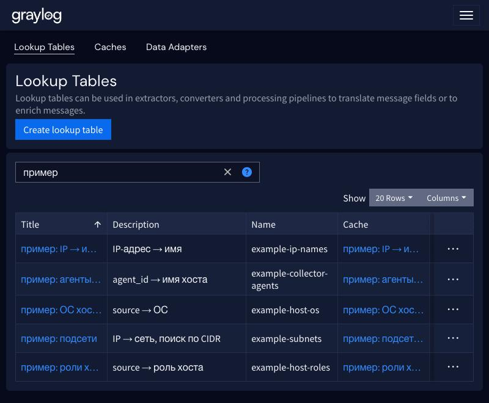

# Lookup Tables: пример на вымышленных данных

Lookup Table в Graylog подставляет значение по ключу из внешнего источника. Таблица состоит из трёх объектов:

| Объект | Роль | В примере |
|---|---|---|
| Data Adapter | откуда брать данные | `csvfile`, файл на сервере Graylog, перечитывается раз в 60 с |
| Cache | где держать результаты поиска | `guava_cache`, 1000 записей |
| Lookup Table | связывает адаптер и кэш, имя используется в правилах | `example-host-roles` и др. |

## Файлы

В каталоге лежат CSV с вымышленными данными (адреса из диапазонов документации RFC 5737, имена `*.example.test`).
Формат — две колонки `key,value`:

| Файл | Таблица | Ключ → значение |
|---|---|---|
| `example-host-roles.csv` | `example-host-roles` | `source` → роль хоста |
| `example-host-os.csv` | `example-host-os` | `source` → ОС |
| `example-ip-names.csv` | `example-ip-names` | IP → имя хоста |
| `example-subnets.csv` | `example-subnets` | IP → сеть (адаптер с `cidr_lookup`) |
| `example-collector-agents.csv` | `example-collector-agents` | `agent_id` → имя хоста |

## Установка

```
sudo install -d -m 750 -o root -g graylog /etc/graylog/server/lookups
sudo cp lookups-example/*.csv /etc/graylog/server/lookups/
sudo chown root:graylog /etc/graylog/server/lookups/example-*.csv
sudo chmod 640 /etc/graylog/server/lookups/example-*.csv
```

Таблицы создаёт [`import-lookup-tables.js`](../import-lookup-tables.js) (в консоли браузера, `await importLookupTables({dryRun: true})`, затем без `dryRun`).

## Использование в правиле pipeline

```
rule "example: host_role"
when
  has_field("source")
  AND lookup_has_value("example-host-roles", to_string($message.source))
then
  set_field("host_role", lookup_value("example-host-roles", to_string($message.source)));
end
```

Проверка без pipeline: `GET /api/system/lookup/tables/example-subnets/query?key=192.0.2.77` вернёт «домашняя сеть».

## Скриншоты

Список таблиц (фильтр «пример»):



Адаптеры: каждый указывает на свой CSV-файл на сервере Graylog:


Страница таблицы `example-subnets`: кэш, адаптер (`CIDR lookup: yes`) и проверка поиска. Ключ `192.0.2.77` попадает в сеть `192.0.2.0/24` и возвращает «домашняя сеть»:


